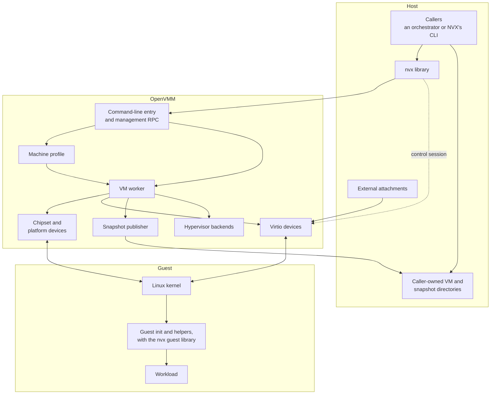

# 1.3 System Components and Responsibilities

[Architecture documentation](README.md) >
[1. Architecture Overview](1-architecture-overview.md)

NVX spans three layers (Figure 1.2), and their responsibilities follow the
boundary between policy and mechanism. In the host, the `nvx` library holds
the mechanisms that every user of a microVM needs, and its callers, such as an
orchestrator or NVX's own command-line interface, hold the policy and the
state: placement, identity, storage, attachment authorization, and recovery.
The OpenVMM virtual machine monitor (VMM) owns the virtual platform and
transition safety. Guest software owns the guest's space, its executions, and
guest-visible repair, while the workload owns only its execution inside the
resulting sandbox.

**Figure 1.2.** Major host, VMM, and guest components.

## 1.3.1 Host Components

- **Callers**, such as an orchestrator or NVX's command-line interface (CLI),
  `nvx-rs`, own the policy and the state that the library leaves to them: the
  runtime files and their labels, each VM's configuration, the private
  directories of their VMs and snapshots, with their names and retention, the
  values with which they find a running VM again, their per-snapshot locks,
  and the protocol that they speak with their guest over the control session,
  with its timing, retries, and recovery. NVX's CLI is one such caller, which
  the `nvx` crate builds with its `cli` feature, outside its documented API:
  it keeps its own store of sandboxes and named snapshots, its locks, the path
  rules of its exports, with the identities of the host objects that it pins
  in them, the staging of its images, and the compilation of its egress-policy
  files.
- **The `nvx` library** holds the mechanisms and value types that every caller
  needs. It checks a VM's configuration without reading the host, and lowers
  it into OpenVMM's arguments and the guest's boot tokens. It creates a cold
  boot, a capture, or a restore in a private VM directory that its caller
  owns, starts OpenVMM detached, holds the VM's process by a verified
  reference, and verifies, reattaches to, and stops it. It verifies the
  control endpoint's server and plays the host's role of the control session,
  which carries the caller's protocol. It finishes a capture with the key and
  description that make it a strict snapshot directory, opens and checks such
  a directory, checks a VM's compatibility with it, and orders a restore's
  activation to Ready without I/O. It keeps no durable state, takes no lock
  but the one that serializes its own spawns on Windows, and starts no process
  but OpenVMM.
- **Caller-owned directories** hold what the library and OpenVMM write for a
  caller: each VM's private directory, with its log, outcome report,
  endpoints, and snapshot files, and the strict snapshot directories in which
  the caller keeps its captures, each with its immutable machine state and
  memory, its key, and its description. The caller names, places, protects,
  and removes them.
- **External attachments** supply process-local resources such as console
  endpoints, network endpoints, host filesystem exports, and block files.

## 1.3.2 VMM Components

- **Command-line entry and management RPC** are the VMM's frontends. They
  construct host attachments, create, capture, and restore microVMs, report
  readiness and guest exit, drain the byte channel at exit, and write outcome
  reports.
- **Machine profile** selects and validates the machine, defines its ABI
  constants, and owns the effective kernel command line. It holds the pinned
  CPU profiles, selects or derives each VM's CPU profile, checks backend
  support and restore compatibility, and computes each VM's effective CPUID.
- **VM worker** composes and runs the machine. It creates the partition and
  its virtual processors, reserves RAM capacity and maps captured memory
  privately with copy-on-write, loads the guest through the Linux direct
  loader, and places the fixed devices. Its state-unit framework quiesces,
  starts, rolls back, and inventories stateful components in dependency order,
  and the worker owns snapshot boundaries, management exclusion, clock
  contracts, and restore sequencing.
- **Chipset and platform devices** provide the allowlisted chipset: the PIC, the IOAPIC, the PIT,
  the RTC, and the byte-channel, shutdown, and
  snapshot-request ports.
- **Virtio devices** comprise the consoles, block, network, and host
  filesystem devices, with shared interrupt status, queue processing, and
  device-private saved state. Their backends include the control-console
  broker, which authenticates the local host peer and frames the control
  session, the in-process network endpoint, which enforces egress policy, and
  the host filesystem server, which enforces each export's access policy.
- **Snapshot publisher** defines the snapshot format and machine contract,
  publishes artifacts, and validates them on restore.
- **Hypervisor backends** implement partitions, processor execution, interrupt
  injection, CPU contracts, and snapshot clocks for KVM, MSHV, and WHP.

## 1.3.3 Guest Components

- **Linux kernel** boots from the fixed Linux-direct handoff, drives the
  allowlisted virtual devices, and provides the filesystems, mounts, and
  process primitives that the guest's software uses.
- **Guest agents**, the guest's init, PID 1, and its helpers, build the VM's
  one space: they mount runtime filesystems, apply boot configuration, mount
  live host shares, and, in a layered root, assemble the root from its image
  and upper and switch into it once. They run the workload's executions as
  plain processes with the VM's workload credentials, without a namespace or
  cgroup of their own, and create workload accounts when requested. They
  supervise one-shot or managed workloads, prepare snapshots, repair
  processors, memory, entropy, and identity after restore, and activate a
  restored layered root before Ready. They also announce the guest's listeners
  when the host publishes them, check time ABI conformance, watch for clock
  violations, discipline the wall clock, and perform the snapshot time steps.
  The space and the executions are the init's own code: nvx-init, NVX's init
  for layered roots, implements NVX's reference space, which is private to
  `nvx`. The `nvx` guest library gives any init the contracts that it reads,
  the guest's side of a capture, which also repairs a restore, the activation
  of a restore, and the account of the host's mapping table, `MappingTable`;
  it starts no helper or workload but the time daemon, which
  `TimeAbi::start_daemon` forks, and the
  [guest-agent guidelines](../guest-agent-guidelines.md#ownership) give the
  one other call that may start a process, and the init's obligations, which
  `nvx` does not enforce.
- **Workload** is the microVM's single tenant: it owns the microVM's lifetime,
  resource envelope, and network identity, and it may run any number of
  processes, all inside the VM, its isolation boundary. It has no direct
  authority over host resources or VMM policy.
