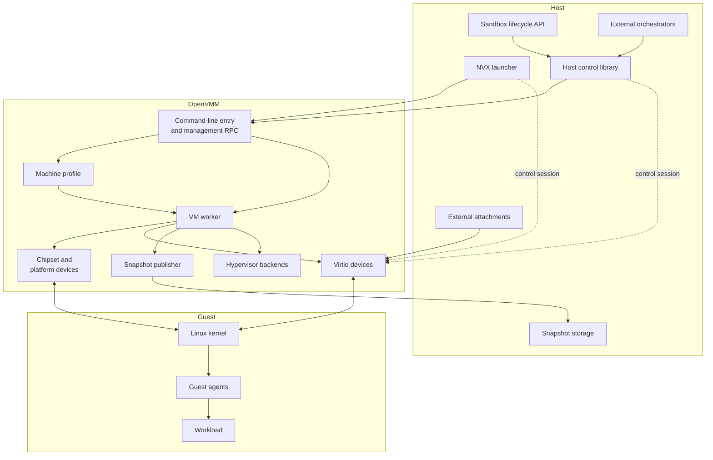

# 1.3 System Components and Responsibilities

[Architecture documentation](README.md) >
[1. Architecture Overview](1-architecture-overview.md)

NVX spans three layers (Figure 1.2), and their responsibilities follow the
boundary between policy and mechanism. Host software owns policy,
orchestration, placement, identity, and attachment authorization. The OpenVMM
virtual machine monitor (VMM) owns the virtual platform and transition safety.
Guest software owns workload construction, supervision, and guest-visible
repair, while the workload owns only its execution inside the resulting
sandbox.

**Figure 1.2.** Major host, VMM, and guest components.

## 1.3.1 Host Components

- **NVX launcher** runs one-shot microVMs and the managed sandbox lifecycle,
  keeps per-sandbox state, prechecks host shares and places them in the guest,
  and compiles structured egress-policy files into VMM egress rules.
- **Sandbox lifecycle API** exposes provision, start, exec, stop, and
  deprovision operations with request validation, backend capabilities, a
  serializable contract model, durable sandbox records, and stable error codes.
- **Host control library** implements the host side of the control protocol,
  artifact discovery, blockless managed launch, VMM process supervision,
  host-path export with its access policy, delivery of the host mapping table,
  and egress-rule translation. It also implements the host half of the
  [managed layered root](4.1-guest-filesystem-and-image-model.md#414-managed-layered-root):
  its root plan, activation configuration, execution admission, and
  execution streams. Its adapters, in the sandbox lifecycle API and in
  external orchestrators, supply policy, resources, and transport, and reuse
  the library's validation and execution semantics instead of reimplementing
  them.
- **External orchestrators** are orchestrators outside NVX, with their own
  storage and admission policy, that drive the host control library through
  their own adapters.
- **Snapshot storage** retains immutable machine state, memory, and optional
  paired scratch together with the identities needed to reconstruct external
  resources.
- **External attachments** supply process-local resources such as console
  endpoints, network endpoints, host filesystem exports, and block files.

## 1.3.2 VMM Components

- **Command-line entry and management RPC** are the VMM's frontends. They
  construct host attachments, create, capture, and restore microVMs, report
  readiness and guest exit, drain the byte channel at exit, and write outcome
  reports.
- **Machine profile** selects and validates the machine, defines its ABI
  constants, and owns the effective kernel command line. It holds the pinned
  CPU profiles, selects or derives each VM's CPU profile, checks backend
  support and restore compatibility, and computes each VM's effective CPUID.
- **VM worker** composes and runs the machine. It creates the partition and
  its virtual processors, reserves RAM capacity and maps captured memory
  privately with copy-on-write, loads the guest through the Linux direct
  loader, and places the fixed devices. Its state-unit framework quiesces,
  starts, rolls back, and inventories stateful components in dependency order,
  and the worker owns snapshot boundaries, management exclusion, clock
  contracts, and restore sequencing.
- **Chipset and platform devices** provide the allowlisted chipset: the PIC, the IOAPIC, the PIT,
  the RTC, and the byte-channel, shutdown, and
  snapshot-request ports.
- **Virtio devices** comprise the consoles, block, network, and host
  filesystem devices, with shared interrupt status, queue processing, and
  device-private saved state. Their backends include the control-console
  broker, which authenticates the local host peer and frames the control
  session, the in-process network endpoint, which enforces egress policy, and
  the host filesystem server, which enforces each export's access policy.
- **Snapshot publisher** defines the snapshot format and machine contract,
  publishes artifacts, and validates them on restore.
- **Hypervisor backends** implement partitions, processor execution, interrupt
  injection, CPU contracts, and snapshot clocks for KVM, MSHV, and WHP.

## 1.3.3 Guest Components

- **Linux kernel** boots from the fixed Linux-direct handoff, drives the
  allowlisted virtual devices, and provides the namespaces, filesystems,
  cgroups, and process primitives used by the runtime.
- **Guest agents** mount runtime filesystems, apply boot configuration, mount
  live host shares, and assemble the workload filesystem. They construct the
  workload's root and credentials, and in the layered sandbox root its
  namespaces and device view. In the blockless root, they create workload
  accounts when requested; the layered root never creates them. They
  supervise one-shot or managed workloads, prepare snapshots, and repair
  processors, memory, entropy, and identity after restore. They also announce
  the guest's listeners when the host publishes them, check time ABI
  conformance, watch for clock violations, discipline the wall clock, and
  perform the snapshot time steps. Their managed layered root comes from a
  guest runtime library. An external guest agent may run as the guest's init
  process instead, embedding the same library through its own adapter, so root
  assembly, host mappings, and execution supervision behave the same for every
  host.
- **Workload** is the microVM's single tenant: it owns the microVM's lifetime,
  resource envelope, and network identity, and it may run any number of
  processes, all inside the isolation boundary that the guest agents
  construct. It has no direct authority over host resources or VMM policy.
