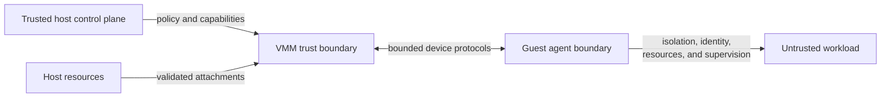

# 1.4 Trust Boundaries

[Architecture documentation](README.md) >
[1. Architecture Overview](1-architecture-overview.md)

As Figure 1.3 shows, the host and its orchestrator are trusted with guest
memory, image contents, and attachment policy, while the workload is
untrusted.

**Figure 1.3.** Trust boundaries of the host, VMM, guest agents, and workload.

Because each microVM has a single tenant, the virtual machine boundary is also
the boundary between workloads. A workload may use ordinary Linux interfaces
inside the guest, but it gains no authority to reconfigure the virtual
platform or host attachments.

From the VMM's perspective, guest physical addresses, port and MMIO accesses, virtio descriptors,
packet data, filesystem requests, control-session records, and the timing of a snapshot request are
all untrusted inputs.

Kernel images, initramfs images, command lines, snapshot artifacts,
restore-time attachments, and host control-console clients also cross
validation boundaries. Authority to provide an input does not make its
structure valid. OpenVMM therefore validates the machine configuration before
opening host resources, validates it again at worker construction, and
validates all persisted state before any restored virtual processor runs.

## 1.4.1 Defense in Depth

Invalid configurations are rejected, never silently adjusted. Every contract
is enforced without silent fallbacks: a host, snapshot, or guest that cannot
meet a contract is rejected, or fails fast, with a stable error. The single
fallback, from automatic CPU-profile selection to a host-derived CPU profile,
warns at every cold boot that takes it.

The VMM uses checked address arithmetic, bounded buffers and tables, typed
validation errors, rate-limited guest-triggerable logs, and fallible quiesce
and restore operations. Native I/O callbacks only record bounded state or
enqueue notifications; they never perform blocking snapshot or host-resource
work. Malformed saved device state is rejected before device workers start,
and no virtual processor runs after a partial restore failure. A failure after
processor stopping begins at a snapshot or post-restore acknowledgement
boundary is terminal: host input stays gated, and the VM is torn down instead
of resuming with uncertain state.

## 1.4.2 Host Control

A host control client reaches the guest only through the control-console
broker. The broker admits one local peer whose operating-system identity is
the VMM's user, requires a launcher-provided capability before any host data
reaches the guest, and bounds every record, queue, and credit window in both
directions. Malformed, stale, or out-of-order records fail closed.
Capabilities are process-local authority: they never appear in arguments,
environment variables, logs, endpoint names, snapshots, or attachment
identities.

## 1.4.3 Device-Enforced Policy

Host devices enforce policy independently of the guest. Read-only block roles
are advertised as read-only, reject writes in the device, and are opened
without host write access. The network endpoint authorizes the exact owned
copy of every transmitted frame. It accepts inbound connections only on the
host listeners that the host's inbound access allows, for published guest
ports or explicit forwards, and only from the clients that this access admits.
The guest's announcements choose which of its ports are published, never the
host addresses or the clients. The host filesystem server applies each
export's access mode and path policy on every request, whichever guest mount
or link reaches it. Guest mount flags, routes, and links are therefore never
security boundaries.

## 1.4.4 Images and Snapshot Artifacts

Image layers are trusted inputs: the overlay filesystem interprets metadata
stored in lower layers, and bytes read from any layer can appear in captured
memory. A snapshot identifies its blocks by a storage generation, which
transfers trust for layer and scratch contents to the storage owner; the VMM
trusts the control plane in the host to authenticate that generation. For the
attachments that a restore supplies, the VMM checks any identities that the
host expects before any processor runs and reports the opened identities in
receipts; see
[Host Attachments](5.4-snapshot-artifact-and-attachment-model.md#547-host-attachments).
A receipt identifies an object, not its contents.

The VMM trusts the host control plane not to give the same writable file, such
as a caller-supplied RAM backing or scratch file, to more than one VMM. It
takes no file locks to detect such sharing, and the RAM backing that it
creates itself is a new file for every VM. Snapshot artifacts are shared by
design: every VM restored from a snapshot maps the same immutable memory
artifact with copy-on-write, so each VM's changes stay private and never reach
the artifact. A capture always publishes new files, and a restored VM is not
captured again.

Copy-on-write isolates writes, not physical pages. Clean pages of a shared
memory artifact may remain shared through the host page cache among the VMs
that map it, and guest kernel, guest agent, and cached workload pages can all
originate in captured memory. Snapshot copy-on-write is therefore not, by
itself, a tenant authorization or physical-page isolation mechanism. Artifact
access control, sharing scope, backing-file placement, retention, and host
memory deduplication remain deployment responsibilities.

## 1.4.5 Host-Facing Outputs

Host-facing outputs are bounded. The optional outcome report is written after
teardown to a previously absent local path. It records only a schema version,
an opaque instance ID, the backend category, the operation and outcome
category with a numeric status, whether the network policy was requested and
applied with its mode, rule counts, and host-loopback action, and per-step
teardown flags. It never contains commands, environment values, paths,
network destinations, proxy details, workload output, credentials, or
free-form error text, and the VMM does not upload it.
