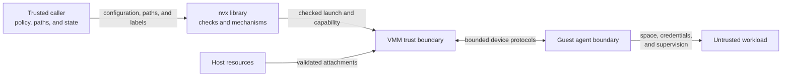

# 1.4 Trust Boundaries

[Architecture documentation](README.md) >
[1. Architecture Overview](1-architecture-overview.md)

As Figure 1.3 shows, the host's control plane, a caller and the `nvx` library
that it uses, is trusted with guest memory, image contents, and attachment
policy, while the workload is untrusted. Inside the control plane, the library
checks what its caller gives it, but trusts the caller with what the caller
owns, as [The Library and Its Callers](#146-the-library-and-its-callers)
describes.

**Figure 1.3.** Trust boundaries of the caller, the library, the VMM, the guest
agents, and the workload.

Because each microVM has a single tenant, the virtual machine boundary is also
the boundary between workloads. A workload may use ordinary Linux interfaces
inside the guest, but it gains no authority to reconfigure the virtual
platform or host attachments.

From the VMM's perspective, guest physical addresses, port and MMIO accesses, virtio descriptors,
packet data, filesystem requests, control-session records, and the timing of a snapshot request are
all untrusted inputs.

Kernel images, initramfs images, command lines, snapshot artifacts,
restore-time attachments, and host control-console clients also cross
validation boundaries. Authority to provide an input does not make its
structure valid. OpenVMM therefore validates the machine configuration before
opening host resources, validates it again at worker construction, and
validates all persisted state before any restored virtual processor runs.
`nvx` checks a caller's configuration without reading the host, checks a
launch completely before it starts OpenVMM, and checks a snapshot's directory,
key, and manifest before it restores from them, in addition to OpenVMM's
checks, never in their place.

## 1.4.1 Defense in Depth

Invalid configurations are rejected, never silently adjusted. Every contract
is enforced without silent fallbacks: a host, snapshot, or guest that cannot
meet a contract is rejected, or fails fast, with a stable error. The single
fallback, from automatic CPU-profile selection to a host-derived CPU profile,
warns at every cold boot that takes it.

The VMM uses checked address arithmetic, bounded buffers and tables, typed
validation errors, rate-limited guest-triggerable logs, and fallible restore
operations, and it rolls back a capture that fails after the quiesce and
before its commit point. Native I/O callbacks only record bounded state or
enqueue notifications; they never perform blocking snapshot or host-resource
work. Malformed saved device state is rejected before device workers start,
and no virtual processor runs after a partial restore failure. A failure after
processor stopping begins at a snapshot or post-restore acknowledgement
boundary is terminal: host input stays gated, and the VM is torn down instead
of resuming with uncertain state.

## 1.4.2 Host Control

A host control client reaches the guest only through the control-console
broker. The broker admits one local peer whose operating-system identity is
the VMM's user, requires the capability that the VM's launch provided before
any host data reaches the guest, and bounds every record, queue, and credit
window in both directions. Malformed, stale, or out-of-order records fail
closed. Capabilities are process-local authority: they never appear in
arguments, environment variables, logs, endpoint names, snapshots, or
attachment identities.

`nvx` generates a fresh capability for each launch, passes it to OpenVMM only
on its standard input, never writes it to a file, and hides it from its
debugging output: a caller that must reconnect after a restart keeps it
itself. Before a caller presents the capability, `nvx` checks that the control
endpoint's server is the VM's held process: through its socket's original peer
on Linux, and through the named pipe's server process on Windows.

## 1.4.3 Device-Enforced Policy

Host devices enforce policy independently of the guest. Read-only block roles
are advertised as read-only, reject writes in the device, and are opened
without host write access. The network endpoint authorizes the exact owned
copy of every transmitted frame. It accepts inbound connections only on the
host listeners that the host's inbound access allows, for published guest
ports or explicit forwards, and only from the clients that this access admits.
The guest's announcements choose which of its ports are published, never the
host addresses or the clients. The host filesystem server applies each
export's access mode and path policy on every request, whichever guest mount
or link reaches it. Guest mount flags, routes, and links are therefore never
security boundaries. `nvx` lowers its caller's network policy and export into
these device policies, and enforces none of its own.

## 1.4.4 Images and Snapshot Artifacts

Image layers are trusted inputs: the overlay filesystem interprets metadata
stored in lower layers, and bytes read from any layer can appear in captured
memory. A snapshot that binds its blocks identifies each, by default, by the
SHA-256 digest of its file, which OpenVMM computes, or by a storage generation,
which transfers trust for layer and scratch contents to the storage owner; the
VMM trusts the control plane in the host to authenticate that generation. A
platform snapshot, the only kind that `nvx` captures, binds no block: each
restore attaches its caller's own image and upper, which the caller trusts as
it trusts any image.

The VMM trusts the host control plane not to give the same writable file, such
as a caller-supplied RAM backing or scratch file, to more than one VMM. It
takes no file locks to detect such sharing, nor does `nvx`, and the RAM
backing that the VMM creates itself is a new file for every VM. Snapshot
artifacts are shared by design: every VM restored from a snapshot maps the same
immutable memory artifact with copy-on-write, so each VM's changes stay private
and never reach the artifact. A capture always publishes new files, and a
restored VM is not captured again.

Copy-on-write isolates writes, not physical pages. Clean pages of a shared
memory artifact may remain shared through the host page cache among the VMs
that map it, and guest kernel, guest agent, and cached workload pages can all
originate in captured memory. Snapshot copy-on-write is therefore not, by
itself, a tenant authorization or physical-page isolation mechanism. Artifact
access control, sharing scope, backing-file placement, retention, and host
memory deduplication remain the responsibilities of the caller and its
deployment.

## 1.4.5 Host-Facing Outputs

A launch's host-facing outputs are OpenVMM's log and its outcome report. `nvx`
gives both fixed names in the caller's private VM directory, beside the VM's
endpoints: it creates the log anew, private to the caller, before OpenVMM
starts, and refuses a launch whose outcome report or Linux socket endpoints
already exist rather than replace them. OpenVMM writes the report after its
VM's teardown, so an OpenVMM process that ends before then leaves none. A
creation that fails removes only the entries that it created, and once a
launch's creation succeeds, `nvx` removes none of its outputs: the caller
reads and removes them.

The outcome report is bounded. It is written after teardown to a previously
absent local path. It records only a schema version, an opaque instance ID,
the backend category, the operation and outcome category with a numeric
status, whether the network policy was requested and applied with its mode,
rule counts, and host-loopback action, and per-step teardown flags. It never
contains commands, environment values, paths, network destinations, proxy
details, workload output, credentials, or free-form error text, and the VMM
does not upload it.

## 1.4.6 The Library and Its Callers

`nvx` checks what its caller gives it, but holds nothing for the caller
between calls: it keeps no record, retains no handle of a snapshot, and takes
no lock of a VM or a snapshot. It checks:

- That each VM directory is private to the current user: on Linux, owned by
  the user with mode 0700, which OpenVMM requires of the directory of its
  control socket; on Windows, owned by the user, with a protected access
  control list that grants access to the user alone. It never changes an
  existing directory, since restricting it would not revoke access through
  files that others already hold open.
- That a snapshot directory has the strict form that
  [Validation and Integrity](5.4-snapshot-artifact-and-attachment-model.md#543-validation-and-integrity)
  describes, once, when it opens the snapshot.
- That a VM's process is the one that the caller recorded, by its host boot,
  process ID, and start time, and that the peers of its control and
  restore-ready endpoints are that process.
- That a saved VM's runtime identity is the current one, before it drives the
  VM; see [Runtime Identity](1.5-compatibility-and-versioning-model.md#154-runtime-identity).

The caller keeps what `nvx` cannot check once and for all:

- **Paths.** It keeps the runtime files and the block images stable, and its
  VM and snapshot directories stable and private, from a launch's creation to
  the end of their use, and each snapshot directory immutable while it uses
  the snapshot. A restore hard-links the snapshot's files into the VM's
  directory, so it keeps both on one filesystem. The `ExportPlan` of an export
  names host paths only, never the objects at them, so the caller also keeps
  each path naming the object that it means, as the
  [export's module](../../nvx-rs/src/host/filesystem/mod.rs) describes: across
  the race between its own checks and OpenVMM's opens, through a recheck of a
  workload's writable parts before each later launch, and for as long as each
  denial is to hold. NVX's CLI pins the identities of the mapped and denied
  objects inside those writable parts when it plans an export, and checks
  them before each start.
- **Outputs.** It owns each launch's log, outcome report, and endpoints, which
  `nvx` never removes, though on Linux OpenVMM removes the control and
  boot-console sockets that it bound, at its VM's teardown. It also owns each
  capture's files, which it moves into a snapshot directory of its own. It
  saves what finds a running VM again: its directory, control endpoint,
  capability, process reference, and runtime identity.
- **Per-snapshot locks.** On Linux, adding or removing a restore's links to a
  snapshot's files changes their metadata, which OpenVMM checks until it
  connects the restore-ready endpoint. The caller therefore holds a lock of
  its own for each snapshot from the creation of a restore, which adds the
  links, through its peer-verified restore-ready event or its VM's verified
  exit, and around the removal of a restore's view of the snapshot. Windows
  needs none.
- **Spawns.** On Windows, `nvx` serializes its own spawns of OpenVMM, but a
  process that the caller starts while a spawn passes handles to OpenVMM may
  inherit them, so the caller keeps its other process starts out of a VM's
  start.
