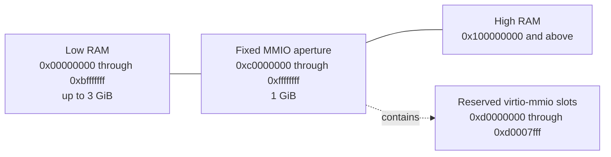

# 2.3 Memory Layout

[Architecture documentation](README.md) >
[2. Virtual Machine Architecture](2-virtual-machine-architecture.md)

As Figure 2.1 shows, guest RAM is continuous in backing-file offset but split
in guest physical address by the fixed MMIO aperture.

**Figure 2.1.** Guest physical memory layout.

Active RAM occupies `[0, min(size, 3 GiB))`. Memory displaced by the one-GiB
MMIO aperture resumes at 4 GiB. There is no high-MMIO or VTL2 aperture. One
memory-layout engine owns this split, using the chipset's fixed MMIO
reservation. Its active RAM ranges are also the snapshot memory-range
inventory and the authoritative PC memory map that tells the Linux kernel
which physical address ranges are RAM and which are reserved (the e820 map).

Table 2.4 lists the fixed locations of the low-memory boot structures.

**Table 2.4.** Fixed low-memory boot structures.

| Guest physical address | Contents |
| ---: | --- |
| `0x0000..0x000f` | Intel MP 1.4 floating pointer |
| `0x0400` | MP configuration table, `180 + 20 * processor count` bytes |
| `0x1000` | Bootstrap GDT |
| `0x2000` | Linux `boot_params` zero page |
| `0x4000..0x9fff` | 4-GiB identity page tables: one table for each of the top two levels of the x86-64 page-table hierarchy (PML4 and PDPT), and four directories of 2-MiB pages |
| `0x20000..0x2ffff` | NUL-terminated kernel command line |
| `0x30000..0x30fff` | Shared virtio interrupt-status page |
| `0x100000` and above | Kernel load segments and ordinary RAM |

The e820 map reserves the live interrupt-status page and the legacy PC range
from 640 KiB to 1 MiB that holds video memory and firmware (the ISA hole),
splits low and high RAM around the aperture, and never reports the aperture
as RAM. Loader writes and DMA ranges must fit wholly inside a RAM range and
may not cross the MMIO aperture or a reserved boot structure.

The Linux direct loader places its writes inside RAM, and the virtio devices
enforce the rule for DMA: each device reaches only the RAM ranges of the e820
map and the RAM that a restore activates beyond them. A device refuses a queue
whose rings, or a descriptor whose buffer, lies even partly outside those
ranges, such as in the interrupt-status page, in the ISA hole, or across the
aperture. It reads and writes none of it, stops serving that queue, and sets
`DEVICE_NEEDS_RESET` in its status, sending a configuration-change
notification if the driver has set `DRIVER_OK`. A refused ring instead fails
`DRIVER_OK`: the device resets as for any queue that cannot start, and its
status holds `DEVICE_NEEDS_RESET` alone, without a notification. Only a device
reset clears the mark. The transports alone update the interrupt-status page.

## 2.3.1 Memory Capacity

Snapshot capture may declare an immutable RAM capacity at least as large as
the active base RAM; both values are then 128-MiB aligned. The layout engine
reserves addresses for the full capacity but publishes only the active base
prefix as RAM, so selecting a larger restore target never moves the MMIO
aperture or any device. The machine contract records the canonical suffix
ranges that are absent from the captured e820 map and memory artifact. A
suffix that crosses the 3-GiB boundary is represented as separate low- and
high-RAM ranges. A snapshot without a declared capacity cannot select a
different RAM size at restore.
[Memory Activation](5.5-restore-protocol.md#554-memory-activation) describes
the restore-time sequence.
