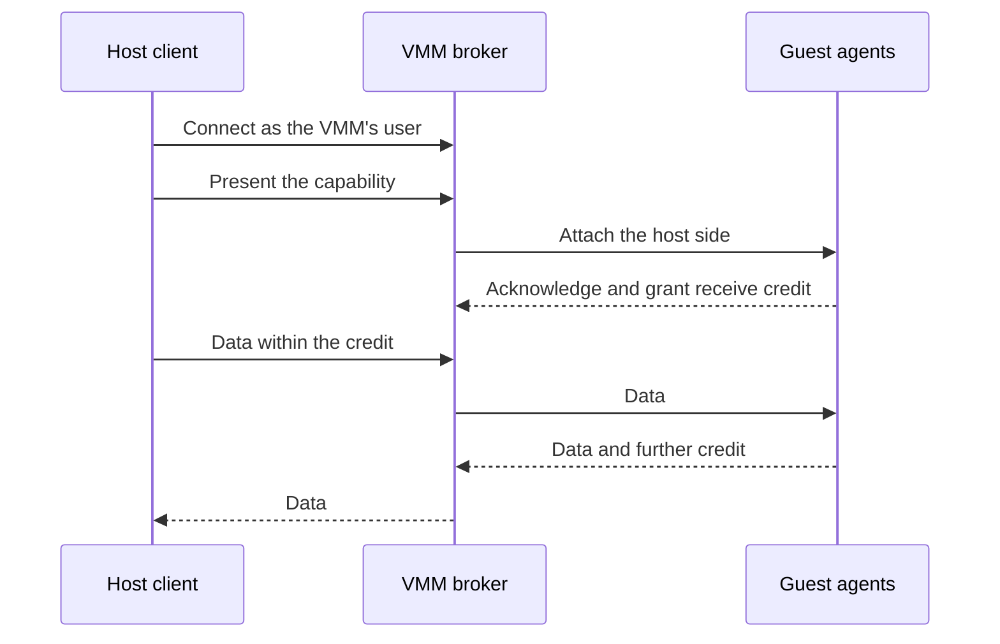

# 3.3 Consoles

[Architecture documentation](README.md) >
[3. Virtual Devices](3-virtual-devices.md)

NVX separates human-oriented boot communication from authenticated workload
control. Both use the single-port virtio-console device with two split queues,
but they are distinct devices with distinct attachment kinds, stable
identities, slots, interrupts, endpoints, saved state, and reconnect policies.

## 3.3.1 Boot Console

The optional boot console carries boot messages and an ordinary byte stream.
The kernel console uses it once its driver is ready, and the byte channel
remains the early console. Host RX accepted by the device and partial guest TX
progress are device-private saved state, so restore never replays a
descriptor from byte zero or silently loses VMM-owned data.

The host attachment is one of:

- A listener on a Unix socket, a named pipe, or loopback TCP with a fixed
  nonzero port, which retains pending guest output until a client connects.
- A client connection.
- The inherited terminal.
- An explicitly disconnected endpoint that discards guest output.

The snapshot records the attachment's stable ID, canonical endpoint identity,
reconnect policy, requiredness, and timeout, never a native handle. A saved
listener may be recreated at a fresh private endpoint of the same kind, but
its stable ID, attachment kind, backend kind, reconnect policy, required flag,
length, and timeout stay exact. A client attachment keeps its exact saved
identity and requires an explicitly approved restore-time attachment, with a
five-second timeout. An inherited terminal must be supplied again, and a
disconnected attachment stays disconnected.

## 3.3.2 Control Console

The control console carries structured operations between the host and the
guest agents. A fresh boot with a control console also requires the boot
console, which makes the control device's guest terminal `hvc2`. The machine
profile owns the token that identifies it, and the boot console remains the
only kernel console. When a control console is present, the machine profile
rejects caller-supplied control terminal, driver probe-order, and
device-discovery tokens, including kernel-equivalent hyphenated spellings, as
well as quotes and the `--` delimiter, so command-line parsing cannot redirect
the guest's terminal discovery.

The host endpoint is either a local listener or explicitly disconnected. A
live endpoint is protected in three layers:

- **Private endpoint.** On Linux hosts, it is a Unix socket bound exclusively
  with mode `0600` inside an existing, owner-only, non-symlink directory of
  the VMM's user. On Windows hosts, it is a named pipe whose protected DACL
  admits only LocalSystem and the VMM's user. Every other backend kind is
  rejected, and the boot and control endpoints must differ.
- **Peer identity.** The broker reserves its single host slot for a peer
  whose operating-system identity is the VMM's user: the Unix peer's effective
  UID, or the pipe client's token user SID. Any other peer is disconnected
  before its bytes are read.
- **Capability.** The launcher passes a random 32-byte capability through a
  one-way pipe whose writers are closed before the VMM starts. The first host
  record must present it within a bounded authentication timeout, five seconds
  by default. A disconnected control console uses a random capability that no
  client can present.

As Figure 3.2 shows, the broker relays a frozen, versioned record stream
between the guest and the authenticated host. Every record has a fixed-size
header with a magic value, protocol version, record type, broker instance ID,
epoch, direction-local sequence number, and payload length. Attach records
establish the guest and host sides; acknowledgement, data, wait, ready, reset,
authentication-error, and credit records carry the session.

**Figure 3.2.** Control-session establishment and data flow.

Flow control is credit based: the guest grants byte-counted receive credit for
host data. When credit is exhausted, one complete host record may wait in a
bounded pending slot, and each output direction is bounded in records and
bytes. Malformed lengths, wrong-state records, wrong instance or epoch values,
and duplicate or out-of-order sequence numbers fail closed. A wrong capability
or an authentication timeout detaches the client without advancing the epoch.
A host disconnect advances the epoch, drops unstarted data and unused credit,
finishes any partially transmitted record so the stream stays aligned, and
emits a reset; the next session receives credit only from a fresh guest
acknowledgement.

Credit cannot recover a lost byte: a guest that misses part of a record never
credits it, and the broker holds the next record forever. The guest kernel
therefore carries a
[fix of the HVC console](../../kernel/patches/0004-hvc-push-flip-buffer-under-lock.patch).
The device's interrupt and the HVC polling thread both read the console's
input into the tty flip buffer. Upstream Linux commits each read only after it
releases the console's lock, so one reader can commit a stale fill after the
other's later reads, which the line discipline then never receives. The fix
commits under the lock.

Snapshots record only the endpoint identity and a broker policy, either an
authenticated listener or a disconnected console, and never the capability or
the peer identity. Broker saved state omits queued records, host output, and
usable receive credit; it keeps only the guest-side parser, any partially
transmitted guest record, and error counters. To restore an authenticated
listener, the launcher must supply an approved endpoint and a fresh
capability. The endpoint may move to a fresh location, so that concurrent
clones do not collide, but it must meet the private-endpoint rules above, and
the attachment's stable ID, attachment kind, backend kind, reconnect policy,
required flag, length, and timeout stay exact. A disconnected console stays
disconnected. The restored broker receives a fresh instance ID, restarts at
the first epoch with a queued reset, and ignores guest records for the old
instance until the guest acknowledges the new one.

The guest agents own the workload protocol carried inside the brokered stream;
see [Host-Guest Control Interface](4.4-host-guest-control-interface.md).
