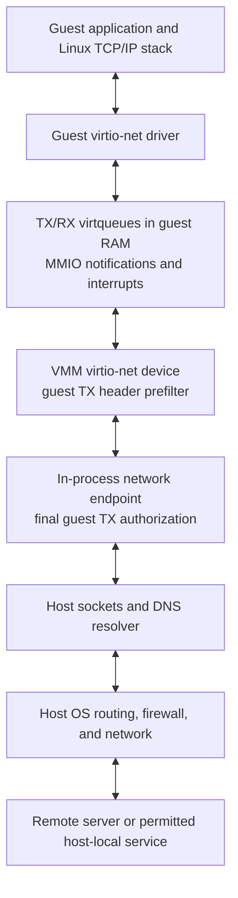

# 3.5 Network

[Architecture documentation](README.md) >
[3. Virtual Devices](3-virtual-devices.md)

As Figure 3.3 shows, the network device is an optional virtio-net NIC backed
by an in-process userspace network stack in the VMM. The stack translates guest
traffic into ordinary host socket operations. It does not attach the guest to
a physical NIC, TAP interface, bridge, or host virtual switch, and the host
needs no interface that holds the guest's gateway address.

**Figure 3.3.** Network data path.

## 3.5.1 Device and Network Identity

The NIC occupies the fixed network slot, has one RX/TX queue pair, and
advertises an exact feature mask: the MAC-address feature and virtio
version 1. Its interrupt is the one backend-specific value in the machine
contract: IRQ 10 on KVM and MSHV, and IRQ 5 on WHP. The portable network
profile is mandatory and selects the same in-process data plane on every
backend.

Table 3.12 shows an example of the static network identity that the host owns.
The identity consists of:

- An IPv4 prefix from `/1` through `/30`, whose first usable address is the
  gateway.
- Deterministic guest and gateway MAC addresses derived from the final three
  IPv4 octets.
- A derived IPv6 identity that embeds the guest and gateway IPv4 addresses in
  `fd00::/96`, with a prefix of 96 plus the IPv4 prefix length, behind a
  gateway that shares the IPv4 gateway's MAC address.

**Table 3.12.** Example network identity.

| Setting | Example |
| --- | --- |
| Guest IPv4 address | `10.0.0.2/24` |
| IPv4 gateway | `10.0.0.1` |
| Guest IPv6 address | `fd00::a00:2/120` |
| IPv6 gateway | `fd00::a00:1` |

The guest configures this identity and its default routes from command-line
tokens that the machine profile owns, without DHCP, router advertisements,
address autoconfiguration, or duplicate address detection. Its kernel-derived
link-local address is its only other IPv6 address, and the egress policy
admits it only as the source of neighbor solicitations. The identity
advertises no routable IPv6 prefix, so external IPv6 reachability depends on
the host's own routes and address-family support.

## 3.5.2 Packet Forwarding

Guest transmission follows this path:

1. The guest network stack builds an Ethernet frame, and the driver places
   its buffers in the TX virtqueue.
2. The driver notifies the device, which reads the descriptors and prefilters
   the frame headers against the egress policy.
3. The endpoint copies the complete frame into an owned buffer, authorizes
   those exact bytes, and passes an allowed frame to the network stack.
4. For a new TCP connection, the stack connects a host TCP socket to the
   destination. For UDP, it sends the datagram's payload through a host UDP
   socket.

TCP forwarding is socket proxying, not packet rewriting. The in-process stack
terminates the guest-facing connection, and the host kernel owns the
remote-facing one, with separate sequencing, acknowledgements, and buffering.
A remote peer normally sees the host's network identity. Host routing, VPN
configuration, and host firewall rules still govern the host sockets, and the
host needs no IP forwarding.

Data arriving on a host socket is associated with its guest-facing flow,
rebuilt as Ethernet, IP, and TCP or UDP packets, and written into buffers that
the guest posted on the RX virtqueue, followed by a used-buffer interrupt.

ARP and IPv6 neighbor discovery are answered locally rather than broadcast on
a physical LAN. The network profile provides outbound TCP and UDP over IPv4
and IPv6. The endpoint answers echo requests to either gateway itself, relays
other IPv4 echo requests through a host ICMP socket, and does not relay ICMPv6
echo to other destinations. It deterministically rejects fragmented IPv4
packets, IPv6 extension headers, and IPv4-mapped IPv6 destinations.

## 3.5.3 Egress Policy

By default, guest egress is allowed and general host ingress is denied. One
canonical egress policy applies before any externally visible transmission. A
generic policy has an explicit default action, `allow` or `deny`, and up to
256 allow rules and 256 deny rules. Each rule selects destinations by IPv4 or
IPv6 address or CIDR, optionally narrowed to TCP, UDP, or ICMP and, for TCP or
UDP, to a destination port or an inclusive port range. Evaluation is
independent of rule order:

1. A matching deny rule denies the packet.
2. Otherwise, a matching allow rule allows it.
3. Otherwise, the default action decides.

A rule matches only destinations of its own address family. The canonical
policy also supports IPv4-only host allow lists, host block lists, and exact
TCP endpoint allow lists; these deny all IPv6 traffic and do not combine with
generic rules.

Filtering is inactive only when the policy allows everything. Otherwise,
packet checks enforce the bound guest MAC and IP identity and validate the
headers, not just the destination, and port-specific rules fail closed on
malformed or fragmented traffic. The device's early header check alone is
insufficient, because guest memory remains mutable after it, so the endpoint
repeats authorization on its complete owned copy of the frame. A guest
therefore cannot rewrite a checked frame into a different destination. Denied
frames are dropped, and their TX descriptors complete without host
transmission.

The rules are destination-based L3 and L4 rules, not hostname or content
filters. They apply to every frame that the guest transmits, including replies
on forwarded connections, but they are not a receive firewall or a host-wide
firewall. While the host publishes the guest's listeners, the policy also
admits the guest's replies on the flows that the endpoint carries, as
[Host-Local Access and Ingress](#354-host-local-access-and-ingress) describes.

## 3.5.4 Host-Local Access and Ingress

By default, and subject to the egress policy, the gateway maps guest TCP and
UDP flows onto host loopback: the IPv4 gateway maps to `127.0.0.1`, and the
IPv6 gateway maps to `::1`. Replies on these flows come from the gateway
address and port that the guest addressed, as connected UDP sockets require.
The guest's own loopback remains guest loopback.
Other host-local destinations, such as link-local addresses, also reach host
sockets unless host loopback is denied.

Denying host loopback disables the gateway-to-loopback mappings, blocks
loopback, unspecified, and link-local destinations, and disallows every
forward. One exact IPv4 gateway TCP proxy endpoint may remain available. It is
bound into the policy digest, admitted before the policy mode is evaluated,
and translated to the same port on host `127.0.0.1`, where the launcher
supplies the proxy service.

An outbound connection never makes guest services reachable from the host or
its networks. As Table 3.13 shows, inbound access is a separate host decision.

**Table 3.13.** Inbound access to guest services.

| Inbound access | Guest listeners published on | Admitted clients |
| --- | --- | --- |
| None, the default | No host address | None |
| Host loopback, under an explicit host-loopback allow | Host loopback, `127.0.0.1` and `::1` | The host |
| Private network, under ingress allow | Every host address | Peers on the host's private networks, and the host under an explicit host-loopback allow |

An explicit host-loopback allow makes host-loopback access bidirectional:
besides the gateway mapping, it publishes the guest's listeners on host
loopback and admits explicit TCP or UDP forwards from host `127.0.0.1` ports
to guest ports, at most 64 of them. Neither binds a LAN-facing listener.

The host decision names no ports, and the endpoint owns no listener of its
own, so publishing follows the ports on which the guest listens. The machine
profile passes the ingress mode to the guest in a boot token that callers
cannot supply, and a guest agent then announces the guest's listeners. It
sends each announcement as one UDP datagram to a fixed port of the IPv4
gateway from a privileged source port, which the workload, holding no
capabilities, cannot bind, so the workload cannot forge an announcement. An
announcement carries a magic value, a version, a flag that marks omitted
listeners, and at most 64 entries in strictly increasing order of protocol and
port, each naming the protocol, TCP or UDP, the address families, and the
port; the conformance vectors of version 1, in
[`nvxl-v1.txt`](../../nvx-rs/tests/vectors/nvxl-v1.txt), give the bytes of
announcements that the guest agent sends and the endpoint accepts. The
endpoint consumes announcements before the egress policy, which
neither authorizes nor forwards them, and each announcement replaces the
published set. For each published port and address family, the endpoint keeps
one host listener at the guest's port number:

- **Private-network ingress** listens on every host address and relays only
  peers in ranges that are not globally reachable: the IPv4 private-use,
  shared, link-local, benchmarking, and documentation ranges, and the IPv6
  unique local, site-local, documentation, and benchmarking ranges. It refuses
  peers inside the guest's own subnets, which the guest would take for its
  gateway or its neighbors. Peers at the host's own addresses, including
  loopback, need an explicit host-loopback allow.
- **Host-loopback publishing** without ingress allow listens on the family's
  loopback address and admits only the host. It never displaces a host
  listener that already holds the port, on loopback or on every host address.

A port that the host cannot bind, for example because a host process holds
it, is retried with the next announcement. While the guest's listeners are
published, the egress policy also admits ARP requests and neighbor
solicitations for the guest's subnet, where the gateway presents host peers.
It admits a frame that its rules deny when the frame continues a flow that the
endpoint carries: a TCP segment other than an initial SYN, or a UDP datagram
from a published port to a peer that recently sent one to it, which leaves
through the port's host listener.

The endpoint presents other host peers, such as the host clients of published
listeners, at synthetic addresses inside the guest's subnet of each family,
allocated downward from its last usable address, such as `10.0.0.254` and
`fd00::a00:ff` for the identity in Table 3.12. Explicit
host-loopback access therefore requires an IPv4 network of /29 or larger: a
/30 holds only the gateway and the guest and leaves no address for host peers.
The guest routes its replies to a synthetic address through its NIC rather
than its own loopback and answers from its own address in that subnet, and
the endpoint translates the synthetic address back on transmission. The
egress policy evaluates guest traffic to a synthetic address at the host
address that it stands for, and at the gateway of its family for host
loopback, so a synthetic address reaches no host-loopback port that the rules
deny at the gateway. The device's early header check, which knows no synthetic
addresses, leaves them to the endpoint.

## 3.5.5 DNS

The gateway provides a DNS proxy over UDP and TCP port 53. The guest is
pointed at the IPv4 gateway when the egress policy permits DNS to it, and
otherwise at the IPv6 gateway when generic rules permit DNS there.
Exact-endpoint policies never name a gateway, and without a permitted gateway
the guest receives no DNS server.

A guest query passes the normal egress checks before the gateway handles it.
Upstream resolution uses the host resolver, whose upstream servers are not
guest packet destinations, so guest rules do not check them. A direct guest
query to an external DNS server uses the ordinary outbound path and needs
permission for that server. DNS permission and connection permission are
separate: resolving a name never authorizes a connection to the result.
Denying host loopback does not disable gateway DNS that the egress policy
permits.

## 3.5.6 Bounded State, Snapshots, and Restore

Flow, DNS, buffer, and queue state are bounded. At most 128 TCP, 256 UDP, and
16 ICMP guest flows are active at once, and excess flows are rejected before a
host socket is created. At most 256 DNS requests may be pending. A resolver
failure, or a UDP query beyond that limit, receives `SERVFAIL`, and a TCP query
beyond it resets its connection.

The snapshot records the network profile, identity, and policy digest.
Restore reconstructs a fresh endpoint and requires the same network profile,
and the same policy unless the NIC is a template: one captured with the
complete deny-all policy, which denies every guest frame, host loopback, and
inbound access, and keeps no proxy endpoint, so that nothing in the snapshot
depends on the policy beyond the NIC's identity. A restore of a template of
the platform tier, or of a snapshot without a tier, may install a policy of
its own with `--restore-network-policy`, which OpenVMM validates as at a cold
boot, binds to the captured identity, and installs, with its forwards, before
any vCPU runs, while the snapshot's contract keeps the template's policy. A
snapshot without a tier may hold a workload that has already run, but under
the deny-all that workload had no connectivity, so the restore grants it
connectivity that it never had. Native sockets, DNS requests, and flows are
never serialized. Published guest listeners and explicit host forwards are
process-local attachments, so capture rejects private-network ingress and
explicit host-loopback access, which create them, and so does every restore
that keeps the captured policy.

A restored guest keeps its captured command line, which under a template's
deny-all names no DNS server and asks for no listener announcements. A
platform clone takes both from its activation. The guest of a snapshot
without a tier takes them from version 6 of the restore packet, which carries
the new policy's DNS server and whether the guest announces its listeners
([Restore Packet](5.5-restore-protocol.md#555-restore-packet)), and its
repair applies them before it acknowledges the restore, which then gates
host input ([Guest Repair](5.5-restore-protocol.md#557-guest-repair)).

Capture quiesces the endpoint, drains completion ownership, and requires the
saved queues to contain no unrepresented RX or TX packets. It saves the queue
lifecycle, negotiated features, link state, and endpoint generation, but no
in-flight packet payload. After restore, pre-capture packets are not
replayed, earlier TCP, UDP, ICMP, and DNS state is invalid, and traffic
establishes fresh flows.
