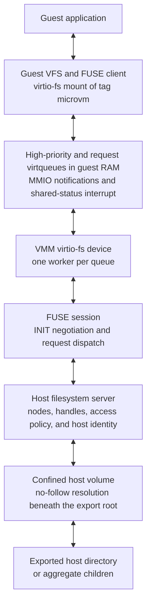
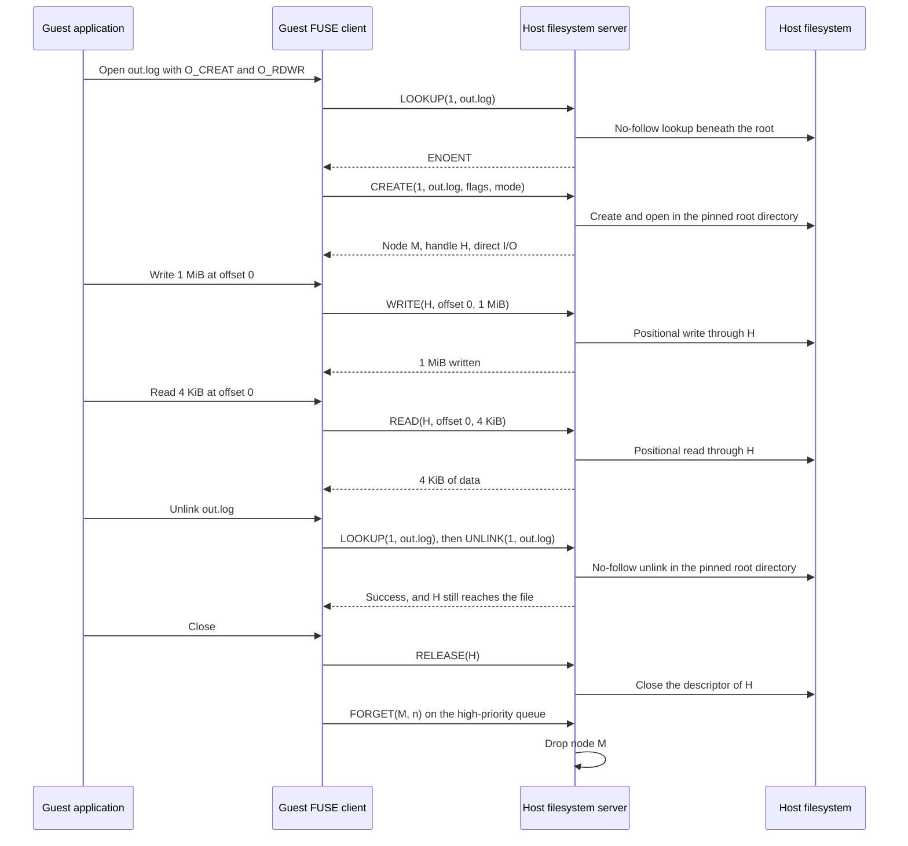

# 3.6 Host Filesystem

[Architecture documentation](README.md) >
[3. Virtual Devices](3-virtual-devices.md)

As Figure 3.4 shows, the host filesystem device shares live host files with
the guest through virtio-fs. The guest kernel's FUSE client turns system calls
on the mounted tag into FUSE requests, which travel through virtqueues in
guest RAM to the host filesystem server, a FUSE server inside the VMM. The
server performs each request on the exported host directory, or on the
children of an aggregate, and returns the reply through the same queue.
Unlike a [block device](3.4-block-storage.md), whose backend sees only
blocks, the server sees names, attributes, and open files: the host owns the
namespace and the data, while the guest owns its VFS objects, permission
checks, and locks. Guest writes reach the host files directly, and host
changes are visible to the guest on its next request.

**Figure 3.4.** Host filesystem data path.

## 3.6.1 Device and FUSE Session

The device is a virtio-fs device with the fixed tag `microvm`, one
high-priority queue, and one request queue. Its configuration space holds only
the tag and the request-queue count. It offers split rings with indirect
descriptors and event-index notification suppression, but never packed rings
or the DAX shared-memory window, so file data always travels through the
queues. The machine profile rejects alternate tags, extra queues,
shared-memory windows, PCI transport, and aggregates whose children change
after boot.

The guest opens the FUSE session with `INIT`, and every other request fails
until it succeeds. The device speaks FUSE protocol version 7 and accepts guest
minor versions 27 and newer, but a [restore](#369-restore) requires a saved
session that negotiated minor version 31 or newer. From a fixed set, the
device grants what the guest offers: asynchronous reads, parallel directory
operations, automatic data invalidation, kill-privilege handling, asynchronous
direct I/O, atomic `O_TRUNC`, big writes, extended `INIT`, adaptive
`READDIRPLUS`, and shared mappings of direct-I/O files. It negotiates a 1 MiB
maximum write and nanosecond timestamps, and it never grants writeback
caching, lock forwarding, or DAX mappings.

Every entry and attribute in a reply carries zero cache lifetimes, and every
file that the guest opens or creates uses direct I/O. The guest therefore
looks up each path component again on every walk, fetches attributes whenever
it needs them, and sends every read and write to the host instead of its page
cache: host changes are visible on the guest's next request, and a guest write
has reached the host file when the write completes. Shared mappings are the
exception, because their pages are cached in the guest and written back
through ordinary write requests. Zero lifetimes also make the guest drop a
name and its inode, and send `FORGET`, as soon as nothing uses them, so it
holds nodes only for objects in use and the directories that lead to them,
such as open files, working directories, and mount and bind points. Because
lock forwarding is not negotiated, the guest kernel keeps POSIX and BSD locks
local, and host processes neither see nor honor them. The guest kernel checks
Unix permissions against the attributes that the host reports before it sends
a request, and the host then checks the operation against the
[host identity](#367-host-identity) that performs it.

## 3.6.2 Export Forms

As Table 3.14 shows, the slot takes one of three forms.

**Table 3.14.** Host filesystem export forms.

| Form | Guest view |
| --- | --- |
| Dormant | No host server and no active policy, but the device remains discoverable; the session can open, but filesystem requests fail with `ENOSYS` |
| Directory export | One host directory as the filesystem root, with one access mode and path policy |
| Aggregate | A read-only synthetic root, mode `0500` and owned by root, that lists named children; each child is an independent volume with its own access mode and path policy |

A dormant slot lets a snapshot
[gain an export at restore](#3610-dormant-slot-and-saved-state-versions). A
directory export always exports a directory, because the guest mounts the
device's root. The machine profile announces an attached export to the guest
in boot tokens: its guest location, the tag, its mode, which is read-write
when the export or any child is, and, for an aggregate, an aggregate marker.
On a cold boot, the guest mounts the tag at that location with that mode; for
an aggregate, the guest agents then bind each child at its target, as
[Live Host Shares](4.1-guest-filesystem-and-image-model.md#412-live-host-shares)
describes.

An aggregate's root lists its children in declaration order and refuses every
change with `EROFS`. A child is a host directory or a single regular file. The
declared kind, not the host object, decides which, and the VMM refuses a host
path of the other kind. A file child serves only its file, as the child
itself: its volume is the file's parent directory, narrowed to the file's
name, which the guest never reaches, so the guest cannot list or change
anything beside the file, a lookup below it fails with `ENOTDIR`, and every
request fails with `EACCES` while anything other than a regular file holds the
name. A file child takes no path policy, because its mode covers the whole
file.

Child names are unique, use `[A-Za-z0-9._-]`, and are at most 64 bytes long.
An aggregate holds at most 256 children with at most 128 KiB of policy paths,
and child host roots must not equal or contain one another, so no child can
reach another's files under a different policy; a file child may sit beside a
directory child. The children share one FUSE superblock, so the server mixes a
per-child key into each host inode number to make inode-number collisions
between children unlikely. A rename between children fails with `EXDEV`. A
hard link between children fails with `EROFS` when its destination is
read-only and with `EXDEV` otherwise.

## 3.6.3 Request Path

A guest operation on the mount becomes one or more FUSE requests:

1. A system call reaches the guest VFS, whose FUSE client issues the requests
   that it needs: `LOOKUP` for each path component, `GETATTR` for attributes,
   `OPEN` or `CREATE` for a descriptor, and `READ` or `WRITE` for data.
2. The client places each request in a descriptor chain in guest RAM.
   Device-readable buffers hold the FUSE header, with the opcode, request ID,
   node ID, and the caller's UID, GID, and PID, followed by the request's
   arguments, names, and any write payload, and device-writable buffers
   receive the reply. `FORGET` notifications use the high-priority queue and
   have no reply buffers; all other requests use the request queue.
3. The client publishes the chain and, unless the device has suppressed
   notifications, notifies the queue, which wakes the queue's worker.
4. The worker copies the request out of guest memory and parses its header.
   In caller ownership mode, it assumes the caller's host identity. The FUSE
   session then dispatches the request to the server.
5. The server resolves the request's node ID to a node, or its handle ID to
   an open host object, and applies the access mode, access policy, and table
   bounds.
6. The confined host volume performs the operation beneath the export root
   without following symbolic links. A Linux host issues the corresponding
   system call relative to a pinned parent directory; a Windows host emulates
   the same Linux semantics through Windows file APIs, without storing Linux
   ownership or mode metadata.
7. The server encodes the result, or a negative error number, after an output
   header that carries the request ID, and the worker writes it into the reply
   buffers. The worker then publishes one used-ring entry and, unless the
   guest suppressed the notification, signals the guest through the slot's
   shared-status word and edge interrupt.
8. The client matches the reply to its request by ID and completes the system
   call.

Each queue has one worker, which performs one request at a time to completion
before it takes the next. The request queue therefore serializes guest
requests in ring order, although the guest may post many at once, while
`FORGET` notifications proceed independently on the high-priority queue. The
device does not implement FUSE interrupts, so a posted request always runs to
completion.

A `READ` fills a host buffer of at most 1 MiB and copies the bytes into the
reply buffers, and a `WRITE` copies its payload out of guest memory before it
writes the host file. Requests on an open handle use its host descriptor
directly, without resolving a path again. A request whose device-readable part
exceeds the 1 MiB write limit plus a 4 KiB header allowance, or whose header
cannot be parsed, completes with no reply, and malformed arguments fail with
`EIO` or a specific error. An operation that the server does not implement,
such as `FLUSH`, `FALLOCATE`, `LSEEK`, or `COPY_FILE_RANGE`, fails with
`ENOSYS`; Linux then stops sending it and either falls back to generic
handling or reports the operation as unsupported. A guest `syncfs` is
acknowledged without flushing the host.

## 3.6.4 Nodes, Handles, and Listings

The server identifies host objects to the guest by node ID. Node 1 is the
root: the exported directory or an aggregate's synthetic root. A node records
its volume; the volume-relative names, or aliases, through which the guest has
reached it; its host and guest-visible inode numbers; and a lookup count. It
holds no host descriptor. Every request on a node first walks each recorded
name from the export root again without following links, fails with `ELOOP`
if a name now crosses a symbolic link and with `EACCES` if the policy hides
it, and then operates on the final component without following it.

Repeated lookups of one host object return the same node and add the new name,
so hard links share one node. The server matches objects by host inode number,
or by name on volumes whose inode numbers are not stable. Every reply that
returns an entry adds one lookup, `FORGET` subtracts the count that the guest
reports, and the node disappears at zero. Renames and removals rewrite or
remove the recorded names at and below the affected path in every node, and
an exchanging rename swaps them.

`OPEN`, `OPENDIR`, and `CREATE` return handles. A handle owns a host
descriptor, opened without following the final component, which every request
that names the handle uses and `RELEASE` closes. The first directory read on a
handle enumerates the host directory once into a listing of at most 4,096
entries and 64 KiB of names, without the entries that the policy hides, and
later reads page through that listing; listing a larger directory fails with
`E2BIG`. Each entry's cookie is its position in the listing, so a listing
survives a snapshot. `READDIRPLUS` looks each listed name up again and fails
if it no longer reaches the listed object.

Figure 3.5 follows one file through a read-write directory export from
creation to removal. The server checks a write against the node's access on
every request, not only at open. A completed write is visible to host
processes but is not forced to stable storage until the guest syncs the file.
A removed file stays reachable through its open handles, and its node remains
until the guest forgets it.

**Figure 3.5.** File lifetime on a read-write directory export.

The server bounds its state at 4,096 nodes, 4,096 handles, 256 names per node,
16,384 names in total, 1 MiB of names, and 4,096-byte paths. It checks these
bounds before it changes the host, so an operation that would exceed them
fails with `ENOSPC` or `E2BIG` instead of creating host state that the device
could not track or save.

## 3.6.5 Confinement

The host root is pinned by its platform object identity, device and inode
number on Linux or volume and file ID on Windows, and revalidated when the
export opens; each aggregate child's root is pinned the same way. Every
operation stays confined to the export: host path resolution follows no
symbolic link or reparse point, never leaves the root, and never follows the
final component. On Windows hosts, guest-created links are reparse points that
path resolution never follows, ancestors that are links or reparse points are
rejected, and reserved device names and objects marked hidden, system,
offline, or recall-on-data-access fail with `EACCES`. A read-write export lets
the guest create symbolic links with exact targets that only the guest
resolves; the host never follows them, and a read-only export rejects them. On
Linux hosts, a rename passes its flags through, so the guest can atomically
exchange two names; Windows hosts reject every rename flag with `EINVAL`
before changing anything.

## 3.6.6 Access Policy

Read-only mode, of an export or of a child, rejects mutation in the host
device before any host filesystem operation runs. Path policy then narrows
access within an export:

- **Denied paths** hide complete subtrees. Denied root object identities also
  block aliases through hard links, junctions, and bind mounts. A denied path
  may name the root of an export or child when allowed paths inside it remain,
  which leaves the root traverse-only.
- **Allowed paths** expose subtrees of denied paths again. The nearest policy
  path that contains a path decides its visibility, so denied and allowed
  paths can alternate. A hidden directory on the way to an allowed path is
  traverse-only: the guest can look it up and list only the entries that lead
  to allowed paths, and its object identity is accepted only at its own path.
- **Writable paths**, when present, are the only parts of a read-write export
  that the guest can modify. Every namespace mutation checks its directories
  and the entries it creates, removes, or replaces, and every object mutation
  checks every name that the guest has used for the object. Refused writes
  fail with `EROFS`, and a hard link to a read-only object from a writable
  path fails with `EXDEV`.

The policy is unchanged by a second guest mount, and guest mount flags are
never a security boundary.

## 3.6.7 Host Identity

By default, the host performs guest operations as the VMM's user. In caller
ownership mode, available on Linux hosts, each request that can access host
files runs as the UID and GID in its FUSE header: the queue worker assumes
that identity for its own thread only, with no supplementary groups or
effective capabilities, and restores its own identity before it handles
anything else. Session negotiation, `FORGET`, and handle release run
unchanged. Guest UID 0 and GID 0 are squashed to the owner and group of the
export root, which therefore must not be UID 0 or GID 0. A request whose
identity cannot be assumed fails with `EPERM` rather than running as the VMM.

## 3.6.8 Snapshot Contents and Capture

The exported files are external live state, not part of the snapshot: neither
their contents nor any host descriptor, handle, or cache is captured. A
snapshot instead preserves the protocol state on both sides of the queues.
The guest's FUSE client state, including its mount, node IDs, lookup counts,
and handles, lives in guest RAM and is captured with memory. The device saves
the matching state:

- The negotiated FUSE session.
- Each node's ID, volume, recorded names, including those of symbolic links,
  lookup count, guest-visible inode number, and object identity of device,
  inode number, and file type.
- Each handle's ID, node, open flags, object identity, and directory listing
  with its cookies.
- The next node and handle IDs.
- The fixed device shape, access mode, ownership mode, root identity, and
  access policy, or, for an aggregate, each child's name, kind, mode, root
  identity, and policy.

Device state names objects relative to the export root and never records a
host path. The snapshot's machine contract records the host side instead: the
guest target, access mode, tag, queue counts, direct I/O, cache lifetimes,
canonical host path, policy paths, ownership mode, and, for an aggregate, each
child's name, canonical host path, kind, mode, policy, and root identity. Its
attachment inventory binds the export, with a live-revalidation reconnect
policy, to the root's identity or, for an aggregate, to a digest of its
children's names and root identities in order, so a restore can neither drop,
add, nor reorder a child.

Capture proceeds as follows:

1. When capture gates host input, each worker finishes its current request,
   publishes the reply, and takes no further request. Descriptors that no
   worker has taken stay on the available ring, in guest memory and the saved
   queue progress, for the restored device to take.
2. After the processors stop at the boundary, the queues stop, and the save
   requires that no request remain in flight.
3. The server inspects every handle through its descriptor and resolves every
   recorded name beneath the export root again without following links,
   checking that all names of a node reach one object. Capture fails while the
   device tracks a node that has no name left, such as a removed file that the
   guest holds open, or a name that is gone, hidden, crosses a symbolic link,
   or reaches another object than the node's other names. It also fails when
   the directory listings of all handles exceed 16,384 entries or 4 MiB of
   names.
4. Capture does not flush the host files. Data that the guest wrote before the
   boundary through file requests is already in them and reaches stable
   storage on the host's schedule unless the guest synced it. Pages of shared
   mappings that the guest dirtied are in them too: before every capture
   request, the guest agents write those pages back and wait for the writes,
   as [Guest Preparation](5.3-snapshot-protocol.md#532-guest-preparation)
   describes, so captured memory holds no file data that the host files lack
   and the queues hold none of those writes.

Capture and restore inspect and reopen objects as the VMM's user, even in
caller ownership mode, so they fail while the guest holds an object that only
its caller can reach or reopen.

## 3.6.9 Restore

A restore rebuilds the device's side of the session before the guest can use
it:

1. Before the guest runs, the launcher supplies the export again. It must
   reproduce the snapshot's target, mode, policy, ownership mode, canonical
   host paths, and root identities, and, for an aggregate, the same children
   with the same names, kinds, and modes in the same order. Only a dormant
   slot may instead gain a new export.
2. Before the transport changes any state, the device validates the saved
   state: a known schema version, the fixed device shape, a FUSE session that
   the device would negotiate, at minor version 31 or newer, tables within
   their bounds, unique IDs below the next IDs, and writable handles only
   where the export or child is read-write and every name of the node is
   writable.
3. When the restored device first starts, before it services any request, the
   server rebuilds the node table with the saved node IDs and lookup counts.
   It resolves every recorded name beneath the supplied export without
   following links and requires the same object, by device, inode number, and
   file type, with the same guest-visible inode number.
4. The server reopens every handle with its saved open flags, except that it
   drops `O_CREAT`, `O_EXCL`, and `O_TRUNC`, so a restore never creates or
   truncates a file. It verifies the identity and kind of each reopened object
   and restores the handle's directory listing.
5. The server restores the negotiated FUSE session without a new `INIT`.

The guest then continues with its mount, working directories, open
descriptors, mappings, and directory listings, without remounting. Because it
caches no entries or attributes, and no file data outside shared mappings,
its next request observes the host as it is at restore time: the restore
checks only the objects that the guest held, and their contents and every
other name may have changed since capture. Pages of shared mappings are the
exception: they return with captured memory, so they hold the file contents
of capture time until the guest kernel invalidates them. They return clean,
because every capture writes back the pages that shared mappings dirtied, so
no restore writes capture-time data back to a live host file unless its guest
writes to such a page again, which writes the whole page back.
Identity, not content, binds a restore: a copy of the export, even with
identical contents, fails it, and so does a held file that host software
replaced by renaming a new file over its name. Every restore of one snapshot
attaches the same live host objects; unlike paired scratch, the export is not
copied. Native file descriptors and Windows handles are never serialized.

## 3.6.10 Dormant Slot and Saved-State Versions

A dormant capture saves explicit unattached state, with no session, nodes,
handles, root identity, or policy. It requires that the guest have no FUSE
session on the slot, so the tag must not be mounted; unmounting ends the
session. A dormant snapshot may restore with no export or bind one new
directory export, but not an aggregate. The resumed guest then mounts the tag
explicitly, because its boot-time mount step has already run. A snapshot
without this capability cannot add an export, and active state cannot restore
into a dormant slot.

Capture records the saved-state version that the export requires. Caller
ownership, the access policy of a directory export with allowed or writable
paths, an aggregate, and a file child each require a newer version, so a
release that predates the feature rejects the snapshot rather than restore a
weaker export.
