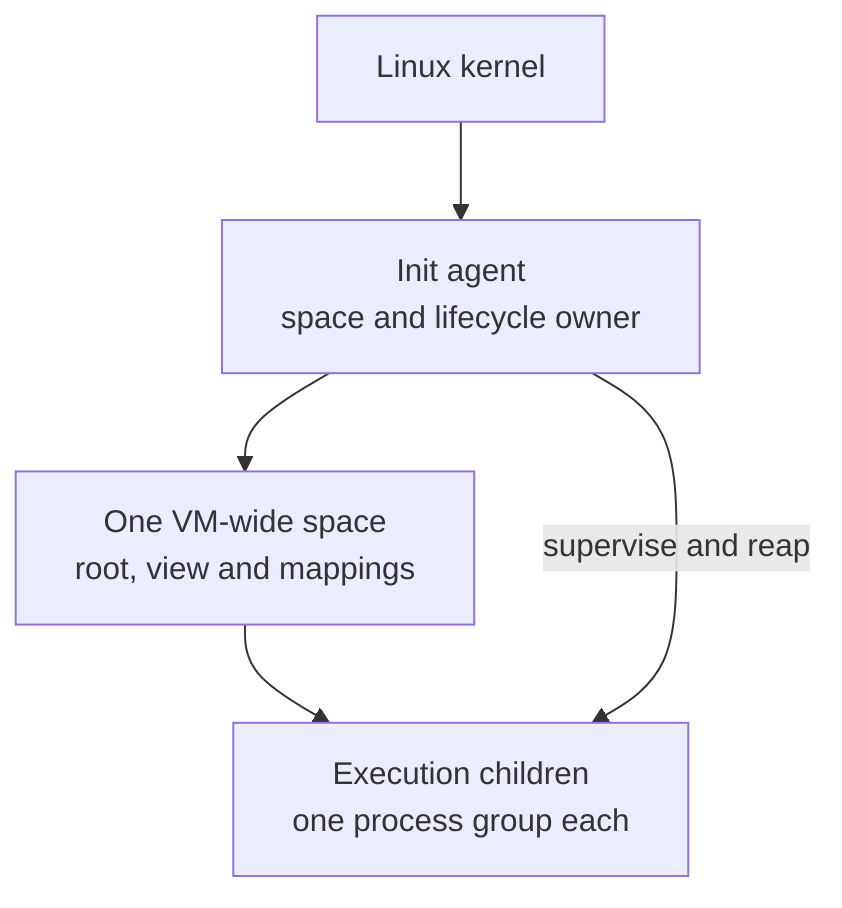

# 4.2 Guest Agents and Workload Model

[Architecture documentation](README.md) >
[4. Guest Runtime Architecture](4-guest-runtime-architecture.md)

The init agent is the guest's long-lived lifecycle authority. It owns the
VM-wide space, helpers, control session and executions. `nvx` supplies contract
parsers, capture and restore-activation mechanisms, but builds no space, runs
no executions and enforces none of the init's lifecycle obligations. The
explicit exception is `TimeAbi::start_daemon`, which forks the time daemon.

**Figure 4.2.** Relationship between the guest agents and the workload.

The workload remains a child; it does not replace the init, whose continued
existence supports supervision, orphan reaping and the control service.
`nvx-init` is the reference implementation, using one shared root and sequential
executions. An init with concurrent executions owns its own workspace
coordination; the library provides no workspace trait.

The detailed construction, execution, capture, transport and restore rules,
with checked excerpts of the reference implementation, live in the
[guest-agent guidelines](../guest-agent-guidelines.md).

## 4.2.1 Execution Launch

Execution launch belongs to the init, not the library's capture or activation
mechanisms. Children use the VM-wide space and the init's selected credentials
and working directory. There is no per-execution root entry or placement
barrier in this model.

## 4.2.2 Containment

The VM is the isolation and resource boundary. Process groups provide an
execution cleanup scope, not a namespace or cgroup containment guarantee.
The init owns termination, capture admission and cleanup; no library workspace
or per-execution enforcement layer supplies them.
