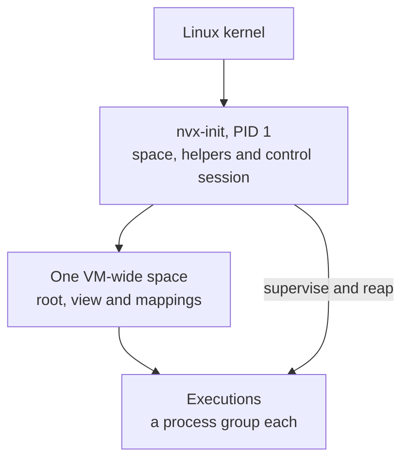

# 4.2 Guest Agents and Workload Model

[Architecture documentation](README.md) >
[4. Guest Runtime Architecture](4-guest-runtime-architecture.md)

The guest's init agent is its long-lived lifecycle authority: it owns the
guest's space, its helpers, its control session and its executions. `nvx`
parses the contracts, captures the guest and drives a restore's activation,
but builds no space, runs no executions and enforces none of the init's
obligations; the one exception is the time daemon, which
`TimeAbi::start_daemon` forks. The
[guest-agent guidelines](../guest-agent-guidelines.md) give the init's
contract, with nvx-init as the worked example.

A layered root's guest runs nvx-init, NVX's PID 1 for layered roots, which
runs its launches, and the restores of platform captures, in one VM-wide
space, as Figure 4.2 shows; it also serves the Fresh boot that a platform
capture takes, which has no root yet. The agent of the
[blockless managed root](4.1-guest-filesystem-and-image-model.md#413-blockless-managed-root)
is PID 1 in the guest's initramfs root, and runs its executions with
nvx-init's plain-process core.

**Figure 4.2.** nvx-init, its space and its executions.

The workload is always a child of a guest agent, which never replaces itself
with it: supervision, orphan reaping and the control service depend on the
agent remaining alive. In a one-shot lifecycle, the guest agents start one
workload, configured by non-secret kernel command-line tokens, and shut down
the VM when it exits. In a managed lifecycle, they run a sequence of
workloads, one at a time, on request over the authenticated control channel.
An init that runs concurrent executions coordinates them for a capture
itself: `nvx` provides no workspace.

## 4.2.1 Execution Launch

Launching an execution belongs to the init, not to the library's capture or
activation. nvx-init's executions, and those of the blockless managed root,
are plain processes of their agent: each child takes its credentials and
enters its working directory itself, in its agent's space, without a root of
its own or a placement barrier.
[Run the executions](../guest-agent-guidelines.md#run-the-executions) gives
nvx-init's steps.

## 4.2.2 Containment

For nvx-init and the blockless managed root, the VM is the isolation and
resource boundary. An execution's process group, which its end,
cancellation, timeout and reset kill, is a cleanup scope, not a namespace or
a cgroup: a process that leaves the group escapes it. The init owns
termination, capture admission and cleanup; no workspace or per-execution
enforcement of `nvx` supplies them.