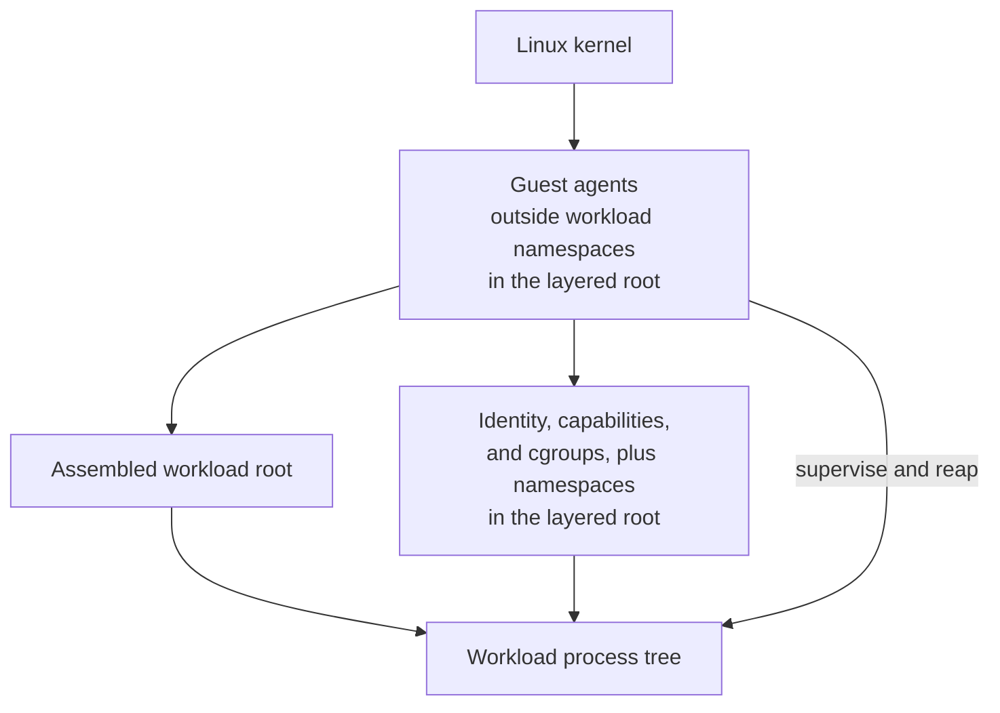

# 4.2 Guest Agents and Workload Model

[Architecture documentation](README.md) >
[4. Guest Runtime Architecture](4-guest-runtime-architecture.md)

As Figure 4.2 shows, the guest agents are the guest's long-lived lifecycle
authority. Their responsibilities are:

1. Initialize runtime filesystems and cgroup v2.
2. Discover and validate the fixed virtual devices.
3. Assemble the workload filesystem.
4. Apply workload identity, isolation, and resource policy.
5. Start the workload behind a placement barrier.
6. Supervise the workload and reap descendants.
7. Announce the guest's listeners when the host publishes them.
8. Participate in capture and post-restore repair.
9. Unmount resources and report the final workload status.

**Figure 4.2.** Relationship between the guest agents and the workload.

In a one-shot lifecycle, the guest agents start one workload, configured by
non-secret kernel command-line tokens, and shut down the VM when it exits. In
a managed lifecycle, the guest agents stay resident and run a sequence of
workloads, one at a time, on request over the authenticated control channel.
Both modes preserve the same separation: the workload is always a child of a
guest agent. The guest agents never replace themselves with the workload,
because supervision, orphan reaping, and the control service all depend on
them remaining alive.

## 4.2.1 Execution Launch

For each managed execution, the guest agent's launch enters the requested
working directory, or `/`, with the workload's identity, and sets `PWD` unless
the request replaces the environment. The working directory is entered once
and kept, so the workload starts in the directory that was checked even if its
path is renamed, replaced, or retargeted in the meantime. If the workload
cannot enter it, the execution fails rather than running elsewhere.

In the blockless managed root, the guest agent uses the init agent's
plain-process builder and driver. The builder prepares the environment, and
the child applies its identity, enters its working directory, and executes the
workload without a launch helper. In the layered sandbox root, the guest
agent's [execution entry](4.3-isolation-and-resource-model.md#432-namespaces-and-mounts)
applies the identity itself, and the guest agent builds the environment.

## 4.2.2 Containment

In the blockless managed root, each execution runs in a process group pinned
by the driver. When the workload's first process exits, the guest agent kills
the processes remaining in that group and, as the guest's init process, reaps
the orphans it inherits. It drains the workload's output before reporting the
outcome. A descendant that leaves the process group is not contained by this
plain-process execution and may keep an output pipe open after its leader
exits. A cancellation or timeout after the leader's status is known or lost
does not change that status while the output drains. This path has no execution
cgroup or workload namespace.

A cancellation that names the running execution kills the workload, and a
cancellation for an execution that already finished is ignored. A session
reset means that the host session that could observe the workload is gone:
the guest agent kills the workload, sends nothing more for it, and
acknowledges the new epoch, and drops the old output descriptors rather than
waiting for them to close, so the next session never waits for an abandoned
workload.

When the blockless agent ends a running workload for cancellation, timeout, or
the output cap, it collects the leader and drops the remaining output
descriptors rather than waiting for an escaped descendant to close them.
Cancellation and timeout first forward any available output up to the cap.
The layered sandbox continues to use its existing namespace and cgroup cleanup.
