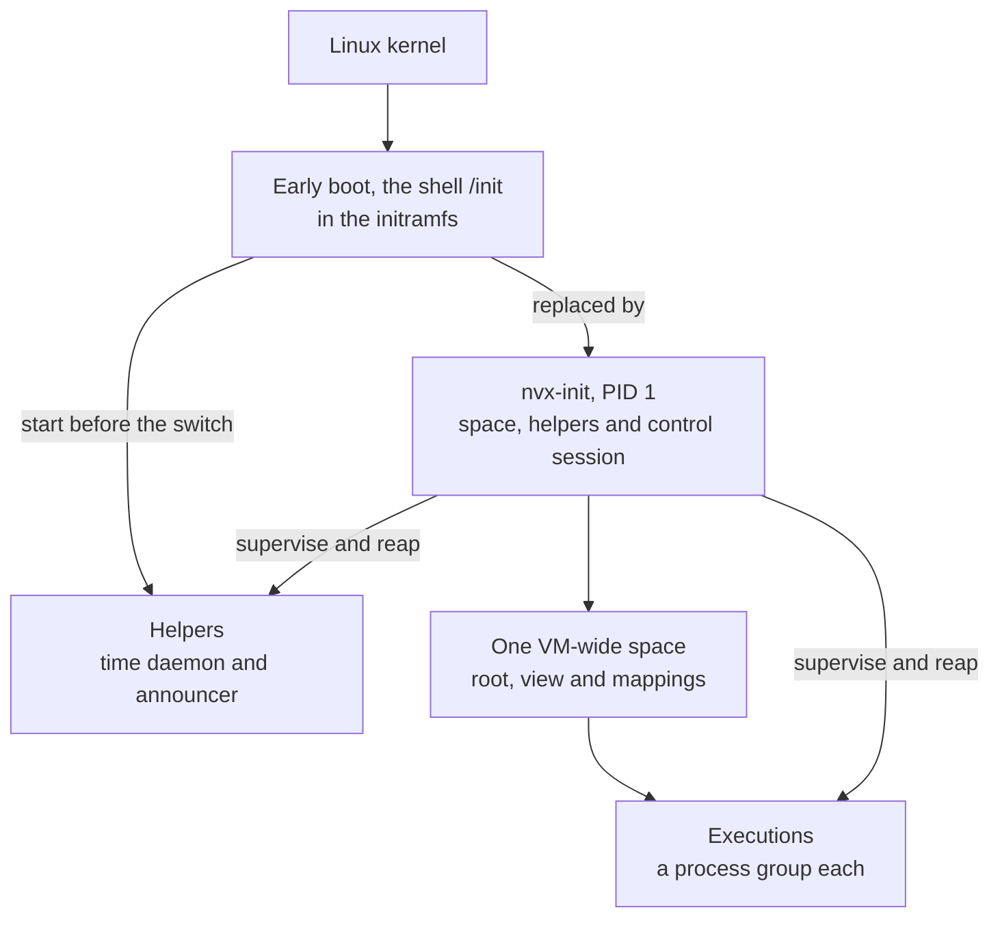

# 4.2 Guest Agents and Workload Model

[Architecture documentation](README.md) >
[4. Guest Runtime Architecture](4-guest-runtime-architecture.md)

The guest's init agent is its long-lived lifecycle authority: it owns the
guest's space, its helpers, its control session and its executions. `nvx`
parses the contracts, captures the guest and drives a restore's activation,
but builds no space, runs no executions and enforces none of the init's
obligations; the one exception is the time daemon, which
`TimeAbi::start_daemon` forks. The
[guest-agent guidelines](../guest-agent-guidelines.md) give the init's
contract, with nvx-init as the worked example.

A layered root's guest runs nvx-init, NVX's PID 1 for layered roots, which
runs its launches, and the restores of platform captures, in one VM-wide
space, as Figure 4.2 shows; it also serves the Fresh boot that a platform
capture takes, which has no root yet. That space, the root that nvx-init
assembles and what it mounts in it, is NVX's internal reference code that
nvx-init implements, not public `nvx` API. The agent of the
[blockless managed root](4.1-guest-filesystem-and-image-model.md#413-blockless-managed-root)
is PID 1 in the guest's initramfs root, and runs its executions with
nvx-init's plain-process core.

**Figure 4.2.** nvx-init, its helpers, its space and its executions.

The workload is always a child of a guest agent, which never replaces itself
with it: supervision, orphan reaping and the control service depend on the
agent remaining alive. A layered root is always managed: nvx-init runs a
sequence of executions, one at a time, on request over the authenticated
control channel. A blockless root takes the lifecycle that its boot names: in
the one-shot lifecycle, the guest's `/init` runs once the workload that
non-secret kernel command-line tokens name, and powers the VM off with its
status, as the [Boot Protocol](5.1-boot-protocol.md) describes; in the managed
lifecycle, the managed agent runs executions as nvx-init does. An init that
runs concurrent executions coordinates them for a capture itself: `nvx`
provides no workspace.

## 4.2.1 Execution Launch

Launching an execution belongs to the init, not to the library's capture or
activation. nvx-init's executions, and those of the blockless managed root,
are plain processes of their agent: each child leads a process group of its
own, resets its priority, takes the VM's workload credentials, and enters its
working directory itself, in its agent's space, without a root of its own or
a placement barrier, before it runs its program.
[Run the executions](../guest-agent-guidelines.md#run-the-executions) gives
nvx-init's steps.

## 4.2.2 Containment

For nvx-init and the blockless managed root, the VM is the isolation and
resource boundary. An execution's process group is a cleanup scope, not a
namespace or a cgroup: the agent kills the group when the execution's leader
ends, normally or not, when the host cancels the execution, when its timeout
passes, and when a reset of the control session abandons it, and a process
that leaves the group escapes it. The init owns termination, capture admission
and cleanup; no workspace or per-execution enforcement of `nvx` supplies them.

## 4.2.3 Helpers

nvx-init's helpers are the time daemon, which disciplines the guest's clock
and watches it, and the announcer, which tells the gateway the workload's
listeners when the network publishes them. Both start before nvx-init switches
into its root, and run from the initramfs, which holds their programs: the
early boot, the shell `/init`, starts the time daemon, and the announcer when
its network publishes the listeners, then replaces itself with nvx-init, which
takes them over as its children, and a restore whose record publishes the
listeners forks its announcer from PID 1 before its switch. nvx-init registers
exactly these helpers, runs them with its own priority, ahead of the
executions, as
[Priority and Resources](4.3-isolation-and-resource-model.md#433-priority-and-resources)
describes, and ends the VM when either ends, since the VM cannot go on without
them.