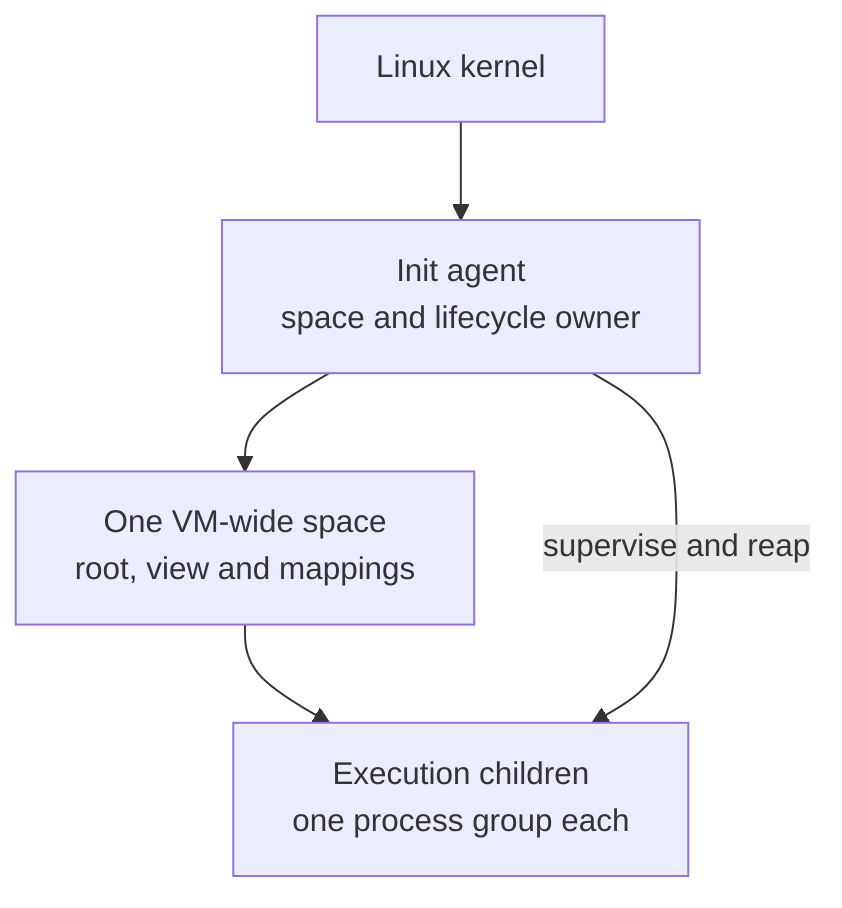

# 4.2 Guest Agents and Workload Model

[Architecture documentation](README.md) >
[4. Guest Runtime Architecture](4-guest-runtime-architecture.md)

The init agent is the guest's long-lived lifecycle authority. It owns the
VM-wide space, helpers, control session and executions. `nvx` supplies contract
parsers, capture and restore-activation mechanisms, but builds no space, runs
no executions and enforces none of the reference init's lifecycle obligations.
`TimeAbi::start_daemon` is the reference workflow's named daemon-fork exception,
not a global no-fork guarantee for every retained API. The
[guidelines](../guest-agent-guidelines.md#ownership) record the retained
announcer and report-only restore-finish compatibility paths.

The VM-wide reference model below is `nvx-init`'s. The retained
[layered sandbox root](4.1-guest-filesystem-and-image-model.md#411-layered-sandbox-root)
has private execution mount, PID and UTS namespaces and sibling guest-agent
and workload cgroups; the blockless managed root retains its plain-process
model. Those boot paths are separate from the reference space.

**Figure 4.2.** Init and workload ownership in nvx-init's VM-wide reference model.

The workload remains a child; it does not replace the init, whose continued
existence supports supervision, orphan reaping and the control service.
`nvx-init` is the reference implementation, using one shared root and sequential
executions. An init with concurrent executions owns its own workspace
coordination; the library provides no workspace trait.

The detailed construction, execution, capture, transport and restore rules,
with checked excerpts of the reference implementation, live in the
[guest-agent guidelines](../guest-agent-guidelines.md).

## 4.2.1 Execution Launch

In nvx-init's reference model, execution launch belongs to the init, not the
library's capture or activation mechanisms. Children use the VM-wide space and
the init's selected credentials and working directory. This reference model
has no per-execution root entry or placement barrier; the retained layered
sandbox root keeps its separate execution entry and placement boundary.

## 4.2.2 Containment

For nvx-init's reference model, the VM is the isolation and resource boundary.
Process groups provide an execution cleanup scope, not a namespace or cgroup
containment guarantee. The init owns termination, capture admission and cleanup;
no library workspace or per-execution enforcement layer supplies them. This
does not remove the retained layered sandbox root's namespace and cgroup
boundaries.
