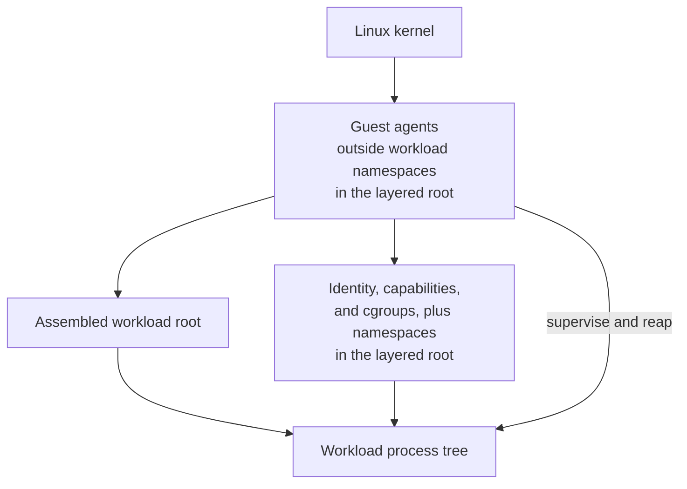

# 4.2 Guest Agents and Workload Model

[Architecture documentation](README.md) >
[4. Guest Runtime Architecture](4-guest-runtime-architecture.md)

As Figure 4.2 shows, the guest agents are the guest's long-lived lifecycle
authority. Their responsibilities are:

1. Initialize runtime filesystems and cgroup v2.
2. Discover and validate the fixed virtual devices.
3. Assemble the workload filesystem.
4. Apply workload identity, isolation, and resource policy.
5. Start the workload behind a placement barrier.
6. Supervise the workload and reap descendants.
7. Announce the guest's listeners when the host publishes them.
8. Participate in capture and post-restore repair.
9. Unmount resources and report the final workload status.

**Figure 4.2.** Relationship between the guest agents and the workload.

In a one-shot lifecycle, the guest agents start one workload, configured by
non-secret kernel command-line tokens, and shut down the VM when it exits. In
a managed lifecycle, the guest agents stay resident and run workloads on
request over the authenticated control channel, under the adapter's
concurrency policy. Both modes preserve the same separation: the workload is
always a child of a guest agent. The guest agents never replace themselves
with the workload, because supervision, orphan reaping, and the control
service all depend on them remaining alive.

## 4.2.1 Execution Launch

For each managed execution, the guest agents pass the execution's parameters
through a sealed anonymous file to a launch helper that runs only after the
workload identity has been applied. The helper enters the requested working
directory, or `/`, sets `PWD` unless the request replaces the environment,
applies the environment, and executes the workload. The working directory is
opened once and kept, so the workload starts in the directory that was
checked even if its path is renamed, replaced, or retargeted in the meantime.
If the workload cannot enter it, the execution fails rather than running
elsewhere.

## 4.2.2 Containment

In a managed root, each execution runs in its own cgroup: a dedicated
execution cgroup in the blockless managed root, and a child of the workload
cgroup in the
[managed layered root](4.1-guest-filesystem-and-image-model.md#414-managed-layered-root).
When the workload's first process exits, the guest agent kills every process
that remains in that cgroup and, as the guest's init process, reaps the
orphans it inherits. It reports the outcome only after the cgroup's process
count reaches zero.
The process controller charges a process until it is reaped, so no workload
process, not even a zombie, outlives its execution. A failed kill, an
unreadable count, or a settlement timeout is reported as a containment
failure, and every later execution first reaps what earlier workloads left and
verifies that the cgroup is empty, so a session reset cannot bypass the
check.

A cancellation that names an active execution kills its workload, and a
cancellation for an execution that already finished is ignored. A session
reset means that the host session that could observe the workloads is gone:
the guest agent kills them, sends nothing more for them, and acknowledges the
new epoch, so the next session never waits for an abandoned workload.
