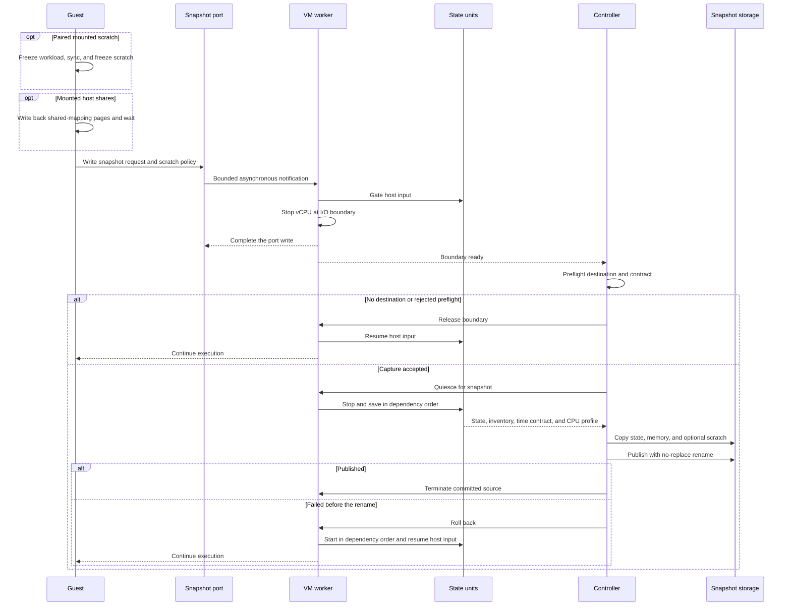
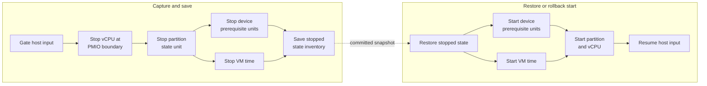

# 5.3 Snapshot Protocol

[Architecture documentation](README.md) >
[5. VM Lifecycle and State](5-vm-lifecycle-and-state.md)

A snapshot captures a virtual machine's configuration, processor, memory and device state into a set
of artifacts, from which one or more virtual machines can later be restored. A snapshot is
guest-initiated and it terminates the source virtual machine, if it succeeds. A snapshot is not a
host-side memory dump or a capture-and-continue operation.

## 5.3.1 Capture Configuration

A snapshot records the machine's launch configuration along with its state,
and a restore may change only the inputs that
[Restore-Time Configuration](2.1-machine-model-and-configuration.md#214-restore-time-configuration)
lists. This section describes the settings that configure a capture, the
launch settings that prevent one, and the launch choices that limit later
restores.

A capture requires up to two settings:

- **Destination directory.** Required for every capture. The snapshot
  artifacts are saved in this directory, which must not already exist.
- **Snapshot tier.** Required for a capture with sandbox blocks. The
  [snapshot tier](5.4-snapshot-artifact-and-attachment-model.md#544-tiers)
  names the configuration of the snapshot's blocks: whether their identities
  are bound, whether its scratch is fresh or paired, and whether its restores
  clone it or resume it once. A capture whose settings contradict it is
  rejected.

A capture also accepts four optional settings:

- **Block identity.** How a capture whose tier binds blocks identifies them:
  by default, by the SHA-256 digest of each file, or, at the storage owner's
  choice, by an immutable storage generation that the owner supplies; see
  [Snapshot Identity](5.4-snapshot-artifact-and-attachment-model.md#545-snapshot-identity).
- **Memory backing file.** The file that backs guest RAM. When none is
  supplied, the VMM creates one at launch in the parent of the destination
  directory and, where the filesystem allows, hard-links it into the
  snapshot. A supplied file is always copied; see
  [Artifact Layout and Publication](5.4-snapshot-artifact-and-attachment-model.md#541-artifact-layout-and-publication).
- **RAM capacity.** A total RAM size, at least the VM's RAM, that the snapshot
  reserves so that a restore can give the VM more memory. Without it, a
  restore cannot add memory; see
  [Memory Activation](5.5-restore-protocol.md#554-memory-activation).
- **Scratch restore mode.** How a restore recreates
  [paired scratch](5.5-restore-protocol.md#552-memory-and-scratch-materialization):
  a private copy; a copy-on-write clone, only for a `workload-start` snapshot;
  or the snapshot's own scratch file, only for an `instance-checkpoint`
  snapshot.

All of these settings are given when the virtual machine is created; see
[Control Frontends](5.2-readiness-and-runtime-control.md#521-control-frontends).

`nvx` captures one configuration, from the capture settings of a cold boot's
configuration: the platform tier, with a sparse placeholder image and a
dormant scratch, of the geometries that the caller names, attached to a
blockless boot without an export; the processor capacity and the processors
online at boot, and the RAM at boot and its capacity, which the caller names;
the `openvmm/` directory in the caller's VM directory as the destination; and
the VM's NIC, if it has one, under the complete deny-all policy, whatever the
VM's own. It names no block identity or scratch restore mode, which unbound
layers and fresh scratch do not use, and no memory backing file, so OpenVMM
creates the RAM backing in the VM directory and, where the filesystem allows,
links it into the snapshot. The capture's context, which `vm::create`
prepares, is the caller's to keep until it finishes the capture; see
[Finishing a Capture](#538-finishing-a-capture).

The parent of the destination directory must already exist, because the VMM
publishes the snapshot by creating a private staging directory there and
renaming it. That filesystem needs room for the VM's RAM and any paired
scratch. The snapshot contains guest memory, which can include secrets, so
access to the destination and any sharing of the snapshot are the
responsibilities of the caller and its deployment; see
[Images and Snapshot Artifacts](1.4-trust-boundaries.md#144-images-and-snapshot-artifacts).

The following launch settings prevent a capture:

- **Restore.** A restored virtual machine is never captured again.
- **Block layout.** A capture with blocks requires a read-only `distro` layer
  followed by writable scratch, so the RAM-backed overlay layout, which has
  no scratch, cannot be captured; see
  [Storage Configuration](2.1-machine-model-and-configuration.md#213-storage-configuration).
- **Live host listeners.** Published guest listeners and host forwards are
  live host attachments, which a snapshot cannot capture; see
  [Host Attachments](5.4-snapshot-artifact-and-attachment-model.md#547-host-attachments).

The following launch choices limit what restores of the snapshot can do:

- **Processors.** A restore can bring more processors online, up to the
  capacity, only if fewer were online at capture; see
  [Processor Activation](5.5-restore-protocol.md#553-processor-activation).
- **RAM.** A restore can add memory only up to a declared RAM capacity.
- **Host filesystem.** A restore can attach a new directory, or, to a platform
  snapshot, a new aggregate, only if the slot had no export at capture and the
  guest had not mounted it. Otherwise, every restore needs the same export;
  see
  [Dormant Slot and Saved-State Versions](3.6-host-filesystem.md#3610-dormant-slot-and-saved-state-versions).
- **Network.** A restore cannot add a network device, so a snapshot captured
  without one restores without one.
- **Command line.** The captured command line fixes the workload identity,
  lifecycle, and network addressing of every restore.

Other parts of a capture are described elsewhere:

- The guest requests the capture after its
  [preparation](#532-guest-preparation) succeeds.
- The workload must follow the
  [replay contract](5.4-snapshot-artifact-and-attachment-model.md#546-replay-contract).
- The guest's timers must satisfy the time contract in step 6 of the
  [capture transaction](#533-capture-transaction); otherwise, the capture
  fails and the guest continues.
- A processor must hold state that the saved state can represent; otherwise,
  step 7 of the capture transaction fails the capture and the guest continues.
  The KVM backend refuses a processor whose global interrupt flag is clear, and
  on an AMD host one whose flag KVM cannot report. It also refuses one that is
  in system management mode (SMM) or has a system management interrupt (SMI)
  pending.
- On KVM, no processor may hold an INIT or a SIPI that it has not accepted:
  one that another processor sent it after the VMM stopped it, which only a
  guest that resets or brings processors online during the capture can cause,
  or an INIT that SMM blocks, which the saved state cannot represent either.
  Step 5 of the capture transaction checks for one; otherwise, the capture
  fails and the guest continues.
- While the capture runs, the VMM rejects
  [management operations](5.2-readiness-and-runtime-control.md#523-management-exclusion)
  that could disturb it.
- A successful capture [terminates the source](#536-capture-outcomes).

## 5.3.2 Guest Preparation

Before they write the snapshot port, the guest agents:

1. Wait until the boot conformance checks have completed, then run the
   capture checks.
2. Save and suppress RCU stall detection, and the debug stall detectors.
3. For paired scratch, freeze the workload cgroup with a bounded wait,
   synchronize, and freeze the mounted scratch filesystem, or, for fresh
   scratch, require scratch to be unmounted.
4. Write back the pages that shared mappings dirtied on the mounted
   [host shares](3.6-host-filesystem.md), and wait for the writes.
5. Write the capture request, with its scratch policy, to the snapshot port.
   Just before the write, the time tools hold the wall clock at the declared
   TSC rate, with no phase slew in flight, under the byte channel's lock, which
   keeps the discipline's polls from changing the rate before the capture
   anchor, so that the kernel counts the restore's advance of the TSC by the
   downtime in its monotonic and boot-time clocks as the downtime itself; see
   [Downtime and Continuity](3.2-clock-and-time.md#328-downtime-and-continuity).

Step 4 keeps captured memory from holding file data that the host files lack,
which every restore would otherwise write back to the live host files. The
guest kernel writes such pages back on its own schedule: `sync` only starts
the writeback of a FUSE superblock, and `syncfs` writes a share back and waits
for the writes, but its pass skips an inode while too many FUSE requests are
in flight. Each pass of step 4 therefore counts the inodes on the writeback
lists of every share's backing device, which the guest agents read from
debugfs in a private mount namespace, and then runs `syncfs` on every share.
The passes end with the first that counts none, whose `syncfs` has also
waited for every write still in flight. When a share's write-back fails, when
three passes in a row count no fewer inodes than the pass before each, or
after 1,024 passes, the guest agents request no capture: they thaw their
barriers and release the stall-detector suppression, as for a rejected
capture.

The write-back covers only what was written before it, so nothing may write
to a shared mapping of a host share between step 4 and the capture. With
paired scratch, the frozen workload cgroup holds the workload. Otherwise, the
process that requests the capture must hold every other process that writes
to such a mapping, as the
[replay contract](5.4-snapshot-artifact-and-attachment-model.md#546-replay-contract)
requires; a page that such a process dirties after step 4 stays dirty in
captured memory.

A committed capture terminates the source, so the write returns in the source
only when the capture had no destination or failed before its commit point.
The guest agents tell the cases apart by the restore-packet status bit, which
is clear in a resumed source and set in a restored process. In a resumed
source, the time tools hold the host's clock correction again before the
request returns, and the guest agents remove their barriers and restore the
detector settings, and a failure to do so, or to hold the correction, powers
off the guest. A rejected capture likewise thaws every guest-owned barrier and
then releases the stall-detector suppression.

An init that captures through `nvx` calls `guest::snapshot::capture`, which
takes steps 1, 2, and 5 for the platform tier's fresh scratch, once it has
found nothing mounted from the `distro`, scratch, and host filesystem devices:
scratch is unmounted, as step 3 requires, and no host share has pages to write
back. One deadline of its caller's bounds every step before the request, whose
own wait has none while OpenVMM saves the VM. It never inspects or freezes the
init's executions, which the init keeps still itself: nvx-init refuses a
capture while an execution runs, or, when the host asks, kills the
executions' process groups and sweeps the guest's other processes. Nor does
`capture` power the VM off: it returns whether the guest continues or was
restored, once its repair completed, or a failure whose disposition says
whether the guest resumed or must end, with the status with which the init
then powers it off. NVX's guest snapshot tool, `nvx-snapshot`, takes all five
steps for the other captures of NVX's guests, a paired capture's freeze
included.

## 5.3.3 Capture Transaction

Figure 5.2 shows the capture transaction from the guest's request to
publication.

**Figure 5.2.** Capture transaction.

The VMM performs the capture as one transaction:

1. Gate host input and defer completion of the snapshot-port write.
2. Stop the virtual processor at the I/O boundary while completing the write,
   so saved state starts at the instruction immediately after the output.
3. Preflight the machine profile, destination, backend, external attachments,
   and snapshot eligibility; a missing destination or a rejected preflight
   releases the boundary and lets the guest continue. Otherwise, deliver the
   console output that the guest wrote before its request; output accepted
   while no endpoint is connected stays in the snapshot, and the restored VM
   writes it.
4. Quiesce the remaining device workers and VM time in dependency order,
   including the block queue drain.
5. Check that no processor holds an INIT or a SIPI that it has not accepted.
   Another processor can send one to a processor that the VMM has already
   stopped, and on KVM a save would accept it between reading the processor's
   registers and the rest of its state, saving the registers from before the
   event and the rest from after it. A processor can also hold an INIT that
   SMM blocks, which, like one behind a clear GIF (step 7), the saved state
   cannot represent. The capture fails instead, and the guest continues.
6. Establish the time contract: require that no LAPIC timer is periodic or in
   TSC-deadline mode and that PIT channel 0 is not counting periodically, take
   the capture anchor and host identities, and record the declared rates, CPU
   profile, effective CPUID, and generation counter.
7. Save the exact state-unit inventory, processor state, device-private state,
   and memory, and derive `Q` from the saved VM-time state.
8. Copy and flush state, memory, and any paired scratch into a unique sibling
   staging directory.
9. Publish the directory with one no-replace rename.
10. Terminate the source worker and process after publication.

A failure in steps 5 through 9, before the rename, rolls the capture back:
the VMM starts the stopped state units again in dependency order, resumes host
input, and releases the boundary, so the guest continues. The source
terminates instead when a unit does not start again, or when the VMM cannot
remove the staging directory's manifest, without which a restore cannot open
the directory, or its alias of guest RAM. Deriving `Q` never fails a
capture; when it cannot be derived, it is omitted with a warning.

Step 7 fails for a processor whose state the saved state cannot represent. The
KVM backend refuses one whose global interrupt flag (GIF) is clear, which `CLGI`
clears and `STGI` sets. The saved state has no GIF, so the restored processor
would run with it set: the interrupts and NMIs that the guest held off would
arrive at once, and an INIT that KVM held latched behind the clear flag would
be lost. Only a guest with SVM can clear GIF, and the microVM offers none, but
a KVM that uses virtual GIF (vGIF) and predates Linux 7.1 runs the `CLGI` of a
guest without SVM instead of raising #UD. On such an AMD host, a guest that
has cleared GIF fails each capture that it requests until it sets the flag
again; the capture rolls back, and the guest continues. An AMD host also
refuses a processor whose GIF KVM cannot report, as a kernel without
`KVM_GET_NESTED_STATE` cannot, since the capture cannot tell whether it would
lose the flag. Intel hosts have no GIF, so they refuse nothing here, and an AMD
host whose KVM reports it refuses a capture only while a guest has cleared it,
which a guest without SVM cannot do where KVM does not use vGIF or has Linux
7.1's fix.

The KVM backend also refuses a processor that is in system management mode
(SMM) or has a system management interrupt (SMI) pending. A guest causes either
by sending an interrupt with the SMI delivery mode: an inter-processor
interrupt, an I/O APIC entry, or a device's MSI. KVM holds an SMI that reaches a
stopped processor until the processor next runs, so a capture can meet one while
no processor is in SMM. The saved state holds neither, so the restored
processor would start outside SMM with no SMI pending: it would lose the SMI, or
run the registers of an SMM handler as ordinary code and never return to the
code that the SMI interrupted. The capture rolls back, and the guest continues
and takes the SMI as it would have without the capture.

OpenVMM maps guest RAM only in KVM's normal address space, and none in its SMM
address space. With RAM mapped that way, KVM could not save the state that an
SMI interrupts when a processor took the SMI: on Linux 6.18.57, `KVM_RUN` failed
with `EIO`, and so did the next `KVM_GET_VCPU_EVENTS`, which is how KVM marks a
VM dead. A guest that sends an SMI therefore ends its own VM, and the refusal
keeps a capture from restoring a VM that would have ended. A change that maps
memory for SMM would change that, and this paragraph with it. A guest that sends
no SMI never meets any of this.

Step 7 saves each processor's interrupt shadow, and its kind when the shadow
is an `STI` shadow. A guest leaves a shadow that lasts one instruction with an
`STI` that finds the interrupt flag clear, or with a `MOV SS` or `POP SS`, and
the kinds differ at the next instruction boundary: a `MOV SS` shadow also blocks
NMIs and suppresses certain debug exceptions there, and an `STI` shadow does
not. A restore sets a shadow that has no kind as a `MOV SS` shadow, as every
KVM restore did before captures held the kind, and a restore of no shadow sets
none. The `MOV SS` shadow errs on the safe side: an `STI` shadow that restores
as a `MOV SS` shadow holds an NMI off for one more instruction and makes an
Intel CPU skip an instruction breakpoint at that instruction, while the reverse
would let an NMI or a debug exception split the `MOV SS` from the instruction
that follows it. So a capture names a kind only for an `STI` shadow, which KVM
on an Intel host reports, and its restore sets an `STI` shadow. A capture records
no kind for a `MOV SS` shadow, nor for a shadow of KVM on an AMD host, whose CPU
has one kind of shadow, or of MSHV and WHP, whose interrupt state has one bit
for both. Each such shadow restores as it always did, and a processor reads back
the activity that its restore was given.
[Processor State Elements](1.5-compatibility-and-versioning-model.md#154-processor-state-elements)
says what a snapshot and an earlier VMM make of the kind.

The transaction has no deadline of its own. Gating host input in step 1 and
the quiesce in step 4 wait for every device, and delivering the console output
in step 3 waits for its endpoint to read it. A device that never finishes, or
an endpoint that stops reading, stalls the capture, with nothing published and
the source never resumed, until the caller that launched the VMM ends it; the
VMM logs each state unit that has not answered after five seconds, so that the
log of such a capture names it. A device whose worker has ended fails the
quiesce instead, and the source terminates with nothing published, since that
device can never start again. Every caller therefore bounds a capture with a
deadline that ends the VMM: `nvx` sets none.

## 5.3.4 State-Unit Ordering

As Figure 5.3 shows, state-unit transitions follow registered dependencies
rather than one global serial list. The partition depends on the device
prerequisite units and on VM time. Save quiesce stops units in reverse
dependency order, and restore and rollback start them in dependency order.
Device prerequisites and VM time may transition in parallel.

**Figure 5.3.** State-unit ordering during capture, restore, and rollback.

A unit's dependents start only once it has confirmed that its start
succeeded, so the partition, and with it every vCPU, starts only after every
device prerequisite unit has started. A device that fails to start therefore
fails the whole start before the partition starts: its dependents never
start, and the units that did start, the device among them, stop again.

## 5.3.5 Commit Point

The directory rename is the commit point. Before it, a capture failure exposes
no final snapshot, and the guest resumes only once the VMM has started the
stopped state units again. After it, the source never resumes. This gives the
guest an observable boundary: code after the snapshot request runs once in
each restored process and never in the successfully captured source. A capture
driven through the management RPC likewise halts the source at the committed
boundary and terminates its process, so clients observe the transport closing.

Establishing the boundary is itself fallible. If a device fails to gate its
host input, the worker rolls the gate back and releases the write so that the
guest continues; if that rollback fails, the worker terminates. Once
processor stopping has begun, a boundary failure is terminal: host input stays
gated, and the VM is torn down rather than resumed. The post-restore
acknowledgement boundary follows the same rule.

## 5.3.6 Capture Outcomes

As Table 5.3 shows, a published snapshot never coexists with a running source.

**Table 5.3.** Capture outcomes.

| Outcome | Source | Snapshot |
| --- | --- | --- |
| Committed capture | Terminated | Published |
| Missing destination, rejected preflight, or failed input gate | Continues | None |
| Failure after the quiesce, before the commit point, that rolls back | Continues | None |
| Failure before the commit point that cannot roll back | Terminated | None |
| Input gate, console delivery, or quiesce that never completes | Ended by its caller | None |

After a commit, execution continues only in virtual machines restored from the
snapshot, either as clones or as one resumed instance; see
[Snapshot Tiers](5.4-snapshot-artifact-and-attachment-model.md#544-tiers). A
snapshot of `nvx` restores only as clones.

## 5.3.7 Guest and Host Barriers

Guest and host barriers have separate jobs. The workload cgroup of a paired
capture is frozen in captured guest state, while an init that captures
through `nvx` keeps its executions still itself; the VMM gates external input;
and a guest agent with worker threads must park them at a capture-safe point.
None of these substitutes for the others. Device workers and the guest kernel
must run during a gated restore so that processors and memory can be
repaired, so the gate does not imply that interrupts stay disabled. After
repair, the guest agents acknowledge the VMM gate before thawing scratch and
then the workload.

## 5.3.8 Finishing a Capture

A published OpenVMM snapshot is not yet a snapshot of `nvx`. Once the caller
holds the proof that the capture's VM exited, `finish_capture` requires the
VM's outcome report to record a successful capture, checks OpenVMM's snapshot
strictly against the context with which `vm::create` prepared the capture,
derives the snapshot's key, and writes the key, `key.bin`, and an
informational description, `snapshot.json`, beside `openvmm/` in the VM
directory. The caller then moves those three entries into a private directory
of its own, the strict snapshot directory that
[Artifact Layout and Publication](5.4-snapshot-artifact-and-attachment-model.md#541-artifact-layout-and-publication)
describes, which it names, keeps immutable, and removes; the log, the outcome
report, and the VM's other files stay in the VM directory. A failure may leave
either file written, but moves nothing, so the caller can correct it and
finish again while the VM directory and the context are intact. NVX's
command-line interface stages the entries in a private directory and
publishes them under the snapshot's name with one non-replacing rename.
