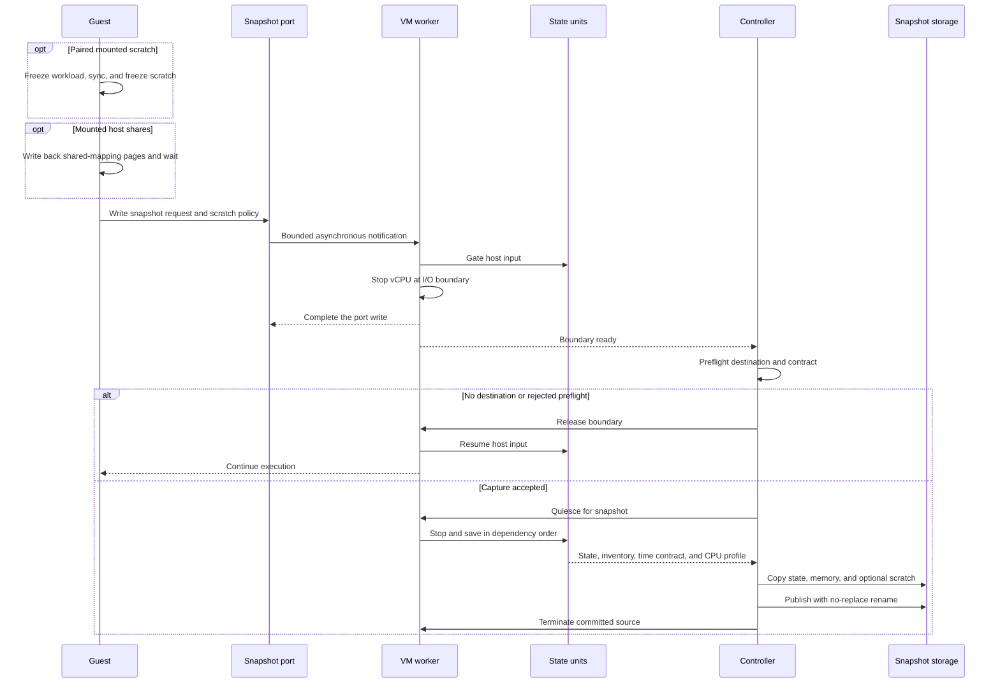
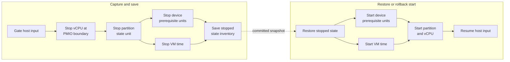

# 5.3 Snapshot Protocol

[Architecture documentation](README.md) >
[5. VM Lifecycle and State](5-vm-lifecycle-and-state.md)

A snapshot captures a virtual machine's configuration, processor, memory and device state into a set
of artifacts, from which one or more virtual machines can later be restored. A snapshot is
guest-initiated and it terminates the source virtual machine, if it succeeds. A snapshot is not a
host-side memory dump or a capture-and-continue operation.

## 5.3.1 Capture Configuration

A snapshot records the machine's launch configuration along with its state,
and a restore may change only the inputs that
[Restore-Time Configuration](2.1-machine-model-and-configuration.md#214-restore-time-configuration)
lists. This section describes the settings that configure a capture, the
launch settings that prevent one, and the launch choices that limit later
restores.

A capture requires up to three settings:

- **Destination directory.** Required for every capture. The snapshot
  artifacts are saved in this directory, which must not already exist.
- **Snapshot tier.** Required for a capture with sandbox blocks. The
  [snapshot tier](5.4-snapshot-artifact-and-attachment-model.md#544-tiers)
  identifies the point in the sandbox's lifecycle at which the snapshot is
  taken, from a platform snapshot that the whole fleet can clone to a
  single-use checkpoint of one instance. It determines whether the snapshot is
  cloned or resumed and whether it includes the scratch disk, and a capture
  whose settings contradict it is rejected.
- **Storage generation.** Required for a capture whose snapshot tier binds
  blocks. The storage owner supplies it to identify the exact block files, and
  a restore must supply the same one; see
  [Snapshot Identity](5.4-snapshot-artifact-and-attachment-model.md#545-snapshot-identity).

A capture also accepts four optional settings:

- **Memory backing file.** The file that backs guest RAM. When none is
  supplied, the VMM creates one at launch in the parent of the destination
  directory and, where the filesystem allows, hard-links it into the
  snapshot. A supplied file is always copied; see
  [Artifact Layout and Publication](5.4-snapshot-artifact-and-attachment-model.md#541-artifact-layout-and-publication).
- **RAM capacity.** A total RAM size, at least the VM's RAM, that the snapshot
  reserves so that a restore can give the VM more memory. Without it, a
  restore cannot add memory; see
  [Memory Activation](5.5-restore-protocol.md#554-memory-activation).
- **Quiesce timeout.** The longest the VMM may spend quiescing the VM,
  including draining block I/O.
- **Scratch restore mode.** How a restore recreates
  [paired scratch](5.5-restore-protocol.md#552-memory-and-scratch-materialization):
  a private copy; a copy-on-write clone, only for a `workload-start` snapshot;
  or the snapshot's own scratch file, only for an `instance-checkpoint`
  snapshot.

All of these settings are given when the virtual machine is created; see
[Control Frontends](5.2-readiness-and-runtime-control.md#521-control-frontends).

The parent of the destination directory must already exist, because the VMM
publishes the snapshot by creating a private staging directory there and
renaming it. That filesystem needs room for the VM's RAM and any paired
scratch. The snapshot contains guest memory, which can include secrets, so
access to the destination and any sharing of the snapshot are deployment
responsibilities; see
[Images and Snapshot Artifacts](1.4-trust-boundaries.md#144-images-and-snapshot-artifacts).

The following launch settings prevent a capture:

- **Restore.** A restored virtual machine is never captured again.
- **Block layout.** A capture with blocks requires a read-only `distro` layer
  followed by writable scratch, so the RAM-backed overlay layout, which has
  no scratch, cannot be captured; see
  [Storage Configuration](2.1-machine-model-and-configuration.md#213-storage-configuration).
- **Live host listeners.** Published guest listeners and host forwards are
  live host attachments, which a snapshot cannot capture; see
  [Host Attachments](5.4-snapshot-artifact-and-attachment-model.md#547-host-attachments).

The following launch choices limit what restores of the snapshot can do:

- **Processors.** A restore can bring more processors online, up to the
  capacity, only if fewer were online at capture; see
  [Processor Activation](5.5-restore-protocol.md#553-processor-activation).
- **RAM.** A restore can add memory only up to a declared RAM capacity.
- **Host filesystem.** A restore can attach a new directory only if the slot
  had no export at capture and the guest had not mounted it. Otherwise, every
  restore needs the same export; see
  [Dormant Slot and Saved-State Versions](3.6-host-filesystem.md#3610-dormant-slot-and-saved-state-versions).
- **Network.** A restore cannot add a network device, so a snapshot captured
  without one restores without one.
- **Command line.** The captured command line fixes the workload identity,
  lifecycle, and network addressing of every restore.

Other parts of a capture are described elsewhere:

- The guest requests the capture after its
  [preparation](#532-guest-preparation) succeeds.
- The workload must follow the
  [replay contract](5.4-snapshot-artifact-and-attachment-model.md#546-replay-contract).
- The guest's timers must satisfy the time contract in step 5 of the
  [capture transaction](#533-capture-transaction); otherwise, the capture
  fails and the guest continues.
- While the capture runs, the VMM rejects
  [management operations](5.2-readiness-and-runtime-control.md#523-management-exclusion)
  that could disturb it.
- A successful capture [terminates the source](#536-capture-outcomes).

## 5.3.2 Guest Preparation

Before they write the snapshot port, the guest agents:

1. Wait until the boot conformance checks have completed, then run the
   capture checks.
2. Save and suppress RCU stall detection, and the debug stall detectors.
3. For paired scratch, freeze the workload cgroup with a bounded wait,
   synchronize, and freeze the mounted scratch filesystem, or, for fresh
   scratch, require scratch to be unmounted.
4. Write back the pages that shared mappings dirtied on the mounted
   [host shares](3.6-host-filesystem.md), and wait for the writes.
5. Write the capture request, with its scratch policy, to the snapshot port.

Step 4 keeps captured memory from holding file data that the host files lack,
which every restore would otherwise write back to the live host files. The
guest kernel writes such pages back on its own schedule: `sync` only starts
the writeback of a FUSE superblock, and `syncfs` writes a share back and waits
for the writes, but its pass skips an inode while too many FUSE requests are
in flight. Each pass of step 4 therefore counts the inodes on the writeback
lists of every share's backing device, which the guest agents read from
debugfs in a private mount namespace, and then runs `syncfs` on every share.
The passes end with the first that counts none, whose `syncfs` has also
waited for every write still in flight. When a share's write-back fails, when
three passes in a row count no fewer inodes than the pass before each, or
after 1,024 passes, the guest agents request no capture: they thaw their
barriers and release the stall-detector suppression, as for a rejected
capture.

The write-back covers only what was written before it, so nothing may write
to a shared mapping of a host share between step 4 and the capture. With
paired scratch, the frozen workload cgroup holds the workload. Otherwise, the
process that requests the capture must hold every other process that writes
to such a mapping, as the
[replay contract](5.4-snapshot-artifact-and-attachment-model.md#546-replay-contract)
requires; a page that such a process dirties after step 4 stays dirty in
captured memory.

A committed capture terminates the source, so the write returns in the source
only when the capture had no destination or failed before its commit point.
The guest agents tell the cases apart by the restore-packet status bit, which
is clear in a resumed source and set in a restored process. In a resumed
source, they remove their barriers and restore the detector settings, and a
failure to do so powers off the guest. A rejected capture likewise thaws every
guest-owned barrier and then releases the stall-detector suppression.

## 5.3.3 Capture Transaction

Figure 5.2 shows the capture transaction from the guest's request to
publication.

**Figure 5.2.** Capture transaction.

The VMM performs the capture as one bounded transaction:

1. Gate host input and defer completion of the snapshot-port write.
2. Stop the virtual processor at the I/O boundary while completing the write,
   so saved state starts at the instruction immediately after the output.
3. Preflight the machine profile, destination, backend, external attachments,
   and snapshot eligibility; a missing destination or a rejected preflight
   releases the boundary and lets the guest continue.
4. Quiesce the remaining device workers and VM time in dependency order,
   including the bounded block queue drain.
5. Establish the time contract: require that no LAPIC timer is periodic or in
   TSC-deadline mode and that PIT channel 0 is not counting periodically, take
   the capture anchor and host identities, and record the declared rates, CPU
   profile, effective CPUID, and generation counter.
6. Save the exact state-unit inventory, processor state, device-private state,
   and memory, and derive `Q` from the saved VM-time state.
7. Copy and flush state, memory, and any paired scratch into a unique sibling
   staging directory.
8. Publish the directory with one no-replace rename.
9. Terminate the source worker and process after publication.

A failure in step 5 is a rollback-safe capture failure. Deriving `Q` never
fails a capture; when it cannot be derived, it is omitted with a warning.

## 5.3.4 State-Unit Ordering

As Figure 5.3 shows, state-unit transitions follow registered dependencies
rather than one global serial list. The partition depends on the device
prerequisite units and on VM time. Save quiesce stops units in reverse
dependency order, and restore and rollback start them in dependency order.
Device prerequisites and VM time may transition in parallel.

**Figure 5.3.** State-unit ordering during capture, restore, and rollback.

## 5.3.5 Commit Point

The directory rename is the commit point. Before it, a capture failure exposes
no final snapshot, and the guest resumes only when rollback is known to be
valid. After it, the source never resumes. This gives the guest an observable
boundary: code after the snapshot request runs once in each restored process
and never in the successfully captured source. A capture driven through the
management RPC likewise halts the source at the committed boundary and
terminates its process, so clients observe the transport closing.

Establishing the boundary is itself fallible. If host input cannot be gated,
the worker rolls the gate back and releases the write so that the guest
continues; if that rollback is uncertain, the worker terminates. Once
processor stopping has begun, a boundary failure is terminal: host input stays
gated, and the VM is torn down rather than resumed. The post-restore
acknowledgement boundary follows the same rule.

## 5.3.6 Capture Outcomes

As Table 5.3 shows, a published snapshot never coexists with a running source.

**Table 5.3.** Capture outcomes.

| Outcome | Source | Snapshot |
| --- | --- | --- |
| Committed capture | Terminated | Published |
| Missing destination or rejected preflight | Continues | None |
| Failure before the commit point, with rollback known to be valid | Continues | None |
| Failure before the commit point, with rollback not known to be valid | Terminated | None |

After a commit, execution continues only in virtual machines restored from the
snapshot, either as clones or as one resumed instance; see
[Snapshot Tiers](5.4-snapshot-artifact-and-attachment-model.md#544-tiers).

## 5.3.7 Guest and Host Barriers

Guest and host barriers have separate jobs. The workload cgroup is frozen in
captured guest state, the VMM gates external input, and a guest agent with
worker threads must park them at a capture-safe point. None of these
substitutes for the others. Device workers and the guest kernel must run
during a gated restore so that processors and memory can be repaired, so the
gate does not imply that interrupts stay disabled. After repair, the guest
agents acknowledge the VMM gate before thawing scratch and then the workload.
