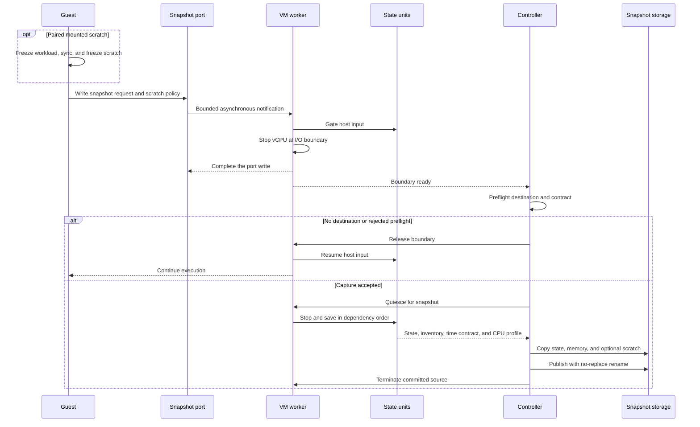
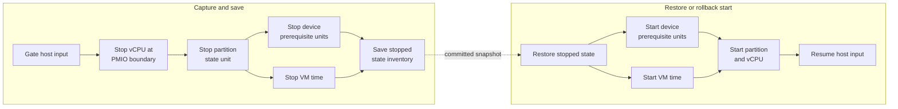

# 5.3 Snapshot Protocol

[Architecture documentation](README.md) >
[5. VM Lifecycle and State](5-vm-lifecycle-and-state.md)

Snapshot is guest-requested and stops the source generation. It is not a
host-side memory dump or a capture-and-continue operation.

## 5.3.1 Capture Configuration

The snapshot destination is configured at launch or through the management
RPC and must not already exist. When no memory backing file was supplied, the
VMM creates file-backed RAM beside the destination, so memory can be published
without copying. A capture with sandbox blocks requires a tier, and
inconsistent tier, clone or resume, and fresh or paired scratch combinations
are rejected. A capture that binds blocks requires the storage generation that
identifies them; see
[Snapshot Identity](5.4-snapshot-artifact-and-attachment-model.md#545-snapshot-identity).

## 5.3.2 Guest Preparation

Before they write the snapshot port, the guest agents:

1. Wait until the boot conformance checks have completed, then run the
   capture checks.
2. Save and suppress RCU stall detection, and the debug stall detectors.
3. For paired scratch, freeze the workload cgroup with a bounded wait,
   synchronize, and freeze the mounted scratch filesystem, or, for fresh
   scratch, require scratch to be unmounted. A `platform` capture, including
   one in the RAM-backed overlay layout, which has no scratch, also requires
   that neither the `distro` image nor the overlay is mounted.
4. Write the capture request, with its scratch policy, to the snapshot port.

A committed capture terminates the source, so the write returns in the source
only when the capture had no destination or failed before its commit point.
The guest agents tell the cases apart by the restore-packet status bit, which
is clear in a resumed source and set in a restored process. In a resumed
source, they remove their barriers and restore the detector settings, and a
failure to do so powers off the guest. A rejected capture likewise thaws every
guest-owned barrier and then releases the stall-detector suppression.

## 5.3.3 Capture Transaction

Figure 5.2 shows the capture transaction from the guest's request to
publication.

**Figure 5.2.** Capture transaction.

The VMM performs the capture as one bounded transaction:

1. Gate host input and defer completion of the snapshot-port write.
2. Stop the virtual processor at the I/O boundary while completing the write,
   so saved state starts at the instruction immediately after the output.
3. Preflight the machine profile, destination, backend, external attachments,
   and snapshot eligibility; a missing destination or a rejected preflight
   releases the boundary and lets the guest continue.
4. Quiesce the remaining device workers and VM time in dependency order,
   including the bounded block queue drain.
5. Establish the time contract: require that no LAPIC timer is periodic or in
   TSC-deadline mode and that PIT channel 0 is not counting periodically, take
   the capture anchor and host identities, and record the declared rates, CPU
   profile, effective CPUID, and generation counter.
6. Save the exact state-unit inventory, processor state, device-private state,
   and memory, and derive `Q` from the saved VM-time state.
7. Copy and flush state, memory, and any paired scratch into a unique sibling
   staging directory.
8. Publish the directory with one no-replace rename.
9. Terminate the source worker and process after publication.

A failure in step 5 is a rollback-safe capture failure. Deriving `Q` never
fails a capture; when it cannot be derived, it is omitted with a warning.

## 5.3.4 State-Unit Ordering

As Figure 5.3 shows, state-unit transitions follow registered dependencies
rather than one global serial list. The partition depends on the device
prerequisite units and on VM time. Save quiesce stops units in reverse
dependency order, and restore and rollback start them in dependency order.
Device prerequisites and VM time may transition in parallel.

**Figure 5.3.** State-unit ordering during capture, restore, and rollback.

## 5.3.5 Commit Point

The directory rename is the commit point. Before it, a capture failure exposes
no final snapshot, and the guest resumes only when rollback is known to be
valid. After it, the source never resumes. This gives the guest an observable
boundary: code after the snapshot request runs once in each restored process
and never in the successfully captured source. A capture driven through the
management RPC likewise halts the source at the committed boundary and
terminates its process, so clients observe the transport closing.

Establishing the boundary is itself fallible. If host input cannot be gated,
the worker rolls the gate back and releases the write so that the guest
continues; if that rollback is uncertain, the worker terminates. Once
processor stopping has begun, a boundary failure is terminal: host input stays
gated, and the VM is torn down rather than resumed. The post-restore
acknowledgement boundary follows the same rule.

## 5.3.6 Guest and Host Barriers

Guest and host barriers have separate jobs. The workload cgroup is frozen in
captured guest state, the VMM gates external input, and a guest agent with
worker threads must park them at a capture-safe point. None of these
substitutes for the others. Device workers and the guest kernel must run
during a gated restore so that processors and memory can be repaired, so the
gate does not imply that interrupts stay disabled. After repair, the guest
agents acknowledge the VMM gate before thawing scratch and then the workload.
