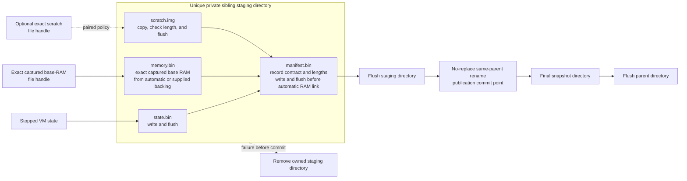

# 5.4 Snapshot Artifact and Attachment Model

[Architecture documentation](README.md) >
[5. VM Lifecycle and State](5-vm-lifecycle-and-state.md)

## 5.4.1 Artifact Layout and Publication

Figure 5.4 shows the files of a snapshot that OpenVMM publishes, and the strict
snapshot directory in which `nvx` keeps OpenVMM's platform snapshot, and
Figure 5.5 shows how OpenVMM publishes its files.

```text
OpenVMM's snapshot             The strict snapshot directory of nvx
snapshot/                      <name>/
|-- manifest.bin               |-- key.bin        # the snapshot key
|-- state.bin                  |-- snapshot.json  # never read
|-- memory.bin                 `-- openvmm/
`-- scratch.img  # paired          |-- manifest.bin
                                   |-- memory.bin
                                   `-- state.bin
```

**Figure 5.4.** Snapshot directory layouts.



**Figure 5.5.** Snapshot publication.

Publication writes and flushes every artifact into a unique private sibling
staging directory with restrictive permissions, flushes that directory,
commits it with one no-replace rename in the same parent, and then flushes the
parent. A failure before the commit removes the staging directory, and a
pre-existing destination is never deleted or replaced.

VMM-created RAM backing is published without copying. Once its shared
mappings, the state, and the manifest are durable, the exact open backing file
is hard-linked into the staging directory, and the link is reopened and
checked against the source's file identity and length. Where the filesystem
cannot link the handle, and for caller-supplied backing, publication copies
the memory instead, cloning extents where the filesystem supports it. After
an automatic RAM link commits, the source VM is terminal. A failure after the
staging link is created is rollback-safe only after the private staging
directory has been removed and its parent flushed; otherwise, the VMM
terminates the source rather than resume it with a writable alias of the
artifact.

The strict snapshot directory of `nvx` wraps OpenVMM's platform snapshot in an
envelope of two files: the snapshot's key, `key.bin`, which `nvx` writes when
it finishes the capture and checks against the manifest whenever it opens the
snapshot (see
[Snapshot Compatibility](1.5-compatibility-and-versioning-model.md#152-snapshot-compatibility)),
and an informational description, `snapshot.json`, which must exist but whose
contents `nvx` never reads, parses, or trusts. The directory holds exactly
these three entries, and `openvmm/` exactly OpenVMM's `manifest.bin`,
`memory.bin`, and `state.bin`, without paired scratch. `nvx` publishes no
snapshot directory itself: the caller names and places it, and moves a
finished capture's entries into it, as
[Finishing a Capture](5.3-snapshot-protocol.md#538-finishing-a-capture)
describes. A restore hard-links the three OpenVMM files into a new `openvmm/`
view in the restore's VM directory, from which OpenVMM restores, so the
snapshot directory and the VM directory share a filesystem; nothing is copied.
The view, like the rest of the VM directory, is the caller's to remove.

## 5.4.2 Manifest

The manifest is authoritative for:

- The machine profile and ABI versions.
- The source hypervisor and architecture.
- Captured RAM ranges and file offsets, plus any immutable RAM capacity, the
  128-MiB memory block size, and the canonical expansion ranges.
- Processor topology, processor count, and every APIC identity.
- The effective command line and its digest.
- The exact device order, stable IDs, state-unit names, MMIO and PMIO ranges,
  interrupts, transport, feature masks, and queue limits.
- The time contract: the declared TSC and LAPIC rates, the rate tolerance, the
  capture anchor, the host clock kind, the host and boot identities, the
  generation counter, and `Q`.
- The CPU profile record: the CPU profile's ID, digest, and canonical
  document, the effective CPUID, and the capture host's CPU signature.
- Required host attachments and their policies.
- Block roles, access, geometry, layer identities, scratch policy, and
  paired-scratch materialization.
- The snapshot tier, clone or resume policy, and consumed configuration
  sections.
- The exact lengths of the state and memory artifacts, and the exact length
  and identity of paired scratch.

## 5.4.3 Validation and Integrity

Snapshot paths and repeated fields are bounded. Restore rejects truncated,
oversized, malformed, wrong-type, path-escaping, symlinked, incompatible,
missing, extra, or reordered state before guest execution. The manifest stores
no checksums of the memory and state artifacts, and the VMM never reads them
to verify their contents, so a same-length change to either is outside the
validation contract: integrity relies on host access control, and
authenticated export or transport belongs outside the local artifact format.
A bound block and paired scratch are checked structurally and by exact size,
and by their identity: restore reads a file of SHA-256 identity to verify its
digest, and relies on the storage owner to keep a storage generation
immutable. Paired scratch must match the captured filesystem state.

Restore opens the snapshot directory once and resolves every artifact,
including the resume claim, relative to that directory handle. It holds the
directory and artifact handles until teardown. Windows hosts open the
artifacts with read sharing only, reject reparse points, and check file
identity and end of file around copy-on-write mapping creation, so writes,
truncation, deletion, and rename stay blocked. Linux hosts keep the exact
descriptors, opened without following symbolic links, and detect metadata
changes before worker handoff, so pathname replacement has no effect. Content
immutability beyond that depends on host access control.

`nvx` checks a strict snapshot directory once, when it opens the snapshot,
reading only the key and the manifest: both directories are private to the
current user and hold exactly their entries; every file is a regular file,
neither a link nor a reparse point, and private to its owner; the manifest, at
most `MAX_MANIFEST_LEN` bytes, is of OpenVMM's snapshot format version 2 and
of a platform capture of the configuration that `nvx` captures; the
artifacts' lengths are the manifest's; and the key holds its one canonical
encoding and agrees with the manifest. It then holds no handle or lock of the
snapshot, so its caller keeps the directory and its entries private and
immutable while it uses the snapshot, and, on Linux, serializes the restores
of one snapshot with a lock of its own; see
[The Library and Its Callers](1.4-trust-boundaries.md#146-the-library-and-its-callers).

## 5.4.4 Tiers

A snapshot's tier is a configuration of its devices, which OpenVMM records and
enforces: whether the identities of its blocks are bound, whether its scratch
is fresh or paired, and whether its restores clone it or resume it once. As
Table 5.4 shows, a capture with sandbox blocks declares one of three tiers.

**Table 5.4.** Snapshot tiers.

| Tier | `distro` identity | Scratch | Restore policy | Consumed configuration |
| --- | --- | --- | --- | --- |
| `platform` | Unbound | Fresh | Clone | Invariants only |
| `workload-start` | Bound | Paired | Clone | Invariants, image binding, and sandbox |
| `instance-checkpoint` | Bound | Paired | Resume | Invariants, image binding, and sandbox |

Tier metadata requires sandbox blocks; blockless snapshots do not declare a
tier. The saved host-owned tier token must agree with the manifest. Platform
lower layers have unbound identities, whereas later tiers bind every consumed
layer. The consumed-section set records which configuration the guest had
already consumed at capture.

A platform capture comes before its guest mounts its `distro` or its scratch:
each restore attaches an image of its own, with the captured block sizes and
at most the captured length, and a scratch of its own, with the captured
geometry, or declares the scratch absent. A capture of a later tier comes
after its guest mounted both, so its memory holds what the guest and its
workload read and wrote, often cached image data and secrets. Read-only layer
files remain external attachments, yet bytes read from them can appear in
captured memory. Paired scratch is an artifact in the snapshot directory, not
a reference to the caller's original writable file.

`nvx` uses one tier, as the configuration of its captures' devices: the
platform tier, whose placeholder image and dormant scratch let each restore
bring its own layered root. It has no type for a tier, and neither captures
nor restores a snapshot of the paired tiers, which OpenVMM alone provides.

What a snapshot's memory holds decides with whom it may be shared, and that
sharing scope is a requirement of the caller's deployment, not a
tenant-authorization feature of the VMM or of `nvx`. The snapshot controller
enforces tier combinations, layer binding, scratch pairing, and the
single-use resume claim. Host artifact access control, snapshot provenance,
and a trustworthy pre-capture guest determine whether cross-tenant
publication is permissible.

## 5.4.5 Snapshot Identity

A snapshot binds each consumed block by role, access mode, exact length, and
block geometry, plus an identity: by default, the SHA-256 digest of its file,
which capture records and restore verifies by reading the file, or, when the
storage owner opts in, one caller-supplied, nonzero storage generation that
every bound block shares, which neither capture nor restore reads a block to
check. With a generation, the storage owner vouches for the bytes and must
keep the generation immutable and bound to the exact files: the generation is
not a byte digest, and the VMM does not authenticate it. A platform snapshot
binds no block: a restore's blocks need only fit its recorded geometry.

A sealed snapshot is immutable. A clone creates a separate writable
descendant, while a resume atomically claims the snapshot and transfers its
continuation into a live instance, after which it is no longer an available
snapshot. There is no mutable-snapshot state. The key of a snapshot of `nvx`
identifies its compatibility class, not its bytes; see
[Snapshot Compatibility](1.5-compatibility-and-versioning-model.md#152-snapshot-compatibility).

## 5.4.6 Replay Contract

Restoring replays captured guest state, so capture follows an explicit
contract: never capture live external connections or other state that cannot
be safely reused, never repeat irreversible side effects, and repair runtime
randomness before accepting work. Kernel entropy reseeding cannot reset a
runtime's own random-number generators, caches, or connections, so a
workload-start snapshot requires a runtime post-restore hook. A cloneable
warm point must be single-threaded or hold every peer thread behind a
runtime-owned barrier until repair completes. An instance checkpoint is one
continuation, and a workload-start snapshot is a cloneable starting point;
neither is transparent checkpointing of arbitrary requests. A workload whose
cgroup the capture does not freeze, such as one that requests a blockless
capture itself, must likewise hold every process that writes to a shared
mapping of a host share from its request until the capture returns, because
the guest agents write back only the pages dirtied before the request. The
[guest-agent guidelines](../guest-agent-guidelines.md#replay) give an init's
part of the contract: nvx-init captures before it runs any workload, so a
restore of its snapshots resumes no workload's state.

## 5.4.7 Host Attachments

As Table 5.5 shows, machine state contains guest-visible progress, not native
process resources, and each external resource has a stable ID and a
declarative reconstruction policy.

**Table 5.5.** Host attachment reconstruction.

| Resource | Saved | Reconstructed or supplied on restore |
| --- | --- | --- |
| Byte channel | Pending RX and TX bytes | Host endpoint, a fresh generation ID, and an optional restore packet |
| Boot console | Queue progress, staged RX, partial TX, endpoint identity, and reconnect policy | An eligible listener at its captured endpoint or an approved fresh endpoint of the same kind, a required client connection, or a supplied inherited terminal |
| Control console | Attachment identity, broker policy, and bounded broker state without queued records, host output, or receive credit; never the capability or peer identity | An approved same-user local endpoint, possibly at a fresh location, with a fresh capability; the broker restarts with a fresh instance and epoch |
| Network | Static identity, queue and packet progress, network profile, and policy digest | A fresh in-process endpoint with the matching policy, which rejects published guest listeners and host forwards, or, on a NIC template, the restore's own policy, with the listeners and forwards that it publishes |
| Host filesystem | FUSE namespace, handles, cookies, root and object identity, access mode, and path policy, or explicit dormant state | A fresh export with the same canonical path, target, mode, and policy; a dormant slot may stay unattached or bind a new directory export, or, in a platform snapshot, a new aggregate export |
| Sandbox block | Queue and device state, roles, access, geometry, layer identities, scratch policy, and paired-scratch materialization | Matching read-only layers, or, for a platform snapshot's unbound `distro`, an image with its block sizes and at most its length; plus private-copy or copy-on-write scratch for clones, direct scratch after an exclusive resume claim, or a new scratch file of the same geometry, which a platform restore may instead declare absent |
| Readiness endpoint | Nothing | An optional single-use endpoint for one restore |

Attachment resolution happens before any processor starts. A supplied
attachment must reproduce the saved identity, except that an eligible
listener may replace only its endpoint while keeping its stable ID, attachment
and backend kinds, reconnect policy, required flag, length, and timeout.
Missing privileges, endpoint binding failures, an egress policy that differs
from the captured one, unless a NIC template's restore installs its own,
replaced filesystem objects, or a wrong attachment kind fail restore
explicitly. Callers of reusable clones supply fresh private boot-console and
control endpoints, so that independent or concurrent restores never collide
with the terminated source: `nvx` gives each restore the endpoints of its own
VM directory on Linux, and fresh named pipes on Windows.

## 5.4.8 Memory Sharing

Private copy-on-write restore prevents a VM's writes from modifying the
reusable artifact. It does not guarantee that clean physical pages are
unshared across VMs that map the same file, and dropping the guest page cache
before capture does not by itself eliminate shared host physical pages or
cache side channels. Write isolation and page-sharing isolation are therefore
separate properties.
