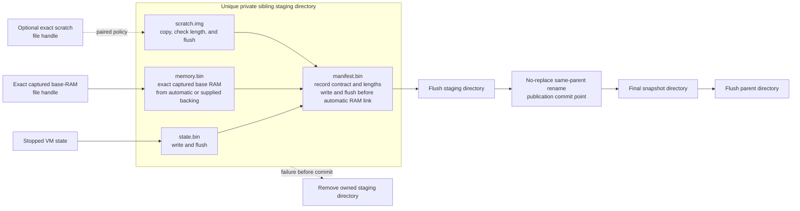

# 5.4 Snapshot Artifact and Attachment Model

[Architecture documentation](README.md) >
[5. VM Lifecycle and State](5-vm-lifecycle-and-state.md)

## 5.4.1 Artifact Layout and Publication

Figure 5.4 shows the files of a published snapshot, and Figure 5.5 shows how
they are published.

```text
snapshot/
|-- manifest.bin
|-- state.bin
|-- memory.bin
`-- scratch.img    # paired scratch only
```

**Figure 5.4.** Snapshot directory layout.



**Figure 5.5.** Snapshot publication.

Publication writes and flushes every artifact into a unique private sibling
staging directory with restrictive permissions, flushes that directory,
commits it with one no-replace rename in the same parent, and then flushes the
parent. A failure before the commit removes the staging directory, and a
pre-existing destination is never deleted or replaced.

VMM-created RAM backing is published without copying. Once its shared
mappings, the state, and the manifest are durable, the exact open backing file
is hard-linked into the staging directory, and the link is reopened and
checked against the source's file identity and length. Where the filesystem
cannot link the handle, and for caller-supplied backing, publication copies
the memory instead, cloning extents where the filesystem supports it. After
an automatic RAM link commits, the source VM is terminal. A failure after the
staging link is created is rollback-safe only after the private staging
directory has been removed and its parent flushed; otherwise, the VMM
terminates the source rather than resume it with a writable alias of the
artifact.

## 5.4.2 Manifest

The manifest is authoritative for:

- The machine profile and ABI versions.
- The source hypervisor and architecture.
- Captured RAM ranges and file offsets, plus any immutable RAM capacity, the
  128-MiB memory block size, and the canonical expansion ranges.
- Processor topology, processor count, and every APIC identity.
- The effective command line and its digest.
- The exact device order, stable IDs, state-unit names, MMIO and PMIO ranges,
  interrupts, transport, feature masks, and queue limits.
- The time contract: the declared TSC and LAPIC rates, the rate tolerance, the
  capture anchor, the host clock kind, the host and boot identities, the
  generation counter, and `Q`.
- The CPU profile record: the CPU profile's ID, digest, and canonical
  document, the effective CPUID, and the capture host's CPU signature.
- Required host attachments and their policies.
- Block roles, access, geometry, layer identities, scratch policy, and
  paired-scratch materialization.
- The snapshot tier, clone or resume policy, and consumed configuration
  sections.
- The exact lengths of the state and memory artifacts, and the exact length
  and identity of paired scratch.

## 5.4.3 Validation and Integrity

Snapshot paths and repeated fields are bounded. Restore rejects truncated,
oversized, malformed, wrong-type, path-escaping, symlinked, incompatible,
missing, extra, or reordered state before guest execution. The manifest stores
no checksums, and the VMM never reads an artifact or a block to verify its
contents, so a same-length change to any of them is outside the validation
contract: integrity relies on host access control and on the storage owner
keeping each block's storage generation immutable, and authenticated export
or transport belongs outside the local artifact format. Paired scratch must
match the captured filesystem state, so restore checks it structurally and by
exact size and storage generation.

Restore opens the snapshot directory once and resolves every artifact,
including the resume claim, relative to that directory handle. It holds the
directory and artifact handles until teardown. Windows hosts open the
artifacts with read sharing only, reject reparse points, and check file
identity and end of file around copy-on-write mapping creation, so writes,
truncation, deletion, and rename stay blocked. Linux hosts keep the exact
descriptors, opened without following symbolic links, and detect metadata
changes before worker handoff, so pathname replacement has no effect. Content
immutability beyond that depends on host access control.

## 5.4.4 Tiers

As Table 5.3 shows, snapshots with sandbox blocks declare one of three
lifecycle tiers.

**Table 5.3.** Snapshot tiers.

| Tier | Restore policy | Scratch | Consumed configuration | Sharing scope |
| --- | --- | --- | --- | --- |
| `platform` | Clone | Fresh, or none in the RAM-backed overlay layout | Invariants only | Trusted platform build |
| `workload-start` | Clone | Paired | Invariants, image binding, and sandbox | Tenant-scoped warm workload or runtime |
| `instance-checkpoint` | Resume | Paired | Invariants, image binding, and sandbox | One live instance with one claimed continuation |

Tier metadata requires sandbox blocks; blockless snapshots do not declare a
tier. The saved host-owned tier token must agree with the manifest. Platform
lower layers have unbound identities, whereas later tiers bind every consumed
layer. The consumed-section set records which configuration the guest had
already consumed at capture. A platform clone receives the image binding and
sandbox sections that it has not consumed through
[platform-clone activation](5.5-restore-protocol.md#559-platform-clone-activation).

The platform point removes kernel and guest agent initialization from later
launches. A workload-start snapshot also removes runtime initialization, but
it contains workload memory and often cached image data and secrets.
Read-only layer files remain external attachments, yet bytes read from them
can appear in captured memory. Paired scratch is an artifact in the snapshot
directory, not a reference to the caller's original writable file.

Sharing scope is a deployment requirement, not a tenant-authorization feature
of the VMM. The snapshot controller enforces tier combinations, layer
binding, scratch pairing, and the single-use resume claim. Host artifact
access control, template provenance, and a trustworthy pre-capture guest
determine whether cross-tenant publication is permissible.

## 5.4.5 Snapshot Identity

A snapshot binds each consumed block by role, access mode, exact length, and
block geometry, plus one caller-supplied, nonzero storage generation that
every bound block shares. Neither capture nor restore reads a block to
identify it: capture records the generation, and restore requires it and
checks the structural fields. The storage owner therefore vouches for the
bytes and must keep the generation immutable and bound to the exact files.
The generation is not a byte digest, and the VMM does not authenticate it.

A sealed snapshot is immutable. A clone creates a separate writable
descendant, while a resume atomically claims the snapshot and transfers its
continuation into a live instance, after which it is no longer an available
snapshot. There is no mutable-snapshot state.

## 5.4.6 Replay Contract

Restoring replays captured guest state, so capture follows an explicit
contract: never capture live external connections or other state that cannot
be safely reused, never repeat irreversible side effects, and repair runtime
randomness before accepting work. Kernel entropy reseeding cannot reset a
runtime's own random-number generators, caches, or connections, so a
workload-start snapshot requires a runtime post-restore hook. A cloneable
warm point must be single-threaded or hold every peer thread behind a
runtime-owned barrier until repair completes. An instance checkpoint is one
continuation, and a workload-start snapshot is a cloneable starting point;
neither is transparent checkpointing of arbitrary requests.

## 5.4.7 Host Attachments

As Table 5.4 shows, machine state contains guest-visible progress, not native
process resources, and each external resource has a stable ID and a
declarative reconstruction policy.

**Table 5.4.** Host attachment reconstruction.

| Resource | Saved | Reconstructed or supplied on restore |
| --- | --- | --- |
| Byte channel | Pending RX and TX bytes | Host endpoint, a fresh generation ID, and a restore packet, which may carry a platform clone's activation record |
| Boot console | Queue progress, staged RX, partial TX, endpoint identity, and reconnect policy | An eligible listener at its captured endpoint or an approved fresh endpoint of the same kind, a required client connection, or a supplied inherited terminal |
| Control console | Attachment identity, broker policy, and bounded broker state without queued records, host output, or receive credit; never the capability or peer identity | An approved same-user local endpoint, possibly at a fresh location, with a fresh capability; the broker restarts with a fresh instance and epoch |
| Network | Static identity, queue and packet progress, network profile, and policy digest | A fresh in-process endpoint with the matching policy, or with a new policy for a `platform` snapshot captured with a deny-all policy; otherwise, published guest listeners and host forwards are rejected |
| Host filesystem | FUSE namespace, handles, cookies, root and object identity, access mode, and path policy, or explicit dormant state | A fresh export with the same canonical path, target, mode, and policy; a dormant slot may stay unattached or bind a new directory export or aggregate |
| Sandbox block | Queue and device state, roles, access, geometry, layer identities, scratch policy, and paired-scratch materialization | Matching read-only layers, or substitutes no longer than their recorded lengths for a `platform` snapshot, and, unless the snapshot has no scratch, private-copy or copy-on-write scratch for clones, direct scratch after an exclusive resume claim, or a new scratch file of the same geometry |
| Readiness endpoint | Nothing | An optional single-use endpoint for one restore |

Attachment resolution happens before any processor starts. A supplied
attachment must reproduce the saved identity, except that an eligible
listener may replace only its endpoint while keeping its stable ID, attachment
and backend kinds, reconnect policy, required flag, length, and timeout, and
that a `platform` snapshot accepts substitute read-only layers and, when
captured with a deny-all policy, a new network policy. Missing privileges,
endpoint binding failures, any other changed egress policy, replaced
filesystem objects, or a wrong attachment kind fail restore explicitly.
Orchestrators of reusable clones supply fresh private boot-console and control
endpoints, so that independent or concurrent restores never collide with the
terminated source.

For the attachments that a restore supplies, a host may name the identity
that it expects for each read-only layer, filesystem root, and pinned file
child. During attachment resolution, before any processor runs, the VMM
compares each with the object that it opened and fails the restore on a
mismatch, so an object replaced after the host's check never reaches the
guest. The VMM also reports a receipt to its launcher for each such
attachment, with its role and the opened object's identity and actual length.
Receipts identify objects, not contents, so producing them reads no data.

## 5.4.8 Memory Sharing

Private copy-on-write restore prevents a VM's writes from modifying the
reusable artifact. It does not guarantee that clean physical pages are
unshared across VMs that map the same file, and dropping the guest page cache
before capture does not by itself eliminate shared host physical pages or
cache side channels. Write isolation and page-sharing isolation are therefore
separate properties.
