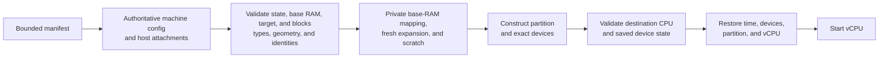

# 5.5 Restore Protocol

[Architecture documentation](README.md) >
[5. VM Lifecycle and State](5-vm-lifecycle-and-state.md)

Restore treats the manifest as the source of machine configuration. A failure
of validation or reconstruction rejects the restore before a restored
processor runs. Guest repair runs afterward on the restored processors, and a
failure there powers the guest off, as
[Guest Repair](#557-guest-repair) describes.

## 5.5.1 Restore Sequence

Figure 5.6 summarizes the restore flow.



**Figure 5.6.** Restore flow.

Before worker construction, restore:

1. Opens one exact snapshot directory, reads its bounded manifest, and
   requires manifest version 6.
2. Validates the time contract and the CPU profile record.
3. Requires the destination backend to equal the recorded source backend.
4. Requires a matching CPU profile and a host CPU of its generation.
5. Preflights the downtime by sampling the host clocks, selecting the
   downtime source, and checking the bounds of `D` and `D + Q`.
6. Derives the authoritative machine configuration and validates its
   topology, devices, attachments, command line, and blocks.
7. Resolves console, network, filesystem, policy, and read-only layer
   attachments by stable ID or role.
8. Validates the state, captured memory, selected RAM target, block geometry
   and identities, any attachment identities that the host expects, and any
   paired scratch, and claims a resume-policy snapshot.
9. Generates the restore entropy and generation ID, checks the size of any
   activation record that the launcher supplied, and sets the generation
   counter to the captured value plus one.
10. Maps captured memory privately with copy-on-write, adds fresh private
    backing for selected expansion ranges, and materializes scratch according
    to its recorded policy.

In the worker, with every processor stopped, restore:

11. Creates the partition and the exact device inventory with the selected
    active RAM and the snapshot's capacity, declaring `F = F_s` and
    `L = L_s`.
12. Preflights the backend before any processor runs or any processor state
    is restored: CPU-profile support, the effective CPUID, identity routing,
    the synchronized-set primitive, and the absence of TSC scaling.
13. Reads the native TSC and LAPIC rates and applies the
    [rate policy](3.2-clock-and-time.md#324-rates).
14. Restores every state unit while stopped: VM time, chipset and virtio
    devices, the time platform, the partition, and every processor.
15. Freezes the set of instantiated processors.
16. Takes the restore anchor, computes `D`, and writes the same target to
    every instantiated processor's TSC at one host instant, never applying
    saved per-processor TSC values:

    ```text
    TSC_target = T_c + floor(D * F_s / 1_000_000_000)
    ```

17. Reads back every processor's TSC, after which guest time runs from the
    restore anchor.
18. Advances every counting one-shot LAPIC timer by `D`, and VM time and the
    RTC by `D + Q`, while the idle PIT catches up from its saved cursor.
19. Seals the time fields of the restore packet.
20. Starts the state units, with host input gated when the restore requires
    an acknowledgement, and publishes the readiness event.
21. Releases the restored processors.
22. For a gated restore, on the guest's acknowledgement, stops at the exact
    post-write boundary, releases host input, and only then lets the guest
    continue.

The partition must exist before the VMM can read the CPUID it presents and
compare it with the effective CPUID. This does not expose a partially
restored guest, because these checks and all saved-state validation complete
before a processor runs.

The management RPC performs the same authoritative restore for snapshots
without sandbox blocks, a network device, or a control console. Its request
may repeat only the machine profile, an exact processor-count assertion, the
byte-channel endpoint, the saved console and filesystem attachments, and guest
power actions, and it may add processor and RAM targets, a gate timeout, and
a readiness endpoint. The restored VM stays paused until the client resumes
it. That resume publishes the readiness event, and a publication failure fails
the resume and tears the VM down.

## 5.5.2 Memory and Scratch Materialization

Captured memory is mapped privately with copy-on-write in every restore,
while selected expansion ranges receive fresh private backing. As Table 5.5
shows, paired scratch records one of three restore policies.

**Table 5.5.** Paired-scratch restore policies.

| Policy | Behavior |
| --- | --- |
| Private copy | Attaches an independent copy of the paired scratch |
| Copy-on-write | Attaches a filesystem reflink clone; valid only for a reusable workload-start clone |
| Direct claimed | Attaches the paired scratch itself, only after an instance checkpoint has been durably and exclusively claimed |

Clone restores therefore dirty independent files and leave the reusable
snapshot immutable, while a direct-claimed restore transfers the single-use
continuation into ordinary live-instance ownership.

An instance checkpoint is single-use. The first restore attempt that passes
artifact and configuration validation atomically creates and flushes a claim
marker in the snapshot directory. Duplicate and concurrent restores fail
before worker construction, and a later startup failure does not make the
checkpoint reusable. The single-use rule prevents accidental forks; it does
not replace artifact confidentiality, retention policy, or protection against
host-side copying.

## 5.5.3 Processor Activation

Restore-time processor activation separates the immutable processor capacity
that a snapshot records from the processors that one restored process brings
online:

- `C` is the processor capacity, which the processor topology, APIC IDs, MP
  tables, and saved processor inventory always contain exactly.
- `B` is the boot-online count that a template records at capture: 1, 2, 4,
  or 8, and no larger than `C`. A snapshot that records no boot-online count
  rejects activation.
- `N` is the online target that a restore selects, with `B <= N <= C`. It is
  process-local and never modifies the snapshot.

The online set is always the contiguous prefix `0..N-1`. Activation is not a
topology change or a general CPU-hotplug interface: the guest still sees the
capacity-`C` machine, and bringing a suffix processor online after readiness
is outside the contract.

Saved processor state remains authoritative for the full capacity. Restore
requires exactly one processor state entry for every index in `0..C-1` and
rejects missing, duplicate, or out-of-range entries, including errors in the
dormant suffix. A backend may then instantiate only the requested online
prefix and apply saved state to that prefix alone, or instantiate the full
capacity. A process restored with a reduced prefix can never produce a
complete capacity-`C` inventory, so it cannot be captured again, and access to
an uninstantiated processor fails explicitly. The immutable snapshot remains
reusable at any valid target.

The restore packet carries the online target `N`, and byte-channel status bit
2 advertises it. While host input remains gated, the guest onlines processors
`B` through `N-1`, verifies that its online set is exactly the requested
prefix, and acknowledges through the snapshot port.

A fixed-capacity `N`-processor snapshot and a capacity-`C` template with
`B` boot-online processors, restored to `N`, reach the same online prefix but
not the same guest state: the first captured all `N` processors online,
whereas the second activates processors during gated repair.

## 5.5.4 Memory Activation

Restore-time memory activation separates the immutable RAM geometry recorded
by a snapshot from the active amount that one restored process uses:

- `M0` is the captured base RAM, which the memory artifact, the e820 map, and
  the saved RAM-range inventory contain exactly.
- `Cmem` is the optional immutable capacity declared at capture, with the
  128-MiB memory block size and every canonical range of `Cmem - M0`.
- `M` is an explicit restore target, 128-MiB aligned, with
  `M0 <= M <= Cmem`. Omitting it restores exactly `M0`, and a snapshot
  without a declared capacity rejects an explicit target.

The selected expansion is always a prefix of the canonical ranges in logical
RAM order. Expansion bytes are never read from or written back to the
snapshot, so independent restores may choose different targets without
changing the reusable artifact. All selected ranges are registered with the
hypervisor before any restored processor runs.

An explicit target sets the restore packet's memory-target flag, and the
packet lists the selected expansion ranges; byte-channel status bits 3 and 4
mirror the target and the presence of ranges. For a nonempty expansion, host
input stays gated while the guest verifies the memory block size and each
range, adds and onlines the missing memory blocks, verifies their state, and
completes entropy and generation-ID repair before acknowledging. A malformed
range or a failure to add or online memory terminates the restore. An
explicit base-size target has no ranges and gates the restore only when the
tier or a processor target requires it.

## 5.5.5 Restore Packet

Figure 5.7 shows the layout of the restore packet, and Table 5.6 lists its
flags. Every restore exposes one restore packet through the byte channel, for
every tier and for untiered snapshots.

```text
offset size field
     0    3 magic "OVR"
     3    1 version = 4, or 5 with an activation record
     4    1 flags
     5    1 online_vp_count      0 = no processor target, else 1, 2, 4, or 8
     6    1 memory_range_count   0 unless MEMORY_TARGET
     7    1 reserved = 0
     8    4 generation           u32, little-endian, g >= 1
    12    4 rate_deviation       i32, little-endian, ppm scaled by 2^16
    16    8 downtime_ns          u64, little-endian, D
    24    8 utc_ns               u64, little-endian, host UTC at selection
    32 16*n ranges               n x { u64 gpa_start, u64 length }, LE
 32+16n  64 entropy
 96+16n   4 activation_length    version 5 only: u32, little-endian, 1..1024
100+16n   m activation           version 5 only: m = activation_length bytes
```

**Figure 5.7.** Restore packet layout.

**Table 5.6.** Restore packet flags.

| Flag bit | Name | Meaning |
| ---: | --- | --- |
| 0 | `DOWNTIME_UTC` | `D` came from the UTC delta; clear means same-boot host monotonic time |
| 1 | `MEMORY_TARGET` | An explicit RAM target was requested; the range count is valid and may be zero |
| 2 | `ACK_REQUIRED` | Host input is gated, and the guest must acknowledge through the snapshot port after repair |
| 3 | `TEST_HOOKS` | Host overrides of the downtime, UTC, rate deviation, time samples, or CPU profile are active |
| 4-7 | | Zero; the guest rejects a packet with any of them set |

The UTC field is latched when the guest first selects the packet; every other
field, including any activation record, is sealed before the first restored
processor runs. A version-4 packet without ranges is 96 bytes, and version 5
adds 4 bytes plus the record. The packet is authoritative, and the status bits
mirror it; the acknowledgement flag spares the guest from inferring gating
from the tier and targets. A VM process exposes at most one packet, and
reading its last byte consumes it, so a guest captured again in the same
process never sees an earlier packet. The guest also ignores a packet whose
generation equals its recorded generation.

The activation record is opaque to the VMM. Only a restore of a `platform`
snapshot accepts one, of 1 to 1,024 bytes, and the VMM never stores it in a
snapshot. The VMM writes version 5 only when a record is present, so a guest
captured before version 5 restores unchanged. The guest agents and the host
own the record's schema, as
[Platform-Clone Activation](#559-platform-clone-activation) describes.

## 5.5.6 Generations

- The generation counter `g` is zero in a cold-booted process and the captured
  value plus one in a restored process. It orders restores within a snapshot
  lineage, clones of one snapshot share it, and the restore packet and every
  time sample carry it, so the guest observes a restore between two samples
  as a change of `g`.
- The generation ID is 16 random bytes unique to each VM process, selected
  through the byte channel. On restore, it equals the first 16 bytes of the
  packet's entropy; on cold boot, it is generated independently. It is never
  serialized or restored from device state, and it distinguishes clones.
- After a restore, the guest requires the packet's `g` to equal its recorded
  `g` plus one, and the generation ID to differ from its recorded one. Either
  mismatch fails repair.

## 5.5.7 Guest Repair

A restored guest performs its repair on the readiness path, and nothing else
runs before the acknowledgement:

1. Read the byte-channel status, whose restore-packet bit is always set after
   a restore.
2. Bracket the packet selection with realtime clock reads, read the packet
   four bytes per access, and validate its magic, version, reserved bits,
   counts, any activation record's length, generation, and generation ID.
3. Set the wall clock: derive the offset and its uncertainty from the
   bracket, take up to two further time samples if the uncertainty exceeds
   1 ms, step the clock by the offset, and set the frequency correction to the
   negated rate deviation, clamped to ±500 ppm.
4. Activate processors and memory as requested.
5. Refresh entropy and identity, as
   [Entropy Refresh](#558-entropy-refresh) describes.
6. Acknowledge through the snapshot port when `ACK_REQUIRED` is set.
7. After the acknowledgement, finish asynchronously at idle priority: rerun
   the restore conformance checks, wait for the stall-detector grace period,
   restore the detector settings, and restart the wall-clock discipline at
   its fast cadence.

A platform clone whose packet carries an activation record also validates the
record before the acknowledgement and activates after it, on the readiness
path rather than at idle priority, as
[Platform-Clone Activation](#559-platform-clone-activation) describes.

A failure in the time ABI's part of the repair, which validates the packet,
steps the wall clock, and restores the stall-detector settings, emits a
violation event and powers off the guest with status 195, and a failed rerun
of the conformance checks powers it off with status 193. A failure in any
other repair step writes an error line and powers off the guest with status 1.
Until the acknowledgement, a gated restore keeps host input gated, so no host
input reaches a guest whose repair failed, and the VMM stops a guest that does
not acknowledge within the restore's gate timeout.

Validation and resource reconstruction may create process-local objects, but
they never expose a partially restored guest: no virtual processor runs after
either fails.

## 5.5.8 Entropy Refresh

Restoring a snapshot replays the guest's captured memory, including the state
of the kernel's random-number generator and of any generators that the
workload runtime keeps. Without a refresh, clones of one snapshot would
produce the same random numbers, and therefore the same keys and identifiers.
To prevent this, every restore delivers fresh entropy, which a clone of a
`platform` or `workload-start` snapshot consumes before any workload code runs:

1. Before any processor runs, the VMM draws 64 bytes from the host operating
   system's cryptographic random-number generator.
2. The bytes reach the guest in the [restore packet](#555-restore-packet),
   and their first 16 bytes also become the process's
   [generation ID](#556-generations).
3. For a clone, the guest agents credit all 64 bytes to the kernel's entropy
   pool and force the kernel's random-number generator to reseed, so all
   later kernel randomness depends on the fresh bytes.
4. When the adapter selects a generated machine ID, they generate a new one
   with `getrandom` after the reseed; an image's own machine ID is left
   unchanged. They also refresh the workload's UTS namespace.
5. The workload runtime's post-restore hook resets the runtime's own
   random-number state, which a kernel reseed cannot reach.
6. The guest agents acknowledge the restore and only then thaw scratch and
   the workload cgroup. A workload captured in a `workload-start` snapshot
   stays frozen until this point, and a platform snapshot is captured before
   the workload starts, so no workload code runs with the replayed state.

As Table 5.7 shows, the refresh depends on the restore path.

**Table 5.7.** Entropy and identity refresh by restore path.

| Restore path | Guest random-number generator | Machine identity |
| --- | --- | --- |
| `platform` or `workload-start` tier (clone) | Reseeded before the acknowledgement with the packet's 64 fresh bytes | Generated machine ID and hostname refreshed; an image machine ID remains, and the runtime hook runs if present; `workload-start` requires the hook |
| Untiered, with processors or memory to activate | Reseeded before the acknowledgement, as for a clone | Generated machine ID and hostname refreshed, as for a clone |
| `instance-checkpoint` tier (resume) | Not reseeded, by design; only the generation ID changes | Preserved |
| Untiered, with nothing to activate | Not reseeded; the fresh entropy is handed to the snapshot's caller | Preserved |

An instance checkpoint is not reseeded because it is single-use: its random
state continues in exactly one process, and keeping it preserves the
continuity of the resumed instance. Fresh post-restore entropy and the
replacement generation ID are never stored in the reusable snapshot, so
independent restores of one snapshot receive independent bytes; only the
prior generation ID remains in captured guest state, as the comparison token.

An untiered snapshot, which is always blockless, has no capture barrier: its
capture freezes no workload, so every process that was running at capture
resumes with the replayed random state as soon as the restored processors
run, and gating host input does not hold it back. The snapshot's caller must
therefore provide the execution barrier, for example by capturing before any
workload starts, and, where the guest does not reseed, repair the kernel's and
the runtime's random state with the entropy handed to it.

## 5.5.9 Platform-Clone Activation

A
[managed layered root](4.1-guest-filesystem-and-image-model.md#414-managed-layered-root)
reads its activation configuration from boot tokens on a cold boot and from
the activation record of the [restore packet](#555-restore-packet) in a
platform clone, because a restore never extends the captured command line.
Both deliveries use the same validation rules and report the same identity in
readiness. A launch that declares a `platform` capture carries no activation
configuration, and its guest agents capture before they assemble the root.

The record is non-secret and small, because the guest reads it four bytes per
port exit. It carries:

- The identity of the configuration, which readiness reports.
- The filesystem UUID or disk GUID that the substituted `distro` image must
  have.
- The upper-layer settings that the template did not capture.
- The form of any export that the restore bound to the dormant filesystem
  slot, and the number of host mappings.
- Whether to require an existing account or use numeric IDs.
- For a template captured with a deny-all network policy, the DNS server, the
  ingress mode, and the guest's settings for any gateway proxy endpoint that
  the new policy permits.

Secrets, per-execution environments, and nonempty host mapping tables never
enter the record. They use the control channel after readiness, as they do
after a cold boot.

Activation proceeds as follows:

1. During [guest repair](#557-guest-repair), the guest agents read the record
   with the packet and validate it before they acknowledge the restore.
2. After the acknowledgement, they flush the cached buffers of the
   substituted `distro` image and assemble the root as steps 3 through 6 of
   [Layered Sandbox Root](4.1-guest-filesystem-and-image-model.md#411-layered-sandbox-root)
   describe, checking the image against the record.
3. They mount any export that the restore bound to the dormant filesystem slot
   and apply the record's network settings.
4. They establish the control path with the restore's fresh capability,
   instance, and epoch, and report readiness with the configuration's
   identity.

Readiness completes activation. The host then checks the reported identity
and delivers any host mapping table, which the guest agents mount as after a
cold boot, refusing executions until every announced mapping is mounted.

The guest agents of a managed layered root captured at the `platform` tier
require the record and fail repair without one. An activation failure writes
an error line and powers off the guest with status 1, so a partially activated
clone never becomes ready. A platform clone of any other guest needs no record
and receives no configuration beyond its captured command line.
