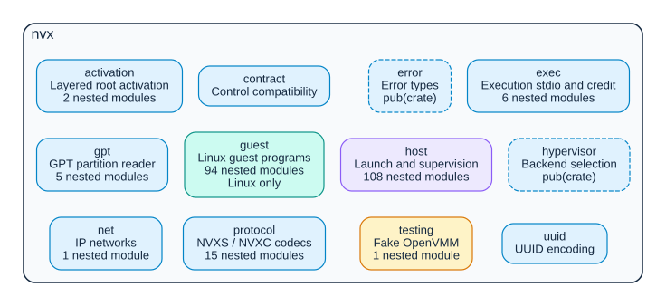
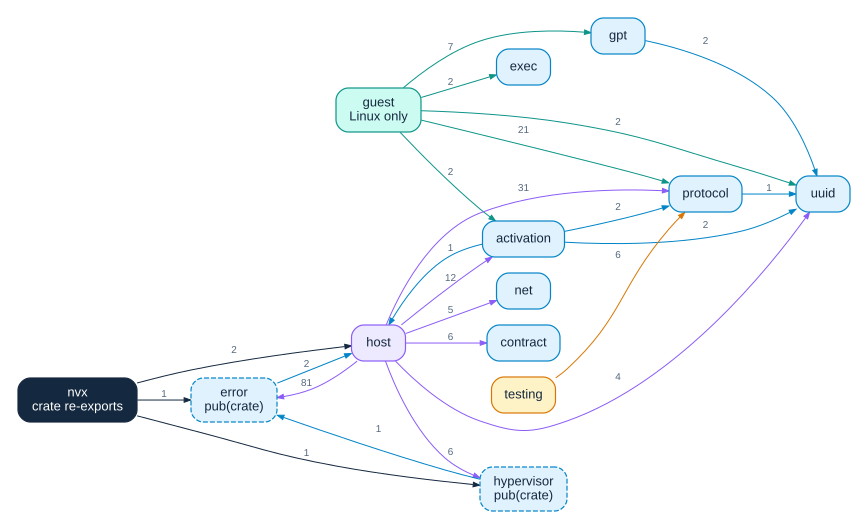
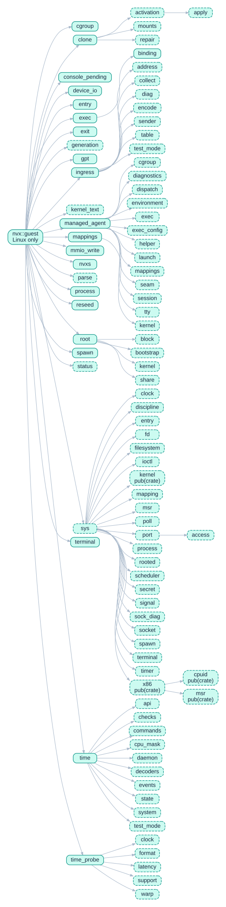
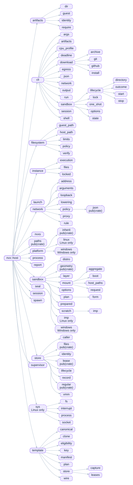
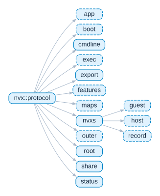

<!-- Generated by scripts/module_diagrams.py; do not edit. -->

# Module diagrams

The modules of the [`nvx` crate](../../nvx-rs/README.md), the modules that each
contains, and the dependencies between them, as
[cargo-modules](https://github.com/regexident/cargo-modules) 0.27.0 finds them
and Graphviz 2.43.0 draws them. They cover the crate's library with its `cli`,
`testing`, and `guest` features, on Linux (`x86_64-unknown-linux-musl`) and
Windows (`x86_64-pc-windows-msvc`). CI draws them again after every merge to
`dev` that changes the crate, and commits them when they change; see [Module
diagrams](../ci.md#module-diagrams).

Each box is a module, colored by the part of the crate that holds it: blue for
the modules that the host and the guest share, purple for the host, teal for
the guest, and amber for the test doubles. A solid box is a public module, and
a dashed box a private one, unless it names another visibility, such as
`pub(crate)`. A box that names platforms, as in *Linux only*, is a module that
only they build, as are the modules that it contains. The diagrams leave out
the crate's tests and binaries, and other crates.

## Overview

The crate's top-level modules, with what each holds and how many modules it
contains.

## Dependencies

The top-level modules that use one another. An arrow points from a module to a
module that it uses, and counts the pairs of their modules in which the first
uses the second, as cargo-modules finds them: a module uses another whose items
it imports, re-exports included, or whose items the definitions of its own
items name, which counts the implementations of a type's traits toward the
type's module, wherever they are. The crate's own arrows are its re-exports.
The uses within a top-level module are left out.

## Hierarchies

The modules that each top-level module contains. An arrow points from a module
to a module that it contains.

### `nvx::activation`

`nvx::activation`, in
[`nvx-rs/src/activation/mod.rs`](../../nvx-rs/src/activation/mod.rs), contains
2 modules.

### `nvx::exec`

`nvx::exec`, in [`nvx-rs/src/exec/mod.rs`](../../nvx-rs/src/exec/mod.rs),
contains 6 modules.

### `nvx::gpt`

`nvx::gpt`, in [`nvx-rs/src/gpt/mod.rs`](../../nvx-rs/src/gpt/mod.rs), contains
5 modules.

### `nvx::guest`

`nvx::guest`, in [`nvx-rs/src/guest/mod.rs`](../../nvx-rs/src/guest/mod.rs),
contains 95 modules.

### `nvx::host`

`nvx::host`, in [`nvx-rs/src/host/mod.rs`](../../nvx-rs/src/host/mod.rs),
contains 113 modules.

### `nvx::net`

`nvx::net`, in [`nvx-rs/src/net/mod.rs`](../../nvx-rs/src/net/mod.rs), contains
1 module.

### `nvx::protocol`

`nvx::protocol`, in
[`nvx-rs/src/protocol/mod.rs`](../../nvx-rs/src/protocol/mod.rs), contains 15
modules.

### `nvx::testing`

`nvx::testing`, in
[`nvx-rs/src/testing/mod.rs`](../../nvx-rs/src/testing/mod.rs), contains 1
module.

