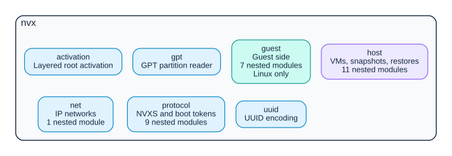
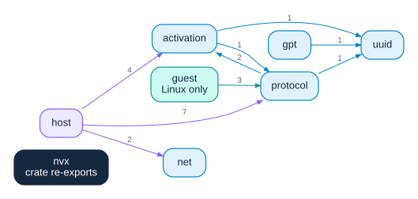
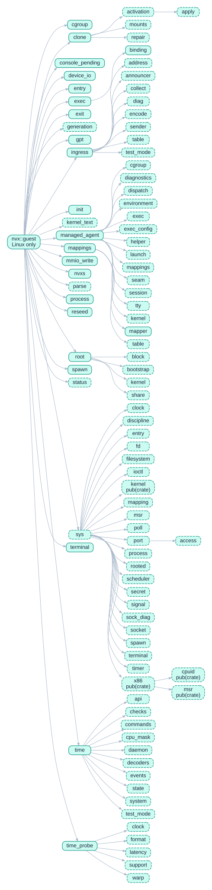
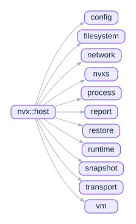
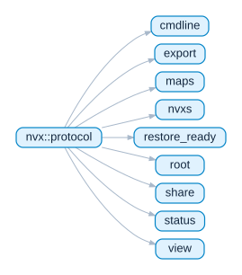

<!-- Generated by scripts/module_diagrams.py; do not edit. -->

# Module diagrams

The public modules of the [`nvx` crate](../../nvx-rs/README.md), the modules
that each contains, and the dependencies between them, as
[cargo-modules](https://github.com/regexident/cargo-modules) 0.27.0 finds them
and Graphviz 2.43.0 draws them. They cover the crate's public API, as its
library builds with its `cli`, `testing`, and `guest` features, on Linux
(`x86_64-unknown-linux-musl`) and Windows (`x86_64-pc-windows-msvc`): each
module that is public, as are the modules that contain it, but the modules of
NVX's own programs, which the crate hides. CI draws them again every night, and
commits them to `dev` when they change; see [Module
diagrams](../ci.md#module-diagrams).

Each box is a public module, colored by the part of the crate that holds it:
blue for the modules that the host and the guest share, purple for the host,
and teal for the guest. A box that names platforms, as in *Linux only*, is a
module that only they build, as are the modules that it contains. The diagrams
leave out the crate's private modules, its tests and binaries, and other
crates.

## Overview

The crate's top-level modules, with what each holds and how many modules it
contains.

## Dependencies

The top-level modules that use one another. An arrow points from a module to a
module that it uses, and counts the pairs of their modules in which the first
uses the second, as cargo-modules finds them: a module uses another whose items
it imports, re-exports included, or whose items the definitions of its own
items name, which counts the implementations of a type's traits toward the
type's module, wherever they are. The crate's own arrows are its re-exports.
The uses within a top-level module, and those of the modules that the diagrams
leave out, are left out.

## Hierarchies

The modules that each top-level module contains. An arrow points from a module
to a module that it contains.

### `nvx::guest`

`nvx::guest`, in [`nvx-rs/src/guest/mod.rs`](../../nvx-rs/src/guest/mod.rs),
contains 7 modules.

### `nvx::host`

`nvx::host`, in [`nvx-rs/src/host/mod.rs`](../../nvx-rs/src/host/mod.rs),
contains 11 modules.

### `nvx::net`

`nvx::net`, in [`nvx-rs/src/net/mod.rs`](../../nvx-rs/src/net/mod.rs), contains
1 module.

### `nvx::protocol`

`nvx::protocol`, in
[`nvx-rs/src/protocol/mod.rs`](../../nvx-rs/src/protocol/mod.rs), contains 9
modules.

