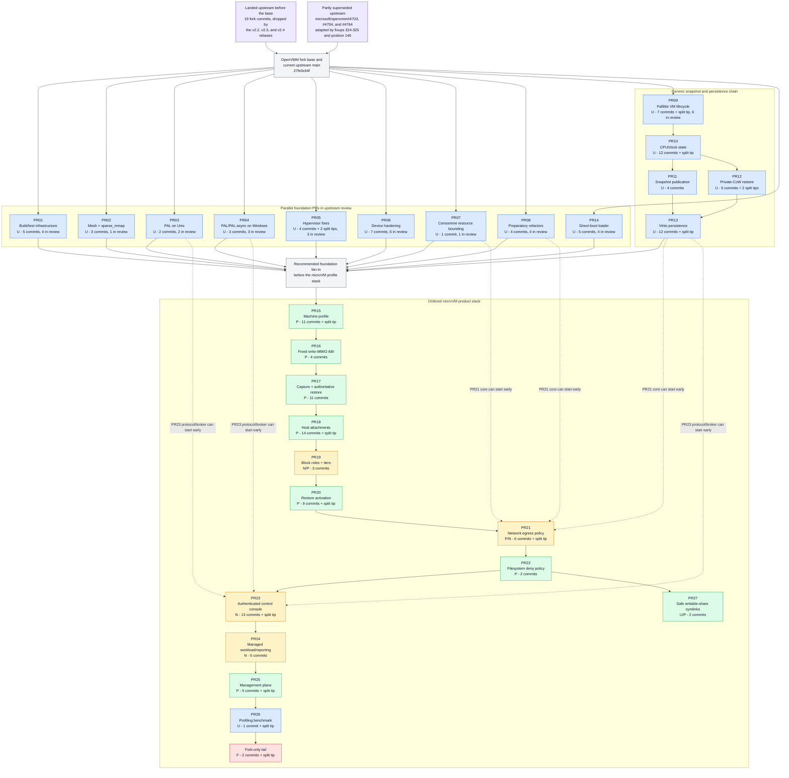

# OpenVMM Micro-VM PR Strategy

## Scope

- OpenVMM fork base: `27fe0c64f02e08e0495b64fe5267ecc7d2f94c70`, upstream main on 2026-10-31.
  The `feature/microvm/release/v2.4` rebase, which NVX adopted in `783e4ea61`, moved the
  chain there from `22c0485be597f87a76771e1db03eaa823a685ffc`; see
  [Upstream status](#upstream-status).
- Mapped fork tip: `f94922de6a63d15a2be48e727236f338c95f9067`, position 147. The graph, PR
  summary, and commit mapping below cover positions 001-147 and the fixups at positions
  324-330, 334, 335, and 371-386.
- NVX's pinned OpenVMM revision: `998b9f2402050cd16d1faa897bc831ef1434be48`, position 386, the
  head of the `feature/microvm/release/v2.4` branch of microsoft/openvmm, to which
  `feature/microvm/dev` also points. Positions 371-386 are the sixteen fixups of the v2.4 rebase,
  on position 370, `a16010246`, which is `757a15fa3`, the head of `feature/microvm/release/v2.3`
  and the previous pin, rebased. Positions 328-370 rebase the commits that pull requests merged
  into `feature/microvm/dev` after the v2.3 rebase: microsoft/openvmm#4734 position 328,
  microsoft/openvmm#4735 positions 329 and 330, microsoft/openvmm#4749 positions 331-333,
  microsoft/openvmm#4762 positions 334 and 335, microsoft/openvmm#4767 positions 336 and 337,
  microsoft/openvmm#4769 positions 338 and 339, microsoft/openvmm#4773 positions 340-342,
  microsoft/openvmm#4775 positions 343 and 344, microsoft/openvmm#4794 positions 345-349,
  microsoft/openvmm#4807 positions 350 and 351, microsoft/openvmm#4804 positions 352-355,
  microsoft/openvmm#4818 positions 356 and 357, microsoft/openvmm#4820 positions 358 and 359,
  microsoft/openvmm#4823 position 360, microsoft/openvmm#4816 positions 361 and 362,
  microsoft/openvmm#4830 positions 363-368, and microsoft/openvmm#4831 positions 369 and 370. The
  pin is 239 commits past the mapped tip on the same first-parent chain. Positions 148-323,
  331-333, 336-360, and 363-370 are not yet assigned to PRs, and positions 361 and 362 port
  microsoft/openvmm#4803; see [Commits after the mapped tip](#commits-after-the-mapped-tip).
- Upstream main: `27fe0c64f02e08e0495b64fe5267ecc7d2f94c70` (2026-10-31), the fork base.

## Upstream status

The `feature/microvm/release/v2.4` rebase moved the 380-commit chain of
`feature/microvm/release/v2.3` from `22c0485be` onto `27fe0c64f`, 76 upstream commits later. It
dropped the ten commits whose changes upstream had landed, v2.3 positions 003, 005, 009, 012,
015, 017, 023, 030, 031, and 036, so positions from 004 on are lower than in
`feature/microvm/release/v2.3` and in earlier revisions of this document, by ten from 037 on.
Forty-five commits conflicted with upstream and were resolved where they conflicted, and the
diffs of seventeen more changed only in context, at positions 005, 013, 024, 028, 032, 033,
041, 090, 096, 119, 131, 163, 168, 186, 193, 213, and 260. Sixteen fixups at the tip,
positions 371-386, adapt the chain to upstream changes that no textual conflict exposed; see
[Rebase conflicts and fixups](#rebase-conflicts-and-fixups).

The `feature/microvm/release/v2.3` rebase moved the 334-commit chain of
`feature/microvm/release/v2.2` from `790132851` onto `22c0485be`, 23 upstream commits later. It
dropped position 074, whose change microsoft/openvmm#4661 had landed upstream, resolved seven
commits that conflicted, and added four fixups at its tip, now positions 324-327.

The `microvm/v2.2` rebase moved the 320-commit chain of `microvm/v2.1` from `e1cdbd916` onto
`790132851`, 75 upstream commits later. It dropped the eight fork commits that had landed
upstream in between and adapted the remaining 312 to upstream API changes where they needed it,
which changed the diffs of 50 of them.

### Landed upstream

| Dropped by | Former position | Fork commit | Roadmap PR | Upstream PR | Upstream commit |
| --- | ---: | --- | --- | --- | --- |
| v2.4 | 003 | `0213cf65d` - flowey: skip reinstalling an identical, possibly running cargo-nextest binary | PR01 | microsoft/openvmm#4608 | `03a2fc597` |
| v2.4 | 005 | `a91dc86fb` - lxutil: tolerate inherited extended attributes in tests | PR01 | microsoft/openvmm#4587 | `a1d71b899` |
| v2.4 | 009 | `15a895dd8` - sparse_mmap: add private copy-on-write file views | PR02 | microsoft/openvmm#4557 | `d8acf2a7c` |
| v2.4 | 012 | `4a7ab405c` - pal: add Unix extent cloning and sparse-extent seeking | PR03 | microsoft/openvmm#4590 | `c62489737` |
| v2.4 | 015 | `074de3406` - pal: add sparse-file range queries, zeroing, and block cloning | PR04 | microsoft/openvmm#4596 | `8f1c36ba5` |
| v2.4 | 017 | `50460c27a` - pal: query named-pipe peers and create protected pipes | PR04 | microsoft/openvmm#4582 | `65db52693` |
| v2.4 | 023 | `938b14343` - chipset: fast-forward periodic PIT counting over long intervals | PR06 | microsoft/openvmm#4586 | `023329997` |
| v2.4 | 030 | `135c503ba` - consomme: cover the pending DNS request limit with a test | PR07 | microsoft/openvmm#4601 | `cd93f761f` |
| v2.4 | 031 | `90734a2ff` - consomme: cover IPv4 fragment rejection with a test | PR07 | microsoft/openvmm#4602 | `3d9cb006a` |
| v2.4 | 036 | `6794f12d0` - openvmm_entry: skip raw console mode when stdin is not a terminal | PR08 | microsoft/openvmm#4606 | `769f2f61f` |
| v2.3 | 074 | `f6e6ff738` - loader_defs: name the boot_params ACPI RSDP field | PR14 | microsoft/openvmm#4661 | `8beae2961` |
| v2.2 | 002 | `607e6c6a2` - nextest: scope a longer budget to the exhaustive ring-buffer loom test | PR01 | microsoft/openvmm#4584 | `9501bb481` |
| v2.2 | 017 | `c61d77644` - pal: create files and directories with explicit security descriptors | PR04 | microsoft/openvmm#4599 | `9fbf965c5` |
| v2.2 | 021 | `88865bf90` - virt_mshv: describe SNP guest workarounds without ACI-specific names | PR05 | microsoft/openvmm#4580 | `40cff1268` |
| v2.2 | 022 | `9b3ce6760` - kvm: preserve pending external interrupts across VP-state capture | PR05 | microsoft/openvmm#4522 | `392890680` |
| v2.2 | 029 | `947ae858b` - virtio: make interrupt tests wait for queue completion | PR06 | microsoft/openvmm#4592 | `5b4656a86` |
| v2.2 | 030 | `21c2206c9` - fuse: rate-limit guest-triggerable diagnostics | PR06 | microsoft/openvmm#4581 | `926827446` |
| v2.2 | 035 | `54c5c34cd` - virtio_console: rate-limit worker errors | PR06 | microsoft/openvmm#4614 | `77ce2aeac` |
| v2.2 | 039 | `dd349021e` - openvmm_entry: accept `delay:<ms>:<disk>` disk wrappers | PR08 | microsoft/openvmm#4610 | `6e0e4fdab` |

A former position counts in the branch that the rebase started from: `microvm/v2.1` for the v2.2
rebase, `feature/microvm/release/v2.2` for the v2.3 rebase, and `feature/microvm/release/v2.3`
for the v2.4 rebase. microsoft/openvmm#4661 names the `acpi_rsdp_addr` field of `boot_params`
exactly as position 074 did, so the v2.3 rebase dropped 074 as empty. microsoft/openvmm#4554
still carries it, ahead of positions 064-066.

Upstream merged most of the v2.4 drops after review changes, so the rebase took upstream's
versions and adapted the later commits to them. microsoft/openvmm#4557 creates a copy-on-write
mappable without the chain's `executable` flag, and on Windows it refuses to unmap or map over
part of a written copy-on-write view. microsoft/openvmm#4582 answers a pipe's peer process
through `PipeExt::get_pipe_peer_process_id` instead of the chain's `pal::windows::pipe::peer`
module, which also had `is_pipe`. microsoft/openvmm#4586 fast-forwards more counting modes, and
microsoft/openvmm#4606 forwards console input in `repl.rs` instead of the `headless` module, which
position 130 now creates for the chain's own use, and ends the run when a stdin that is not a
terminal ends, which fixup 385 confines to machines other than the microVM.
microsoft/openvmm#4587 is identical to v2.3 position 005.

microsoft/openvmm#4522 fixes the lost-PIC-interrupt bug of v2.1 position 022 in a different way.
Instead of tracking the queued vector in `kvm::VpRunner`, it injects PIC interrupts through the
vCPU's injected-interrupt slot (`KVM_SET_VCPU_EVENTS`), which the existing activity save/restore
already covers. Fork builds that include `9b3ce6760`, such as those of `microvm/v2.1`, can save a
queued PIC vector as a pending `ExtInt` event. Current builds reject restoring one with
`KvmError::InvalidState`, so recapture KVM snapshots that those builds captured.

Upstream also landed parts of commits that remain in the chain:

- microsoft/openvmm#4556 (`96647c331`) derives `Clone` for `ProtobufMessage` and `ProtobufAny`.
  Position 006 keeps its subject but now only adds `ProtobufAny::value_len` and checks a clone
  in the round-trip test.
- microsoft/openvmm#4524 (`9cf109547`) adds the generic `PartitionTimeControl` contract, MSHV
  and WHP implementations, and full-VM freeze/thaw lifecycle calls. Position 041 now reuses the
  MSHV implementation, through fallible freeze and thaw helpers, instead of private plumbing.
  Positions 039-043 and the position 141 fixup keep the exact TSC-frequency exposure, snapshot
  downtime handling, and restored-vCPU synchronization that upstream lacks.
- microsoft/openvmm#4704 (`1c093df84`) adds the architectural `TscDeadline` VP state element,
  the `tsc_deadline` partition capability, and the KVM, MSHV, WHP, and OpenHCL register
  accessors that position 038 also added. The position 324 fixup removes the chain's copies;
  folded into 038, it leaves 038 with the `tsc_deadline` field of the CPU compatibility
  contract, the finalized MSHV partition's report of no TSC-deadline support, and the LAPIC
  timer helpers that position 240 deletes in favor of those that position 168 adds for the time
  ABI. Upstream compares a
  restored deadline on partitions that can freeze time, as WHP can, whereas 038 never compared
  it, so the WHP state access of position 042, which reads the deadline before the APIC state,
  now discards that read when it restores the deadline.
- microsoft/openvmm#4764 (`29f0adceb`) makes every lxutil volume resolve paths beneath its root
  without following a host symbolic link, as position 146 did for a confined volume, and
  microsoft/openvmm#4783 (`7c92b147e`) rejects unsafe opens. Position 146 now only adds
  `LxVolumeOptions::confine_paths`, which makes a Windows volume create LX symlinks, and runs its
  confinement tests against upstream's implementation. A share therefore needs `openat2`,
  Linux 5.6 or later, where the chain fell back to opening each component with `O_NOFOLLOW`.

### Open upstream pull requests

As of 2026-10-31, every commit of PR01-PR09 and PR14 except positions 001 and 006 is in an open
upstream pull request; the ten commits that upstream has since merged are under
[Landed upstream](#landed-upstream). Each pull request carries one commit, except
microsoft/openvmm#4554, which carries positions 064-066 after the `boot_params` field that
microsoft/openvmm#4661 has since landed; its ELF and initrd validation was split out during
review and landed as microsoft/openvmm#4667 (`a87971184`). Six of the 32 pull requests are
drafts, microsoft/openvmm#4607, microsoft/openvmm#4619, microsoft/openvmm#4622,
microsoft/openvmm#4623, microsoft/openvmm#4625, and microsoft/openvmm#4626; microsoft/openvmm#4583
has requested changes, and none has an approving review yet. microsoft/openvmm#4451, which
proposed position 001, was closed without merging, and the remainder of position 006 has not
been proposed. PR10-PR13 and PR15-PR27 have no upstream pull requests yet.

| Roadmap PR | Positions | Upstream pull requests, in position order |
| --- | ---: | --- |
| PR01 | 002-005 | microsoft/openvmm#4595, microsoft/openvmm#4618, microsoft/openvmm#4598, microsoft/openvmm#4615 |
| PR02 | 007 | microsoft/openvmm#4558 |
| PR03 | 008-009 | microsoft/openvmm#4589, microsoft/openvmm#4591 |
| PR04 | 010-012 | microsoft/openvmm#4593, microsoft/openvmm#4604, microsoft/openvmm#4585 |
| PR05 | 013-015 | microsoft/openvmm#4536, microsoft/openvmm#4607, microsoft/openvmm#4613 |
| PR06 | 016-021 | microsoft/openvmm#4583, microsoft/openvmm#4588, microsoft/openvmm#4594, microsoft/openvmm#4597, microsoft/openvmm#4605, microsoft/openvmm#4609 |
| PR07 | 022 | microsoft/openvmm#4600 |
| PR08 | 023-026 | microsoft/openvmm#4616, microsoft/openvmm#4617, microsoft/openvmm#4620, microsoft/openvmm#4621 |
| PR09 | 027-032 | microsoft/openvmm#4619, microsoft/openvmm#4622, microsoft/openvmm#4623, microsoft/openvmm#4624, microsoft/openvmm#4625, microsoft/openvmm#4626 |
| PR14 | 064-067 | microsoft/openvmm#4554 (064-066), microsoft/openvmm#4611 |

Stacked pull requests carry their prerequisites' commits: microsoft/openvmm#4585 built on
microsoft/openvmm#4582, which has merged, and microsoft/openvmm#4609 builds on
microsoft/openvmm#4585; microsoft/openvmm#4613 builds on microsoft/openvmm#4536; and
microsoft/openvmm#4622, microsoft/openvmm#4623, and microsoft/openvmm#4625 build on
microsoft/openvmm#4619, as microsoft/openvmm#4626 builds on microsoft/openvmm#4625. Most of these
pull requests have gained review commits that the fork chain does not carry. When one merges, the
next rebase should drop its fork commit, as the `microvm/v2.2`, `feature/microvm/release/v2.3`,
and `feature/microvm/release/v2.4` rebases dropped the nineteen above, and adapt later commits
to the merged form.

### Rebase conflicts and fixups

The `feature/microvm/release/v2.4` rebase replayed the chain onto `86427897a`, the upstream main
of 2026-10-31, with conflicts at 45 positions, which it resolved in place. It merged
`Cargo.lock` by keeping both sides' entries, checked with `cargo metadata --locked`. When
upstream main gained microsoft/openvmm#4587, a second pass moved the chain onto `a1d71b899`
without its position 005. When upstream main then gained microsoft/openvmm#4833, which fixes the
build of its `net_dio` test exactly as a fixup at the chain's tip had, a third pass moved the chain
onto `27fe0c64f` without that fixup. Neither pass had conflicts, and neither changed the tree.

| Position | Fork commit | Upstream PR | Resolution |
| ---: | --- | --- | --- |
| 008 | `4ef8c34b4` - pal: bound Linux descriptor-table pre-expansion | microsoft/openvmm#4590 | Declares the commit's `fd_table` module next to upstream's `fs` module |
| 010 | `167b61f99` - pal: add handle-relative file access that does not follow reparse points | microsoft/openvmm#4596 | Declares the commit's `relative` module next to upstream's `sparse` module |
| 014 | `6557e809a` - virt: add Partition::finalize_memory; create the MSHV BSP after finalization | microsoft/openvmm#4753 | Keeps upstream's nested-virtualization check, and the capabilities that finalization builds take `nested_virt` from a new `CreationConfig` field |
| 017 | `c88f61b52` - virtio_blk: let stop cancellation win over a ready queue and drain accepted I/O | microsoft/openvmm#4751 | Upstream's tests take `disk_hook` instead of `disklayer_ram`, and the commit's blocking-write test keeps `parking_lot` and adds `async-channel`; fixup 378 restores the imports that its test disk needs |
| 018 | `784f589c5` - virtiofs: make handle and inode ID allocation fallible | microsoft/openvmm#4764, microsoft/openvmm#4783 | `open` takes upstream's validated open options with the fallible handle insert, and `InodeMap::insert` stays fallible after upstream's eviction of a dedup key whose file type changed |
| 019 | `ddb756a73` - virtiofs: bound guest payload allocations and rate-limit diagnostics | microsoft/openvmm#4783 | `virtiofs` depends on both upstream's `thiserror` and the commit's `tracelimit` |
| 022 | `4388e26cd` - consomme: bound active TCP, UDP, and ICMP flows | microsoft/openvmm#4602 | Declares the commit's `limits` test module next to upstream's `fragments` module |
| 026 | `c9f5240b5` - virtio_console: move the direct receive loop into its own module | microsoft/openvmm#4778 | The moved receive loop takes upstream's disconnect detection, which polls for a disconnect without a receive queue and while it waits for one |
| 027 | `7fcfadd68` - state_unit: make unit start fallible and roll back partial starts | microsoft/openvmm#3846 | The rollback of a partial start waits on upstream's ordered dependency sets, and upstream's edge-pruning test unwraps the fallible start |
| 029 | `b96679a2e` - openvmm: make VM resume fallible | microsoft/openvmm#4468 | The fallible resume keeps upstream's `resume_vm` OpenTelemetry span |
| 038 | `5c2580b5d` - virt: add portable TSC-deadline VP state and APIC-timer advance | microsoft/openvmm#4753 | The finalized capabilities set both upstream's `nested_virt` and the commit's `tsc_deadline` |
| 046 | `223416953` - openvmm_helpers: publish snapshots atomically through durable staging | microsoft/openvmm#4732 | `Cargo.lock` lists both upstream's `pal_async` and the commit's `pal` for `openvmm_helpers` |
| 051 | `49630526a` - openvmm: signal restore readiness to a local socket or pipe | microsoft/openvmm#4606 | Declares the commit's `launch` and `restore_ready` REPL modules without the `headless` module of v2.3 position 036, which upstream's version of that change does not have |
| 053 | `d426451b2` - virtio: add device-private saved state with deferred activation and serialized kicks | microsoft/openvmm#4799 | The PCI transport's saved state adds the commit's `device_state` to upstream's explicit config-space save, and `save_restore.rs` keeps upstream's async adapter tests with the commit's test |
| 055 | `125e5a5a6` - virtio_console: add attachment identities and reconnect and disconnect policies | microsoft/openvmm#4778 | Keeps the imports of upstream's disconnect detection with the commit's task control, and the crate documentation describes both |
| 056 | `f9e0903e5` - virtio_console: persist buffered direct-console I/O | microsoft/openvmm#4778, microsoft/openvmm#4532 | The staged receive loop polls upstream's disconnect detection without a receive queue and while staged input waits for a guest buffer; the snapshot guides list upstream's virtio-rtc and the commit's virtio-console |
| 058 | `3059fd408` - net_tap: quiesce queues and retain pending transmit ownership | microsoft/openvmm#4545 | `TapQueue` keeps upstream's receive-offload state and read buffer with the commit's transmit state and input quiescing, and both sides' tests |
| 061 | `ebfd28f5b` - virtio_net: persist drained queue state for static-identity NICs | microsoft/openvmm#4545, microsoft/openvmm#4792 | virtio-net carries both upstream's `enable_rx_gso` and the commit's `save_restore`; petri adds NICs with RX GSO off next to upstream's private virtio devices, and the test harness gives upstream's mock endpoint its new channels |
| 063 | `63ccb7158` - virtiofs: track inode aliases through link, rename, and unlink | microsoft/openvmm#4764, microsoft/openvmm#4783 | `InodeMap` keeps upstream's dedup-key eviction next to the commit's alias methods, and the commit's dedup-key rebuild keeps the newest inode per key so as not to undo it |
| 077 | `a92e6d272` - openvmm_entry: expose `--machine microvm` | microsoft/openvmm#4766 | Upstream's `open_vmgs` replaces the VMGS destructuring, after the commit's microVM VMGS check |
| 078 | `d83592d5d` - petri, vmm_tests: add a microVM builder, portb harness, and cold-boot test | microsoft/openvmm#4665, microsoft/openvmm#4792 | Pipette runs as init when both upstream's conditions and the machine profile allow it; the builder keeps upstream's new methods with the commit's, and the microVM command line takes upstream's `rdinit` |
| 087 | `5fc3f7c3f` - openvmm_helpers: define the authoritative microVM machine contract | microsoft/openvmm#4732 | `Cargo.lock` lists both upstream's `pal_async` and the commit's `sha2` for `openvmm_helpers` |
| 097 | `adea4e3ed` - openvmm: persist the microVM NIC and restore a fresh endpoint generation | microsoft/openvmm#4532 | The snapshot format guide keeps upstream's virtio-rtc with the commit's microVM NIC example |
| 099 | `259117fbb` - virtiofs: add the fixed microVM filesystem profile | microsoft/openvmm#4764, microsoft/openvmm#4783 | The strict-path volume builds on upstream's constructor, and inode `open` keeps the commit's confinement check but no longer adds `O_NOFOLLOW`, which upstream's `LxVolume::open` rejects and applies itself |
| 101 | `67b3d7887` - virtiofs: persist microVM FUSE namespaces, handles, and directory cookies | microsoft/openvmm#4783 | A restored handle reopens with upstream's validated host options, without the guest-only flags that upstream's `LxVolume::open` applies itself or rejects |
| 117 | `e9e0fdeb6` - net_tap: enforce the egress policy on TAP transmit | microsoft/openvmm#4545 | TAP endpoints and queues carry upstream's receive-offload state with the commit's egress policy, and the tests run both sides' trials |
| 118 | `be3595b94` - virtio_net: install and prefilter the egress policy | microsoft/openvmm#4545, microsoft/openvmm#4746 | The adapter carries upstream's `enable_rx_gso` with the commit's egress policy, and `TxPacketError` adds the commit's variants without the one that upstream removed |
| 120 | `8b19f06ea` - virtiofs: enforce denied subtrees by object identity | microsoft/openvmm#4764 | The strict-path constructor builds on upstream's `VirtioFsVolume::new` and sets the commit's denied-subtree fields |
| 130 | `d0c81d202` - openvmm_entry: add authenticated microVM control-console endpoints | microsoft/openvmm#4606 | Creates the `headless` REPL module of v2.3 position 036, which upstream's version of that change does not have, without its raw-mode helpers; the documentation sync heuristics take upstream's list with the commit's entries |
| 136 | `1b85b7165` - vmservice: create, capture, and restore microVMs over the management RPC | microsoft/openvmm#4752, microsoft/openvmm#4753, microsoft/openvmm#4766 | `VMConfig` keeps upstream's `vmgs` and moves upstream's `nested_virt` to field 23, since the chain uses field 20; `CreateVm` prepares a microVM and rejects its VMGS before it builds upstream's VMGS, PCIe topology, and MMIO overrides |
| 137 | `1f1edd232` - ttrpc: propagate nonzero guest exit status | microsoft/openvmm#4785 | Upstream's server returns the guest's exit status at once; the commit's handler still marks the VM halted and answers a pending `WaitVM`, successfully only for status 0, and a failed output drain still ends the server with its error |
| 138 | `dbcfce404` - openvmm_helpers: add a publication and private-restore benchmark | microsoft/openvmm#4732 | Dev-dependencies keep upstream's `pal_async` with the commit's `sparse_mmap` |
| 140 | `ba4e62fe0` - vmservice: keep NVX wire-tag compatibility | microsoft/openvmm#4696, microsoft/openvmm#4766 | `DevicesConfig` keeps upstream's repeated `virtio_consoles` at field 6, which decodes the former single field, and `VMConfig` moves upstream's `vmgs` to field 24, as `disable_hv` takes field 21 |
| 146 | `a91864166` - lxutil: add path confinement that never follows symbolic links | microsoft/openvmm#4764, microsoft/openvmm#4783 | Upstream's lxutil never follows a host symbolic link, so the commit drops its own Unix resolver and per-component fallback, keeps `confine_paths` for Windows LX links, and runs its tests against upstream's implementation, which reports `ENOTDIR` or `ELOOP` |
| 147 | `f94922de6` - virtiofs: allow symlink creation on read-write microVM shares | microsoft/openvmm#4764, microsoft/openvmm#4783 | Inode `open` keeps upstream's options without `O_NOFOLLOW` and adds the commit's checks; the symlink tests accept upstream's `ENOTDIR`, and the security model says that a share needs `openat2` on Linux |
| 153 | `43c78328b` - virt_mshv: implement the NVX time ABI backend | microsoft/openvmm#4753 | Partition creation runs upstream's nested-virtualization check and then the time ABI's, which never both apply, as nested virtualization requires `hv_config` and the time ABI rejects it |
| 269 | `6abfbb272` - virt: serve AMD's HWCR and DE_CFG and per-VP 0x8000001E under AMD profiles | microsoft/openvmm#4753 | Keeps upstream's unimplemented-MSR action for nested virtualization before the time ABI's identity-MSR routing, which now takes the profile's vendor |
| 273 | `adf000e6d` - virtiofs: add a per-subtree access policy to microVM shares | microsoft/openvmm#4764 | The strict-path volume still builds on upstream's constructor, with the policy and pinned identities that replace the denied paths, and the commit's `exchanged_path` helper precedes upstream's inode tests |
| 283 | `9b88cabd9` - microVM: share several host directories through one virtio-fs slot | microsoft/openvmm#4764 | `add_child` keeps upstream's `CreateError` and returns the commit's `EINVAL` for a microVM aggregate through it |
| 287 | `da5f32344` - microVM: export single host files as aggregate virtio-fs children | microsoft/openvmm#4764 | `VirtioFsVolume` keeps upstream's `supports_stable_file_id` next to the commit's `root_entry` |
| 288 | `c4c6e01f0` - microVM: model aggregate child kinds and exposed files explicitly | microsoft/openvmm#4764 | `VirtioFsVolume` keeps upstream's `supports_stable_file_id` next to the commit's `exposed_file` |
| 322 | `7dfc57a46` - vmservice: select the microVM CPU profile over the management RPC | microsoft/openvmm#4753, microsoft/openvmm#4766 | The gRPC reference lists upstream's `nested_virt` and `vmgs` at fields 23 and 24 with the commit's `cpu_profile` at field 22 |
| 331 | `b8ada6d09` - disk_zerofill: present a fixed geometry over a shorter or absent disk | microsoft/openvmm#4732 | `openvmm_resources` depends on both upstream's `disk_vmdk` and the commit's `disk_zerofill` |
| 340 | `7601b67cf` - disk_blob: bound the time that an HTTP blob request may take | microsoft/openvmm#4732 | The storage backend table keeps upstream's `FlatVmdkDisk` row with the commit's `BlobDisk` row |
| 341 | `fa32ac888` - disk_blob: retry HTTP blob requests that fail transiently | microsoft/openvmm#4732 | The storage backend table keeps upstream's `FlatVmdkDisk` row with the commit's `BlobDisk` row |

Replaying position 139 also changed more than its context without a conflict: its generated
workflows merged back to the runner image and bootstrap packages that upstream had replaced, while
the pipeline sources kept upstream's. A range-diff of the whole chain against
`feature/microvm/release/v2.3` found no other such change. Sixteen fixups at the tip adapt the
chain to upstream changes that no textual conflict exposed. Fold each into the commits that it
names before submission.

| Position | Fixup | Upstream PR | Fold into |
| ---: | --- | --- | --- |
| 371 | `2b10020f8` - state_unit: pass upstream's dependency sets to the chain's transactions | microsoft/openvmm#3846 | 031 and 033 |
| 372 | `0ae3fc7c5` - virtio: await the PCI transport's save and restore in saved-state tests | microsoft/openvmm#4799 | 053 |
| 373 | `6a5a6f40d` - virt_mshv: adapt the chain to upstream's nested virtualization | microsoft/openvmm#4753 | 014, 153, 193, 238, and 271 |
| 374 | `0fff37663` - serial_socket, openvmm_entry: use upstream's named-pipe peer API | microsoft/openvmm#4582 | 123 and 130 |
| 375 | `f0432967b` - openvmm: create copy-on-write mappables with upstream's signature | microsoft/openvmm#4557 | 048, 050, and 138 |
| 376 | `f04b01d5f` - openvmm_entry: keep RX GSO off on the microVM NIC | microsoft/openvmm#4545 | 096 |
| 377 | `d37530633` - openvmm_entry: accept one microVM console in virtio_consoles | microsoft/openvmm#4696 | 136 |
| 378 | `db5cbc830` - virtio_blk: import what the blocking-write test disk needs | microsoft/openvmm#4751 | 017 |
| 379 | `6206bb816` - net: enable no receive offloads in the chain's endpoint tests | microsoft/openvmm#4545 | 116, 117, 296, and 309 |
| 380 | `43c45af53` - petri: adapt upstream's Incubator changes to the chain's petri | microsoft/openvmm#4665, microsoft/openvmm#4792 | 055 and 078 |
| 381 | `f0b5b7f84` - openvmm_entry: name Path through the RPC module's import in a test | microsoft/openvmm#4757 | 136 |
| 382 | `b2bab5bbc` - vmm_tests: give the backend contract tests the chain's partition options | microsoft/openvmm#4705 | 052 and 149 |
| 383 | `b06fbd19f` - ci: regenerate the workflows from upstream's pipeline changes | microsoft/openvmm#4740, microsoft/openvmm#4793 | 139 and 308 |
| 384 | `647171110` - virtio_console: attach the broker's replacement host on its own connection | microsoft/openvmm#4778 | 126 |
| 385 | `967da81f2` - openvmm_entry: keep a microVM running past the end of its stdin | microsoft/openvmm#4606 | 130 |
| 386 | `998b9f240` - vmm_tests: finalize the backend contract tests' partition memory | microsoft/openvmm#4705 | 014 |

Positions 374 and 375 adapt the chain to the revised forms of microsoft/openvmm#4582 and
microsoft/openvmm#4557 under [Landed upstream](#landed-upstream). Position 386 adapts the backend
contract tests of microsoft/openvmm#4705 to position 014, so microsoft/openvmm#4607, which proposes
014 upstream, needs it too.

The `feature/microvm/release/v2.3` rebase added four fixups, which remain to be folded:

| Position | Fixup | Upstream PR | Fold into |
| ---: | --- | --- | --- |
| 324 | `442f69804` - virt: adopt upstream's TscDeadline VP state element | microsoft/openvmm#4704 | 038 and 042 |
| 325 | `7d19d47f6` - virt_mshv: adapt the microVM partition to partition scrub | microsoft/openvmm#4703 | 014, 015, 141, 153, and 187 |
| 326 | `1f856cc8c` - vmm_core: build the ACPI builder tests with level-triggered IRQs | microsoft/openvmm#4661 | 067 |
| 327 | `eb3b80b3a` - underhill_core: make the hardware reseal unit's start fallible | microsoft/openvmm#4415 | 027 |

microsoft/openvmm#4703 (`284127421`) resets MSHV partitions through the partition scrub ioctl
and moves partition reset into `virt_mshv`'s `lib.rs`. Fixup 325 reads capabilities from the
finalized partition state of position 014 and names the fields that positions 014, 015, 141,
153, and 187 add in upstream's reset. A VP reset now also clears a pending PIC ExtINT, since the
PIC is reset as well. microsoft/openvmm#4415 (`2ed16e8fc`) adds an OpenHCL hardware reseal state
unit whose start returns nothing, while position 027 makes `StateUnit::start` fallible.

### Upstream main past the fork base

Upstream main is at the fork base, `27fe0c64f`, so the chain applies to it without conflicts.

## Legend

| Class | Meaning |
| --- | --- |
| U | Independently upstreamable |
| P | Upstreamable as part of an accepted microVM profile |
| N | NVX product policy; fork-only unless generalized |
| F | Fork-only |

Solid arrows in the diagram are the recommended landing/stacking order. Dashed arrows show work
that can start before the product stack reaches that PR. Purple nodes mark upstream changes that
supersede or partially overlap fork work. "In review" counts a node's commits that are in open
upstream pull requests.

## PR Dependency and Submission Graph



## Actual branch DAG

The physical branch is one first-parent chain:

```text
27fe0c64f
  -> PR01 [001-005] -> PR02 [006-007] -> PR03 [008-009]
  -> PR04 [010-012] -> PR05 [013-015] -> PR06 [016-021]
  -> PR07 [022] -> PR08 [023-026] -> PR09 [027-032]
  -> PR10 [033-043] -> PR11 [044-047] -> PR12 [048-052]
  -> PR13 [053-063] -> PR14 [064-067] -> PR15 [068-078]
  -> PR16 [079-082] -> PR17 [083-093] -> PR18 [094-103]
  -> PR19 [104-106] -> PR20 [107-113] -> PR21 [114-119]
  -> PR22 [120-121] -> PR23 [122-130] -> PR24 [131-135]
  -> PR25 [136-137] -> PR26 [138] -> fork tail [139-140]
  -> PR20 fixup [141] -> PR20/PR25 split [142]
  -> PR18/PR23 split [143]
  -> PR18 fixup [144] -> PR25 fixup [145] -> PR27 [146-147]
  -> f94922de6 (mapped tip)
  -> unassigned [148-323]
  -> PR10 fixup [324] -> PR05/PR20/unassigned split [325]
  -> PR14 fixup [326] -> PR09 fixup [327]
  -> PR02 fixup [328] -> PR20 fixup [329] -> PR23 fixup [330]
  -> unassigned [331-333] -> PR18 fixups [334-335]
  -> unassigned [336-360]
  -> microsoft/openvmm#4803 port [361-362]
  -> unassigned [363-370]
  -> PR09/PR10 split [371] -> PR13 fixup [372]
  -> PR05/unassigned split [373] -> PR23 fixup [374]
  -> PR12/PR26 split [375] -> PR18 fixup [376] -> PR25 fixup [377]
  -> PR06 fixup [378] -> PR21/unassigned split [379]
  -> PR13/PR15 split [380] -> PR25 fixup [381]
  -> PR12/unassigned split [382]
  -> fork tail/unassigned split [383] -> PR23 fixups [384-385]
  -> PR05 fixup [386]
  -> 998b9f240 (NVX pin)
```

For upstream review, PR01-PR08 and PR14 can be rebased independently onto current upstream main,
and nearly all of their commits are already in upstream review; see
[Open upstream pull requests](#open-upstream-pull-requests). PR09-PR13 form the generic dependency
chain shown above. The recommended product queue then fans those foundations into PR15 and keeps
PR15-PR26 ordered. PR21's generic enforcement commits can be prepared after PR07, PR08, and PR13;
PR23's protocol and broker commits can be prepared after PR03, PR04, and PR13. Positions 139-140
remain outside the upstream queue. Fold position 141 into PR20, split position 142 between PR20
and PR25, and split position 143 between PR18 and PR23 before submission. Fold position 144 into
PR18's position 094 and position 145 into PR25's position 136. Fold the v2.3 rebase's fixups into
the commits that [Rebase conflicts and fixups](#rebase-conflicts-and-fixups) names: position 324
into PR10, position 326 into PR14, position 327 into PR09, and position 325 into PR05, the PR20
fixup at position 141, and the unassigned positions 153 and 187. Fold position 328 into PR02's
position 007, which microsoft/openvmm#4558 carries. PR27 can be prepared once PR22 lands; its
generic confinement commit can be submitted independently if preferred. Fold position 329 into
PR20's position 110 and position 330 into PR23's position 126. Fold positions 334 and 335 into
PR18's position 101. Fold the v2.4 rebase's fixups into the commits that
[Rebase conflicts and fixups](#rebase-conflicts-and-fixups) names: position 371 into PR09 and
PR10, position 372 into PR13, position 373 into PR05 and the unassigned positions 153, 193, 238,
and 271, positions 374, 384, and 385 into PR23, position 375 into PR12 and PR26, position 376 into PR18,
positions 377 and 381 into PR25, position 378 into PR06, position 379 into PR21 and the
unassigned positions 296 and 309, position 380 into PR13 and PR15, position 382 into PR12 and the
unassigned position 149, position 383 into the fork tail and the unassigned position 308, and
position 386 into PR05.

## Commits after the mapped tip

The NVX pin extends the chain past position 147 without merges. Of the 239 later commits,
positions 148-323, 331-333, 336-360, and 363-370 are not yet classified or assigned to PRs,
positions 324-327 are the fixups of the `feature/microvm/release/v2.3` rebase, position 328 is a
PR02 fixup, positions 329 and 330 are PR20 and PR23 fixups, positions 334 and 335 are PR18
fixups, positions 361 and 362 port microsoft/openvmm#4803, and positions 371-386 are the fixups
of the `feature/microvm/release/v2.4` rebase.
This table groups them by topic in chain order; ranges are inclusive, as in the
[PR summary](#pr-summary).

| Positions | Commit range | Count | Topic |
| ---: | --- | ---: | --- |
| 148 | `e41a95b1b` | 1 | Flush buffered portb output before a guest-requested snapshot |
| 149-259 | `9a1f11def..b73b1ad58` | 111 | NVX time ABI v1 on KVM, MSHV, and WHP; pinned CPU profiles and the `--cpu-fingerprint` tool; removal of the legacy microVM clock paths; snapshot manifest version 6 as the only format; and MSHV and WHP delivery of LAPIC vectors written into a halted VP's IRR |
| 260-261 | `b9189cc8f..ba1703f3f` | 2 | Serve microVM virtio-fs share requests as the guest caller |
| 262-264 | `ddb4a50ea..a5e39b146` | 3 | Alder Lake CPU profile and opt-in host CPU profiles |
| 265-266 | `359173940..213343450` | 2 | Second microVM virtio-fs slot, which position 283 removes |
| 267-272 | `5c0d58b98..16f0739ac` | 6 | AMD CPU profiles (Milan, Genoa, and Turin) and AMD host profiles |
| 273 | `adf000e6d` | 1 | Per-subtree access policy for microVM shares |
| 274 | `14e1717da` | 1 | WHP answers CPUID leaves 0 and 1 without exits |
| 275-277 | `9a361f370..de8657dcc` | 3 | Generation-bound microVM snapshots and scratch bound by file identity |
| 278 | `a94fc4da9` | 1 | `--cpu-profile auto` falls back to a host profile |
| 279 | `7d377766a` | 1 | RAM-backed microVM overlays without scratch |
| 280-282 | `fe7b28d2b..7839f4020` | 3 | Egress rules that select a protocol or a destination-port range, and IPv6 in the portable network profile |
| 283-286 | `9b88cabd9..3ed2a5b1b` | 4 | Several host directories on one virtio-fs slot, their snapshot, and their path policy |
| 287-289 | `da5f32344..0f6cf1f53` | 3 | Single host files as aggregate virtio-fs children, their saved kinds, and the `file` flag that requests one |
| 290 | `d65c287be` | 1 | Partition halt state across snapshots |
| 291-292 | `0eb646582..0dc82f029` | 2 | Restore advances VM time and the RTC by the downtime plus the recorded interval from their stop at capture to the capture anchor |
| 293 | `be5ed0685` | 1 | Tests of `RENAME_EXCHANGE` on microVM virtio-fs shares: node names, the alias limits, and snapshots |
| 294-295 | `90f88cdf4..d252a4e4d` | 2 | Host paths with commas in `--mount`, whose mode follows the last comma |
| 296 | `c001757d3` | 1 | Private-network ingress: `--network-ingress allow` publishes the guest's announced listeners to clients on the host's private networks |
| 297 | `e6bc47f6a` | 1 | Bidirectional host-loopback access: `--host-loopback allow` publishes the guest's announced listeners on host loopback for the host alone |
| 298 | `9ec7411cb` | 1 | IPv6 host peers appear inside the static IPv6 subnet, so the guest answers them from its address there |
| 299 | `92cf1cfec` | 1 | Standalone time ABI documentation: comments describe the contract without citing NVX's removed specification |
| 300 | `b04c38d8b` | 1 | Replies of the host-loopback services that the guest reaches at its gateway come from the gateway, so connected guest UDP sockets receive them |
| 301 | `09eec47fd` | 1 | The VM worker stops its devices before it tears down the partition and guest memory, so no device worker reads guest memory that teardown has unmapped |
| 302-307 | `0d90fa14a..2ad6fa24f` | 6 | Refuse kernel command lines that the guest kernel would truncate, with limit tests derived from the shared check and the profile |
| 308 | `ace6818d2` | 1 | Run the check-in gates on pushes to the `feature/microvm` branches |
| 309 | `a239e34fc` | 1 | `net_tap` writes every packet of a transmit batch |
| 310-321 | `edc0f89a2..257290a47` | 12 | Check-in gate fixes for the `feature/microvm` branches: aarch64 guest builds, the macOS clippy build, and portable microVM tests |
| 322 | `7dfc57a46` | 1 | The management RPC selects the microVM CPU profile |
| 323 | `79b5a3d34` | 1 | Petri and the VMM tests fall back to the host CPU profile where `auto`'s is unsupported |
| 324-327 | `442f69804..eb3b80b3a` | 4 | Fixups of the `feature/microvm/release/v2.3` rebase; see [Rebase conflicts and fixups](#rebase-conflicts-and-fixups) |
| 328 | `1887a8370` | 1 | Windows mapped-file flushes mark every page of a writable view modified and write the range in one ascending pass, so NTFS no longer zero-fills ranges that are then written again (microsoft/openvmm#4734); fold into 007 |
| 329 | `735d72a9c` | 1 | Platform snapshots opt into restore-time vCPU activation with one canonical `maxcpus=` token, so each clone of a platform capture can bring its own VP prefix online; fold into 110 |
| 330 | `5ebf53bdb` | 1 | The control-console authentication timeout counts only while the broker reads host input, so a gated restore no longer detaches a host that authenticated at launch; fold into 126 |
| 331 | `b8ada6d09` | 1 | `disk_zerofill` presents a fixed geometry over a shorter backing disk, or none: reads past the backing disk's end return zeros, and every write fails without reaching it |
| 332-333 | `4448c4b93..b41243404` | 2 | A platform restore presents the snapshot's `distro` capacity over a shorter image and, with `--restore-absent-scratch`, attaches its fresh scratch without a file, reading zeros and failing writes |
| 334-335 | `6057b9e3c..6af3a4d49` | 2 | A microVM virtio-fs queue worker waits for request admission to reopen instead of ending, so the queues that a gated restore, or the rollback of a failed save, starts behind the input gate serve the guest once input resumes (microsoft/openvmm#4762); fold into 101 |
| 336 | `e19a999e3` | 1 | A platform snapshot whose NIC was captured with the complete deny-all policy, `--network-egress deny` and `--host-loopback deny` without rules, a proxy, or ingress, is a NIC template, which digest encodings from version 3 on identify |
| 337 | `d1df80cd1` | 1 | `--restore-network-policy` lets a platform restore install the policy of its own options on a NIC template, including private-network ingress, explicit host loopback, and forwards, before any vCPU runs, while the NIC keeps its identity and the contract keeps the template's deny-all (microsoft/openvmm#4767) |
| 338-339 | `aae3977f6..95faa7fdc` | 2 | A second revision of the Genoa CPU profile, `amd.genoa.v2`, which `auto` selects: `amd.genoa.v1` without the basic leaves above `0xd` and without `LFENCE` serialization, NoSmmCtlMsr, and the TSA immunities in `0x80000021`, none of which the Microsoft hypervisor of the Azure Genoa VMs fingerprinted so far presents, with the nested-WHP Genoa host of microsoft/nvx#928 as a test fixture (microsoft/openvmm#4769); revises position 272's Genoa profile |
| 340-342 | `7601b67cf..38c80aa44` | 3 | HTTP blob disks bound each request in time, retry the ones that fail transiently on a new connection, and show them in inspect, so that a network path that silently stops delivering a connection's packets no longer hangs a guest's disk read (microsoft/openvmm#4773) |
| 343 | `c51b29300` | 1 | Test that the microVM virtio-fs device takes a dormant slot's state into the device of an aggregate of a directory and a file, which then saves the aggregate |
| 344 | `1f22b610f` | 1 | A platform restore may bind an aggregate, `--mount-aggregate` with its children, policy paths, and owner mode, to the filesystem slot that the snapshot left dormant, validated as at a cold boot, while the slot's device and the captured command line stay as captured; other tiers keep binding only a `--mount` (microsoft/openvmm#4775) |
| 345-349 | `d8a3dc21f..588cfd34f` | 5 | microVM virtio devices reach only the RAM ranges of the e820 map: guest memory views that admit only a set of ranges, a virtio queue that refuses a descriptor unless its memory admits the whole buffer, an MMIO transport that restricts device DMA and marks a device that addresses other memory as needing reset, and the loader's e820 RAM ranges, to which every microVM device is restricted (microsoft/openvmm#4794) |
| 350-351 | `dd28e1571..a27b5cf83` | 2 | CPU profile validation checks the CPU time bits, so a snapshot's host profile document must fix them too, and the catalog verifies each pinned profile once per process, before a partition uses it: its static data must form a valid profile whose canonical encoding is the encoding that snapshots embed, while the tests keep checking its digest (microsoft/openvmm#4807) |
| 352-355 | `3b43939ec..ebe3fa00d` | 4 | The microVM's `E_CPU_SURFACE` errors name every CPUID difference rather than the first 16, each entry of a snapshot's effective CPUID record on one line with the registers in which it differs, and VP 0's non-zero CPUID entries outside the profile's tables together with the results that VP 0 does not observe; and the VM worker runs every CPU check of a partition, the comparison with the snapshot's record, the check of VP 0's CPUID, and the check that the backend supports the profile, even after one fails, and reports their failures together (microsoft/openvmm#4804) |
| 356-357 | `22107ed9f..26712d7c6` | 2 | The restore's comparison of the effective CPUID with a snapshot's record names every difference of a record that the decoder admits although no OpenVMM writes it, each entry that the record lists more than once, each of its listings that differs, and a record out of order, together with the entries that differ; and its tests check each register, value, and mask that the error names (microsoft/openvmm#4818) |
| 358-359 | `4e4dfac5b..da4c1a292` | 2 | The VM time keeper maps a timeout beyond what the host clock can represent to the host clock's latest time: one more than about 584 years after the last start no longer panics the task that arms it, as one armed across a restore to a far VM time panicked the keeper's task at start (microsoft/nvx#1038), and one nearly half the ring after now, which VM time's circular order puts before the start, no longer arms the host timer in the past, which made the keeper spin (microsoft/openvmm#4820) |
| 360 | `b2edac9db` | 1 | Explicit `--host-loopback allow` requires an IPv4 network of /29 or larger: OpenVMM refuses it on a /30, which leaves no address at which Consomme presents host peers, at a cold boot and at a restore that installs a new policy on a NIC template, instead of presenting IPv4 host peers at the gateway (microsoft/openvmm#4823) |
| 361-362 | `90162f45a..076a8773a` | 2 | The KVP IC VMM test boots Windows Server 2025 instead of 2022, whose COM activation race can lose WMI's server-registration notification, so that the guest answers the test's IP information request with `0x80080005` after 120 seconds (microsoft/nvx#1035); and the check-in gates' x64 Linux KVM job downloads the Server 2025 image and keeps running the test, while the x64 Linux MSHV job excludes it because Server 2025's required initial reset fails there (microsoft/openvmm#4816, which ports microsoft/openvmm#4803) |
| 363-368 | `d61f2b47a..21bb2aed4` | 6 | NVX time ABI 2: the VMM pairs each time sample's host UTC with the guest TSC, through the guest TSC's offset from the host TSC that every backend measures at every start, and publishes with it the host's clock correction that the host OS reports (`adjtimex`, `GetSystemTimeAdjustmentPrecise`), the bound of its error, the status and maximum error of host UTC, and a disruption counter, in a 48-byte version-2 sample; restore packet 5 drops host UTC, and the `host-rate-offset-ppm` test hook skews the published host clock (microsoft/openvmm#4830, which rebases microsoft/openvmm#4809) |
| 369-370 | `582237df4..a16010246` | 2 | `--restore-network-policy` also installs a new policy on the NIC template of a snapshot without a tier, refusing only `workload-start` and `instance-checkpoint` snapshots (microsoft/nvx#942); and such a restore hands its guest the new policy's DNS server and whether to announce its listeners in version 6 of the restore packet, in the network byte, which version 5 reserves, and a 16-byte DNS server after the entropy, and gates host input until the guest acknowledges that it applied them, while every other restore keeps version 5 (microsoft/nvx#943, microsoft/openvmm#4831) |
| 371-386 | `2b10020f8..998b9f240` | 16 | Fixups of the `feature/microvm/release/v2.4` rebase; see [Rebase conflicts and fixups](#rebase-conflicts-and-fixups) |

Some of these commits change mapped work rather than add to it. Positions 236-240 remove the
legacy microVM clock paths and change files that PR10 and PR17 also change. Position 242 makes
manifest version 6 the only snapshot format and changes files that PR11 and PR17 also change.
Positions 332 and 333 change the sandbox block attachment of PR19's position 105 and the
restore of positions 275 and 276. Positions 336 and 337 change the snapshot network policy and
the forward refusal of PR21's position 119 and the snapshot refusals of positions 296 and 297.
Position 344 changes the dormant-slot restore of PR18's position 103, as the aggregates of
position 283 restricted it.
Assigning the later commits therefore means revisiting those PRs, not only appending new ones.
Positions 340-342, by contrast, change only `disk_blob`, which upstream main and the fork base
have alike and no other commit of the chain changes, so they can go upstream on their own.
Position 345 likewise changes only `guestmem`, which no other commit of the chain changes, so it
can go upstream on its own, and position 346 adds only the virtio queue's check on top of it.
Positions 347-349 build on the fork's virtio-mmio shared interrupt-status transport, MP-table
loader, and microVM worker. Positions 350 and 351 change only `cpu_profile`, the fork's CPU
profile crate that positions 149-259 add, one of its test helpers in `virt_mshv`, and the
snapshot guide, so they build on that fork-only code. Positions 352-355 change only the CPU
checks of the VM worker's time ABI, which positions 149-259 also add, and the snapshot guide's
description of them. Positions 356 and 357 change only the first of those checks, the
comparison with a snapshot's record, its tests, and the snapshot guide's description of it.
Positions 358 and 359 change only the VM time keeper of `vmcore`, whose `vmtime.rs` upstream main
and the fork base have alike. Positions 033 and 291 change other parts of that file, and positions
358 and 359 apply to upstream main as they are, so they can go upstream on their own. Position
360 changes only how the microVM options bind their network policy to the NIC's identity, to
which position 297 adds explicit host-loopback access and position 337 the restore that installs
a new policy, and the CLI and Consomme references, so it builds on those fork-only commits.
Position 361 makes the change of microsoft/openvmm#4803 unchanged. Position 362 stages the
Server 2025 image for the x64 Linux KVM job, which runs the test, and excludes the test and its
image from the x64 Linux MSHV job, where Server 2025's required initial reset fails. A rebase
onto an upstream main that includes microsoft/openvmm#4803 drops position 361, as the rebases
dropped the commits under [Landed upstream](#landed-upstream), and reconciles position 362 with
whatever upstream changes for those jobs. Positions 363-368 move the time ABI of positions
149-259 to version 2: they change the time-ABI backends of KVM, MSHV, and WHP, the portb device's
time sample, the restore packet, and the microVM worker's time-abi unit, all of which those
positions added, so they follow them upstream; they don't apply to upstream main on their own.
Position 367 also adapts petri's microVM configuration, which PR15's position 078 adds, and the
ttrpc microVM test, which PR25's position 136 adds, to the portb device's configuration and
restore packet 5. Position 368 names restore packet 5 in the CLI reference, apart from the
host-loopback rule that position 360 adds to it. Position 369 changes only the tier check of
position 337's restore that installs a new policy, its tests, and the guides, and position 370
extends restore packet 5 of positions 363-368, and its encoders, decoders, and tests, so both
build on those fork-only commits.

## PR summary

`N + split` means N whole commits plus selected hunks from a physical commit. Fixup positions count
as whole physical commits here but should be folded into their target commits before submission.

| PR | Class | Topic | Actual positions | Actual commit range(s) | Count | Recommended direct dependency |
| --- | --- | --- | ---: | --- | ---: | --- |
| PR01 | U | Build and test infrastructure | 001-005 | `5384aa792..58fe0c514` | 5 | Current upstream |
| PR02 | U | Host primitives: mesh and sparse_mmap | 006-007; 328 (fixup) | `91def5744..c2040f174`; `1887a8370` | 3 | Current upstream |
| PR03 | U | Host primitives: PAL on Unix | 008-009 | `4ef8c34b4..971c3e776` | 2 | Current upstream |
| PR04 | U | Host primitives: PAL and PAL async on Windows | 010-012 | `167b61f99..d17a17355` | 3 | Current upstream |
| PR05 | U | Hypervisor backend fixes | 013-015; 325 (split); 373 (split); 386 (fixup) | `412cb418a..acbf363a3`; `7d19d47f6` (split); `6a5a6f40d` (split); `998b9f240` | 4 + split | Current upstream |
| PR06 | U | Device fixes and hardening | 016-021; 378 (fixup) | `f5231b2d2..f15a3148a`; `db5cbc830` | 7 | Current upstream |
| PR07 | U | Consomme resource bounding | 022 | `4388e26cd` | 1 | Current upstream |
| PR08 | U | Preparatory refactors | 023-026 | `d9556eb03..c9f5240b5` | 4 | Current upstream |
| PR09 | U | Fallible and bounded VM lifecycle | 027-032; 327 (fixup); 371 (split) | `7fcfadd68..78c96dd67`; `eb3b80b3a`; `2b10020f8` (split) | 7 + split | Current upstream |
| PR10 | U | Portable CPU and clock state | 033-043; 324 (fixup); 371 (split) | `e0e278f5b..327c6851c`; `442f69804`; `2b10020f8` (split) | 12 + split | PR09 |
| PR11 | U | Snapshot publication protocol | 044-047 | `70d1e4ac6..afae5e032` | 4 | PR10 |
| PR12 | U | Immutable private-CoW restore | 048-052; 375 (split); 382 (split) | `653db98ec..4377b73d7`; `f0432967b` (split); `b2bab5bbc` (split) | 5 + split | PR10 |
| PR13 | U | Generic virtio persistence | 053-063; 372 (fixup); 380 (split) | `d426451b2..63ccb7158`; `0ae3fc7c5`; `43c45af53` (split) | 12 + split | PR11 + PR12 |
| PR14 | U | Firmware-less direct boot, loader half | 064-067; 326 (fixup) | `ecaa2ead3..076e09e9e`; `1f856cc8c` | 5 | Current upstream |
| PR15 | P | microVM machine profile and minimal chipset | 068-078; 380 (split) | `e114e7142..d83592d5d`; `43c45af53` (split) | 11 + split | Foundation fan-in |
| PR16 | P | Fixed virtio-MMIO ABI and shared interrupt status | 079-082 | `467b4272e..f46c0e5a9` | 4 | PR15 |
| PR17 | P | microVM snapshot capture and authoritative restore | 083-093 | `a1b962020..a0aa56953` | 11 | PR16 |
| PR18 | P | microVM host attachments and device persistence | 094-103; 143 (split); 144 (fixup); 334-335 (fixups); 376 (fixup) | `92013c667..17a1cf486`; `93d1bec5e` (split); `03dbd8e8a`; `6057b9e3c..6af3a4d49`; `f04b01d5f` | 14 + split | PR17 |
| PR19 | N/P | Sandbox block roles and snapshot tiers | 104-106 | `46a2acb40..b153ec668` | 3 | PR18 |
| PR20 | P | Restore-time processor and memory activation | 107-113; 141-142; 325 (split); 329 (fixup) | `fb4254e9a..4126b45d6`; `77394aa60..f8f122375`; `7d19d47f6` (split); `735d72a9c` | 9 + split | PR19 |
| PR21 | P/N | Network egress policy | 114-119; 379 (split) | `a15cfe74e..a7f8610af`; `6206bb816` (split) | 6 + split | PR20; core can start after PR07 + PR08 + PR13 |
| PR22 | P | Filesystem deny policy | 120-121 | `8b19f06ea..c1f33e880` | 2 | PR21 |
| PR23 | N | Authenticated control console | 122-130; 143 (split); 330 (fixup); 374 (fixup); 384 (fixup); 385 (fixup) | `75553b42e..d0c81d202`; `93d1bec5e` (split); `5ebf53bdb`; `0fff37663`; `647171110`; `967da81f2` | 13 + split | PR22; protocol/broker can start after PR03 + PR04 + PR13 |
| PR24 | N | Managed workload and outcome reporting | 131-135 | `39a54d578..0a9e9e5a6` | 5 | PR23 |
| PR25 | P | Management plane | 136-137; 142 (split); 145 (fixup); 377 (fixup); 381 (fixup) | `1b85b7165..1f1edd232`; `f8f122375` (split); `33bc51c01`; `d37530633`; `f0b5b7f84` | 5 + split | PR24 |
| PR26 | U | Profiling benchmark | 138; 375 (split) | `dbcfce404`; `f0432967b` (split) | 1 + split | PR25 in the current stack |
| PR27 | U/P | Safe symlinks for writable microVM shares | 146-147 | `a91864166..f94922de6` | 2 | PR22; position 146 can land independently |
| Fork tail | F | CI guards and NVX wire compatibility | 139-140; 383 (split) | `4df9d6555..ba4e62fe0`; `b06fbd19f` (split) | 2 + split | PR26; do not submit upstream |

## Exact commit-to-PR mapping

Positions 142 and 143 intentionally appear under two PRs because their commits must be split when
forming submission branches. Positions 144 and 145 are fixups that should be folded into positions
094 and 136, respectively. Tip positions 141-145 and the fixups at positions 324-330, 334, 335,
and 371-386 are listed under their destination PRs rather than in numerical order, and
positions 325, 371, 375, and 380 appear under both PRs that they change. The counts distinguish
whole commits from selected split hunks.
Struck-through entries landed upstream before the fork base. The `microvm/v2.2`,
`feature/microvm/release/v2.3`, and `feature/microvm/release/v2.4` rebases dropped them, so they
name the commits and positions of the branch that the rebase started from, `microvm/v2.1`,
`feature/microvm/release/v2.2`, or `feature/microvm/release/v2.3`, and the counts exclude them.
Partial upstream overlap is called out without striking the remaining fork work, and
**open upstream** names the upstream pull request that carries a commit.

<details>
<summary><strong>PR01 - Build and test infrastructure (U)</strong> - 5 commits + 3 landed upstream</summary>

- 001 `5384aa792` - build: keep Winsock eagerly imported on Windows (**not upstream**: microsoft/openvmm#4451 was closed without merging)
- ~~`607e6c6a2` - nextest: scope a longer budget to the exhaustive ring-buffer loom test~~
  (**landed upstream**: microsoft/openvmm#4584, merged as `9501bb481`; v2.1 position 002)
- 002 `d21b9e8e6` - flowey: distinguish native Windows and WSL nextest paths (**open upstream**: microsoft/openvmm#4595)
- ~~`0213cf65d` - flowey: skip reinstalling an identical, possibly running cargo-nextest binary~~
  (**landed upstream**: microsoft/openvmm#4608, merged as `03a2fc597`; v2.3 position 003)
- 003 `04de6ddd4` - flowey: keep caller temp directories for native local VMM-test runs (**open upstream**: microsoft/openvmm#4618)
- ~~`a91dc86fb` - lxutil: tolerate inherited extended attributes in tests~~
  (**landed upstream**: microsoft/openvmm#4587, merged as `a1d71b899`; v2.3 position 005)
- 004 `fc21614ee` - consomme: make TCP window-reopen validation deterministic (**open upstream**: microsoft/openvmm#4598)
- 005 `58fe0c514` - virt_whp, petri: enable native PCIe NVMe boot on WHP (**open upstream**: microsoft/openvmm#4615)

</details>

<details>
<summary><strong>PR02 - Host primitives: mesh and sparse_mmap (U)</strong> - 3 commits + 1 landed upstream</summary>

- 006 `91def5744` - mesh_protobuf: clone type-erased messages and expose encoded length (**partly landed upstream**: microsoft/openvmm#4556, merged as `96647c331`, derives `Clone`; this commit now adds only `ProtobufAny::value_len` and a clone check)
- ~~`15a895dd8` - sparse_mmap: add private copy-on-write file views~~
  (**landed upstream**: microsoft/openvmm#4557, merged as `d8acf2a7c`; v2.3 position 009)
- 007 `c2040f174` - sparse_mmap: flush file-backed ranges with bounded concurrency (**open upstream**: microsoft/openvmm#4558)
- 328 `1887a8370` - sparse_mmap: flush writable file views whole, in one ascending pass (**fold into 007**; merged into `feature/microvm/dev` by microsoft/openvmm#4734)

</details>

<details>
<summary><strong>PR03 - Host primitives: PAL on Unix (U)</strong> - 2 commits + 1 landed upstream</summary>

- 008 `4ef8c34b4` - pal: bound Linux descriptor-table pre-expansion (**open upstream**: microsoft/openvmm#4589)
- ~~`4a7ab405c` - pal: add Unix extent cloning and sparse-extent seeking~~
  (**landed upstream**: microsoft/openvmm#4590, merged as `c62489737`; v2.3 position 012)
- 009 `971c3e776` - pal: query Unix socket peer credentials (**open upstream**: microsoft/openvmm#4591)

</details>

<details>
<summary><strong>PR04 - Host primitives: PAL and PAL async on Windows (U)</strong> - 3 commits + 3 landed upstream</summary>

- 010 `167b61f99` - pal: add handle-relative file access that does not follow reparse points (**open upstream**: microsoft/openvmm#4593)
- ~~`074de3406` - pal: add sparse-file range queries, zeroing, and block cloning~~
  (**landed upstream**: microsoft/openvmm#4596, merged as `8f1c36ba5`; v2.3 position 015)
- ~~`c61d77644` - pal: create files and directories with explicit security descriptors~~
  (**landed upstream**: microsoft/openvmm#4599, merged as `9fbf965c5`; v2.1 position 017)
- 011 `47c35fcb3` - pal: resolve the process token user SID (**open upstream**: microsoft/openvmm#4604)
- ~~`50460c27a` - pal: query named-pipe peers and create protected pipes~~
  (**landed upstream**: microsoft/openvmm#4582, merged as `65db52693`; v2.3 position 017)
- 012 `d17a17355` - pal_async: fix named-pipe reconnect and already-connected listen (**open upstream**: microsoft/openvmm#4585, stacked on microsoft/openvmm#4582)

</details>

<details>
<summary><strong>PR05 - Hypervisor backend fixes (U)</strong> - 4 commits + 2 split fixups + 2 landed upstream</summary>

- ~~`88865bf90` - virt_mshv: describe SNP guest workarounds without ACI-specific names~~
  (**landed upstream**: microsoft/openvmm#4580, merged as `40cff1268`; v2.1 position 021)
- ~~`9b3ce6760` - kvm: preserve pending external interrupts across VP-state capture~~
  (**landed upstream**: superseded by microsoft/openvmm#4522, merged as `392890680`; v2.1 position 022)
- 013 `412cb418a` - virt_mshv: make RUN_VP cancellation race-free (**open upstream**: microsoft/openvmm#4536)
- 014 `6557e809a` - virt: add Partition::finalize_memory; create the MSHV BSP after finalization (**open upstream**: microsoft/openvmm#4607)
- 015 `acbf363a3` - virt_mshv: persist and redeliver pending external interrupts (**open upstream**: microsoft/openvmm#4613, stacked on microsoft/openvmm#4536)
- 325 `7d19d47f6` - virt_mshv: adapt the microVM partition to partition scrub (**split fixup**: the hunks for positions 014 and 015 belong in PR05; the hunk for position 141 belongs in PR20, and those for positions 153 and 187 stay with those unassigned commits)
- 373 `6a5a6f40d` - virt_mshv: adapt the chain to upstream's nested virtualization (**split fixup**: the hunks for position 014 belong in PR05, and those for positions 153, 193, 238, and 271 stay with those unassigned commits)
- 386 `998b9f240` - vmm_tests: finalize the backend contract tests' partition memory (**fold into 014**)

</details>

<details>
<summary><strong>PR06 - Device fixes and hardening (U)</strong> - 7 commits + 4 landed upstream</summary>

- 016 `f5231b2d2` - chipset: preserve IOAPIC line levels across restore (**open upstream**: microsoft/openvmm#4583)
- ~~`938b14343` - chipset: fast-forward periodic PIT counting over long intervals~~
  (**landed upstream**: microsoft/openvmm#4586, merged as `023329997`; v2.3 position 023)
- 017 `c88f61b52` - virtio_blk: let stop cancellation win over a ready queue and drain accepted I/O (**open upstream**: microsoft/openvmm#4588)
- ~~`947ae858b` - virtio: make interrupt tests wait for queue completion~~
  (**landed upstream**: microsoft/openvmm#4592, merged as `5b4656a86`; v2.1 position 029)
- ~~`21c2206c9` - fuse: rate-limit guest-triggerable diagnostics~~
  (**landed upstream**: microsoft/openvmm#4581, merged as `926827446`; v2.1 position 030)
- 018 `784f589c5` - virtiofs: make handle and inode ID allocation fallible (**open upstream**: microsoft/openvmm#4594)
- 019 `ddb756a73` - virtiofs: bound guest payload allocations and rate-limit diagnostics (**open upstream**: microsoft/openvmm#4597)
- 020 `ad4934fe4` - serial_socket: drop the connection on any write failure (**open upstream**: microsoft/openvmm#4605)
- 021 `f15a3148a` - serial_socket: keep Windows named-pipe listeners reconnectable (**open upstream**: microsoft/openvmm#4609, stacked on microsoft/openvmm#4582 and microsoft/openvmm#4585)
- ~~`54c5c34cd` - virtio_console: rate-limit worker errors~~
  (**landed upstream**: microsoft/openvmm#4614, merged as `77ce2aeac`; v2.1 position 035)
- 378 `db5cbc830` - virtio_blk: import what the blocking-write test disk needs (**fold into 017**)

</details>

<details>
<summary><strong>PR07 - Consomme resource bounding (U)</strong> - 1 commit + 2 landed upstream</summary>

- 022 `4388e26cd` - consomme: bound active TCP, UDP, and ICMP flows (**open upstream**: microsoft/openvmm#4600)
- ~~`135c503ba` - consomme: cover the pending DNS request limit with a test~~
  (**landed upstream**: microsoft/openvmm#4601, merged as `cd93f761f`; v2.3 position 030)
- ~~`90734a2ff` - consomme: cover IPv4 fragment rejection with a test~~
  (**landed upstream**: microsoft/openvmm#4602, merged as `3d9cb006a`; v2.3 position 031)

</details>

<details>
<summary><strong>PR08 - Preparatory refactors (U)</strong> - 4 commits + 2 landed upstream</summary>

- ~~`dd349021e` - openvmm_entry: accept `delay:<ms>:<disk>` disk wrappers~~
  (**landed upstream**: microsoft/openvmm#4610, merged as `6e0e4fdab`; v2.1 position 039)
- 023 `d9556eb03` - openvmm_helpers: split the snapshot module without behavior changes (**open upstream**: microsoft/openvmm#4616)
- 024 `7da11cd0e` - net_tap: move the transmit path into its own module (**open upstream**: microsoft/openvmm#4617)
- 025 `2ac511617` - net_consomme: move queue transmit processing into a module (**open upstream**: microsoft/openvmm#4620)
- 026 `c9f5240b5` - virtio_console: move the direct receive loop into its own module (**open upstream**: microsoft/openvmm#4621)
- ~~`6794f12d0` - openvmm_entry: skip raw console mode when stdin is not a terminal~~
  (**landed upstream**: microsoft/openvmm#4606, merged as `769f2f61f`; v2.3 position 036)

</details>

<details>
<summary><strong>PR09 - Fallible and bounded VM lifecycle (U)</strong> - 7 commits + split fixup</summary>

- 027 `7fcfadd68` - state_unit: make unit start fallible and roll back partial starts (**open upstream**: microsoft/openvmm#4619)
- 028 `5b2c6140f` - vmcore: add fallible device start through chipset device workers (**open upstream**: microsoft/openvmm#4622, stacked on microsoft/openvmm#4619)
- 029 `b96679a2e` - openvmm: make VM resume fallible (**open upstream**: microsoft/openvmm#4623, stacked on microsoft/openvmm#4619)
- 030 `b441153fc` - state_unit: record the exact unit inventory in saved state (**open upstream**: microsoft/openvmm#4624)
- 031 `9243f987d` - state_unit: add bounded quiesce transactions with rollback classification (**open upstream**: microsoft/openvmm#4625, stacked on microsoft/openvmm#4619)
- 032 `78c96dd67` - vmcore: add device input quiesce and resume (**open upstream**: microsoft/openvmm#4626, stacked on microsoft/openvmm#4625)
- 327 `eb3b80b3a` - underhill_core: make the hardware reseal unit's start fallible (**fold into 027**)
- 371 `2b10020f8` - state_unit: pass upstream's dependency sets to the chain's transactions (**split fixup**: the hunk for position 031 belongs in PR09, and the one for position 033 in PR10)

</details>

<details>
<summary><strong>PR10 - Portable CPU and clock state (U)</strong> - 12 commits + split fixup</summary>

- 033 `e0e278f5b` - vmcore, state_unit: advance guest time across stopped downtime
- 034 `db2320ff4` - chipset: persist and advance the RTC clock
- 035 `af280e052` - chipset: reject inconsistent RTC interrupt state on restore
- 036 `29a4d6777` - chipset: catch up the PIT after downtime
- 037 `8fe3e0a33` - virt: define a canonical x86 CPU compatibility contract
- 038 `5c2580b5d` - virt: add portable TSC-deadline VP state and APIC-timer advance (**partly superseded upstream**: microsoft/openvmm#4704, merged as `1c093df84` before the fork base, adds the same `TscDeadline` state element and backend accessors, whose chain copies the position 324 fixup removes)
- 039 `02928a894` - virt: add exact TSC-frequency helpers and snapshot clock hooks
- 040 `00a8da63b` - virt_kvm: save and restore exact TSC and kvm-clock state
- 041 `88abc0c62` - virt_mshv: synchronize restored vCPU clocks and expose the exact TSC frequency
- 042 `a8408b2ec` - virt_whp: synchronize restored vCPU clocks and keep SMP TSC reads coherent
- 043 `327c6851c` - vmm_core: advance VP TSC and APIC timers across downtime
- 324 `442f69804` - virt: adopt upstream's TscDeadline VP state element (**fold into 038 and 042**)

Position 038 partially overlaps microsoft/openvmm#4704, which landed before the fork base, and
the position 324 fixup reworks 038 and 042 onto it; see [Landed upstream](#landed-upstream).
Position 041 already reuses the MSHV `PartitionTimeControl` implementation of
microsoft/openvmm#4524 and keeps only the exact-frequency and restored-TSC synchronization work
that upstream lacks.
- 371 `2b10020f8` - state_unit: pass upstream's dependency sets to the chain's transactions (**split fixup**: the hunk for position 031 belongs in PR09, and the one for position 033 in PR10)

</details>

<details>
<summary><strong>PR11 - Snapshot publication protocol (U)</strong> - 4 commits</summary>

- 044 `70d1e4ac6` - openvmm_defs: add opt-in snapshot lifecycle profiling
- 045 `568c24188` - openvmm_helpers: version the snapshot manifest format and bound its decoding
- 046 `223416953` - openvmm_helpers: publish snapshots atomically through durable staging
- 047 `afae5e032` - openvmm: publish the exact file-backed RAM handle

</details>

<details>
<summary><strong>PR12 - Immutable private-CoW restore (U)</strong> - 5 commits + 2 split fixups</summary>

- 048 `653db98ec` - membacking: map guest RAM privately copy-on-write with fault accounting
- 049 `7ddf1c027` - openvmm_helpers: open snapshots once and read artifacts relative to the directory
- 050 `170b389ba` - openvmm: restore RAM through a private CoW mapping and retain generation handles
- 051 `49630526a` - openvmm: signal restore readiness to a local socket or pipe
- 052 `4377b73d7` - virt_whp: resolve unmapped-GPA faults and register restored RAM lazily
- 375 `f0432967b` - openvmm: create copy-on-write mappables with upstream's signature (**split fixup**: the hunks for positions 048 and 050 belong in PR12, and the one for position 138 in PR26)
- 382 `b2bab5bbc` - vmm_tests: give the backend contract tests the chain's partition options (**split fixup**: the memory options of position 052 belong in PR12, and the time ABI option of position 149 stays with that unassigned commit)

</details>

<details>
<summary><strong>PR13 - Generic virtio persistence (U)</strong> - 12 commits + split fixup</summary>

- 053 `d426451b2` - virtio: add device-private saved state with deferred activation and serialized kicks
- 054 `f7efa4ebf` - virtio: forward input quiesce and resume through transports
- 055 `125e5a5a6` - virtio_console: add attachment identities and reconnect and disconnect policies
- 056 `f9e0903e5` - virtio_console: persist buffered direct-console I/O
- 057 `c2f2fdb37` - net_backend: add an endpoint queue quiesce contract
- 058 `3059fd408` - net_tap: quiesce queues and retain pending transmit ownership
- 059 `5678886d6` - net_consomme: quiesce endpoint queues
- 060 `eeacffcaf` - consomme: add an exact static IPv4 and gateway identity
- 061 `ebfd28f5b` - virtio_net: persist drained queue state for static-identity NICs
- 062 `0128f5e5f` - fuse: save and restore negotiated session state
- 063 `63ccb7158` - virtiofs: track inode aliases through link, rename, and unlink
- 372 `0ae3fc7c5` - virtio: await the PCI transport's save and restore in saved-state tests (**fold into 053**)
- 380 `43c45af53` - petri: adapt upstream's Incubator changes to the chain's petri (**split fixup**: the virtio-console hunk for position 055 belongs in PR13, and the others, for position 078, in PR15)

</details>

<details>
<summary><strong>PR14 - Firmware-less direct boot, loader half (U)</strong> - 5 commits + 1 landed upstream</summary>

- ~~`f6e6ff738` - loader_defs: name the boot_params ACPI RSDP field~~
  (**landed upstream**: microsoft/openvmm#4661, merged as `8beae2961`; v2.2 position 074)
- 064 `ecaa2ead3` - loader: let static ELF loading reuse a caller buffer (**open upstream**: microsoft/openvmm#4554)
- 065 `0ebe222c7` - loader: add an Intel MP 1.4 table builder (**open upstream**: microsoft/openvmm#4554)
- 066 `b3afdd066` - loader: add firmware-less Linux direct boot with MP tables (**open upstream**: microsoft/openvmm#4554)
- 067 `076e09e9e` - vmm_core: make level-triggered legacy IRQs explicit (**open upstream**: microsoft/openvmm#4611)
- 326 `1f856cc8c` - vmm_core: build the ACPI builder tests with level-triggered IRQs (**fold into 067**)

</details>

<details>
<summary><strong>PR15 - microVM machine profile and minimal chipset (P)</strong> - 11 commits + split fixup</summary>

- 068 `e114e7142` - openvmm_defs: add machine-profile selection
- 069 `7e184efaf` - virt: describe the deterministic microVM topology
- 070 `201bc0f52` - chipset: add an RTC mode seam
- 071 `145fdfe41` - vm_manifest_builder: add the minimal microVM base chipset without ACPI
- 072 `e3b668cc5` - vmm_core: add status-bearing guest power-off
- 073 `b86971905` - chipset: add the microVM portb console
- 074 `4032b0a5f` - chipset: add the microVM shutdown and exit-status port
- 075 `816c3d074` - openvmm_core: boot microVMs through MP-table direct load
- 076 `c1befcdae` - openvmm_core: reject host save, pulse save/restore, and worker restart for microVMs
- 077 `a92e6d272` - openvmm_entry: expose `--machine microvm`
- 078 `d83592d5d` - petri, vmm_tests: add a microVM builder, portb harness, and cold-boot test
- 380 `43c45af53` - petri: adapt upstream's Incubator changes to the chain's petri (**split fixup**: the virtio-console hunk for position 055 belongs in PR13, and the others, for position 078, in PR15)

</details>

<details>
<summary><strong>PR16 - Fixed virtio-MMIO ABI and shared interrupt status (P)</strong> - 4 commits</summary>

- 079 `467b4272e` - virtio: allow feature masking for virtio-MMIO devices
- 080 `663066d5c` - openvmm: place virtio devices at fixed microVM MMIO slots
- 081 `926ed97c8` - virtio: add shared MMIO interrupt status and ACK doorbells
- 082 `f46c0e5a9` - openvmm: use shared interrupt status for fixed microVM slots

</details>

<details>
<summary><strong>PR17 - microVM snapshot capture and authoritative restore (P)</strong> - 11 commits</summary>

- 083 `a1b962020` - vmm_core: stop VPs at a deferred-I/O boundary
- 084 `aa116f5b7` - chipset: add the microVM snapshot-request port
- 085 `a51aff012` - openvmm_core: establish the post-OUT snapshot boundary in the worker
- 086 `d873161e5` - openvmm_core: fence management mutations during snapshot boundaries
- 087 `5fc3f7c3f` - openvmm_helpers: define the authoritative microVM machine contract
- 088 `3416ab3ea` - openvmm_core: propagate the guest TSC frequency for snapshot-capable cold boots
- 089 `28e4c0f6a` - openvmm_entry: capture guest-requested microVM snapshots
- 090 `c1322269e` - virt: build a reproducible CPU and clock contract for microVM partitions
- 091 `4c9d92f4e` - openvmm_core: validate restored CPU and clock contracts and apply host downtime
- 092 `4a67b6fdb` - openvmm_entry: restore microVMs authoritatively
- 093 `a0aa56953` - vmm_tests: check that an unconfigured microVM snapshot request continues

</details>

<details>
<summary><strong>PR18 - microVM host attachments and device persistence (P)</strong> - 14 commits + split tip</summary>

- 094 `92013c667` - openvmm_entry: add connect= serial backends with bounded timeouts
- 095 `269194954` - openvmm: persist the microVM boot console and rebuild its attachment on restore
- 096 `b354f24b9` - openvmm: attach a portable Consomme NIC to microVMs
- 097 `adea4e3ed` - openvmm: persist the microVM NIC and restore a fresh endpoint generation
- 098 `fe043442a` - net_tap: support persistent TAP attachments
- 099 `259117fbb` - virtiofs: add the fixed microVM filesystem profile
- 100 `0269673e8` - openvmm_entry: expose `--mount` for the microVM HostFs slot
- 101 `67b3d7887` - virtiofs: persist microVM FUSE namespaces, handles, and directory cookies
- 102 `4580ddac0` - openvmm: snapshot the microVM filesystem and revalidate it on restore
- 103 `17a1cf486` - openvmm: reserve a dormant microVM filesystem slot
- 143 `93d1bec5e` - Restore listener endpoint rebinding (**split with PR23**: boot-listener and shared attachment-contract portions belong in PR18; authenticated control-listener portions belong in PR23)
- 144 `03dbd8e8a` - openvmm_entry: compile connect_serial without the RPC features (**fold into 094**)
- 334 `6057b9e3c` - virtiofs: factor the integration test harness for input-gate tests (**fold into 101**)
- 335 `6af3a4d49` - virtiofs: wait for request admission instead of ending a queue worker (**fold into 101**)
- 376 `f04b01d5f` - openvmm_entry: keep RX GSO off on the microVM NIC (**fold into 096**)

</details>

<details>
<summary><strong>PR19 - Sandbox block roles and snapshot tiers (N/P)</strong> - 3 commits</summary>

- 104 `46a2acb40` - openvmm: add fixed-role microVM sandbox block slots
- 105 `156f8cdc2` - openvmm: snapshot sandbox blocks with paired or fresh scratch
- 106 `b153ec668` - openvmm: add clone and resume tiers with single-use resume claims

</details>

<details>
<summary><strong>PR20 - Restore-time processor and memory activation (P)</strong> - 9 commits + split tip</summary>

- 107 `fb4254e9a` - chipset: expose a stable generation ID and restore entropy on portb
- 108 `6072385a9` - openvmm: gate external input until post-restore repair completes
- 109 `a235bd3bf` - vmm_core: instantiate an active VP prefix
- 110 `3270d7e57` - openvmm: bring a restore-time processor prefix online
- 111 `2669d1c43` - openvmm_core: back expandable restore RAM with fresh private memory
- 112 `182f5235b` - openvmm: add bounded restore-time memory expansion
- 113 `4126b45d6` - openvmm_entry: pre-expand the Linux descriptor table at startup
- 141 `77394aa60` - virt_mshv: synchronize restored TSCs only on created VPs
- 142 `f8f122375` - openvmm_core: instantiate only the requested VP prefix on MSHV restore (**split with PR25**: worker and backend changes belong in PR20; the gRPC reference hunk belongs in PR25)
- 325 `7d19d47f6` - virt_mshv: adapt the microVM partition to partition scrub (**split fixup with PR05**: the hunk for position 141 belongs in PR20)
- 329 `735d72a9c` - microVM: let platform snapshots opt into restore-time vCPU activation (**fold into 110**)

</details>

<details>
<summary><strong>PR21 - Network egress policy (P/N)</strong> - 6 commits + split fixup</summary>

- 114 `a15cfe74e` - net_backend_resources: define a canonical bound IPv4 egress policy
- 115 `0417d63cb` - net_backend: let endpoints accept a run-scoped egress policy
- 116 `0e5b2bc5e` - net_consomme: enforce the egress policy on final transmitted bytes
- 117 `e9e0fdeb6` - net_tap: enforce the egress policy on TAP transmit
- 118 `be3595b94` - virtio_net: install and prefilter the egress policy
- 119 `a7f8610af` - openvmm: add microVM network egress policy and bind it into snapshots
- 379 `6206bb816` - net: enable no receive offloads in the chain's endpoint tests (**split fixup**: the hunks for positions 116 and 117 belong in PR21, and those for positions 296 and 309 stay with those unassigned commits)

</details>

<details>
<summary><strong>PR22 - Filesystem deny policy (P)</strong> - 2 commits</summary>

- 120 `8b19f06ea` - virtiofs: enforce denied subtrees by object identity
- 121 `c1f33e880` - openvmm: add --mount-deny and record denied paths in snapshots

</details>

<details>
<summary><strong>PR23 - Authenticated control console (N)</strong> - 13 commits + split tip</summary>

- 122 `75553b42e` - serial_core: expose local peer identity and active-peer eviction
- 123 `36d918e13` - serial_socket: report Unix and named-pipe peer identities
- 124 `72c24f033` - virtio_console: define the control-session record protocol
- 125 `a6e550e5d` - virtio_console: add the control-session broker state machine
- 126 `927ec0d11` - virtio_console: attach the broker to serial I/O with receive credits
- 127 `72b3b4e8f` - virtio_console: save and restore broker state
- 128 `334cd2413` - openvmm: reserve the dedicated microVM control-console slot
- 129 `f49433604` - openvmm_helpers: record the control console in the microVM machine contract
- 130 `d0c81d202` - openvmm_entry: add authenticated microVM control-console endpoints
- 143 `93d1bec5e` - Restore listener endpoint rebinding (**split with PR18**: authenticated control-listener portions belong in PR23; boot-listener and shared attachment-contract portions belong in PR18)
- 330 `5ebf53bdb` - virtio_console: time host authentication only while host input is read (**fold into 126**)
- 374 `0fff37663` - serial_socket, openvmm_entry: use upstream's named-pipe peer API (**fold into 123 and 130**)
- 384 `647171110` - virtio_console: attach the broker's replacement host on its own connection (**fold into 126**)
- 385 `967da81f2` - openvmm_entry: keep a microVM running past the end of its stdin (**fold into 130**)

</details>

<details>
<summary><strong>PR24 - Managed workload and outcome reporting (N)</strong> - 5 commits</summary>

- 131 `39a54d578` - openvmm_entry: drain portb output before guest-requested exit
- 132 `e9ae67dbc` - openvmm: add a fixed non-root workload identity
- 133 `677cea7ff` - openvmm: support a managed workload lifecycle
- 134 `d9b2729c8` - openvmm_entry: write bounded microVM outcome reports
- 135 `0a9e9e5a6` - Guide: describe teardown after a failed snapshot boundary

</details>

<details>
<summary><strong>PR25 - Management plane (P)</strong> - 5 commits + split tip</summary>

- 136 `1b85b7165` - vmservice: create, capture, and restore microVMs over the management RPC
- 137 `1f1edd232` - ttrpc: propagate nonzero guest exit status
- 142 `f8f122375` - openvmm_core: instantiate only the requested VP prefix on MSHV restore (**split with PR20**: the gRPC reference hunk belongs in PR25; worker and backend changes belong in PR20)
- 145 `33bc51c01` - openvmm_entry: gate RPC-only microVM helpers behind the RPC features (**fold into 136**)
- 377 `d37530633` - openvmm_entry: accept one microVM console in virtio_consoles (**fold into 136**)
- 381 `f0b5b7f84` - openvmm_entry: name Path through the RPC module's import in a test (**fold into 136**)

</details>

<details>
<summary><strong>PR26 - Profiling benchmark (U)</strong> - 1 commit + split fixup</summary>

- 138 `dbcfce404` - openvmm_helpers: add a publication and private-restore benchmark
- 375 `f0432967b` - openvmm: create copy-on-write mappables with upstream's signature (**split fixup**: the hunks for positions 048 and 050 belong in PR12, and the one for position 138 in PR26)

</details>

<details>
<summary><strong>PR27 - Safe symlinks for writable microVM shares (U/P)</strong> - 2 commits</summary>

- 146 `a91864166` - lxutil: add path confinement that never follows symbolic links
- 147 `f94922de6` - virtiofs: allow symlink creation on read-write microVM shares

</details>

<details>
<summary><strong>Fork-only tail (F)</strong> - 2 commits + split fixup</summary>

- 139 `4df9d6555` - ci: restrict privileged, self-hosted, and publishing jobs to microsoft/openvmm
- 140 `ba4e62fe0` - vmservice: keep NVX wire-tag compatibility
- 383 `b06fbd19f` - ci: regenerate the workflows from upstream's pipeline changes (**split fixup**: the regenerated jobs of position 139 belong in the fork tail, and those of position 308 stay with that unassigned commit)

</details>
