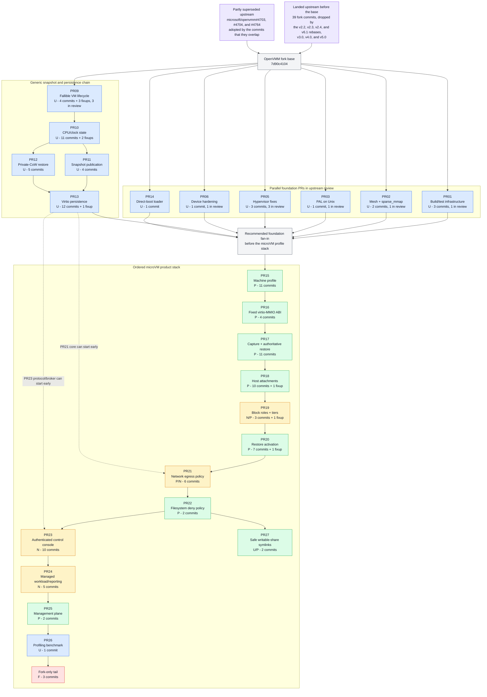

# OpenVMM Micro-VM PR Strategy

## Scope

- OpenVMM fork base: `7d90c41044077e31ca060df9206532f579f24716`, upstream main on 2026-11-13.
  The `feature/microvm/release/v6.1` rebase moved the chain there from
  `ba105dd7f00499acc1862456c179c0930cb2c8f7`, upstream main on 2026-11-06, where the
  `feature/microvm/release/v5.1` rebase had moved it and the `feature/microvm/release/v6.0`
  reorganization kept it; see [Upstream status](#upstream-status).
- Mapped fork tip: `7f31de5352aed253234f87995423406d29dcaa29`, position 124. The graph, PR
  summary, and commit mapping below cover positions 001-124, the PR09 fixups at positions
  234-236, the PR13 fixup at position 240, the PR18 fixup at position 241, the PR20 fixup at
  position 242, the PR19 fixup at position 243, and the PR10 fixups at positions 271 and 273.
- NVX's pinned OpenVMM revision: `efe6bc26734fff155cfd3a5dcbacc5ed285cd0ae`, position 275, the
  head of microsoft/openvmm#5087, whose one commit follows position 274, `e2458a6ce`, the head of
  `feature/microvm/dev`, to which microsoft/openvmm#5084 added position 274 after position 273,
  `09cd771c0`, microsoft/openvmm#5083 added position 273 after position 272, `fb2c8b75c`, and
  microsoft/openvmm#5077 added positions 270-272 after position 269, `73cf40357`, the head of
  `feature/microvm/release/v6.1`. The v6.1 rebase replayed the 268
  commits of `feature/microvm/dev` at NVX's pin before it, `5ca20ee08`, whose first 220 commits
  are those of `feature/microvm/release/v6.0`, onto the new fork base without the seven whose
  changes upstream had landed, and added eight fixups at its tip, positions 262-269. A commit's
  position is its v6.0 position less the number of dropped commits before it: v6.0 positions
  003-007 are positions 002-006, 010-013 are 007-010, 015-050 are 011-046, and 054-268 are
  047-261; see [Conflicts of the v6.1 rebase](#conflicts-of-the-v61-rebase). The pin is 151
  commits past the mapped tip on the same first-parent chain. Positions 125-233, 237-239,
  244-270, 272, and 274-275 are not yet assigned to PRs, positions 234-236 are PR09 fixups,
  position 240 is a PR13 fixup, position 241 is a PR18 fixup, position 242 is a PR20 fixup,
  position 243 is a PR19 fixup, and positions 271 and 273 are PR10 fixups; see
  [Commits after the mapped tip](#commits-after-the-mapped-tip).
- Upstream main: `7d90c41044077e31ca060df9206532f579f24716` (2026-11-13), the fork base itself;
  see [Upstream main past the fork base](#upstream-main-past-the-fork-base).

## Upstream status

The `feature/microvm/release/v6.1` rebase moved the 268-commit chain of `feature/microvm/dev`,
through NVX's previous pin `5ca20ee08`, from `ba105dd7f` onto `7d90c4104`, 44 upstream commits
later. It dropped v6.0 positions 002, 008, 009, 014, and 051-053, whose changes upstream had
landed, all but 002 after review changes; [Landed upstream](#landed-upstream) lists them.
Replaying the remaining 261 commits had conflicts at 16 positions, 11 of them with
microsoft/openvmm#4553, upstream's SaveVM and RestoreVM, which changes the snapshot manifest and
publication of PR11, and the generated workflows of one more needed regenerating;
[Conflicts of the v6.1 rebase](#conflicts-of-the-v61-rebase) lists them. Eight fixups at its tip,
positions 262-269, adapt the chain to upstream changes that no textual conflict exposed. The
patches of 220 replayed commits are unchanged, and those of 25 more differ only in context.

The `feature/microvm/release/v6.0` reorganization kept the 223-commit chain of
`feature/microvm/dev`, through NVX's previous pin `3f2ab4c2f`, on `ba105dd7f`, which upstream main
had not passed, so it dropped no commit and nothing conflicted with upstream. It folded the PR20
fixup at v5.1 position 148 into v6.0 position 097 and the PR12 fixup at v5.1 position 221 into
v6.0 positions 035 and 036, combined v5.1 positions 222 and 223 into v6.0 position 220, and
checked that every commit builds; the pin's tree is the tree of `3f2ab4c2f`. See
[The v6.0 reorganization](#the-v60-reorganization).

The `feature/microvm/release/v5.1` rebase moved the 219-commit chain of `feature/microvm/dev`,
through NVX's previous pin `db42fde04`, from `61994293a` onto `ba105dd7f`, nine upstream commits
later. Upstream had landed none of its commits, so it dropped none, and every commit kept its
position. Replaying the chain conflicted only at v5.1 position 183, now position 175, which
[Conflicts of the v5.1 rebase](#conflicts-of-the-v51-rebase) lists; the other 218 commits replayed
with unchanged patches, and no upstream change broke the chain without a textual conflict, so the
rebase added no fixups.

The `feature/microvm/release/v5.0` reorganization moved the 220-commit chain of
`feature/microvm/dev`, through NVX's previous pin `e1ca353eb`, from `c6d3da0ff` onto `61994293a`,
61 upstream commits later. It dropped v4.0 positions 004, 017, and 217, whose changes upstream had
landed, and v4.0 position 023, whose stop before teardown microsoft/openvmm#4863 supersedes;
[Landed upstream](#landed-upstream) lists them. Replaying the remaining commits had conflicts at 31
positions, which [Conflicts of the v5.0 rebase](#conflicts-of-the-v50-rebase) lists, and 15
fixups adapted commits to upstream changes that no textual conflict exposed. The reorganization
then folded those fixups into the commits that they fix, retired PR09's bounded quiesce
transactions of v4.0 position 021, folded the snapshot quiesce without a deadline of v4.0 position
216 and PR13's fixups at v4.0 positions 218 and 219 into the commits that they change, and fixed
what checking each commit found; see [The v5.0 reorganization](#the-v50-reorganization).

The `feature/microvm/release/v4.0` reorganization moved the 205-commit chain of
`feature/microvm/release/v3.0`, through NVX's previous pin `35e76265f`, from `b2676222b` onto
`c6d3da0ff`, 30 upstream commits later. It dropped v3.0 positions 010, 012, 017, and 022-025,
whose changes upstream had landed, and position 016, whose stop cancellation
microsoft/openvmm#4835 supersedes; [Landed upstream](#landed-upstream) lists them. Replaying the
remaining commits had conflicts at 16 positions, which
[Conflicts of the v4.0 rebase](#conflicts-of-the-v40-rebase) lists, and two fixups adapted
v4.0 positions 017 and 128 to upstream changes that no textual conflict exposed. The
reorganization then retired the fallible device start of v3.0 position 027, folded
microsoft/nvx#1232's awaited device restoration into the chain, and added the ABI restart at v4.0
positions 197-210; see [The v4.0 reorganization](#the-v40-reorganization).

The `feature/microvm/release/v3.0` reorganization moved the chain of
`feature/microvm/release/v2.4` from `27fe0c64f` onto `b2676222b`, two upstream commits later.
Upstream had landed v2.4 position 016 in a revised form as microsoft/openvmm#4583, so the
reorganization dropped it. microsoft/openvmm#4829 makes cancelled `pal_async` event waits
reusable and changes no file of the chain except `Cargo.lock`, where it adds a line that the chain
does not touch. Replaying the remaining 385 commits had no conflicts. The reorganization then
regrouped them into 200 commits without changing the tree: the pin's tree, `652f88f95`, is
the tree of that replay, the rebase of `feature/microvm/release/v2.4` onto `b2676222b` without
position 016; see [The v3.0 reorganization](#the-v30-reorganization).

The `feature/microvm/release/v2.4` rebase moved the 380-commit chain of
`feature/microvm/release/v2.3` from `22c0485be` onto `27fe0c64f`, 76 upstream commits later. It
dropped the ten commits whose changes upstream had landed, v2.3 positions 003, 005, 009, 012,
015, 017, 023, 030, 031, and 036, and resolved conflicts at 45 positions, which
[Conflicts of the v2.4 rebase](#conflicts-of-the-v24-rebase) lists at their v3.0 positions. It
added sixteen fixups at its tip, v2.4 positions 371-386, which adapted the chain to upstream
changes that no textual conflict exposed; the v3.0 reorganization folded them into the commits
that they fix.

The `feature/microvm/release/v2.3` rebase moved the 334-commit chain of
`feature/microvm/release/v2.2` from `790132851` onto `22c0485be`, 23 upstream commits later. It
dropped position 074, whose change microsoft/openvmm#4661 had landed upstream, resolved seven
commits that conflicted, and added four fixups at its tip, v2.4 positions 324-327, which the
v3.0 reorganization folded too.

The `microvm/v2.2` rebase moved the 320-commit chain of `microvm/v2.1` from `e1cdbd916` onto
`790132851`, 75 upstream commits later. It dropped the eight fork commits that had landed
upstream in between and adapted the remaining 312 to upstream API changes where they needed it,
which changed the diffs of 50 of them.

### Landed upstream

| Dropped by | Former position | Fork commit | Roadmap PR | Upstream PR | Upstream commit |
| --- | ---: | --- | --- | --- | --- |
| v6.1 | 002 | `707747c16` - flowey: distinguish native Windows and WSL nextest paths | PR01 | microsoft/openvmm#4595 | `5d3ab02f0` |
| v6.1 | 008 | `299a04d4f` - pal: query Unix socket peer credentials | PR03 | microsoft/openvmm#4591 | `42d4fe619` |
| v6.1 | 009 | `a0e70d99e` - pal: resolve the process token user SID | PR04 | microsoft/openvmm#4604 | `6937acefb` |
| v6.1 | 014 | `5ed5f7a22` - serial_socket: keep Windows named-pipe listeners reconnectable | PR06 | microsoft/openvmm#4609 | `f5ef11b8a` |
| v6.1 | 051 | `6cea1ae18` - loader: let static ELF loading reuse a caller buffer | PR14 | microsoft/openvmm#4554, which supersedes it | `e4728b7f4` |
| v6.1 | 052 | `4ccef3c27` - loader: add an Intel MP 1.4 table builder | PR14 | microsoft/openvmm#4554 | `e4728b7f4` |
| v6.1 | 053 | `b585c7300` - loader: add firmware-less Linux direct boot with MP tables | PR14 | microsoft/openvmm#4554 | `e4728b7f4` |
| v5.0 | 004 | `6476a457f` - consomme: make TCP window-reopen validation deterministic | PR01 | microsoft/openvmm#4598 | `19485f88e` |
| v5.0 | 017 | `ea1153ef4` - consomme: bound active TCP, UDP, and ICMP flows | PR07 | microsoft/openvmm#4600 | `e89a7e22d` |
| v5.0 | 023 | `0692a461c` - openvmm_core: stop the devices before tearing down the VM | PR09 | microsoft/openvmm#4863, which supersedes it | `0c9697277` |
| v5.0 | 217 | `62b427a38` - serial_socket: report read errors as EOF and drop the connection | PR06 | microsoft/openvmm#4605 | `48e0681e9` |
| v4.0 | 010 | `1a8bc4363` - pal: add handle-relative file access that does not follow reparse points | PR04 | microsoft/openvmm#4593 | `789d51653` |
| v4.0 | 012 | `d25e0e13f` - pal_async: fix named-pipe reconnect and already-connected listen | PR04 | microsoft/openvmm#4585 | `03e8ae741` |
| v4.0 | 016 | `47102941e` - virtio_blk: let stop cancellation win over a ready queue and drain accepted I/O | PR06 | microsoft/openvmm#4835, which supersedes it | `79e67ae36` |
| v4.0 | 017 | `41460f3f7` - virtiofs: make handle and inode ID allocation fallible | PR06 | microsoft/openvmm#4594 | `389e4e57a` |
| v4.0 | 022 | `38998a580` - openvmm_helpers: split the snapshot module without behavior changes | PR08 | microsoft/openvmm#4616 | `0812555fe` |
| v4.0 | 023 | `313b5fe0b` - net_tap: move the transmit path into its own module | PR08 | microsoft/openvmm#4617 | `c696625c6` |
| v4.0 | 024 | `238c6cc96` - net_consomme: move queue transmit processing into a module | PR08 | microsoft/openvmm#4620 | `3bb37a191` |
| v4.0 | 025 | `c1bd1e0a5` - virtio_console: move the direct receive loop into its own module | PR08 | microsoft/openvmm#4621 | `2a17dfdd5` |
| v3.0 | 016 | `f5231b2d2` - chipset: preserve IOAPIC line levels across restore | PR06 | microsoft/openvmm#4583 | `db4331e53` |
| v2.4 | 003 | `0213cf65d` - flowey: skip reinstalling an identical, possibly running cargo-nextest binary | PR01 | microsoft/openvmm#4608 | `03a2fc597` |
| v2.4 | 005 | `a91dc86fb` - lxutil: tolerate inherited extended attributes in tests | PR01 | microsoft/openvmm#4587 | `a1d71b899` |
| v2.4 | 009 | `15a895dd8` - sparse_mmap: add private copy-on-write file views | PR02 | microsoft/openvmm#4557 | `d8acf2a7c` |
| v2.4 | 012 | `4a7ab405c` - pal: add Unix extent cloning and sparse-extent seeking | PR03 | microsoft/openvmm#4590 | `c62489737` |
| v2.4 | 015 | `074de3406` - pal: add sparse-file range queries, zeroing, and block cloning | PR04 | microsoft/openvmm#4596 | `8f1c36ba5` |
| v2.4 | 017 | `50460c27a` - pal: query named-pipe peers and create protected pipes | PR04 | microsoft/openvmm#4582 | `65db52693` |
| v2.4 | 023 | `938b14343` - chipset: fast-forward periodic PIT counting over long intervals | PR06 | microsoft/openvmm#4586 | `023329997` |
| v2.4 | 030 | `135c503ba` - consomme: cover the pending DNS request limit with a test | PR07 | microsoft/openvmm#4601 | `cd93f761f` |
| v2.4 | 031 | `90734a2ff` - consomme: cover IPv4 fragment rejection with a test | PR07 | microsoft/openvmm#4602 | `3d9cb006a` |
| v2.4 | 036 | `6794f12d0` - openvmm_entry: skip raw console mode when stdin is not a terminal | PR08 | microsoft/openvmm#4606 | `769f2f61f` |
| v2.3 | 074 | `f6e6ff738` - loader_defs: name the boot_params ACPI RSDP field | PR14 | microsoft/openvmm#4661 | `8beae2961` |
| v2.2 | 002 | `607e6c6a2` - nextest: scope a longer budget to the exhaustive ring-buffer loom test | PR01 | microsoft/openvmm#4584 | `9501bb481` |
| v2.2 | 017 | `c61d77644` - pal: create files and directories with explicit security descriptors | PR04 | microsoft/openvmm#4599 | `9fbf965c5` |
| v2.2 | 021 | `88865bf90` - virt_mshv: describe SNP guest workarounds without ACI-specific names | PR05 | microsoft/openvmm#4580 | `40cff1268` |
| v2.2 | 022 | `9b3ce6760` - kvm: preserve pending external interrupts across VP-state capture | PR05 | microsoft/openvmm#4522 | `392890680` |
| v2.2 | 029 | `947ae858b` - virtio: make interrupt tests wait for queue completion | PR06 | microsoft/openvmm#4592 | `5b4656a86` |
| v2.2 | 030 | `21c2206c9` - fuse: rate-limit guest-triggerable diagnostics | PR06 | microsoft/openvmm#4581 | `926827446` |
| v2.2 | 035 | `54c5c34cd` - virtio_console: rate-limit worker errors | PR06 | microsoft/openvmm#4614 | `77ce2aeac` |
| v2.2 | 039 | `dd349021e` - openvmm_entry: accept `delay:<ms>:<disk>` disk wrappers | PR08 | microsoft/openvmm#4610 | `6e0e4fdab` |

A former position counts in the branch that the rebase started from: `microvm/v2.1` for the v2.2
rebase, `feature/microvm/release/v2.2` for the v2.3 rebase, `feature/microvm/release/v2.3` for
the v2.4 rebase, `feature/microvm/release/v2.4` for the v3.0 reorganization,
`feature/microvm/release/v3.0` for the v4.0 reorganization, `feature/microvm/dev` at
`e1ca353eb`, whose first 210 commits are those of `feature/microvm/release/v4.0`, for the v5.0
reorganization, and `feature/microvm/dev` at `5ca20ee08`, whose first 220 commits are those of
`feature/microvm/release/v6.0`, for the v6.1 rebase.
microsoft/openvmm#4661 names the `acpi_rsdp_addr` field of `boot_params` exactly as position 074
did, so the v2.3 rebase dropped 074 as empty. microsoft/openvmm#4554 carried it ahead of v6.0
positions 051-053 until it merged.

The v6.1 rebase took upstream's versions of its drops and adapted the later commits to them.
microsoft/openvmm#4595 is identical to v6.0 position 002, and microsoft/openvmm#4591 adds tests to
v6.0 position 008's `credentials` module of `pal`, whose API the chain uses unchanged.
microsoft/openvmm#4604 resolves the token user SID in `pal::windows::security` itself rather
than in the `user_sid` module of v6.0 position 009, so the fixup at position 262 calls it there.
microsoft/openvmm#4609 returns a failed write, flush, or close of a Windows named pipe and returns
its backend to listening, as v6.0 position 014 did, with reconnection tests of its own in place of
014's, so position 103's call of `disconnect_current` in 014's test moved into upstream's.
microsoft/openvmm#4554 merged the MP table
builder and the firmware-less Linux direct boot of v6.0 positions 052 and 053 after review moved
the boot into `loader::linux::mptable_boot`, rebuilt the table with `zerocopy` from the MP
specification's structures, numbered the I/O APIC after the processors, and loaded the kernel and
initrd through upstream's `load_kernel_and_initrd_x64`, without the buffer reuse that v6.0
position 051 added for it. Position 183's routing of every IOAPIC input moved onto that builder,
and the fixup at position 263 loads the microVM through `mptable_boot`; see
[Conflicts of the v6.1 rebase](#conflicts-of-the-v61-rebase).

microsoft/openvmm#4863 gives devices a consuming teardown. The VM worker's run drains pending
device removals, and its pause stops the state units before the worker tears down the chipset
devices and the partition, which is what v4.0 position 023, which had no upstream pull request,
made it do, so that commit was empty on the new base and the v5.0 reorganization dropped it.

microsoft/openvmm#4835 makes devices answer task-control requests promptly. Its virtio-blk
tests `stop_drains_one_accepted_write_exactly_once` and `stop_preempts_continuously_ready_queue`
cover what v3.0 position 016 made virtio-blk do, so the v4.0 rebase dropped 016, and its pull
request, microsoft/openvmm#4588, was closed. No later commit of the chain changes `virtio_blk`.

microsoft/openvmm#4583 saves each IOAPIC input's last observed level as edge-detector history, as
v2.4 position 016 did, but restores the redirection entries, routes, and input history without
evaluating the inputs, which 016 did. A restored asserted level-triggered input therefore raises
its interrupt when its producer republishes it, when the guest's EOI clears the remote IRR, or
when the guest writes its redirection entry, not during the restore itself.

Upstream merged most of the v2.4 drops after review changes, so the v2.4 rebase took upstream's
versions and adapted the later commits to them. microsoft/openvmm#4557 creates a copy-on-write
mappable without the chain's `executable` flag, and on Windows it refuses to unmap or map over
part of a written copy-on-write view. microsoft/openvmm#4582 answers a pipe's peer process
through `PipeExt::get_pipe_peer_process_id` instead of the chain's `pal::windows::pipe::peer`
module, which also had `is_pipe`. microsoft/openvmm#4586 fast-forwards more counting modes, and
microsoft/openvmm#4606 forwards console input in `repl.rs` instead of the `headless` module, which
position 110 creates for the chain's own use, and ends the run when a stdin that is not a
terminal ends, which position 110 confines to machines other than the microVM.
microsoft/openvmm#4587 is identical to v2.3 position 005.

microsoft/openvmm#4522 fixes the lost-PIC-interrupt bug of v2.1 position 022 in a different way.
Instead of tracking the queued vector in `kvm::VpRunner`, it injects PIC interrupts through the
vCPU's injected-interrupt slot (`KVM_SET_VCPU_EVENTS`), which the existing activity save/restore
already covers. Its saved state has no slot for v2.1 position 022's queued vector: KVM snapshots
from builds with position 022 persist a queued PIC vector as a pending `ExtInt` event. Current
builds reject restoring one with `KvmError::InvalidState`, so recapture KVM snapshots that those
builds captured.

Upstream also landed parts of commits that remain in the chain:

- microsoft/openvmm#4556 (`96647c331`) derives `Clone` for `ProtobufMessage` and `ProtobufAny`.
  Position 004 keeps its subject but now only adds `ProtobufAny::value_len` and checks a
  clone in the round-trip test.
- microsoft/openvmm#4524 (`9cf109547`) adds the generic `PartitionTimeControl` contract, MSHV
  and WHP implementations, and full-VM freeze/thaw lifecycle calls. Position 023 reuses the
  MSHV implementation, through fallible freeze and thaw helpers, instead of private plumbing.
  Positions 021-025 keep the exact TSC-frequency exposure, snapshot downtime handling,
  and restored-vCPU synchronization that upstream lacks, and position 090 synchronizes only
  the VPs that a restore creates.
- microsoft/openvmm#4704 (`1c093df84`) adds the architectural `TscDeadline` VP state element,
  the `tsc_deadline` partition capability, and the KVM, MSHV, WHP, and OpenHCL register
  accessors that v2.4 position 038 also added. Position 020 now uses upstream's, so it keeps
  the `tsc_deadline` field of the CPU compatibility contract, the finalized MSHV partition's
  report of no TSC-deadline support, and the LAPIC timer helpers that position 140 deletes
  in favor of those that position 132 adds for the time ABI. Upstream compares a restored
  deadline on partitions that can freeze time, as WHP can, whereas 020 never compared it, so the
  WHP state access of position 024, which reads the deadline before the APIC state,
  discards that read when it restores the deadline.
- microsoft/openvmm#4764 (`29f0adceb`) makes every lxutil volume resolve paths beneath its root
  without following a host symbolic link, as position 123 did for a confined volume, and
  microsoft/openvmm#4783 (`7c92b147e`) rejects unsafe opens. Position 123 now only adds
  `LxVolumeOptions::confine_paths`, which makes a Windows volume create LX symlinks, and runs its
  confinement tests against upstream's implementation. A share therefore needs `openat2`,
  Linux 5.6 or later, where the chain fell back to opening each component with `O_NOFOLLOW`.

### Open upstream pull requests

As of 2026-11-13, every commit of PR01-PR03, PR05, PR06, and PR09 except positions 001, 003, 004,
and 012 is in an open upstream pull request; the commits that upstream has merged are under
[Landed upstream](#landed-upstream), and PR04, PR07, and PR08 have landed whole. Each pull request
carries one commit. Of those 10 pull requests, only microsoft/openvmm#4597, microsoft/openvmm#4613,
and microsoft/openvmm#4618 are ready for review: microsoft/openvmm#4607 has been a draft again
since 2026-11-06, and the other six since 2026-11-10. None has an approving review.
microsoft/openvmm#4451, which proposed position 001, was closed without merging, and the
remainder of position 004 has not been proposed. microsoft/openvmm#4615, which proposed position
003, was closed on 2026-11-10, since a Windows servicing release fixes the WHP behavior that it
works around; the chain keeps it. PR14's remaining commit, position 047, is in no pull request
either: microsoft/openvmm#4611, which proposed it, was closed on 2026-11-10, after review suggested
combining it with the commit that needs it. microsoft/openvmm#4619, microsoft/openvmm#4622, and
microsoft/openvmm#4623, which proposed the fallible unit start, device start, and VM resume of
v3.0 positions 026-028, were closed in favor of microsoft/nvx#1232: position 011 now only rolls
back a partial start, v3.0 position 027 is retired, and position 012's resume stays fallible; see
[The v4.0 reorganization](#the-v40-reorganization). PR10-PR13 and PR15-PR27 have no upstream pull
requests yet.

On 2026-11-04, microsoft/nvx#1260 withdrew v4.0 position 021 from PR09, since the deadline of the
snapshot quiesce added no safety: microsoft/openvmm#4625, which proposed its bounded quiesce
transactions, was closed, and the v5.0 reorganization retired the commit and folded the quiesce
without a deadline into the commits that it changes; see
[The v5.0 reorganization](#the-v50-reorganization). microsoft/openvmm#4872, opened on 2026-11-03,
proposes position 011's rollback of a partial start, with review changes that the chain lacks,
apart from its handling of a unit in a terminal state, its teardown after a failed restart, and
its rollback's stop in reverse dependency order, which the PR09 fixups at positions 234-236 carry.
microsoft/openvmm#4626, which proposes position 014's input gate without a deadline, as the chain
now has it, builds on it. So does microsoft/openvmm#4937, a draft since 2026-11-10, which makes
`StateUnits::stop` fail instead of panicking when a unit's task has ended, as position 237 does in
the chain. Position 237 also adapts the chain's own callers of `StateUnits::stop`, such as the
microVM worker's snapshot quiesce, and makes `VmRpc::Pause` fail where #4937's VM worker panics on
a failed stop.

On 2026-11-05, microsoft/openvmm#4605 merged as `48e0681e9`, narrowed in review to the read path: a
read error is traced, drops the socket, and is reported as EOF, while writes keep upstream's
handling, which reports a broken pipe as a successful write and keeps the socket. Review settled
disconnect detection in virtio-console instead, with microsoft/openvmm#4778, which every fork base
since v2.4 includes. Position 037, which carried the pull request's first revision and drops the
socket and returns the error on any failed write, therefore has no upstream pull request. The chain
keeps it for output rather than disconnects: a virtio-console with the `Retain` policy of PR13's
position 038 and the portb console of PR15's position 053 keep the guest output written after their
peer leaves only when that write fails, and on Linux a write to an AF_UNIX peer that has closed
fails with `EPIPE`, which upstream's backend reports as successful. Dropping it as
microsoft/openvmm#4605's commit would make `Retain` consoles and portb lose that output on Linux.
The v5.0 reorganization therefore dropped v4.0 position 217, which cherry-picked `48e0681e9` for
PR06, and moved v4.0 position 015 into PR13 as position 037, ahead of the policy that needs it,
with v4.0 position 218, which explains and tests that write handling, folded into it. PR13's
position 039 took the test of v4.0 position 219 that a `Retain` console keeps that output for the
next peer.

microsoft/openvmm#4609, which v6.0 position 014 carried, had the same split, but its review kept
the write handling: since it merged as `f5ef11b8a` on 2026-11-11, a Windows named pipe returns a
failed write, flush, or close and drops its client, so a `Retain` console on a named pipe keeps
that output too. The v6.1 rebase therefore dropped 014 as landed.

On 2026-11-10, microsoft/openvmm#4553, upstream's SaveVM and RestoreVM for the management RPC,
which proposes no chain commit, merged as `64828d2b5`. It records a snapshot ID in the manifest's
field 18, to which it moved the ID from field 8, the chain's `state_size_bytes`, after
microsoft/nvx#1210 raised the clash, and it reserves fields 19 and 20 for
`compatibility_bundle_digest` and `memory_artifacts`, all three of which position 224 had kept
free. It also changes `write_snapshot` in the snapshot publication of `openvmm_helpers`, which
PR11's positions 027-029 and later chain commits change. The v6.1 rebase therefore gives the
chain's `SnapshotManifest` upstream's `snapshot_id`, which a microVM capture leaves zero, publishes
upstream's snapshots through the chain's staged publication, and keeps microVMs out of RestoreVM;
see [Conflicts of the v6.1 rebase](#conflicts-of-the-v61-rebase). NVX's pin of the rebase has
`nvx-rs`'s reader of a template's manifest, which refuses fields that it does not know, accept
field 18.

| Roadmap PR | Positions | Upstream pull requests, in position order |
| --- | ---: | --- |
| PR01 | 002 | microsoft/openvmm#4618 |
| PR02 | 005 | microsoft/openvmm#4558 |
| PR03 | 006 | microsoft/openvmm#4589 |
| PR05 | 007-009 | microsoft/openvmm#4536, microsoft/openvmm#4607, microsoft/openvmm#4613 |
| PR06 | 010 | microsoft/openvmm#4597 |
| PR09 | 011, 013, 014 | microsoft/openvmm#4872, microsoft/openvmm#4624, microsoft/openvmm#4626 |

Stacked pull requests carry their prerequisites' commits: microsoft/openvmm#4613 builds on
microsoft/openvmm#4536, and microsoft/openvmm#4626 builds on microsoft/openvmm#4872.
Most of these pull requests have gained review commits that the fork chain does not carry. When
one merges, the next rebase should drop its fork commit, as the `microvm/v2.2`,
`feature/microvm/release/v2.3`, `feature/microvm/release/v2.4`, and
`feature/microvm/release/v6.1` rebases and the v3.0, v4.0, and v5.0 reorganizations dropped the
39 above, and adapt later commits to the merged form.

The v3.0 reorganization folded fixups into positions 005, 008, 009, and 047, and the v4.0
reorganization changed positions 011 and 014, whose pull requests lack those changes; see
[The v4.0 reorganization](#the-v40-reorganization) and
[The v3.0 reorganization](#the-v30-reorganization). The v5.0 reorganization adapted positions 002,
005, 010, 011, and 014 to upstream main, and folded into position 014 the removal of its input
gate's deadline, which microsoft/openvmm#4626 already lacks; see
[The v5.0 reorganization](#the-v50-reorganization). The v6.1 rebase adapted position 006 to
microsoft/openvmm#4591; see [Conflicts of the v6.1 rebase](#conflicts-of-the-v61-rebase).

### Conflicts of the v6.1 rebase

A v6.0 position in this section counts in `feature/microvm/dev` at `5ca20ee08`, whose first 220
commits are those of `feature/microvm/release/v6.0`, and a position without a release is a v6.1
position. The v6.1 rebase dropped seven commits, so a commit's position is its v6.0 position less
the number of dropped commits before it: v6.0 positions 003-007 are positions 002-006, 010-013 are
007-010, 015-050 are 011-046, and 054-268 are 047-261. A position from 003 on in a section on an
earlier release counts in that release.

The `feature/microvm/release/v6.1` rebase replayed the 261 remaining commits onto `7d90c4104`
with conflicts at 16 positions, which it resolved in place. The table lists each resolution at its
v6.1 position.

| Position | v6.1 commit | v6.0 commit | Upstream PR | Resolution |
| ---: | --- | --- | --- | --- |
| 006 | `50018e52e` | 007 `432f59f81` - pal: bound Linux descriptor-table pre-expansion | microsoft/openvmm#4591 | Keeps upstream's `credentials` module beside the commit's Linux-only `fd_table` module, in name order |
| 027 | `9a8d99b0b` | 031 `f1d03f428` - openvmm_helpers: version the snapshot manifest format and bound its decoding | microsoft/openvmm#4553 | The manifest keeps upstream's `snapshot_id`, field 18, after the commit's fields, and the commit's `Default` gives it the zero GUID; the CLI save and the save-to-disk VMM test set their snapshot IDs and take the rest from `Default`; `write_snapshot` takes upstream's refusal of an existing destination, its cleanup, and its manifest-last order, checks the saved-state size limit before it claims the destination, and records `state_size_bytes` in the manifest that it writes last; the round-trip test checks both the ID and the recorded length |
| 028 | `119345ead` | 032 `f6cdb703a` - openvmm_helpers: publish snapshots atomically through durable staging | microsoft/openvmm#4553 | The commit's staged publication replaces upstream's in-place write, cleanup, and hard link, and keeps upstream's public `check_snapshot_destination`, which SaveVM calls before it pauses the VM; upstream's tests stay, apart from `write_snapshot_creates_dir`, which the commit removes since the parent must exist: the existing-snapshot test backs the manifest's 1024 bytes of RAM, and the cleanup test fails while it copies `memory.bin`, after `state.bin` is staged, and checks that no staging directory remains; the guides describe the copy and the staged rename, with upstream's advice to keep the backing file outside the snapshot directory |
| 032 | `fff152a23` | 036 `49a1a98b9` - openvmm: restore RAM through a private CoW mapping and retain generation handles | microsoft/openvmm#4553 | The management RPC's launch keeps upstream's saved state and shared memory, which RestoreVM prepares from the snapshot, and passes the commit's defaults for other management launches, a shared mapping and no restore guards, so RestoreVM still runs guest RAM in place from `memory.bin` |
| 057 | `cd065f0c0` | 064 `87811096f` - openvmm_entry: expose `--machine microvm` | microsoft/openvmm#5018, microsoft/openvmm#4147, microsoft/openvmm#4554 | Upstream's `supports_acpi_power_button`, which decides from the load mode and gives the microVM's MP-table boot no power button, replaces the commit's check of the machine profile in the helper that microsoft/openvmm#5018 removed; the microVM's load mode precedes upstream's IGVM branch, without the restore branch that microsoft/openvmm#4147 removed; the Linux direct boot guide keeps upstream's description of `load_x86_mptable`, which `--machine microvm` now uses, before the commit's layout |
| 069 | `f8a051525` | 076 `652724750` - openvmm_entry: capture guest-requested microVM snapshots | microsoft/openvmm#4553 | The CLI's save keeps upstream's return of the snapshot ID and refuses a microVM first, as the commit has it; the snapshots guide takes the commit's description of the RAM file's promotion and publication, with upstream's advice to keep the backing file outside the snapshot directory and its statement that existing data is never overwritten |
| 086 | `7868666b8` | 093 `65f8b0d31` - openvmm: add clone and resume tiers with single-use resume claims | microsoft/openvmm#4553 | The manifest's tier, restore policy, and consumed sections, fields 15-17 until position 198 numbers them 13-15, precede upstream's `snapshot_id`, field 18, in the manifest and in its `Default` |
| 103 | `56b65cb4f` | 110 `1414c1a56` - serial_socket: report Unix and named-pipe peer identities | microsoft/openvmm#4609 | Upstream's named-pipe tests replace the reconnect test of v6.0 position 014, which the rebase dropped; the commit's call of `disconnect_current`, a no-op once the client has gone, moves into upstream's `reconnects_after_client_close`, after the failed write leaves the backend listening, and upstream's `reconnects_after_close_failure` stays as it is |
| 117 | `669e4aecd` | 124 `5fde97978` - vmservice: create, capture, and restore microVMs over the management RPC | microsoft/openvmm#4553 | CreateVM parses its microVM settings with the commit's `CreateVm` and creates the VM through upstream's `create_vm_inner`, which takes them beside upstream's restore parameters; RestoreVM restores only a standard VM and refuses a microVM, which restores from its authoritative manifest through CreateVM; a microVM refuses upstream's memory backing file; the worker takes upstream's restored state and shared memory, or else the microVM's, and the controller upstream's backing file, or else the microVM's RAM file; the service keeps upstream's SaveVM state beside the commit's pending readiness; the ttrpc test's upstream-built configuration fills the new virtio-fs fields with defaults |
| 118 | `9ef38e9ec` | 125 `502f72235` - ttrpc: propagate nonzero guest exit status | microsoft/openvmm#4553 | Upstream's `save_vm` stays ahead of the controller-event handler, which takes the commit's fallible signature |
| 120 | `4527dbc00` | 127 `75d359f4c` - ci: restrict privileged, self-hosted, and publishing jobs to microsoft/openvmm | microsoft/openvmm#5057 | The commit's fork gates take the runner, `.0`, of upstream's `(GhRunner, NextestProfile)` pools wherever microsoft/openvmm#5057 made the pool functions return one; `cargo xflowey regen` reproduces the merged workflows, and `cargo xtask fmt --pass verify-flowey` passes |
| 183 | `3a891414e` | 190 `282c72377` - microVM: route every IOAPIC input in the MP table | microsoft/openvmm#4554 | The commit's routing of IOAPIC inputs 16 and up moves onto upstream's `zerocopy` table builder: `MpTableConfig::ioapic_inputs` and `Error::TooFewIoApicInputs` join upstream's, the entry count adds the inputs past the ISA IRQs, and each of those inputs gets an `IoInterruptEntry` of its own number, active high and edge triggered through a new `spec::INTERRUPT_FLAG_EDGE_TRIGGERED`, aimed at upstream's I/O APIC, whose ID follows the processors' instead of being 0; upstream's tests pass 24 inputs, or 16 where they pin the ISA-only bytes, and the commit's tests expect upstream's I/O APIC ID |
| 221 | `68cb32387` | 228 `d6addf8c1` - vmservice: carry microVM blocks, network, RAM file, and share policy | microsoft/openvmm#4553 | The commit's `MemoryConfig.backing_file_path`, field 10, is upstream's, which is `optional` and which a standard VM takes for SaveVM, so the microVM conversion reads the optional value and a standard request no longer refuses it; CreateVM converts a microVM request as the commit does, and builds a standard VM through the commit's `create_standard_vm`, which takes upstream's restore parameters and returns the restored snapshot's ID beside the launch; RestoreVM builds a standard request from its configuration, refuses a microVM, and launches through the commit's `launch_vm`, which records the backing file that SaveVM needs for a standard VM only, beside upstream's saved-snapshot state |
| 224 | `03c6c0cef` | 231 `98e5b3ca5` - openvmm_helpers: reserve the manifest fields that upstream assigns | microsoft/openvmm#4553 | The manifest carries upstream's `snapshot_id` in field 18, which the commit only reserved, and the commit's reservation of fields 19 and 20 joins upstream's comment; the Guide's rule for extending the format still keeps 18-20 from new fields |
| 227 | `32b73e83b` | 234 `f41a1ecfc` - openvmm_helpers: don't publish a snapshot over an empty directory | microsoft/openvmm#4553 | The snapshots guide keeps upstream's statement that existing data is never overwritten beside the commit's refusal of a destination that appears during the capture |
| 232 | `9cb3c8206` | 239 `b5d20bf84` - petri: let a microVM test be its snapshot controller | microsoft/openvmm#4553 | Petri's worker launch takes upstream's saved state and then the commit's microVM snapshot channels |

Position 121, v6.0 position 128 `88c55fa8f` - ci: run the checkin gates on the feature/microvm
branches, replayed its generated workflows without a conflict, but the merge displaced the SIVM
IGVM build and publish steps that microsoft/openvmm#4940 adds, so the rebase regenerated the three
workflows from the commit's flowey sources with `cargo xflowey regen`, which leaves the commit's
patch as it was.

Upstream changes also broke the chain without a textual conflict. Eight fixups at the tip adapt
the chain to them; fold each into the commits that it names at the next reorganization, or before
submission.

| Position | Fixup | Upstream PR | Fold into |
| ---: | --- | --- | --- |
| 262 | `55adb5c93` - serial_socket, openvmm_entry: resolve user SIDs at upstream's path | microsoft/openvmm#4604 | 103 and 110 |
| 263 | `b9a8f7f6e` - openvmm_core: load microVMs through upstream's MP-table boot module | microsoft/openvmm#4554 | 055 and 176 |
| 264 | `7b98adc6d` - openvmm_entry, openvmm_helpers: read upstream's snapshots through OpenedSnapshot | microsoft/openvmm#4553 | 031 |
| 265 | `5460c8e05` - openvmm_entry, openvmm_helpers: record no snapshot ID in microVM captures | microsoft/openvmm#4553 | 069 and 119 |
| 266 | `649aeacf0` - ttrpc: give the guest exit test's service upstream's SaveVM state | microsoft/openvmm#4553 | 118 |
| 267 | `4a1d9b07a` - Guide, openvmm_entry: describe upstream's snapshots with the chain's publication | microsoft/openvmm#4553 | 028, 032, and 069 |
| 268 | `63688dd58` - vmm_tests: save the ttrpc interface test's VM with a VMBus NIC | microsoft/openvmm#4553 | 044 |
| 269 | `73cf40357` - openvmm_helpers: drop an independent snapshot copy's page cache | microsoft/openvmm#4553 | 028 |

Position 262 calls the token user SID queries of microsoft/openvmm#4604 in
`pal::windows::security`, where upstream merged them, from the peer identities and the control
console of PR23's positions 103 and 110. Position 263 loads the microVM's kernel and computes
its e820 RAM ranges through upstream's `loader::linux::mptable_boot` instead of the chain's
`loader::linux::microvm`, for PR15's position 055 and the device DMA ranges of position 176.
Position 264 has RestoreVM open its snapshot once with PR12's `OpenedSnapshot`, which checks that
`memory.bin` has the manifest's length, instead of upstream's path-based `read_snapshot`, which
position 031 replaced; it checks the expected snapshot ID against that manifest and closes the
snapshot's artifacts before the restore maps `memory.bin`. Position 265 gives the manifests that
the microVM capture of PR17's position 069 and the benchmark of PR26's position 119 build field by
field the zero snapshot ID, which the manifest defines as none, since only RestoreVM, which
refuses a microVM, checks an expected ID. Position 266 initializes upstream's SaveVM state in the
service of the guest exit test of PR25's position 118, and position 267 describes upstream's SaveVM
and the command line's save with the staged copy of PR11's position 028, which never hard-links
the memory backing file into the snapshot, and the command line's restore with the private
copy-on-write mapping of PR12's position 032, which leaves the snapshot unchanged. RestoreVM still
runs `memory.bin` in place, and so restores a snapshot once, as upstream's guide says. Position 268
gives the save and restore iteration of upstream's ttrpc interface test a VMBus NIC and moves the
test's virtio-frontend NIC to its third iteration, which does not save: PR13's position 044 lets
virtio-net save only a NIC bound to a static identity and feature contract, which the management
RPC does not configure, so SaveVM refused the test's VM on KVM and MSHV in OpenVMM CI. Position
269 has `copy_exact`, from PR11's position 028, drop the page cache of each independent copy that
it makes, of `memory.bin` or of a paired scratch image, once the copy is flushed. On MSHV, with the
snapshot on ext4, the VM that the ttrpc interface test restores through RestoreVM stopped as soon
as it resumed, on a memory intercept that an interrupt's delivery caused and that the emulator
refuses, unless the snapshot hard-linked the backing file, as upstream's does, or the copy's pages
had left the page cache; on tmpfs, it passed either way. NVX's templates publish `memory.bin` by
hard link wherever the filesystem allows one and pair no scratch, so their captures and clones
make no such copy.

The chain has no merges, and every commit has a good signature. Against v6.0, a range diff finds
the patches of 220 commits unchanged, those of the 16 resolved commits changed, and those of 25
more changed only in their context. At the 16 resolved commits, the eight fixups, and positions
002, 121, and 179, which change the pipelines, rustfmt on the files that the commit changes and
`cargo xtask fmt --pass lints` pass on x86_64 Linux and x86_64 Windows, and
`cargo xtask fmt --pass verify-flowey` passes at positions 002, 120, 121, and 179. There,
`cargo check --locked --workspace --all-targets` passes at positions 002, 006, 027, 028, and
266-269 on both hosts, and from position 032 to position 265 it fails only with the breaks that the
fixups at positions 262-266 repair; on Windows, it and Clippy leave out `guest_test_uefi` and
`opentmk_executor`, which upstream's Clippy job checks for their UEFI targets alone, and
`vtpm_util`, whose TPM needs OpenSSL, as upstream's Windows jobs do. At position 267,
`cargo xtask fmt` passes, Clippy with `-D warnings` passes on both hosts, the unit tests of the 20
packages that the conflicts and fixups change or build on pass on Linux and, apart from a
`sparse_mmap` test that fails on upstream main on that host too, on Windows, and the microVM VMM
tests pass on WHP; position 268 changes only a VMM test, whose package's Clippy passes there. At
position 269, Clippy and the unit tests of `openvmm_helpers` pass on both hosts, and the ttrpc
interface test, which failed on MSHV at position 268 with its snapshot on ext4, passes there twice.

### The v6.0 reorganization

A v5.1 position in this section counts in `feature/microvm/dev` at `3f2ab4c2f`, the head of
`feature/microvm/release/v5.1`, and a position without a release is a v6.0 position. The v6.0
reorganization renumbered the positions after 147: v5.1 position N is position N-1 for N from 149
to 220, so a position from 149 on in a section on an earlier release counts in that release.

The reorganization replayed the 223 commits of `feature/microvm/dev` at `3f2ab4c2f` on their own
fork base, `ba105dd7f`, which upstream main has not passed: upstream had landed none of their
changes, and none conflicted with upstream. It folded the two fixups that the roadmap assigned to
mapped PRs into the commits that they fix, re-expressed for the code that those commits have, and
combined the two commits of microsoft/openvmm#4984, which landed together and the second of which
revises the first. The pin's tree, `7575cbccb`, is the tree of `3f2ab4c2f`. Position 219, which is
v5.1 position 220 renumbered, has the tree of v5.1 position 221, `0e46a01ed`, rather than that of
v5.1 position 220, since the fold moved v5.1 position 221's change ahead of it, into positions 035
and 036. The table lists where each change went.

| v5.1 position | Change | v6.0 positions |
| ---: | --- | --- |
| 148 | `8c0a0251f` - microVM: let platform snapshots opt into restore-time vCPU activation | 097, 099, 116, 147 |
| 221 | `0e46a01ed` - openvmm_helpers: leave the change time out of snapshot file generations | 035, 036, 076, 092, 093 |
| 222 | `5799877f0` - virt: read on while the guest TSC's offset is wide | 220 |
| 223 | `3f2ab4c2f` - virt: read the guest TSC offset until it is within its bound | 220 |

- v5.1 position 221 folds into PR12's position 035, which adds the file generation that it changes:
  the Linux generation of an opened snapshot file keeps the device, inode, length, and modification
  time, but not the change time, which removing the other link of an automatic `memory.bin` moves.
  Its test publishes the snapshot through `write_snapshot_from_owned_memory_file`, the owned-RAM
  publication that PR11's position 033 adds, and 035's snapshot format guide no longer says that
  Linux records the change time. Position 036 takes 221's sentence of that guide in place of the
  one on observable metadata changes that it adds, which PR19's position 093 rewraps. PR17's
  position 076, which names the RAM file of a microVM capture `.openvmm-microvm-memory-`, gives the
  test's RAM file that name, and PR19's position 092, which replaces
  `write_snapshot_from_owned_memory_file` with `write_snapshot_from_owned_memory_and_scratch_files`,
  has the test publish through the new function, as 221's test does.
- v5.1 position 148 folds into PR20's position 097. 097's platform tier check still checks the TSC
  and LAPIC tokens of the platform command line, so its `maxcpus=` check follows the processor
  capacity's among them, the allowlist accepts `maxcpus=` between `nr_cpus=` and
  `lapic_timer_hz=`, the test helper that builds the worker's platform command line takes the TSC
  frequency and builds it with `build_microvm_command_line`, and the tests validate with
  `validate_manifest_version`. At 097, the snapshots guide's sentence on platform snapshots ends
  with each clone's own prefix, and PR20's position 099, which adds `--restore-memory`, adds its
  comparison with expanding RAM. PR23's position 116 keeps `maxcpus=` ahead of the control
  console's token and builds the helper's command line with `build_microvm_control_command_line`,
  and position 147, which removes the clock tokens, takes the check, the allowlist, the helper, the
  tests, and the CLI and snapshots guides as v5.1 position 148 left them.
- v5.1 positions 222 and 223 combine into position 220, with 223's subject: 223 replaced 222's
  limit of 64 reads with a search that reads until a read is within the bound and fails the start
  after 10 seconds of the host TSC. Position 220 keeps 222's author and date, and its message gives
  the measurements of both.

Replaying the chain with the folds conflicted at four positions, all in files that the folds
change, which the reorganization resolved as the list says: position 036 in the snapshot format
guide, position 093 in that guide and in the test imports of `restore.rs`, position 116 in the
platform allowlist and the test helper, and position 147 in the tier check, the test helper, and
the CLI and snapshots guides. Only the patches of positions 035, 036, 076, 092, 093, 097, 099, 116,
147, and 220 changed; positions 115 and 184 differ only in the context of their hunks.

Every commit of the v6.0 chain builds: `cargo check --locked --workspace --all-targets` passes at
each one on x86_64 Linux and, without `vtpm_util`, whose TPM needs OpenSSL and which upstream's
Windows jobs exclude too, on x86_64 Windows, as do `cargo xtask fmt --pass lints`, rustfmt on the
files that the commit changes, and, at each commit that changes the pipelines, positions 002, 003,
127, 128, and 186, `cargo xtask fmt --pass verify-flowey`. `openvmm_helpers`' unit tests pass at
each position whose patch the folds changed, on Linux and Windows, and the folded tests fail at
positions 035 and 097 without the fixes that they test.

### Conflicts of the v5.1 rebase

The `feature/microvm/release/v5.1` rebase replayed the 219 commits of `feature/microvm/dev` at
`db42fde04`, whose first 212 commits are those of `feature/microvm/release/v5.0`, onto `ba105dd7f`
with a conflict at one position, which it resolved in place. Every commit kept its position, so the
table lists the resolution at the position that the commit had in v5.0 too. It is position 182 in
v6.0 and position 175 in v6.1.

| Position | v5.1 commit | v5.0 commit | Upstream PR | Resolution |
| ---: | --- | --- | --- | --- |
| 183 | `7bc9f7fd3` | 183 `0efa13a45` - guestmem, virtio: admit only a set of ranges to a device's memory | microsoft/openvmm#4944 | `GuestMemoryInner` keeps upstream's separate kernel and user lock capabilities next to the commit's restriction, and a restricted view copies both from the memory that it restricts; the view's backing forwards upstream's `lock_kernel_gpns` and `lock_user_gpns` instead of `lock_gpns`, and the restriction test locks through `lock_user_gpns`, as its `lock_gpns` calls without kernel access did, from the commit's place in `mod tests` rather than at the end of upstream's new `lock_mode_tests`, where the merge appended it |

### The v5.0 reorganization

A v4.0 position in this section and in
[Conflicts of the v5.0 rebase](#conflicts-of-the-v50-rebase) counts in `feature/microvm/dev` at
`e1ca353eb`, whose first 210 commits are those of `feature/microvm/release/v4.0`;
[Exact commit-to-PR mapping](#exact-commit-to-pr-mapping) and
[Commits after the mapped tip](#commits-after-the-mapped-tip) name the v4.0 position of each
commit. A position without a release counts in v5.0, as in v5.1; see
[The v6.0 reorganization](#the-v60-reorganization) for the positions from 149 on.

Besides the rebase, the v5.0 reorganization retired PR09's bounded quiesce transactions and folded
the snapshot quiesce without a deadline into the commits that it changes, moved PR13's write
handling ahead of the console policy that needs it, and folded every fixup into the commit that it
fixes. The pin's tree is the tree of the replay with its fixups, apart from the pipeline workflows,
which the reorganization regenerated where the replay merged them wrongly, and the fixes of
positions 079 and 112, below. Every commit of the v5.0 chain builds:
`cargo check --locked --workspace --all-targets` passes at each one on x86_64 Linux and, without
upstream's `vtpm_util`, whose TPM needs OpenSSL and which upstream's Windows jobs exclude too, on
x86_64 Windows, as do `cargo xtask fmt --pass lints`, rustfmt on the files that the commit changes,
and, at each commit that changes the pipelines, `cargo xtask fmt --pass verify-flowey`.

microsoft/nvx#1260 withdrew v4.0 position 021, PR09's bounded quiesce transactions, since the
deadline of the snapshot quiesce added no safety, and v4.0 position 216, which
microsoft/openvmm#4921 landed on `feature/microvm/dev`, removed them with the capture's other
bounds. The reorganization retired v4.0 position 021 and folded v4.0 position 216 into the commits
that it changes, so that no commit adds a bound that a later one removes:

- PR09's position 018 adds the input gate without a deadline, as microsoft/openvmm#4626 proposes
  it, in a private module.
- PR17's position 071 adds the snapshot-request port, and position 076 its handles in OpenVMM and
  petri, without the input gate's timeout. The worker of position 072 quiesces a capture by
  stopping the state units and rolls back a capture that fails by starting them again, with the
  start rollback of PR09's position 015, so the controller of position 076 has no uncertain
  quiesce to handle. Position 076 adds no `--snapshot-quiesce-timeout-ms` option, and tests that
  the capture options take no timeout; the dispatcher test of position 073 builds the RPCs and the
  port without durations.
- The post-restore input gate of PR20's position 095 quiesces input without a timeout, and the
  console flush of PR24's position 119 has none either.
- The management RPC of PR25's position 124 never adds the timeout field. Position 204, which
  gives the microVM fields upstream-compatible numbers, reserves the field's number, 3, and the
  names that v4.0 gave it.
- The boot console flush test of position 207 calls the flush without a duration, and position
  211, which logs the units that a state change waits for, also adds the test of a slow input
  quiesce that reads that log, and the CLI guide's sentence about it.

The fold changed the patches of 30 commits: positions 018, 019, 071-073, 076, 079, 082-084, 087,
089, 091-095, 099, 106, 119, 124, 125, 139, 147, 163, 167, 177, 204, 207, and 211. The others
that it changed adapt to those changes, in their imports, arguments, tests, or Guide text, or only
in their context.

Position 041, v4.0 position 015, moved from PR06's place into PR13, ahead of the `Retain` policy
of position 042, and v4.0 position 218, which explains and tests why a failed write drops the
connection, folded into it, so that its message gives the output-retention reason. The test runs
on Linux only, since on Windows the first write after an AF_UNIX peer closes is accepted and the
next fails with `ConnectionReset`. v4.0 position 219, which tests that a `Retain` console keeps
that output for the next peer, folded into position 043, re-expressed for the direct-mode test
harness there, to which PR23's position 113 later adds a `Default` implementation and the write
interception that the test extends; see [Open upstream pull requests](#open-upstream-pull-requests).

Checking each commit found four more problems, which the reorganization fixed in the commits that
introduced them:

- Upstream's `TestVp` of microsoft/openvmm#4871 does not implement the `advance_tsc` that PR10's
  position 029 adds to `ControlVp`, so `vmm_core`'s tests did not build from position 029 to
  position 146. Position 029 gives `TestVp` the method, which position 147 removes with the rest of
  `advance_tsc`.
- rustfmt rejected the layout of the one-element list that the fold left in position 082's microVM
  option test, and an import order in position 097's MSHV TSC tests, which the v4.0 chain already
  had.
- Clippy of Rust 1.97, which upstream main now requires, rejects a needless borrow of a format
  argument in a test of position 112's broker.
- Position 079 made `--restore-snapshot` conflict with `--kernel` and `--initrd` for every machine,
  so upstream's new test that a restore builds the ACPI power button of its boot command line,
  from microsoft/openvmm#4924, failed. Clap's conflicts are upstream's again, and a microVM restore
  refuses, in the microVM's own validation, a kernel or initrd that differs from its default, with
  a test. Positions 177 and 179, whose tests and validation comments had used `--kernel` as an
  option that conflicts with `--restore-snapshot`, use `--snapshot-destination` instead.

#### Conflicts of the v5.0 rebase

The `feature/microvm/release/v5.0` rebase replayed the 216 remaining commits onto `61994293a`
with conflicts at 31 positions, which it resolved in place. The table lists each resolution at its
v5.0 position.

| Position | v5.0 commit | v4.0 commit | Upstream PR | Resolution |
| ---: | --- | --- | --- | --- |
| 003 | `824eead65` | 003 `301082446` - flowey: keep caller temp directories for native local VMM-test runs | microsoft/openvmm#4817 | Takes upstream's manifest, which already makes `tempfile` a regular dependency, with the commit's `test_with_tracing` development dependency |
| 013 | `96ffa21cb` | 014 `d58f66764` - virtiofs: bound guest payload allocations and rate-limit diagnostics | microsoft/openvmm#4836, microsoft/openvmm#4885 | `read_dir_with`, to which upstream's `read_dir` now delegates, checks the reply size before it locks the directory and reserves fallibly; `forget` keeps upstream's atomic update with the commit's rate-limited warning |
| 015 | `bb55a304c` | 018 `a1a72fa96` - state_unit: roll back a partial start instead of panicking | microsoft/openvmm#4538 | The PCI resource assignment's start keeps upstream's comment that it freezes the SMMU capabilities, with the commit's start |
| 018 | `0efc9061b` | 022 `cc2108a97` - vmcore: add device input quiesce and resume | microsoft/openvmm#4863 | `quiesce_input` and `resume_input` precede upstream's rewritten stop documentation, and the device worker handles their requests next to upstream's running flag and teardown request |
| 019 | `c2b9feb0e` | 024 `a6bd7a70f` - vmcore, state_unit: advance guest time across stopped downtime | microsoft/openvmm#4863 | `ChangeDeviceState` and the erased chipset device take the commit's `advance_time` and `advances_time` after upstream's teardown, and a dynamic device's unit advances time before upstream takes its driver for the removal handle |
| 040 | `77d460b89` | 045 `b11f00541` - virtio: forward input quiesce and resume through transports | microsoft/openvmm#4945 | The device task's commands and their handling take the commit's input quiesce and resume next to upstream's teardown |
| 047 | `d82897c56` | 051 `a3d5e9d22` - consomme: add an exact static IPv4 and gateway identity | microsoft/openvmm#4669 | `ConsommeParams` and `ConsommeHandle` carry upstream's parameters and DNS switch with the commit's identity and overrides; the resolver applies the identity and the overrides after upstream's CIDR and parameters, so that they cannot make the identity inexact and the host-local access override wins over upstream's parameter; the RPC's handles come from upstream's `build_consomme_handle`, which sets none of the commit's fields |
| 063 | `1bf092dff` | 067 `4bb8bd81c` - openvmm_core: reject host save, pulse save/restore, and worker restart for microVMs | microsoft/openvmm#4863 | The event loop rejects a microVM's unsupported RPCs before upstream defers RPCs that wait for a pending device removal, so that a rejection never waits for one |
| 064 | `346d4cc40` | 068 `474b41571` - openvmm_entry: expose `--machine microvm` | microsoft/openvmm#4856 | The portb and shutdown devices join upstream's chipset build, which now follows the load mode, and the microVM rejects VMGS after it; `acpi_power_button_enabled` is false for `--machine microvm`, whose machine contract admits no chipset device beyond its own |
| 072 | `6fc32aff9` | 076 `43ca4535e` - openvmm_core: establish the post-OUT snapshot boundary in the worker | microsoft/openvmm#4863 | The worker's event loop races the commit's snapshot boundary with upstream's device removal |
| 073 | `8550ae2b1` | 077 `401676126` - openvmm_core: fence management mutations during snapshot boundaries | microsoft/openvmm#4883 | `openvmm_core`'s lock entry takes the commit's `chipset` dependency without the `cfg-if` dependency that upstream removed |
| 078 | `7ce646403` | 082 `8bf1c4069` - openvmm_core: validate restored CPU and clock contracts and apply host downtime | microsoft/openvmm#4863 | Declares the commit's `clock` module next to upstream's `device_removal` module |
| 081 | `df9ce2bf0` | 085 `0a3b8d226` - openvmm_entry: add connect= serial backends with bounded timeouts | microsoft/openvmm#4889 | The serial parser's rejection test keeps upstream's `listen=tcp:` cases and adds the commit's bare `connect` |
| 088 | `82776b0cf` | 092 `81e72c373` - virtiofs: persist microVM FUSE namespaces, handles, and directory cookies | microsoft/openvmm#4836 | A microVM's directory read takes its persisted-cookie path in upstream's `read_dir` wrapper, before upstream's `read_dir_with` |
| 095 | `f57d6a19e` | 099 `cc78e4691` - openvmm: gate external input until post-restore repair completes | microsoft/openvmm#4863 | The worker's event loop races the commit's restore gate expiry with upstream's device removal and the snapshot boundary |
| 110 | `af611dcb5` | 114 `f2dbfa315` - serial_socket: report Unix and named-pipe peer identities | microsoft/openvmm#4605 | The commit's Linux-only peer-identity test joins upstream's unconditional test module, gated on Linux, as v4.0 position 217 had it |
| 117 | `f3130df35` | 121 `8254c78a0` - openvmm_entry: add authenticated microVM control-console endpoints | microsoft/openvmm#4856 | `end_of_stdin` follows the console input forwarding, and the REPL's tests stay in the module that upstream moved to the end of the file |
| 124 | `4f169ab2d` | 128 `064573568` - vmservice: create, capture, and restore microVMs over the management RPC | microsoft/openvmm#4856, microsoft/openvmm#4873, microsoft/openvmm#4669 | `VMConfig` keeps upstream's `guest_watchdog` field 22 with the commit's `machine_profile`; the standard profile's base chipset follows upstream's choice by `disable_hv`; the chipset takes the commit's portb split of the serial ports, then upstream's ACPI power button, which an MP-table boot does not support, and guest watchdog; the per-NIC Consomme RPC map stays upstream's |
| 127 | `d2cb7dae8` | 131 `9e71e43ce` - ci: restrict privileged, self-hosted, and publishing jobs to microsoft/openvmm | microsoft/openvmm#4902 | The shared VMM-test artifact and OpenHCL build jobs gate upstream's AMD v6 1ES pool on the repository, and `cargo xflowey regen` regenerates the four workflows |
| 129 | `e641bf33d` | 133 `965a34e60` - vmservice: keep NVX wire-tag compatibility | microsoft/openvmm#4873 | `VMConfig` keeps upstream's `guest_watchdog` field 22 next to the commit's `vmgs` field 24, so no number repeats |
| 138 | `ccff33cac` | 142 `ffd43376f` - cpu_profile: fingerprint backend CPU surfaces and pin CPU profiles | microsoft/openvmm#4883, microsoft/openvmm#4817 | `virt_kvm`'s lock entry takes the commit's `cpu_profile` dependency without the `cfg-if` dependency that upstream removed, and the new `cpu_profile` crate depends on `sha2` 0.11.0 by its version, since upstream's lock holds `sha2` 0.10.9 too |
| 139 | `b4f3afaae` | 143 `63335024f` - openvmm: preflight, capture, and restore the time ABI clocks | microsoft/openvmm#4863, microsoft/openvmm#4817 | The worker's event loop races the commit's restore events with upstream's device removal, and `openvmm_core` depends on `sha2` 0.11.0 by its version |
| 143 | `b362d940a` | 147 `9bdad46fd` - virt_mshv, virt_whp: deliver LAPIC vectors written to a halted VP's IRR | microsoft/openvmm#4893 | The commit's pending-vector tests join upstream's page-aligned buffer tests in one test module |
| 146 | `f4f5d9724` | 150 `058421168` - virt: complete the time ABI's topology leaves and VP 0's CPUID view | microsoft/openvmm#4817 | `openvmm_core`'s lock entry drops its `sha2` 0.11.0 dependency, as the commit drops `sha2` |
| 147 | `470bfc2ba` | 151 `4273d4891` - openvmm: make the NVX time ABI the only microVM time path | microsoft/openvmm#4863 | Removes the commit's retired `clock` module and keeps upstream's `device_removal` module |
| 157 | `94566f5dd` | 161 `6391930dd` - openvmm: preserve snapshot VM clock cut across save/restore | microsoft/openvmm#4863 | Adds the commit's `VMTIME_UNIT_NAME` after upstream's constants, without the VPCI eject helpers that upstream moved into its `device_removal` module |
| 161 | `acd94d986` | 165 `e7c38705d` - virt: publish host UTC and its clock correction in time ABI 2 | microsoft/openvmm#4538 | The PCI resource assignment starts the units through the commit's `start_units`, which measures the TSC offset first, under upstream's comment that the start freezes the SMMU capabilities |
| 169 | `935149d32` | 173 `b1a5a0e82` - microVM: select egress rules by protocol and port range, and add IPv6 | microsoft/openvmm#4669, microsoft/openvmm#4600 | `ConsommeParams` adds the commit's `gateway_ipv6` before upstream's UDP and ICMP idle timeouts; upstream's `build_consomme_handle` sets no static IPv6 identity, and the commit's addressing test handle sets upstream's default parameters and internal DNS |
| 175 | `e23b4676a` | 179 `7d5b21c09` - microVM: publish guest listeners to private networks and host loopback | microsoft/openvmm#4600, microsoft/openvmm#4669 | The UDP flows keep upstream's flow limit check next to the commit's listener peer lookup, and upstream's `build_consomme_handle` publishes no guest listener |
| 187 | `5cb534d56` | 191 `560a9ffa1` - ci: run the Windows Server 2025 KVP test on Linux KVM | microsoft/openvmm#4938 | On upstream's regrouped test artifacts, the Linux KVM job downloads the emulation host's artifacts and the Windows Server 2025 image, and the Linux MSHV job keeps upstream's filter and excludes the Server 2025 KVP test |
| 204 | `9f67da154` | 208 `bec51b3ac` - vmservice: give the microVM fields upstream-compatible numbers | microsoft/openvmm#4873 | `machine_profile` and `cpu_profile` follow upstream's `guest_watchdog` field 22, so they take 23 and 24 |

Other upstream changes broke commits without a textual conflict. The reorganization folded each
fix into the commit that it fixes:

| Position | v5.0 commit | v4.0 commit | Upstream PR | Fix |
| ---: | --- | --- | --- | --- |
| 006 | `078fdf174` | 007 `596f9c28e` - sparse_mmap: flush file-backed ranges with bounded concurrency | microsoft/openvmm#4866 | Upstream already adds `test_with_tracing` as a development dependency, so the commit no longer adds it a second time, as the merge had |
| 020 | `8928f7136` | 025 `10d06284f` - chipset: persist and advance the RTC clock | microsoft/openvmm#4864 | Advancing the clock updates the interrupt line through upstream's renamed `sync_interrupt_line_level` |
| 048 | `6b9194eee` | 052 `3f7c036d2` - virtio_net: persist drained queue state for static-identity NICs | microsoft/openvmm#4669 | The management RPC's virtio NIC frontend, which upstream added, saves no queue state and has no static identity or effective features |
| 062 | `dc5ee4ad5` | 066 `4afdb2716` - openvmm_core: boot microVMs through MP-table direct load | microsoft/openvmm#4856 | `supports_acpi_power_button`, which upstream matches on every direct-boot mode, gives MP-table boot no ACPI power button |
| 073 | `8550ae2b1` | 077 `401676126` - openvmm_core: fence management mutations during snapshot boundaries | microsoft/openvmm#4666 | A snapshot boundary also refuses upstream's `AddHvsockListener` and `RemoveHvsockListener` |
| 074 | `27f608991` | 078 `6ce9a1691` - openvmm_helpers: define the authoritative microVM machine contract | microsoft/openvmm#4817 | `openvmm_helpers` depends on `sha2` 0.11.0 by its version, since upstream's lock now holds `sha2` 0.10.9 too |
| 079 | `ea3d738bb` | 083 `b09ea1b9d` - openvmm_entry: restore microVMs authoritatively | microsoft/openvmm#4924 | Upstream's test that a restore builds the ACPI power button of its boot command line passes the commit's new `MicrovmRestore` argument, as its default |
| 083 | `fd56833b1` | 087 `0fd958133` - openvmm: attach a portable Consomme NIC to microVMs | microsoft/openvmm#4669 | The microVM's Consomme handle sets upstream's default parameters and internal DNS, which keep Consomme's behavior |
| 105 | `ab288b6a0` | 109 `c75757e59` - virtio_net: install and prefilter the egress policy | microsoft/openvmm#4669 | The management RPC's virtio NIC frontend installs no egress policy |
| 117 | `f3130df35` | 121 `8254c78a0` - openvmm_entry: add authenticated microVM control-console endpoints | microsoft/openvmm#4856 | The headless REPL test's controller has no ACPI power button |
| 128 | `db0da392b` | 132 `caf65a036` - ci: run the checkin gates on the feature/microvm branches | microsoft/openvmm#4852, microsoft/openvmm#4902 | The textual merge of the regenerated workflows restored the old base's Rust 1.95.0 and runner pools, so `cargo xflowey regen` regenerates them |
| 139 | `b4f3afaae` | 143 `63335024f` - openvmm: preflight, capture, and restore the time ABI clocks | microsoft/openvmm#4871 | Upstream's `TestVp` gets the LAPIC timer check and advance that the commit adds to `ControlVp`, as unreachable stubs |
| 156 | `7b46154ae` | 160 `3f1221d1e` - vmm_core: preserve halt state across snapshots | microsoft/openvmm#4871 | The halt latch test joins upstream's test module in `vp_set.rs` |
| 162 | `abab4db6d` | 166 `3e1ea0376` - vmservice: select the microVM CPU profile over the management RPC | microsoft/openvmm#4873 | `cpu_profile` takes field 25, since upstream's `guest_watchdog` has field 22, until position 204 numbers it 24 |
| 175 | `e23b4676a` | 179 `7d5b21c09` - microVM: publish guest listeners to private networks and host loopback | microsoft/openvmm#4600 | Upstream's UDP flow-limit tests build their flows with the commit's `translated_peers` |
| 183 | `0efa13a45` | 187 `135d5f7f6` - guestmem, virtio: admit only a set of ranges to a device's memory | microsoft/openvmm#4948 | The restriction test names `AccessType` through the import that upstream's test module now has |
| 212 | `f1e1d8545` | 220 `e1ca353eb` - net_consomme: give a port forward that cannot bind a stable code | microsoft/openvmm#4669 | The resolver test's Consomme handle sets upstream's default parameters and internal DNS |

### The v4.0 reorganization

This section and [Conflicts of the v4.0 rebase](#conflicts-of-the-v40-rebase) number positions,
and name commits, as `feature/microvm/release/v4.0` did;
[Exact commit-to-PR mapping](#exact-commit-to-pr-mapping) and
[Commits after the mapped tip](#commits-after-the-mapped-tip) name the current position of each
v4.0 position.

The v4.0 reorganization made three changes besides the rebase: it moved microsoft/nvx#1232's
awaited device restoration into the chain in place of the fallible-start design, it added 14
commits that give each ABI that the chain introduces a single version, and it folded three smaller
fixes into the commits that they fix. Every commit of the v4.0 chain builds:
`cargo check --locked --workspace --all-targets` passes at each one, without warnings, on x86_64
Linux and x86_64 Windows.

microsoft/nvx#1232 restores a device's private state while the VM is stopped, so that a device that
cannot restore fails the restore itself, before any VP runs, rather than a later start. Upstream's
awaited chipset restore, microsoft/openvmm#4799, which the fork base includes, carries it through
the chipset and the device workers. The chain therefore no longer needs a fallible start to report
restore errors:

- v3.0 position 026, now position 018, keeps `StateUnits::start`'s rollback of a partial start
  and its refusal to start a unit in a terminal state, but a unit's own `start` cannot fail again,
  as upstream's cannot. A unit task that does not answer leaves its unit in the terminal state
  instead of panicking.
- v3.0 position 027, which made chipset device starts fallible through the device workers, is
  retired: device workers start their devices without an acknowledgement, as upstream's do.
- v3.0 position 053, now position 044, restores device-private state into the stopped device
  task and waits for it, on the virtio-mmio transport, whose save and restore become asynchronous,
  as on PCI. It no longer stages the state for activation at start, at `DRIVER_OK`, at a device
  configuration access, or at a queue kick, and queue kicks signal the queue event directly again,
  as upstream's do. A queue that fails to start at resume stops the queues that did and marks the
  device `DEVICE_NEEDS_RESET`, notifying a driver that has set `DRIVER_OK`. Since the serialized
  kicks are gone, the virtio-blk over virtio-mmio boot test keeps upstream's unstable marking.
- Position 165, time ABI 2, measures the guest TSC offset in the VM's start path, before the state
  units start, instead of in the `time-abi` unit's start, so that a failed measurement fails the
  start; the partition unit no longer depends on the `time-abi` unit. Position 139 likewise starts
  the `time-abi` unit infallibly.
- v3.0 position 028, now position 019, keeps the VM resume fallible: the post-restore input gate,
  the restore readiness event, the TSC offset measurement, and a unit task that does not answer
  fail it. The hardware reseal unit of microsoft/openvmm#4415 keeps its infallible start.

After the v4.0 reorganization, a queue or host backend that failed to start after a successful
restore still let the resume succeed: the device marked itself `DEVICE_NEEDS_RESET`, which a
driver that has set `DRIVER_OK` sees, and the host logged the failure. Until v5.0 position 213,
virtio-net's host backend did not even do that: its coordinator created the endpoint queues after
the start and only logged a failure, leaving workers that wait for a queue forever. v5.0 position
213 creates them in the queue start, and v5.0 position 215 documented in the Guide that neither
the resume nor the restore readiness event waited for the queues to start. microsoft/nvx#1232
requires that a partially activated VM never report success. Preparing the queues at restore, as
microsoft/openvmm#4713 proposes, would not meet it alone, since microsoft/openvmm#4713 still creates
their host backends at activation. v5.0 position 219 instead confirms each device's start before
the VM runs: `StateUnits::start` awaits a confirmation of each unit's start, which reports success
by default, before it starts the unit's dependents, and the virtio transports confirm with their
device task's answer. Since the partition depends on the chipset devices, a device that fails to
start fails the resume before any vCPU runs, stops again with the units that started, and keeps the
progress of its queues, which v5.0 position 218 preserves, and a restore publishes no readiness
event. The starts themselves stay notifications, as upstream's are, so v3.0 position 027's fallible
device start stays retired.

The fold changed the patches of 27 commits, positions 018, 021, 022, 024, 044, 045, 047, 051,
052, 072, 093, 094, 110, 111, 118, 128, 139, 143, 151, 165, 168-170, 174, 179, 185, and 188,
which define, implement, or call state-unit and device starts, save or restore virtio-mmio
devices, or measure the TSC offset. It left the pin's tree as microsoft/nvx#1232's implementation
on the rebased chain has it, apart from the boot test's unstable marking and the three smaller
fixes. Position 051 drops an unnecessary qualification of `UdpSocket` in its static IPv4 test,
which upstream's test module now imports, instead of position 179 dropping it. Positions 052 and
094 no longer add `chipset_device` as a development dependency of `virtio_net` and `virtiofs`,
which only the virtio-mmio register tests that the fold rewrote used. And position 165's comment
says that the VM, not the `time-abi` unit, measures the offset that time samples use.

Positions 197-210 then give each ABI that the chain introduces a single version, without decoders
of earlier versions: microVM ABI 1 and boot layout 1; time ABI 1, with time sample 1 and restore
packet 1, whose single layout carries the network settings that packet 6 had and, as before, every
restore's fresh entropy, which made the `--restore-entropy` switch a no-op that position 199
removes; snapshot manifest version 2, since upstream's manifest is version 1,
with the magic `OPENVMM_SNAPSHOT_V2`; one saved-state schema each for virtio-console, virtio-fs,
and the egress policy digest; an IPv6 identity for every NIC; a required VM-time cut; a
filesystem slot that every microVM reserves; the management RPC's microVM fields after upstream's
field numbers; and snapshot fields numbered without gaps. The chain's earlier commits still
introduce and revise those ABIs in steps, so these 14 commits, rather than the commits that
introduced each version, retire the earlier versions.

#### Conflicts of the v4.0 rebase

The `feature/microvm/release/v4.0` rebase replayed the 197 remaining commits onto `c6d3da0ff`
with conflicts at 16 positions, which it resolved in place. The table lists each resolution at its
v4.0 position.

| Position | v4.0 commit | v3.0 commit | Upstream PR | Resolution |
| ---: | --- | --- | --- | --- |
| 004 | `6476a457f` | 004 `7b7d7c3b7` - consomme: make TCP window-reopen validation deterministic | microsoft/openvmm#4847 | Keeps the commit's deterministic window-reopen test in place of upstream's bounded-send-buffer flood test |
| 014 | `d58f66764` | 018 `3f6941671` - virtiofs: bound guest payload allocations and rate-limit diagnostics | microsoft/openvmm#4594, microsoft/openvmm#3440 | `read_dir` checks the reply size first, then takes upstream's lock and sandbox revalidation, then reserves fallibly; `lib.rs` takes upstream's reservation types with the commit's `guest_buffer` |
| 017 | `ea1153ef4` | 021 `6425cf88a` - consomme: bound active TCP, UDP, and ICMP flows | microsoft/openvmm#4620 | Takes upstream's `process_tx` call, which upstream moved into `egress.rs`, and adds the commit's TCP, UDP, and ICMP connection limits to its dropped-packet accounting |
| 018 | `a1a72fa96` | 026 `fa02eed4b` - state_unit: make unit start fallible and roll back partial starts | microsoft/openvmm#4845 | A start first clears upstream's `restore_allowed`, as upstream's start does, then rolls back a partial start; upstream's edge-pruning and failing-unit tests unwrap the start |
| 024 | `a6bd7a70f` | 033 `3dcf87849` - vmcore, state_unit: advance guest time across stopped downtime | microsoft/openvmm#4845 | Keeps upstream's failing-unit tests and adds the commit's time unit before `test_state_change` |
| 046 | `c72a9d0d6` | 055 `569c31998` - virtio_console: add attachment identities and reconnect and disconnect policies | microsoft/openvmm#4835 | The receive loop keeps upstream's `StopCheck` parameter before the commit's direct-mode destructuring |
| 047 | `10b776837` | 056 `a29e7173e` - virtio_console: persist buffered direct-console I/O | microsoft/openvmm#4835 | The direct receive loop checks for a stop before it delivers staged input, and the test's mock keeps upstream's write gate with the commit's controls |
| 050 | `25140a413` | 059 `0f7048709` - net_consomme: quiesce endpoint queues | microsoft/openvmm#4847 | `ConsommeQueue` keeps upstream's enabled receive offloads with the commit's input quiescing |
| 052 | `3f7c036d2` | 061 `0afebc9dd` - virtio_net: persist drained queue state for static-identity NICs | microsoft/openvmm#4847 | Petri's `with_virtio_nic` delegates to upstream's `with_virtio_nic_rx_gso`, which builds the commit's NIC with RX GSO off |
| 054 | `c10e1b7c2` | 063 `be2ec6c40` - virtiofs: track inode aliases through link, rename, and unlink | microsoft/openvmm#4594 | Upstream's dedup-key eviction of type-replaced keys makes the commit's `evict_dedup_key` unused, so it is gone; `inode.rs` keeps upstream's tests |
| 090 | `d2274f94f` | 099 `d0b79eaad` - virtiofs: add the fixed microVM filesystem profile | microsoft/openvmm#4594 | The microVM preflights run first, then upstream's ID reservations, whose inode and file reservations gain the microVM's handle limit |
| 092 | `81e72c373` | 101 `f11af4bb1` - virtiofs: persist microVM FUSE namespaces, handles, and directory cookies | microsoft/openvmm#4594 | `create` reserves IDs as upstream does, and a test-only `insert_file` reserves and inserts for the commit's tests |
| 107 | `eecd4ad25` | 116 `e0228e079` - net_consomme: enforce the egress policy on final transmitted bytes | microsoft/openvmm#4620, microsoft/openvmm#4854 | The egress check builds on upstream's moved transmit path without partial checksums, and the commit's egress tests move into `tests/egress.rs` next to upstream's test module |
| 117 | `e45d33646` | 126 `a699e9b52` - virtio_console: attach the broker to serial I/O with receive credits | microsoft/openvmm#4835 | The receive loop keeps upstream's `StopCheck` with the commit's broker dispatch; a reset test waits on a bounded timer for the host to detach, since upstream checks for a stop before work |
| 135 | `3cdf4fe38` | 144 `82686c983` - virtiofs: allow symlink creation on read-write microVM shares | microsoft/openvmm#4594 | Symlink creation validates its target and path, then reserves the inode as upstream does |
| 179 | `7d5b21c09` | 188 `ccf3a2849` - microVM: publish guest listeners to private networks and host loopback | microsoft/openvmm#4846, microsoft/openvmm#4854 | TCP listeners keep upstream's optional socket with the commit's admission check, and the commit's UDP publication tests build packets without partial checksums |

Two fixups, which the rebase folded, adapted commits that no textual conflict exposed: position
017's TCP connection-limit tests take the `test_with_tracing` test attribute that upstream's TCP
test module now uses, and upstream's graceful-shutdown tests of microsoft/openvmm#4688 build the
management RPC server with the fields that position 128 adds.

### The v3.0 reorganization

This section and
[Conflicts of the v2.4 rebase](#conflicts-of-the-v24-rebase) number positions, and name
commits, as `feature/microvm/release/v3.0` did; [Exact commit-to-PR mapping](#exact-commit-to-pr-mapping)
and [Commits after the mapped tip](#commits-after-the-mapped-tip) name the current position of
each v3.0 position.

The reorganization regrouped the chain without changing what it adds to upstream. Fixups fold into
the commits that they fix, apart from the few that the list after the table names. A fixup that
fixes several commits splits by file, or by hunk or line within a file, so that each commit carries
its own part: partition scrub's resets name each field in the commit that adds it, and each microVM
option test's x86_64 gate goes with the commit that adds the test. Where the code that a fixup
changes differs in the commit that it fixes, the fold re-expresses the fixup for that code and
carries it through the later commits: v2.4 position 309's transmit loop replaces position
058's one-packet transmit path before position 117 adds the egress check to it, position
038 uses upstream's `TscDeadline` and its WHP accessors from the start, and the MSHV tests of
positions 041, 147, 157, and 164 call upstream's `partition_create_args` with
its creation options from the commits that add them. The table lists where each fix went.

| v2.4 position | Fix | v3.0 positions |
| ---: | --- | --- |
| 141 | `77394aa60` - virt_mshv: synchronize restored TSCs only on created VPs | 110 |
| 142 | `f8f122375` - openvmm_core: instantiate only the requested VP prefix on MSHV restore | 110, 137 |
| 144 | `03dbd8e8a` - openvmm_entry: compile connect_serial without the RPC features | 094 |
| 145 | `33bc51c01` - openvmm_entry: gate RPC-only microVM helpers behind the RPC features | 137 |
| 148 | `e41a95b1b` - openvmm_entry: flush portb output before a guest-requested snapshot | 132, 137, 138 |
| 213 | `f81f3c54d` - state_unit: advance time only in the units that keep their own | 033, 034 |
| 309 | `a239e34fc` - net_tap: write every packet of a transmit batch | 058, 117 |
| 310 | `edc0f89a2` - vmm_tests: poll portb when the ttrpc microVM guest has no hvc0 | 137 |
| 311 | `ec2c26920` - virt_mshv: initialize the ExtINT flag only for x86_64 guests | 015 |
| 312 | `9d332bb8c` - virt_whp: query the TSC frequency for the aarch64 hv1 emulator | 042 |
| 313 | `c8eb19272` - virt_whp: build the deferred-registration fault path for x86_64 only | 052 |
| 314 | `8d3bcb9df` - openvmm_core: gate the microVM's x86_64-only items for aarch64 guests | 075, 076, 080, 152, 172 |
| 315 | `1ca441da2` - openvmm_core: reject MP-table boot for aarch64 guests | 075 |
| 316 | `96658eb2c` - openvmm_entry: gate the microVM checks of x86_64-only options | 077, 096 |
| 317 | `9a0c10c11` - microVM: fix the macOS clippy build | 047, 077, 105, 130, 145, 180 |
| 318 | `9704505d8` - virt_hvf: name the ID register type in the policy test | 162 |
| 319 | `bd0bf48f8` - openvmm_entry: make the fatal error message test backtrace-independent | 152 |
| 320 | `97e43dc27` - openvmm_entry: run the microVM option tests only for x86_64 guests | 077, 104, 106, 112, 119, 121, 130, 133, 177, 179, 180, 181, 182, 183, 184, 187, 188 |
| 321 | `257290a47` - vmm_tests: run the ttrpc microVM test only on x86_64 hosts | 137 |
| 324 | `442f69804` - virt: adopt upstream's TscDeadline VP state element | 038, 042, 160 |
| 325 | `7d19d47f6` - virt_mshv: adapt the microVM partition to partition scrub | 014, 015, 110, 147, 156 |
| 326 | `1f856cc8c` - vmm_core: build the ACPI builder tests with level-triggered IRQs | 067 |
| 327 | `eb3b80b3a` - underhill_core: make the hardware reseal unit's start fallible | 026 |
| 328 | `1887a8370` - sparse_mmap: flush writable file views whole, in one ascending pass | 007, 089 |
| 330 | `5ebf53bdb` - virtio_console: time host authentication only while host input is read | 126, 130 |
| 334 | `6057b9e3c` - virtiofs: factor the integration test harness for input-gate tests | 186 |
| 335 | `6af3a4d49` - virtiofs: wait for request admission instead of ending a queue worker | 101, 103, 108, 186 |
| 371 | `2b10020f8` - state_unit: pass upstream's dependency sets to the chain's transactions | 030, 033 |
| 372 | `0ae3fc7c5` - virtio: await the PCI transport's save and restore in saved-state tests | 053 |
| 373 | `6a5a6f40d` - virt_mshv: adapt the chain to upstream's nested virtualization | 014, 041, 147, 157, 160, 164 |
| 374 | `0fff37663` - serial_socket, openvmm_entry: use upstream's named-pipe peer API | 123, 130 |
| 375 | `f0432967b` - openvmm: create copy-on-write mappables with upstream's signature | 048, 050, 139 |
| 376 | `f04b01d5f` - openvmm_entry: keep RX GSO off on the microVM NIC | 096 |
| 377 | `d37530633` - openvmm_entry: accept one microVM console in virtio_consoles | 137, 175 |
| 378 | `db5cbc830` - virtio_blk: import what the blocking-write test disk needs | 016 |
| 379 | `6206bb816` - net: enable no receive offloads in the chain's endpoint tests | 058, 116, 117, 188 |
| 380 | `43c45af53` - petri: adapt upstream's Incubator changes to the chain's petri | 055, 078 |
| 381 | `f0b5b7f84` - openvmm_entry: name Path through the RPC module's import in a test | 137 |
| 382 | `b2bab5bbc` - vmm_tests: give the backend contract tests the chain's partition options | 052, 145 |
| 383 | `b06fbd19f` - ci: regenerate the workflows from upstream's pipeline changes | 140 |
| 384 | `647171110` - virtio_console: attach the broker's replacement host on its own connection | 126 |
| 385 | `967da81f2` - openvmm_entry: keep a microVM running past the end of its stdin | 130 |
| 386 | `998b9f240` - vmm_tests: finalize the backend contract tests' partition memory | 014 |

Some changes stay apart from the commits that they fix, or moved:

- v2.4 position 329 fixes PR20's position 110, but it changes the platform tier check that
  position 160 rewrites for manifest version 6, so it follows that commit as position
  161. Folding it needs the fix re-expressed for 110's version of the check. Its test helper
  also clears the scratch restore mode that position 180 adds, so that statement moved into
  position 180.
- v2.4 position 143 restores listener endpoint rebinding for both the boot listener of PR18 and
  the control listener of PR23, and it builds on PR23's position 130, so it stays a commit of
  its own, position 131, at the end of PR23.
- v2.4 position 335's integration tests drive a microVM queue through the microVM share API that
  positions 183 and 184 complete, so they and the test harness of v2.4 position 334
  follow position 185 as position 186, while 335's admission wait folds into
  position 101.
- v2.4 position 137 gives upstream's power-exit test of the management RPC server the field that
  v2.4 position 136 adds, so that line moved into position 137.
- v2.4 position 301, which stops the devices before the VM worker tears down the partition and
  guest memory, changes only upstream code, so it moved into PR09 as position 032; v2.4
  position 308, which runs the check-in gates on the `feature/microvm` branches, joined the fork
  tail as position 141.

The v2.4 commits after the mapped tip, apart from the fixes that folded into earlier commits,
became the 56 commits that [Commits after the mapped tip](#commits-after-the-mapped-tip) lists, by
concept: the time ABI v1 series and its CPU profiles, the later CPU profiles, VM time, the time ABI
checks, time ABI 2, and the host filesystem, storage, network, device DMA, and command-line
features. Each combines a series of commits that revised one another. Combining a series kept
apart the commits that can go upstream on their own: positions 171, 191, and
196.

Upstream's backend contract test fixture, which microsoft/openvmm#4705 added after position
090 was written, builds a partition configuration. Position 090 adds
`versioned_cpu_contract` to that configuration and position 160 removes it, so the fixture
sets the field in the commits between them. It is the only change that the reorganization made for
its own sake, and it leaves the pin's tree unchanged.

Every commit of the v3.0 chain builds: `cargo check --locked --workspace --all-targets` passes
at each one on x86_64 Linux and x86_64 Windows. Before the reorganization, most of the chain's
intermediate commits did not build on the current upstream base, because the tip's fixups
adapted them only at the end: from v2.4 position 038 on, for example, `virt` defined
`TscDeadline` twice.

#### Conflicts of the v2.4 rebase

The `feature/microvm/release/v2.4` rebase replayed the chain onto `86427897a`, the upstream main
of 2026-10-31, with conflicts at 45 positions, which it resolved in place. It merged `Cargo.lock`
by keeping both sides' entries, checked with `cargo metadata --locked`. When upstream main gained
microsoft/openvmm#4587, a second pass moved the chain onto `a1d71b899` without its position 005.
When upstream main then gained microsoft/openvmm#4833, which fixes the build of its `net_dio` test
exactly as a fixup at the chain's tip had, a third pass moved the chain onto `27fe0c64f` without
that fixup. Neither pass had conflicts, and neither changed the tree. The table lists each
resolution at the v3.0 position that now holds it.

| Position | v3.0 commit | v2.4 commit | Upstream PR | Resolution |
| ---: | --- | --- | --- | --- |
| 008 | `d0bb3db2a` | 008 `4ef8c34b4` - pal: bound Linux descriptor-table pre-expansion | microsoft/openvmm#4590 | Declares the commit's `fd_table` module next to upstream's `fs` module |
| 010 | `1a8bc4363` | 010 `167b61f99` - pal: add handle-relative file access that does not follow reparse points | microsoft/openvmm#4596 | Declares the commit's `relative` module next to upstream's `sparse` module |
| 014 | `8a7dea926` | 014 `6557e809a` - virt: add Partition::finalize_memory; create the MSHV BSP after finalization | microsoft/openvmm#4753 | Keeps upstream's nested-virtualization check, and the capabilities that finalization builds take `nested_virt` from a new `CreationConfig` field |
| 016 | `47102941e` | 017 `c88f61b52` - virtio_blk: let stop cancellation win over a ready queue and drain accepted I/O | microsoft/openvmm#4751 | Upstream's tests take `disk_hook` instead of `disklayer_ram`, and the commit's blocking-write test keeps `parking_lot` and adds `async-channel`; fixup 378 restores the imports that its test disk needs |
| 017 | `41460f3f7` | 018 `784f589c5` - virtiofs: make handle and inode ID allocation fallible | microsoft/openvmm#4764, microsoft/openvmm#4783 | `open` takes upstream's validated open options with the fallible handle insert, and `InodeMap::insert` stays fallible after upstream's eviction of a dedup key whose file type changed |
| 018 | `3f6941671` | 019 `ddb756a73` - virtiofs: bound guest payload allocations and rate-limit diagnostics | microsoft/openvmm#4783 | `virtiofs` depends on both upstream's `thiserror` and the commit's `tracelimit` |
| 021 | `6425cf88a` | 022 `4388e26cd` - consomme: bound active TCP, UDP, and ICMP flows | microsoft/openvmm#4602 | Declares the commit's `limits` test module next to upstream's `fragments` module |
| 025 | `c1bd1e0a5` | 026 `c9f5240b5` - virtio_console: move the direct receive loop into its own module | microsoft/openvmm#4778 | The moved receive loop takes upstream's disconnect detection, which polls for a disconnect without a receive queue and while it waits for one |
| 026 | `fa02eed4b` | 027 `7fcfadd68` - state_unit: make unit start fallible and roll back partial starts | microsoft/openvmm#3846 | The rollback of a partial start waits on upstream's ordered dependency sets, and upstream's edge-pruning test unwraps the fallible start |
| 028 | `7496e02e8` | 029 `b96679a2e` - openvmm: make VM resume fallible | microsoft/openvmm#4468 | The fallible resume keeps upstream's `resume_vm` OpenTelemetry span |
| 038 | `876e1a7ca` | 038 `5c2580b5d` - virt: add portable TSC-deadline VP state and APIC-timer advance | microsoft/openvmm#4753 | The finalized capabilities set both upstream's `nested_virt` and the commit's `tsc_deadline` |
| 046 | `fd5eb056e` | 046 `223416953` - openvmm_helpers: publish snapshots atomically through durable staging | microsoft/openvmm#4732 | `Cargo.lock` lists both upstream's `pal_async` and the commit's `pal` for `openvmm_helpers` |
| 051 | `e7aaeab26` | 051 `49630526a` - openvmm: signal restore readiness to a local socket or pipe | microsoft/openvmm#4606 | Declares the commit's `launch` and `restore_ready` REPL modules without the `headless` module of v2.3 position 036, which upstream's version of that change does not have |
| 053 | `3d11ed01e` | 053 `d426451b2` - virtio: add device-private saved state with deferred activation and serialized kicks | microsoft/openvmm#4799 | The PCI transport's saved state adds the commit's `device_state` to upstream's explicit config-space save, and `save_restore.rs` keeps upstream's async adapter tests with the commit's test |
| 055 | `569c31998` | 055 `125e5a5a6` - virtio_console: add attachment identities and reconnect and disconnect policies | microsoft/openvmm#4778 | Keeps the imports of upstream's disconnect detection with the commit's task control, and the crate documentation describes both |
| 056 | `a29e7173e` | 056 `f9e0903e5` - virtio_console: persist buffered direct-console I/O | microsoft/openvmm#4778, microsoft/openvmm#4532 | The staged receive loop polls upstream's disconnect detection without a receive queue and while staged input waits for a guest buffer; the snapshot guides list upstream's virtio-rtc and the commit's virtio-console |
| 058 | `4931d8ab0` | 058 `3059fd408` - net_tap: quiesce queues and retain pending transmit ownership | microsoft/openvmm#4545 | `TapQueue` keeps upstream's receive-offload state and read buffer with the commit's transmit state and input quiescing, and both sides' tests |
| 061 | `0afebc9dd` | 061 `ebfd28f5b` - virtio_net: persist drained queue state for static-identity NICs | microsoft/openvmm#4545, microsoft/openvmm#4792 | virtio-net carries both upstream's `enable_rx_gso` and the commit's `save_restore`; petri adds NICs with RX GSO off next to upstream's private virtio devices, and the test harness gives upstream's mock endpoint its new channels |
| 063 | `be2ec6c40` | 063 `63ccb7158` - virtiofs: track inode aliases through link, rename, and unlink | microsoft/openvmm#4764, microsoft/openvmm#4783 | `InodeMap` keeps upstream's dedup-key eviction next to the commit's alias methods, and the commit's dedup-key rebuild keeps the newest inode per key so as not to undo it |
| 077 | `d386b6bfe` | 077 `a92e6d272` - openvmm_entry: expose `--machine microvm` | microsoft/openvmm#4766 | Upstream's `open_vmgs` replaces the VMGS destructuring, after the commit's microVM VMGS check |
| 078 | `310048ce1` | 078 `d83592d5d` - petri, vmm_tests: add a microVM builder, portb harness, and cold-boot test | microsoft/openvmm#4665, microsoft/openvmm#4792 | Pipette runs as init when both upstream's conditions and the machine profile allow it; the builder keeps upstream's new methods with the commit's, and the microVM command line takes upstream's `rdinit` |
| 087 | `2fccba420` | 087 `5fc3f7c3f` - openvmm_helpers: define the authoritative microVM machine contract | microsoft/openvmm#4732 | `Cargo.lock` lists both upstream's `pal_async` and the commit's `sha2` for `openvmm_helpers` |
| 097 | `619ce0e45` | 097 `adea4e3ed` - openvmm: persist the microVM NIC and restore a fresh endpoint generation | microsoft/openvmm#4532 | The snapshot format guide keeps upstream's virtio-rtc with the commit's microVM NIC example |
| 099 | `d0b79eaad` | 099 `259117fbb` - virtiofs: add the fixed microVM filesystem profile | microsoft/openvmm#4764, microsoft/openvmm#4783 | The strict-path volume builds on upstream's constructor, and inode `open` keeps the commit's confinement check but no longer adds `O_NOFOLLOW`, which upstream's `LxVolume::open` rejects and applies itself |
| 101 | `f11af4bb1` | 101 `67b3d7887` - virtiofs: persist microVM FUSE namespaces, handles, and directory cookies | microsoft/openvmm#4783 | A restored handle reopens with upstream's validated host options, without the guest-only flags that upstream's `LxVolume::open` applies itself or rejects |
| 117 | `65e32fee9` | 117 `e9e0fdeb6` - net_tap: enforce the egress policy on TAP transmit | microsoft/openvmm#4545 | TAP endpoints and queues carry upstream's receive-offload state with the commit's egress policy, and the tests run both sides' trials |
| 118 | `906bd0de9` | 118 `be3595b94` - virtio_net: install and prefilter the egress policy | microsoft/openvmm#4545, microsoft/openvmm#4746 | The adapter carries upstream's `enable_rx_gso` with the commit's egress policy, and `TxPacketError` adds the commit's variants without the one that upstream removed |
| 120 | `d6ee19e65` | 120 `8b19f06ea` - virtiofs: enforce denied subtrees by object identity | microsoft/openvmm#4764 | The strict-path constructor builds on upstream's `VirtioFsVolume::new` and sets the commit's denied-subtree fields |
| 130 | `5ec16d5ee` | 130 `d0c81d202` - openvmm_entry: add authenticated microVM control-console endpoints | microsoft/openvmm#4606 | Creates the `headless` REPL module of v2.3 position 036, which upstream's version of that change does not have, without its raw-mode helpers; the documentation sync heuristics take upstream's list with the commit's entries |
| 137 | `ddd66b91c` | 136 `1b85b7165` - vmservice: create, capture, and restore microVMs over the management RPC | microsoft/openvmm#4752, microsoft/openvmm#4753, microsoft/openvmm#4766 | `VMConfig` keeps upstream's `vmgs` and moves upstream's `nested_virt` to field 23, since the chain uses field 20; `CreateVm` prepares a microVM and rejects its VMGS before it builds upstream's VMGS, PCIe topology, and MMIO overrides |
| 138 | `8bf88a785` | 137 `1f1edd232` - ttrpc: propagate nonzero guest exit status | microsoft/openvmm#4785 | Upstream's server returns the guest's exit status at once; the commit's handler still marks the VM halted and answers a pending `WaitVM`, successfully only for status 0, and a failed output drain still ends the server with its error |
| 139 | `83f0740aa` | 138 `dbcfce404` - openvmm_helpers: add a publication and private-restore benchmark | microsoft/openvmm#4732 | Dev-dependencies keep upstream's `pal_async` with the commit's `sparse_mmap` |
| 142 | `1be1c24d3` | 140 `ba4e62fe0` - vmservice: keep NVX wire-tag compatibility | microsoft/openvmm#4696, microsoft/openvmm#4766 | `DevicesConfig` keeps upstream's repeated `virtio_consoles` at field 6, which decodes the former single field, and `VMConfig` moves upstream's `vmgs` to field 24, as `disable_hv` takes field 21 |
| 143 | `b4e47fc38` | 146 `a91864166` - lxutil: add path confinement that never follows symbolic links | microsoft/openvmm#4764, microsoft/openvmm#4783 | Upstream's lxutil never follows a host symbolic link, so the commit drops its own Unix resolver and per-component fallback, keeps `confine_paths` for Windows LX links, and runs its tests against upstream's implementation, which reports `ENOTDIR` or `ELOOP` |
| 144 | `82686c983` | 147 `f94922de6` - virtiofs: allow symlink creation on read-write microVM shares | microsoft/openvmm#4764, microsoft/openvmm#4783 | Inode `open` keeps upstream's options without `O_NOFOLLOW` and adds the commit's checks; the symlink tests accept upstream's `ENOTDIR`, and the security model says that a share needs `openat2` on Linux |
| 147 | `7047f020c` | 153 `43c78328b` - virt_mshv: implement the NVX time ABI backend | microsoft/openvmm#4753 | Partition creation runs upstream's nested-virtualization check and then the time ABI's, which never both apply, as nested virtualization requires `hv_config` and the time ABI rejects it |
| 164 | `99f06acae` | 269 `6abfbb272` - virt: serve AMD's HWCR and DE_CFG and per-VP 0x8000001E under AMD profiles | microsoft/openvmm#4753 | Keeps upstream's unimplemented-MSR action for nested virtualization before the time ABI's identity-MSR routing, which now takes the profile's vendor |
| 179 | `be760ed24` | 273 `adf000e6d` - virtiofs: add a per-subtree access policy to microVM shares | microsoft/openvmm#4764 | The strict-path volume still builds on upstream's constructor, with the policy and pinned identities that replace the denied paths, and the commit's `exchanged_path` helper precedes upstream's inode tests |
| 183 | `15f62a20d` | 283 `9b88cabd9` - microVM: share several host directories through one virtio-fs slot | microsoft/openvmm#4764 | `add_child` keeps upstream's `CreateError` and returns the commit's `EINVAL` for a microVM aggregate through it |
| 184 | `7797b12e2` | 287 `da5f32344` - microVM: export single host files as aggregate virtio-fs children | microsoft/openvmm#4764 | `VirtioFsVolume` keeps upstream's `supports_stable_file_id` next to the commit's `root_entry` |
| 184 | `7797b12e2` | 288 `c4c6e01f0` - microVM: model aggregate child kinds and exposed files explicitly | microsoft/openvmm#4764 | `VirtioFsVolume` keeps upstream's `supports_stable_file_id` next to the commit's `exposed_file` |
| 175 | `675ba0818` | 322 `7dfc57a46` - vmservice: select the microVM CPU profile over the management RPC | microsoft/openvmm#4753, microsoft/openvmm#4766 | The gRPC reference lists upstream's `nested_virt` and `vmgs` at fields 23 and 24 with the commit's `cpu_profile` at field 22 |
| 189 | `805f5d721` | 331 `b8ada6d09` - disk_zerofill: present a fixed geometry over a shorter or absent disk | microsoft/openvmm#4732 | `openvmm_resources` depends on both upstream's `disk_vmdk` and the commit's `disk_zerofill` |
| 191 | `55f9e50dd` | 340 `7601b67cf` - disk_blob: bound the time that an HTTP blob request may take | microsoft/openvmm#4732 | The storage backend table keeps upstream's `FlatVmdkDisk` row with the commit's `BlobDisk` row |
| 191 | `55f9e50dd` | 341 `fa32ac888` - disk_blob: retry HTTP blob requests that fail transiently | microsoft/openvmm#4732 | The storage backend table keeps upstream's `FlatVmdkDisk` row with the commit's `BlobDisk` row |

Replaying v2.4 position 139 also changed more than its context without a conflict: its generated
workflows merged back to the runner image and bootstrap packages that upstream had replaced,
while the pipeline sources kept upstream's. v2.4 position 383 regenerated them, and the v3.0
reorganization folded it into position 140.

microsoft/openvmm#4703 (`284127421`) resets MSHV partitions through the partition scrub ioctl
and moves partition reset into `virt_mshv`'s `lib.rs`. Positions 014, 015,
110, 147, and 156 name the fields that they add in upstream's reset, position
014 reads capabilities from the finalized partition state, and a VP reset also clears a
pending PIC ExtINT, since the PIC is reset as well.
microsoft/openvmm#4415 (`2ed16e8fc`) adds an OpenHCL hardware reseal state unit whose start
returns nothing, which position 026 makes fallible with `StateUnit::start`.

### Upstream main past the fork base

Upstream main has no commits past the fork base: as of 2026-11-13, its head is the fork base,
`7d90c4104`. Of the 44 commits that upstream main had past the v6.0 base, `ba105dd7f`, the v6.1
rebase dropped the chain commits that five had landed, microsoft/openvmm#4554,
microsoft/openvmm#4591, microsoft/openvmm#4595, microsoft/openvmm#4604, and microsoft/openvmm#4609;
resolved conflicts with microsoft/openvmm#4147, microsoft/openvmm#4553, microsoft/openvmm#4554,
microsoft/openvmm#4591, microsoft/openvmm#4609, microsoft/openvmm#5018, and microsoft/openvmm#5057;
regenerated the workflows that microsoft/openvmm#4940 changes; and added fixups for
microsoft/openvmm#4553, microsoft/openvmm#4554, and microsoft/openvmm#4604; see [Conflicts of the
v6.1 rebase](#conflicts-of-the-v61-rebase). The other 34 merged with the chain without conflicts.

## Legend

| Class | Meaning |
| --- | --- |
| U | Independently upstreamable |
| P | Upstreamable as part of an accepted microVM profile |
| N | NVX product policy; fork-only unless generalized |
| F | Fork-only |

Solid arrows in the diagram are the recommended landing/stacking order. Dashed arrows show work
that can start before the product stack reaches that PR. Purple nodes mark upstream changes that
supersede or partially overlap fork work. "In review" counts a node's commits that are in open
upstream pull requests.

## PR Dependency and Submission Graph



## Actual branch DAG

The physical branch is one first-parent chain:

```text
7d90c4104
  -> PR01 [001-003] -> PR02 [004-005] -> PR03 [006]
  -> PR05 [007-009] -> PR06 [010]
  -> PR09 [011-014] -> PR10 [015-025] -> PR11 [026-029]
  -> PR12 [030-034] -> PR13 [035-046] -> PR14 [047]
  -> PR15 [048-058] -> PR16 [059-062] -> PR17 [063-073]
  -> PR18 [074-083] -> PR19 [084-086] -> PR20 [087-093]
  -> PR21 [094-099] -> PR22 [100-101] -> PR23 [102-111]
  -> PR24 [112-116] -> PR25 [117-118] -> PR26 [119]
  -> fork tail [120-122] -> PR27 [123-124]
  -> 7f31de535 (mapped tip)
  -> time ABI v1 and CPU profiles [125-141] -> CPU profiles [142-147]
  -> VM time [148-150] -> time ABI checks [151-152]
  -> time ABI 2 [153] -> management and test profiles [154-155]
  -> host filesystem [156-158] -> storage [159-160]
  -> network [161] -> host filesystem [162-166]
  -> network [167] -> storage [168-170]
  -> network [171-172] -> host filesystem [173]
  -> network [174] -> device DMA [175-176]
  -> command lines [177] -> KVP test [178-179]
  -> sandbox block roles [180] -> virtio feature masks [181-182]
  -> IOAPIC interrupt lines [183-184] -> ABI restart [185-198]
  -> boot console exit drain [199] -> portb without host input [200-201]
  -> long Windows paths [202] -> state change wait logging [203]
  -> port forward bind code [204] -> virtio queue starts after restore [205-207]
  -> storage generation block identity [208-209]
  -> device start confirmation [210-211] -> long Windows report paths [212]
  -> guest TSC offset within its bound [213]
  -> Granite Rapids CPU profile [214-216]
  -> second Turin CPU profile [217]
  -> microVM consoles without TCP [218]
  -> undelivered portb output kept [219]
  -> restore listener of a disconnected boot console [220]
  -> management RPC with the command line's microVM settings [221]
  -> staged manifest removed before a failed capture resumes [222]
  -> earlier snapshot formats refused before decoding [223]
  -> manifest fields reserved for upstream [224]
  -> unknown paired-scratch restore mode refused [225]
  -> clone's activation record carried in the restore packet [226]
  -> no-replace snapshot publication on every target [227]
  -> kernel tuning admitted on platform command lines [228]
  -> memory-expansion ranges placed without overflow [229]
  -> FIFO artifacts refused without waiting for a writer [230]
  -> device input gated without closing devices to the vCPUs [231]
  -> quiesced microVM run again only through its rollback [232-233]
  -> PR09 fixups [234-236]
  -> state changes failed rather than panicking on a lost unit [237-238]
  -> PCI restore tests before the first start [239]
  -> PR13 fixup [240]
  -> PR18 fixup [241]
  -> PR20 fixup [242]
  -> PR19 fixup [243]
  -> direct-claimed scratch attached in place [244]
  -> clock tokens split at Linux's whitespace [245]
  -> 365-day maximum snapshot downtime [246]
  -> restored VM time run from the TSCs' restart [247-248]
  -> LAPIC timer restores without drift or a downtime refire [249-251]
  -> LAPIC timer captures that keep a taken timer from refiring [252-254]
  -> restore phase logs through a host clock step back [255]
  -> PIT low/high counts without a control word [256]
  -> PIT time below 100 ns counted once [257]
  -> PIT restore rejecting a control word with RW = 0 [258-259]
  -> RTC port reads wider than a byte zero-extended [260]
  -> periodic timer's missed periods skipped at once [261]
  -> v6.1 rebase fixups [262-269]
  -> periodic timer started at a given deadline [270]
  -> PR10 fixup [271]
  -> microVM RPC options parsed on a big stack [272]
  -> PR10 fixup [273]
  -> IOAPIC MMIO reads wider than 4 bytes zero-extended [274]
  -> restored IOAPIC id checked against the ID register's 4 bits [275]
  -> efe6bc267 (NVX pin)
```

For upstream review, PR01-PR03, PR05, PR06, and PR14 can be rebased independently onto current
upstream main, and most of their commits are already in upstream review; see
[Open upstream pull requests](#open-upstream-pull-requests). PR04, PR07, and PR08 have landed.
PR09-PR13 form the generic dependency chain shown above. The recommended product queue then fans
those foundations into PR15 and keeps PR15-PR26 ordered. PR21's generic enforcement commits can be
prepared after PR13, and PR23's protocol and broker commits too, since the peer credentials and
user SIDs that they take from PR03 and PR04 have landed upstream.
The fork tail, positions 120-122, remains outside the upstream queue. PR27 can be prepared once
PR22 lands; its generic confinement commit can be submitted independently if preferred. The v6.0
reorganization folded the PR20 and PR12 fixups into the commits that they fix; see
[The v6.0 reorganization](#the-v60-reorganization). Fold positions 234-236 into PR09's position 011
before submission, which adds the terminal state that position 234 handles, the restart's handling
of a failed start that position 235 changes, and the rollback whose stop position 236 orders;
position 234's check of a time advance, with its test, folds into PR10's position 015, which adds
the time advance, and position 236's description of the snapshot rollback's start into PR17's
position 065, which adds that rollback. Fold position 240 into PR13's positions 039 and 044 before
submission, which add the console's and virtio-net's input gates and the resets that cleared them;
its documentation of `VirtioDevice`'s gate folds into PR13's position 036, which adds that gate,
its virtio-fs change, with its tests, into PR18's position 081, which adds virtio-fs's request
admission and its reset, its broker test into PR23's position 106, its virtio-fs queue test into
position 165, its documentation of `ChangeDeviceState`'s gate into PR09's position 014, and its
sentence of the snapshot guide into PR20's position 088, which adds the post-restore gate. Fold
position 241 into PR18's position 076 before submission, which adds the network identity, the
range of prefixes that its parser accepts, and the command-line check that derives its netmask;
its test's virtio-fs device folds into position 195, which reserves the virtio-fs slot on every
command line. Fold position 242 into PR20's position 091 before submission, which adds the
snapshot and restore RAM ranges, the check that they have a RAM capacity, and the merge of
adjacent ranges at load; its test's time ABI parameters fold into position 140, which makes the
microVM profile require them. Fold position 243 into PR19's position 086 before submission, which
adds the single-use resume claim and takes it after artifact validation; its test's FIFO case
folds into position 230, which opens artifacts without waiting for a FIFO's writer and adds the
helper that the case uses. Fold the v6.1 rebase's fixups at positions 262-269 into the commits
that [Conflicts of the v6.1 rebase](#conflicts-of-the-v61-rebase) names before submission, PR23's
positions 103 and 110, PR15's position 055, PR12's positions 031 and 032, PR17's position 069,
PR26's position 119, PR25's position 118, PR11's position 028, and PR13's position 044 among them.
Fold position 271 into PR10's position 016 before submission, which adds the RTC's clock
persistence, whose save read the clock source after the RTC had stopped, so that the guest's time
gained the time from the stop to the save. Its saved timer deadlines restore the periodic timers
through position 270's `start_at`, which builds on position 261's rounding, so positions 261 and
270, which can go upstream on their own in that order, go before PR10; its saved-state fields'
numbering folds into position 193, which renumbers position 016's fields, and its comment on the
chipset state unit's time advance and its sentence of the snapshot guide into position 248, which
writes them. Fold position 273 into position 016 too, after position 271, whose time advance,
snapshot validation, and timekeeping paragraph it changes; it bounds the time that position 016's
restore and time advance set in the RTC's clock source, which overflowed near either end of `i64`.

## Commits after the mapped tip

The NVX pin extends the chain past position 124 without merges. Of the 151 later commits,
positions 234-236 are PR09 fixups, position 240 is a PR13 fixup, position 241 is a PR18 fixup,
position 242 is a PR20 fixup, position 243 is a PR19 fixup, positions 262-269 are the fixups of
the v6.1 rebase, positions 271 and 273 are PR10 fixups, and the others are not yet classified or
assigned to PRs.
Each of positions 125-179 combines the v2.4 commits that the table lists, as v3.0 positions 145-160
and 162-200 did, which developed one concept; "(part)" marks a v2.4 fixup that split across
commits. Positions 180-184 followed the v3.0 reorganization, positions 185-198 are the ABI restart
of the v4.0 reorganization, positions 199-204 followed it, positions 205-211 followed the v5.0
reorganization, positions 212 and 213 followed the v5.1 rebase, positions 214-261 followed the
v6.0 reorganization, positions 262-269 are the v6.1 rebase's fixups, and positions 270-275
followed the v6.1 rebase, so they combine none, apart from position 213, which combines v5.1
positions 222 and 223. Each commit's position is its v6.0 position less seven, the number of
commits that the v6.1 rebase dropped before it, and its v6.0 position is its v5.1 position
through 147 and one less from v5.1 position 149 on; see
[Conflicts of the v6.1 rebase](#conflicts-of-the-v61-rebase) and
[The v6.0 reorganization](#the-v60-reorganization). A v6.0 position counts in
`feature/microvm/dev` at `5ca20ee08`, whose first 220 commits are those of
`feature/microvm/release/v6.0`, and a v4.0 position counts in `feature/microvm/dev` at
`e1ca353eb`, whose first 210 commits are those of `feature/microvm/release/v4.0`.

| Position | Commit | v6.0 position | v5.1 position | v4.0 position | v3.0 position | v2.4 positions | Topic |
| ---: | --- | ---: | ---: | ---: | ---: | --- | --- |
| 125 | `3fac2c101` | 132 | 132 | 136 | 145 | 149, 150, 382 (part), 317 (part) | virt: add the NVX time ABI v1 scaffolding |
| 126 | `eb1707a51` | 133 | 133 | 137 | 146 | 151, 152 | virt_kvm: implement the NVX time ABI backend |
| 127 | `ec148f7ec` | 134 | 134 | 138 | 147 | 153, 325 (part), 373 (part) | virt_mshv: implement the NVX time ABI backend |
| 128 | `8e5e646e3` | 135 | 135 | 139 | 148 | 154, 157, 159, 160 | openvmm_core: add the time ABI platform behind --x-time-abi-v1 |
| 129 | `95481b3f5` | 136 | 136 | 140 | 149 | 155, 158 | openvmm_helpers: add snapshot manifest version 6 for the time ABI |
| 130 | `281a7326a` | 137 | 137 | 141 | 150 | 156 | chipset: serve restore packet v4 and time samples on portb |
| 131 | `2b4547e81` | 138 | 138 | 142 | 151 | 161, 162, 163, 164, 166, 167, 179 | cpu_profile: fingerprint backend CPU surfaces and pin CPU profiles |
| 132 | `633108a3e` | 139 | 139 | 143 | 152 | 165, 314 (part), 168, 169, 170, 171, 173, 174, 175, 176, 180, 319 | openvmm: preflight, capture, and restore the time ABI clocks |
| 133 | `1b58b35b3` | 140 | 140 | 144 | 153 | 172 | virt_whp: implement the NVX time ABI backend |
| 134 | `4dedb2d5e` | 141 | 141 | 145 | 154 | 177 | openvmm_entry: add the --cpu-fingerprint tool |
| 135 | `3193f6e66` | 142 | 142 | 146 | 155 | 178, 181, 182, 183, 184, 185 | openvmm: carry the selected CPU profile in the time ABI configuration |
| 136 | `bfb1c3df6` | 143 | 143 | 147 | 156 | 186, 187, 325 (part), 196 | virt_mshv, virt_whp: deliver LAPIC vectors written to a halted VP's IRR |
| 137 | `5b41af47c` | 144 | 144 | 148 | 157 | 188, 189, 190, 191, 192, 193, 373 (part), 194, 195, 197, 198, 199 | openvmm: program the complete effective CPUID of time ABI CPU profiles |
| 138 | `1df3d732f` | 145 | 145 | 149 | 158 | 200, 201, 202, 203, 204, 205, 206, 207, 208, 209, 210, 211, 212 | virt: make the CPUID entries that a CPU profile omits read zero |
| 139 | `021ebf1d6` | 146 | 146 | 150 | 159 | 214, 215, 216, 217, 218, 219, 220, 221, 222, 223, 224, 225, 226, 227, 228, 229, 230, 231, 232, 233, 234, 235 | virt: complete the time ABI's topology leaves and VP 0's CPUID view |
| 140 | `825c0dd3e` | 147 | 147 | 151 | 160 | 236, 237, 238, 373 (part), 239, 240, 241, 242, 243, 244, 324 (part) | openvmm: make the NVX time ABI the only microVM time path |
| 141 | `7b426cc92` | 148 | 149 | 153 | 162 | 245, 246, 247, 248, 249, 250, 318, 251, 252, 253, 254, 255, 256, 257, 258, 259 | virt: build the time ABI effective CPUID in one place |
| 142 | `7375acf48` | 149 | 150 | 154 | 163 | 262, 263, 264 | openvmm: pin an Alder Lake CPU profile and add opt-in host profiles |
| 143 | `69696886e` | 150 | 151 | 155 | 164 | 267, 268, 269, 270, 271, 373 (part), 272 | cpu_profile: pin AMD Milan, Genoa, and Turin CPU profiles |
| 144 | `0eff540db` | 151 | 152 | 156 | 165 | 274 | virt_whp: let WHP answer CPUID leaves 0 and 1 without exits |
| 145 | `1de25abfc` | 152 | 153 | 157 | 166 | 278 | openvmm_core: fall back from --cpu-profile auto to a host profile |
| 146 | `f79e22e5a` | 153 | 154 | 158 | 167 | 338, 339 | cpu_profile: pin amd.genoa.v2 for Genoa hosts without the TSA immunities |
| 147 | `423fcd7f6` | 154 | 155 | 159 | 168 | 350, 351 | cpu_profile: verify pinned profiles, including their CPU time bits |
| 148 | `8580cad00` | 155 | 156 | 160 | 169 | 290 | vmm_core: preserve halt state across snapshots |
| 149 | `a02d02e0a` | 156 | 157 | 161 | 170 | 291, 292 | openvmm: preserve snapshot VM clock cut across save/restore |
| 150 | `1f7d85020` | 157 | 158 | 162 | 171 | 358, 359 | vmcore: map VM times beyond the host clock to its latest time |
| 151 | `3a22b75dd` | 158 | 159 | 163 | 172 | 299, 314 (part) | openvmm: make the time ABI documentation standalone |
| 152 | `cc9db2fed` | 159 | 160 | 164 | 173 | 352, 353, 354, 355, 356, 357 | openvmm_core: name every CPUID difference in E_CPU_SURFACE errors |
| 153 | `e062398f5` | 160 | 161 | 165 | 174 | 363, 364, 365, 366, 367, 368 | virt: publish host UTC and its clock correction in time ABI 2 |
| 154 | `b4a26b8f7` | 161 | 162 | 166 | 175 | 322, 377 (part) | vmservice: select the microVM CPU profile over the management RPC |
| 155 | `687cf753b` | 162 | 163 | 167 | 176 | 323 | petri, vmm_tests: fall back to the host CPU profile where auto's is unsupported |
| 156 | `ac8569c67` | 163 | 164 | 168 | 177 | 260, 261, 320 (part) | virtiofs: perform microVM share requests as the guest caller |
| 157 | `0a4e859fb` | 164 | 165 | 169 | 178 | 265, 266 | microVM: attach a second virtio-fs share with its own slot |
| 158 | `257530b34` | 165 | 166 | 170 | 179 | 273, 320 (part) | virtiofs: add a per-subtree access policy to microVM shares |
| 159 | `08893264b` | 166 | 167 | 171 | 180 | 275, 276, 277, 317 (part), 320 (part), 329 (part) | openvmm_entry: bind microVM snapshots to their generation and scratch |
| 160 | `60bac7b58` | 167 | 168 | 172 | 181 | 279, 320 (part) | openvmm_entry: permit RAM-backed microVM overlays without scratch |
| 161 | `279c2712d` | 168 | 169 | 173 | 182 | 280, 320 (part), 281, 282 | microVM: select egress rules by protocol and port range, and add IPv6 |
| 162 | `ec2b7e01f` | 169 | 170 | 174 | 183 | 283, 320 (part), 284, 285, 286 | microVM: share several host directories through one virtio-fs slot |
| 163 | `6b38fffd1` | 170 | 171 | 175 | 184 | 287, 320 (part), 288, 289 | microVM: export single host files as aggregate virtio-fs children |
| 164 | `1724b5a16` | 171 | 172 | 176 | 185 | 293 | virtiofs: test RENAME_EXCHANGE node names and snapshots |
| 165 | `1eb49b466` | 172 | 173 | 177 | 186 | 334, 335 (part) | virtiofs: test microVM queues that start or stop with host input gated |
| 166 | `a3ceeb478` | 173 | 174 | 178 | 187 | 294, 320 (part), 295 | microVM: accept host paths with commas in --mount |
| 167 | `bf0a2afb1` | 174 | 175 | 179 | 188 | 296, 320 (part), 297, 379 (part), 298, 300 | microVM: publish guest listeners to private networks and host loopback |
| 168 | `60b3fff6a` | 175 | 176 | 180 | 189 | 331 | disk_zerofill: present a fixed geometry over a shorter or absent disk |
| 169 | `55082abf0` | 176 | 177 | 181 | 190 | 332, 333 | microVM: let a platform restore present a shorter distro and no scratch |
| 170 | `4f0cb8721` | 177 | 178 | 182 | 191 | 340, 341, 342 | disk_blob: bound, retry, and inspect HTTP blob requests |
| 171 | `92331138e` | 178 | 179 | 183 | 192 | 336, 337 | microVM: let a platform restore install a new policy on a NIC template |
| 172 | `3410c5ef8` | 179 | 180 | 184 | 193 | 360 | microVM: reject explicit host-loopback access on a /30 IPv4 network |
| 173 | `e70c4af27` | 180 | 181 | 185 | 194 | 343, 344 | microVM: let a platform restore attach an aggregate to a dormant slot |
| 174 | `c3b428824` | 181 | 182 | 186 | 195 | 369, 370 | microVM: install a new network policy at an untiered restore |
| 175 | `d8acfbe5e` | 182 | 183 | 187 | 196 | 345, 346 | guestmem, virtio: admit only a set of ranges to a device's memory |
| 176 | `a5f8d2eda` | 183 | 184 | 188 | 197 | 347, 348, 349 | microVM: restrict virtio device DMA to the RAM ranges of the e820 map |
| 177 | `1b02e09ad` | 184 | 185 | 189 | 198 | 302, 303, 304, 305, 306, 307 | microVM: refuse command lines that the guest kernel would truncate |
| 178 | `c490ef7f6` | 185 | 186 | 190 | 199 | 361 | vmm_tests: Fix kvp test flakiness by updating windows version |
| 179 | `11688662a` | 186 | 187 | 191 | 200 | 362 | ci: run the Windows Server 2025 KVP test on Linux KVM |
| 180 | `63b88c95a` | 187 | 188 | 192 | 201 | - | microVM: remove the runtime and custom sandbox block roles (microsoft/openvmm#4839) |
| 181 | `edf8334cb` | 188 | 189 | 193 | 202 | - | microVM: give every virtio device class an exact feature mask (microsoft/openvmm#4840) |
| 182 | `00577e626` | 189 | 190 | 194 | 203 | - | microVM: drop access-platform and the console size in microVM ABI 3 (microsoft/openvmm#4840) |
| 183 | `3a891414e` | 190 | 191 | 195 | 204 | - | microVM: route every IOAPIC input in the MP table (microsoft/openvmm#4842) |
| 184 | `86fc24b60` | 191 | 192 | 196 | 205 | - | microVM: give each virtio slot its own IOAPIC input in ABI 3 (microsoft/openvmm#4842) |
| 185 | `59e7c81a9` | 192 | 193 | 197 | - | - | microVM: restart the microVM ABI and boot layout at version 1 |
| 186 | `cebed82b0` | 193 | 194 | 198 | - | - | microVM: restart the time ABI, time sample, and restore packet at version 1 |
| 187 | `e0e239642` | 194 | 195 | 199 | - | - | openvmm_entry: remove the no-op --restore-entropy switch |
| 188 | `832ed0e4f` | 195 | 196 | 200 | - | - | openvmm_helpers: make the snapshot manifest version 2 |
| 189 | `23f682c57` | 196 | 197 | 201 | - | - | virtio_console: give the saved state a single schema version |
| 190 | `9bd688c6f` | 197 | 198 | 202 | - | - | net_backend_resources: give the egress policy digest a single encoding |
| 191 | `66b22879c` | 198 | 199 | 203 | - | - | microVM: give every NIC an IPv6 identity |
| 192 | `833d6ae74` | 199 | 200 | 204 | - | - | virtiofs: restart the microVM saved-state schema at 1 |
| 193 | `63112c385` | 200 | 201 | 205 | - | - | chipset: drop the retired RTC transaction state |
| 194 | `ea1ac0fba` | 201 | 202 | 206 | - | - | openvmm: require the snapshot's VM-time cut |
| 195 | `040565d00` | 202 | 203 | 207 | - | - | microVM: always reserve the virtio-fs slot |
| 196 | `42d6fe030` | 203 | 204 | 208 | - | - | vmservice: give the microVM fields upstream-compatible numbers |
| 197 | `366eb7c9b` | 204 | 205 | 209 | - | - | microVM: drop the history from the layout and snapshot helpers |
| 198 | `db5f8d6cb` | 205 | 206 | 210 | - | - | openvmm_helpers: number the snapshot's fields without gaps |
| 199 | `bb3ae12ae` | 206 | 207 | 211 | - | - | microVM: drain the boot console's terminal output at guest exit (microsoft/openvmm#4894) |
| 200 | `aba883dd8` | 207 | 208 | 212 | - | - | vmm_tests: drive the microVM guests without portb input (microsoft/openvmm#4886) |
| 201 | `21f1f7da9` | 208 | 209 | 213 | - | - | microVM: remove portb's host input (microsoft/openvmm#4887) |
| 202 | `f21e63a14` | 209 | 210 | 214 | - | - | pal: support long paths in secure file and directory creation (microsoft/openvmm#4916) |
| 203 | `f3750d6c3` | 210 | 211 | 215 | - | - | state_unit: log the units that a state change waits for (microsoft/openvmm#4921) |
| 204 | `229570095` | 211 | 212 | 220 | - | - | net_consomme: give a port forward that cannot bind a stable code (microsoft/openvmm#4951) |
| 205 | `ff1b6bd43` | 212 | 213 | - | - | - | virtio_net: fail the queue start when the endpoint cannot create queues (microsoft/openvmm#4953) |
| 206 | `880b791f4` | 213 | 214 | - | - | - | virtio: test removal before start and stop/start queue progress (microsoft/openvmm#4954) |
| 207 | `de6410d08` | 214 | 215 | - | - | - | virtio: document how a queue that fails to start after restore is reported (microsoft/openvmm#4955) |
| 208 | `8177ff238` | 215 | 216 | - | - | - | microVM: identify snapshot blocks only by storage generation (microsoft/openvmm#4970) |
| 209 | `2f5bc661f` | 216 | 217 | - | - | - | microVM: check the storage generation of a restore's sandbox blocks (microsoft/openvmm#4970) |
| 210 | `703aba8f4` | 217 | 218 | - | - | - | virtio: keep the progress of queues that a failed start stops (microsoft/openvmm#4968) |
| 211 | `e6da114f5` | 218 | 219 | - | - | - | vmcore: confirm device starts before the VM runs (microsoft/openvmm#4969) |
| 212 | `f81f4dc80` | 219 | 220 | - | - | - | microVM: publish the outcome report below long Windows paths (microsoft/openvmm#4981) |
| 213 | `6e2f46891` | 220 | 222, 223 | - | - | - | virt: read the guest TSC offset until it is within its bound (microsoft/openvmm#4984) |
| 214 | `5720246e7` | 221 | - | - | - | - | cpu_profile: clear AMX's features without its XSAVE state (microsoft/openvmm#4986) |
| 215 | `bee2ac855` | 222 | - | - | - | - | cpu_profile: clear AVX10, whose leaf 0x24 keeps no data (microsoft/openvmm#4986) |
| 216 | `a77d4e8fa` | 223 | - | - | - | - | cpu_profile: pin intel.graniterapids.v1 for Granite Rapids (microsoft/openvmm#4986) |
| 217 | `ee556c8f3` | 224 | - | - | - | - | cpu_profile: pin amd.turin.v2 for Turin hosts without the TSA immunities (microsoft/openvmm#4987) |
| 218 | `bf32674d3` | 225 | - | - | - | - | openvmm_entry: refuse TCP endpoints for microVM consoles (microsoft/openvmm#4988) |
| 219 | `a310e3200` | 226 | - | - | - | - | chipset: keep undelivered microVM portb output (microsoft/openvmm#4989) |
| 220 | `81b72b49d` | 227 | - | - | - | - | microvm: let a restore attach a listener to a disconnected boot console (microsoft/openvmm#4991) |
| 221 | `68cb32387` | 228 | - | - | - | - | vmservice: carry microVM blocks, network, RAM file, and share policy (microsoft/openvmm#4992) |
| 222 | `a94e433ff` | 229 | - | - | - | - | openvmm_helpers: don't resume beside a restorable staged snapshot (microsoft/openvmm#4993) |
| 223 | `47b1cfbb7` | 230 | - | - | - | - | openvmm_helpers: refuse earlier snapshot formats before decoding them (microsoft/openvmm#4994) |
| 224 | `03c6c0cef` | 231 | - | - | - | - | openvmm_helpers: reserve the manifest fields that upstream assigns (microsoft/openvmm#4994) |
| 225 | `542d54f3a` | 232 | - | - | - | - | openvmm_helpers: refuse an unknown paired-scratch restore mode (microsoft/openvmm#4995) |
| 226 | `0a0a8aaa1` | 233 | - | - | - | - | microvm: carry a clone's activation record in the restore packet (microsoft/openvmm#4996) |
| 227 | `32b73e83b` | 234 | - | - | - | - | openvmm_helpers: don't publish a snapshot over an empty directory (microsoft/openvmm#4997) |
| 228 | `ee2cc7e79` | 235 | - | - | - | - | openvmm_helpers: admit kernel tuning on platform command lines (microsoft/openvmm#5001) |
| 229 | `df5010ffe` | 236 | - | - | - | - | openvmm_helpers: compute memory-expansion ranges without overflow (microsoft/openvmm#5003) |
| 230 | `571e7ee22` | 237 | - | - | - | - | openvmm_helpers: refuse a FIFO artifact without waiting for a writer (microsoft/openvmm#5004) |
| 231 | `7926299a1` | 238 | - | - | - | - | vmotherboard: gate a device's input without closing it to the vCPUs (microsoft/openvmm#5005) |
| 232 | `9cb3c8206` | 239 | - | - | - | - | petri: let a microVM test be its snapshot controller (microsoft/openvmm#5010) |
| 233 | `6d314ae1c` | 240 | - | - | - | - | openvmm_core: run a quiesced microVM again only through its rollback (microsoft/openvmm#5010) |
| 234 | `dcc3065ad` | 241 | - | - | - | - | state_unit: handle a unit in a terminal state instead of panicking (microsoft/openvmm#5012); fold into 011, its time advance check into 015 |
| 235 | `b62b21163` | 242 | - | - | - | - | openvmm_core: tear the VM down when a restart cannot resume it (microsoft/openvmm#5012); fold into 011 |
| 236 | `e1433b346` | 243 | - | - | - | - | state_unit: roll back a partial start without panicking on a lost unit (microsoft/openvmm#5013); fold into 011, its snapshot rollback description into 065 |
| 237 | `dddae01eb` | 244 | - | - | - | - | state_unit: fail a stop instead of panicking when a unit is lost (microsoft/openvmm#5013) |
| 238 | `5249a48dc` | 245 | - | - | - | - | state_unit: fail a reset, save, restore, or time advance on a lost unit (microsoft/openvmm#5013) |
| 239 | `2ff4fea82` | 246 | - | - | - | - | virtio: test PCI re-save before start and missing queue progress (microsoft/openvmm#5016) |
| 240 | `459c28110` | 247 | - | - | - | - | virtio: keep a held input gate across a device reset (microsoft/openvmm#5022); fold into 039 and 044, its virtio-fs change into 081 |
| 241 | `066b40f14` | 248 | - | - | - | - | microVM: refuse a decoded network prefix outside /1 to /30 (microsoft/openvmm#5026); fold into 076, its test's virtio-fs device into 195 |
| 242 | `1ec79d60f` | 249 | - | - | - | - | microVM: refuse an unaligned or reversed decoded snapshot RAM range (microsoft/openvmm#5038); fold into 091, its test's time ABI parameters into 140 |
| 243 | `67000c096` | 250 | - | - | - | - | openvmm_helpers: check paired scratch when opening a snapshot (microsoft/openvmm#5041); fold into 086, its test's FIFO case into 230 |
| 244 | `28b293cb1` | 251 | - | - | - | - | microVM: attach direct-claimed scratch in place instead of linking it (microsoft/openvmm#5042) |
| 245 | `40b8c49dd` | 252 | - | - | - | - | virt: split clock-token command lines at every Linux whitespace byte (microsoft/openvmm#5044) |
| 246 | `673154fb3` | 253 | - | - | - | - | virt: accept a snapshot downtime of up to 365 days (microsoft/openvmm#5046) |
| 247 | `62d2aec37` | 254 | - | - | - | - | virt: report when the synchronized TSC set lets the TSCs run (microsoft/openvmm#5052) |
| 248 | `95d87f47a` | 255 | - | - | - | - | openvmm: run restored VM time from the instant the TSCs resume (microsoft/openvmm#5052) |
| 249 | `ca7cd3b5e` | 256 | - | - | - | - | virt_kvm: share the guest RAM of the real-mode KVM tests (microsoft/openvmm#5053) |
| 250 | `4d22fb488` | 257 | - | - | - | - | virt_kvm: do not fire an expired LAPIC timer whose interrupt is pending (microsoft/openvmm#5053) |
| 251 | `ba2764ce8` | 258 | - | - | - | - | vmm_core, virt: run a restored LAPIC timer from the time ABI anchors (microsoft/openvmm#5053) |
| 252 | `20d910035` | 259 | - | - | - | - | kvm: deliver the interrupts that KVM holds without running the VP (microsoft/openvmm#5055) |
| 253 | `a47886197` | 260 | - | - | - | - | virt_kvm: keep a restore from firing a taken one-shot LAPIC timer again (microsoft/openvmm#5055) |
| 254 | `93c4f651e` | 261 | - | - | - | - | virt_kvm: build the LAPIC timer KVM tests for musl (microsoft/openvmm#5055); fold into 253 |
| 255 | `10f30429d` | 262 | - | - | - | - | microVM: saturate the time ABI restore's logged phase durations (microsoft/openvmm#5056) |
| 256 | `426fdb5d7` | 263 | - | - | - | - | chipset: start each PIT low/high count with its low byte (microsoft/openvmm#5061) |
| 257 | `9aad3ee42` | 264 | - | - | - | - | chipset: keep the sub-100 ns part of the PIT's last tick time (microsoft/openvmm#5065) |
| 258 | `d0d644396` | 265 | - | - | - | - | chipset: reject a saved PIT control word with RW = 0 (microsoft/openvmm#5067) |
| 259 | `3cad2668f` | 266 | - | - | - | - | chipset: keep the PIT restore tests within Linux's open file limit (microsoft/openvmm#5067); fold into 258 |
| 260 | `c58d77c9d` | 267 | - | - | - | - | chipset: zero-extend wide reads of the RTC's ports (microsoft/openvmm#5072) |
| 261 | `f2389fd16` | 268 | - | - | - | - | vmcore: skip a periodic timer's missed periods at once (microsoft/openvmm#5073) |
| 262 | `55adb5c93` | - | - | - | - | - | serial_socket, openvmm_entry: resolve user SIDs at upstream's path (v6.1 rebase fixup for microsoft/openvmm#4604); fold into 103 and 110 |
| 263 | `b9a8f7f6e` | - | - | - | - | - | openvmm_core: load microVMs through upstream's MP-table boot module (v6.1 rebase fixup for microsoft/openvmm#4554); fold into 055 and 176 |
| 264 | `7b98adc6d` | - | - | - | - | - | openvmm_entry, openvmm_helpers: read upstream's snapshots through OpenedSnapshot (v6.1 rebase fixup for microsoft/openvmm#4553); fold into 031 |
| 265 | `5460c8e05` | - | - | - | - | - | openvmm_entry, openvmm_helpers: record no snapshot ID in microVM captures (v6.1 rebase fixup for microsoft/openvmm#4553); fold into 069 and 119 |
| 266 | `649aeacf0` | - | - | - | - | - | ttrpc: give the guest exit test's service upstream's SaveVM state (v6.1 rebase fixup for microsoft/openvmm#4553); fold into 118 |
| 267 | `4a1d9b07a` | - | - | - | - | - | Guide, openvmm_entry: describe upstream's snapshots with the chain's publication (v6.1 rebase fixup for microsoft/openvmm#4553); fold into 028, 032, and 069 |
| 268 | `63688dd58` | - | - | - | - | - | vmm_tests: save the ttrpc interface test's VM with a VMBus NIC (v6.1 rebase fixup for microsoft/openvmm#4553); fold into 044 |
| 269 | `73cf40357` | - | - | - | - | - | openvmm_helpers: drop an independent snapshot copy's page cache (v6.1 rebase fixup for microsoft/openvmm#4553); fold into 028 |
| 270 | `fad381b7a` | - | - | - | - | - | vmcore: start a periodic timer at a given deadline (microsoft/openvmm#5077) |
| 271 | `67ac3e283` | - | - | - | - | - | chipset: keep the RTC's time and timer phases across a snapshot (microsoft/openvmm#5077); fold into 016, its fields' numbering into 193, its comment and guide sentence into 248 |
| 272 | `fb2c8b75c` | - | - | - | - | - | openvmm_entry: parse the microVM options on a big stack on every host (microsoft/openvmm#5077) |
| 273 | `09cd771c0` | - | - | - | - | - | chipset: bound the RTC's restored and advanced time (microsoft/openvmm#5083); fold into 016, after 271 |
| 274 | `e2458a6ce` | - | - | - | - | - | chipset: zero-extend wide IOAPIC MMIO reads (microsoft/openvmm#5084) |
| 275 | `efe6bc267` | - | - | - | - | - | chipset: reject a restored IOAPIC id that the ID register cannot hold (microsoft/openvmm#5087) |

The remarks that say whether commits apply to upstream main record what was found on upstream
main when each commit was mapped: the v3.0 reorganization's base, `b2676222b`, for the commits
that it regrouped, and later fork bases, up to `7d90c4104` for positions 270-275, for later
commits. They name the positions that the commits have now, but the v6.1 rebase did not check the
earlier ones again on `7d90c4104`.

Some of these commits change mapped work rather than add to it. Position 140 removes the
legacy microVM clock paths, changing files that PR10 and PR17 also change, and makes manifest
version 6 the only snapshot format, changing files that PR11 and PR17 also change. Position
169 changes the sandbox block attachment of PR19's position 085 and the restore of
position 159. Position 171 changes the snapshot network policy and the forward refusal
of PR21's position 099 and the snapshot refusals of position 167. Position 173
changes the dormant-slot restore of PR18's position 083, as the aggregates of position
162 restricted it. Position 180 removes the `runtime` and `custom` sandbox block roles that PR19's
position 084 adds, with the slots and IRQs that PR16's position 060 places for them and the
shared-status words that PR16's position 062 gives them, which stay unassigned, and the role
names and layer counts of PR19's position 085's snapshot capture and restore. Positions 181 and
182 change the feature masks of the devices that PR16's position 060 places, the console's
fall-through among them, and that PR18's positions 075, 076, and 080, PR19's position 084, and
PR23's position 109 give the NIC, the filesystem, the sandbox blocks, and the consoles and record
in the snapshot contract. Position 182 also moves the microVM ABI version of PR17's position 067
to 3, which PR20's position 088 and PR25's position 117 check. Position 183 extends the MP table
builder that microsoft/openvmm#4554 merged in place of v6.0 position 052, its tests, those of
upstream's firmware-less direct boot, and those of PR14's position 047, to route every IOAPIC
input, and passes the microVM's 24 inputs from the loader of PR15's position 055. Position 184 moves
every virtio slot from the ISA IRQ that PR16's position 060 gives it, and the NIC from the
backend-specific IRQ that PR18's position 076 selects, to the IOAPIC input of its window, which
changes the interrupts and discovery tokens that PR17's position 067 records in the snapshot
contract and that the slots of PR18, PR19, and PR23 use. Position 199 extends the portb exit drain
of PR24's position 112 to the relay that copies the boot console of PR16's position 060 to the
terminal, and gives the management RPC's drain of PR25's position 117 no such relay. Position 200
makes the guests of the microVM cold-boot test and portb harness of PR15's position 058, of the
check of PR17's position 073 that an unconfigured snapshot request continues, and of the management
RPC's microVM test of PR25's position 117 run without portb's host input, and removes the harness's
input. Position 201 then removes that input: the receive path of the portb console of PR15's
position 053, which PR20's position 087 shares with the restore records and PR20's position 088
gates, and the console input that PR15's position 057 gives the device on the CLI. Since those reads
also noticed a departed peer of a listening endpoint, position 201 has the device poll the backend
for it instead. Position 203 documents and tests that the input quiesce of PR09's position 014 logs
each unit that has not answered, as the CLI guide now says of a capture. Position 206 adds tests to
the virtio saved-state tests of PR13's position 035, and position 207 extends the restore
descriptions that PR18's position 082 and PR25's position 117 add to the CLI and management RPC
guides, and the restore section of the snapshot guide after the readiness event of PR12's position
033, which PR20's position 088 gates. Position 208 removes the SHA-256 identity of sandbox blocks,
with the whole-file hashing and the verified copy that PR19's position 085 adds, and the
`--snapshot-block-identity` option and default that position 159 adds, whose storage generation
becomes a bound block's only identity. It also has the block contract of position 159 record a
platform capture's layers unbound, which PR19's position 086 did in the capture, and changes
position 169's test of an absent scratch. Position 209 adds a restore-time check of that generation
to position 159's restore. Position 210 changes the failed start that PR13's position 035 gives the
virtio device task, which now keeps the progress of the queues that it stops. Position 211 changes
PR09's position 011, whose start now confirms each unit's start before it starts the unit's
dependents, and PR13's position 035, whose transports now leave a start's answer to that
confirmation instead of taking it in `poll_device`, and replaces one of position 035's tests; it
adds its confirmation next to the input quiesce of PR09's position 014 in the files that position
014 changes, and rewrites position 207's documentation. Position 212 changes the outcome report
publication of PR24's position 115, which on Windows now publishes the report through the
extended-length form of its path, and moves the extended-length encoding that position 202 gives
`pal`'s secure creation into `pal`'s file system module, which both now use. Position 218 removes
the TCP endpoints of microVM consoles, which the CLI guide described: the TCP listener that PR16's
position 060 gives the microVM's virtio console; the TCP client, the checks of loopback addresses
and stable ports, and the `tcp` identities of the boot console's attachment, its restore, and the
snapshot contract of PR17's position 067, which PR18's position 075 adds; the `Tcp` backend kind
of the console attachments of PR13's position 038; and the TCP backends that the management RPC's
restore of PR25's position 117 rebuilds. Position 219 changes the output of the portb console of
PR15's position 053, which dropped the output that it held when a write to its endpoint failed
with an error other than a broken pipe, and whose stop wrote that output to an endpoint without a
peer, which discards it; the sentence of the CLI guide on that output, which PR25's position 118
adds; and the test endpoint and tests of position 201. Position 220 lets a restore attach a
listener to a disconnected boot console, which the restore of PR18's position 075 kept
disconnected: it extends the restore of the boot console's attachment that position 075 adds and
PR23's position 110 generalizes, beside the listener rebinding of PR23's position 111, whose
alignment of the machine contract in the restore check of PR17's position 072 it extends; the
disconnect policy that the virtio console's handle of PR16's position 060 takes from the
attachment; the validation of the console attachments of PR13's position 038, which now accepts a
listener that discards output while disconnected; and the management RPC's restore of PR25's
position 117, which now takes the disconnect policy from the attachment, as the CLI's does.
Position 221 replaces the management RPC's microVM module of position 117, which the fork tail's
position 122 and positions 154, 196, 218, and 220 change, with a conversion of a request into the
options of the microVM CLI of PR15's position 057, whose launch, capture, and restore it then
runs: it adds to the protocol that position 117 extends and position 196 renumbers the fields of
the sandbox blocks and tiers of PR19's positions 084-086, of the NIC and policy of PR18's position
076 and PR21's position 099, of a RAM backing file, which microsoft/openvmm#4553 has since added
to the same field for SaveVM, of the share policy of PR22's position 101 and
positions 156, 158, 162, and 163, and of a boot console with no endpoint; it changes the CLI's
configuration builder, which takes portb's endpoint from the RPC, and its storage builder and
network endpoint, which take the microVM's resources; and it removes the exports and accessors
that only position 117's module used, the console restore that positions 218 and 220 changed
among them. Position 222 changes the rollback of a failed publication that PR11's position 028
adds and its position 029 extends with the live RAM alias: the cleanup of the staging directory
now removes its manifest first, and a cleanup that cannot prove the manifest gone returns position
029's uncertain outcome, on which the controller of PR17's position 069 terminates the source,
where position 028 let it resume beside a snapshot that restore could open. It also rewords that
outcome's message, the controller's log, and the sentences on a failed publication that position
069 adds to the snapshot and snapshot format guides. Position 223 changes the manifest's decoding,
which PR11's position 027 bounds and checks and PR12's position 031 moves to the snapshot directory
that it opens: positions 188 and 198 restarted the manifest at version 2 and numbered its fields
without gaps, which gives some fields of earlier formats other types, so restore now decodes the
version and then the magic, each alone, and refuses any other with `E_SNAPSHOT_VERSION` before it
decodes the rest, and the version and magic checks of position 027's header check become helpers
that both share. It also says why in the manifest section of the snapshot format guide, which
position 188 rewrote. Position 224 adds a comment to the manifest's fields, which position 198
numbers, and a sentence to the snapshot format guide's rule for extending the manifest, that keep
fields 18-20 for upstream's SaveVM and RestoreVM, microsoft/openvmm#4553; since the v6.1 rebase,
field 18 holds upstream's `snapshot_id`, and upstream reserves 19 and 20. Position 225 changes the
restore-mode match that position 159 adds to the capture-tier check of PR19's position 086:
restore runs that check before the machine contract's shape check, so the match now refuses a mode
that it does not know with the shape check's error, where it panicked on the assumption that the
shape check had refused the mode. Position 226 lets a platform restore end the restore packet with
its clone's activation record: it defines bit 5 of the packet's flags, which position 186 reserved
when it restarted the packet at version 1, beside the network settings of position 174; adds
`--restore-activation-record`, which the restore preparation of PR17's position 072 reads before
any vCPU runs, only for the platform tier of PR19's position 086, and with the post-restore gate of
PR20's position 088; adds the field that the management RPC's conversion of position 221 turns into
that option, in the protocol that PR25's position 117 extends; and adds a test of the restore
packet that the portb device of PR15's position 053 serves since position 130. Position 227 changes
the no-replace rename of the snapshot publication that PR11's position 028 adds, which renamed
without replacing only in Linux glibc builds and replaced an empty destination directory
elsewhere: every target now renames through `pal`, which the commit gives a no-replace rename on
Unix and on Windows, the latter on the extended-length encoding that position 212 moves into
`pal`'s file system module. It also adds a test beside position 028's test of a destination
created after staging, and extends the snapshot guide's sentence that PR17's position 069 adds.
Position 228 changes the platform tier's check of a snapshot's command line, which PR19's position
086 adds and PR20's position 090, PR23's position 109, and positions 140 and 161 change: the
allowlist of the command line's tokens also admits a closed set of kernel tuning parameters, and
the check refuses a command line that repeats one of them, after position 090's check of the
boot-online processor count. It also extends the `--snapshot-tier` entry that position 086 adds to
the CLI reference. Position 229 changes how the canonical memory-expansion ranges that PR20's
position 092 adds to the machine contract of PR17's position 067 compute their start, which
overflowed for a base RAM of at least 2^64 - 4 GiB, and adds a test beside position 092's tests
of the memory capacity. Position 230 changes the artifact openers of the snapshot file system
module that PR11's position 028 adds, with the path-based opener and the type check, and its
position 029 extends with the directory-relative opener, through which PR12's position 031
restores: on Unix both now open with `O_NONBLOCK`, so that position 028's type check refuses a
FIFO without waiting for a writer, and then make a regular file's descriptor blocking again. It
also adds tests beside position 028's tests of the module and position 031's tests of a restore's
artifacts, and extends the restore paragraph that PR12's position 032 adds to the snapshot format
guide. Position 231 changes the input gate that PR09's position 014 adds: the chipset device unit,
which changed a device's gate with the device's mutex closed, as it changes the device's other
states, now makes the gate's synchronous part under the device's ordinary lock and awaits the rest
without the device, since the vCPUs run through a gate change. It changes the gate's methods of
`ChangeDeviceState`, the erased chipset devices, and the remote device proxy, which position 014
adds, and the virtio transports' forwarding of the gate, which PR13's position 036 adds, and adds
tests of the unit, both virtio transports, and the proxy. Positions 232 and 233 change the
snapshot boundary of PR17. Position 232 lets a VMM test be the snapshot controller: it gives the
snapshot-request port's handle in petri, which PR17's position 069 adds without a channel, and
petri's launch of the VM worker, which position 065 gives the boundary's parameters, a boundary's
channels, which the petri microVM support of PR15's position 058 keeps for the test, and adds such
a test beside position 058's cold-boot test. Position 233 has the snapshot quiesce and the
boundary's release, which position 065 adds to the VM worker, refuse a VM outside a boundary and
the boundary of a quiesced VM, so that only position 065's rollback runs a quiesced VM again. It
extends the snapshot guide's paragraph on the RPCs that a boundary refuses, which position 069
adds, and adds tests beside position 232's. Positions 234 and 235 change what PR09's position 011
adds, the terminal state in which its start leaves a unit whose task does not answer, which only a
later start refused, and the restart's start again after a failed save. Position 234 has a stop of
the state units also stop such a unit, which may be running, and keep it in that state, and has a
reset, save, or restore, and the time advance that PR10's position 015 adds, fail while a unit is
in it. It rewrites position 011's description of that state and adds tests in a new file. Position
235 has the VM worker tear the VM down when that restart's start fails, rather than keep serving a
VM that it marks running over stopped units, and has the worker's teardown stop the state units
when they run, where upstream's microsoft/openvmm#4863 stops them when the VM runs. Position 236
changes position 011's rollback too: it stops the units that started again in reverse dependency
order, so that a started unit that a unit that is not stopped depends on keeps running, and leaves
a started unit whose task does not answer that stop in the terminal state, rather than panicking,
with the units kept running for a later stop. It rewrites position 011's description of the
rollback, adds tests beside position 011's, and extends the description of the snapshot rollback's
start, which PR17's position 065 adds to the VM worker. Position 237 has `StateUnits::stop` fail,
rather than panic, when a unit does not answer, leaving that unit in a new terminal state, and
moves position 236's ordered stop into a module that the stop and the rollback share. It changes
the callers that the chain adds or changes: the restart and the teardown that position 235
changes; the snapshot quiesce and boundary of PR17's position 065, whose quiesce error it extends,
the boundary's request filter of position 066, and the VM controller's capture of position 069;
the restore readiness failure of PR12's position 033 and the gate timeout of PR20's position 088;
and, in OpenHCL, the stops of a pause, a save, a restart, and servicing, beside the start that
position 011 makes fallible. It makes `VmRpc::Pause` failable, as position 012 makes
`VmRpc::Resume`, and has position 234's tests check the stop's result. Position 238 has a reset, a
save, a restore, and the time advance of PR10's position 015 fail, rather than panic, when a unit
does not answer, leaving that unit in a terminal state of the operation, which position 234's
check of terminal units then refuses, and adds tests in a new file. Position 239 adds the PCI
counterparts of two MMIO tests to the virtio saved-state tests of PR13's position 035, which
positions 206 and 211 also extend, and corrects the module documentation of the virtio-net
saved-state tests that PR13's position 044 adds, which still described the deferred restore of
device-private state that position 035's rewrite for microsoft/nvx#1232 retired. Position 240
changes what PR13's positions 039 and 044 and PR18's position 081 add with the saved state of the
console, virtio-net, and virtio-fs: the reset of each device, which those positions add or extend,
cleared the device's input gate, and now keeps it, so that only resuming input releases it. It
states that rule on the gate's methods of `VirtioDevice`, which PR13's position 036 adds, and of
`ChangeDeviceState`, which PR09's position 014 adds and position 231 changes, extends the snapshot
guide's paragraph on the post-restore gate that PR20's position 088 adds, and adds tests beside
those of PR13's positions 039 and 044, PR18's positions 081 and 083, PR23's position 106, and
position 165, and a new module of console tests. Position 241 checks the prefix of the network
identity that PR18's position 076 adds in `validate_machine_config`, which PR15's position 055
adds, before the command-line check of position 076 derives the identity's netmask, and gives
that position's parser the same range. Position 242 checks the snapshot and restore RAM ranges
that PR20's position 091 adds, in `validate_machine_config`, which PR15's position 055 adds,
against the alignment and order that `MemoryRange::new` asserts when position 091's load merges
them. Position 243 has the open of a snapshot that PR12's position 031 adds also open the paired
`scratch.img` that PR19's position 085 adds, with position 085's opener, so that the open refuses
one that is not a regular file of its recorded length before the single-use resume claim of
position 086 can consume the snapshot. Position 244 changes the direct-claimed scratch restore that
position 159 adds to the paired scratch restore of PR19's position 085, which hard-linked a
checkpoint's scratch into a private directory before the claim of position 086: the restore now
opens the opened generation's scratch for writing through the snapshot directory that position
031 opens, with a writable variant of that position's directory-relative openers, which position
230 makes refuse a FIFO without waiting, and carries the handle in the restore inputs of PR17's
position 072 to the sandbox blocks of PR19's position 084, whose storage builder attaches it
through the part of position 085's block attachment that takes an opened file. It removes
position 159's link helper and the path-based opener of a given length that position 085 adds and
only that helper used, replaces position 159's test of the link, extends position 230's test of
the openers, adds tests beside those that position 140 adds to the microVM restore module, and
changes the CLI reference's sentence on direct-claimed scratch, which position 159 adds.
Position 247 has the synchronized TSC set of the time ABI backends of positions 126, 127, and 133
report the host instant from which the TSCs run, which the time ABI restore of position 132 passes,
with position 248, to the time advance that PR10's position 015 adds: `StateUnits::advance_time`,
`StateUnit::advance_time`, and `VmTimeKeeper::advance` take that instant, from which the keeper's
next start runs VM time, and the chipset's state unit, whose time advance position 015 adds, takes
it too. Position 248 also has the tests of positions 234, 237, and 238 pass an instant, and extends
the snapshot guide's paragraph on the VM-time cut that positions 149 and 194 write.
Assigning the later commits therefore means revisiting those PRs, not only appending new ones.

Position 170, by contrast, changes only `disk_blob`, which upstream main and the fork base
have alike and no other commit of the chain changes, so it can go upstream on its own. Position
175 likewise changes only `guestmem` and the virtio queue's check, and can go upstream on its
own; position 176 builds on the fork's virtio-mmio shared interrupt-status transport,
MP-table loader, and microVM worker. Position 147 changes only `cpu_profile`, the fork's CPU
profile crate that the time ABI series adds, one of its test helpers in `virt_mshv`, and the
snapshot guide, so it builds on that fork-only code. Position 152 changes only the CPU checks
of the VM worker's time ABI and the snapshot guide's description of them. Position 150
changes only the VM time keeper of `vmcore`, whose `vmtime.rs` upstream main and the fork base have
alike, and applies to upstream main as it is, so it can go upstream on its own. Position 172
changes only how the microVM options bind their network policy to the NIC's identity and the CLI
and Consomme references, so it builds on the fork-only commits of positions 167 and
171. Position 178 makes the change of microsoft/openvmm#4803 unchanged, and position
179 stages the Server 2025 image for the x64 Linux KVM job, which runs the test, and
excludes the test and its image from the x64 Linux MSHV job, where Server 2025's required initial
reset fails. microsoft/openvmm#4803 was closed without merging, so the chain keeps both until
upstream fixes the test's flakiness. Position 153
moves the time ABI to version 2: it changes the time ABI backends of KVM, MSHV, and WHP, the
portb device's time sample, the restore packet, and the microVM worker's time-abi unit, all of
which the time ABI series added, so it follows that series upstream. Position 174 changes
the tier check of position 171's restore that installs a new policy and extends restore
packet 5 of position 153, so it builds on those fork-only commits. Position 180 changes only the
microVM profile, CLI, and snapshot contract that PR16 and PR19 add, and their Guide pages, so it
does not apply to upstream main and follows those PRs upstream. Positions 181 and 182 likewise
change only the microVM profile, its worker's device configuration, its snapshot contract, and
its management RPC profile, which PR16-PR20, PR23, and PR25 add, and their Guide pages: replaying
them on `b2676222b` conflicts in all nine of their files, so they follow those PRs upstream.
Positions 183 and 184 change the MP-table loader of PR14 and the microVM profile, worker, CLI, and
snapshot contract of PR15-PR19 and PR23, and their Guide pages: replaying them on `b2676222b`
conflicts in 16 of their 17 files, so they follow those PRs upstream. The 17th, the IOAPIC's
`chipset` tests, which position 183 extends with a save and restore of the inputs past the ISA
IRQs, applies to upstream main without conflicts.

Positions 185-198 change only ABIs that the chain introduces: the microVM ABI and boot layout,
the time ABI, its time samples and restore packet, the snapshot manifest and machine contract, the
saved states of virtio-console, virtio-fs, and the RTC, the egress policy digest, the NIC's
identity, the virtio-fs slot, and the management RPC's microVM fields, so they follow the PRs that
introduce those ABIs upstream.

Position 199 changes only the microVM CLI's output drain and host consoles, the anonymous serial
pair that they use, and the CLI guide: replaying it on upstream main, `ba105dd7f`, conflicts in
five of its seven files, four of which upstream main lacks, so it follows those PRs upstream.
Positions 200 and 201 change only the microVM portb device, its CLI and test harness, the VMM tests
of PR15, PR17, and PR25, and their Guide pages: replaying them on upstream main conflicts in all
nine of their files, six of which upstream main lacks, so they follow those PRs upstream.

Position 202 makes the secure file and directory creation of `pal`, which upstream main has, take
long Windows paths, and adds tests of it to `pal` and to the snapshot publication of
`openvmm_helpers`. microsoft/openvmm#4604, which landed PR04, also changes that `pal` file, and
PR11's positions 027-029, PR17's position 069, PR19's position 085, and positions 132, 140, and 159
that publication file, but position 202 changes nothing that they add. Replaying it on upstream main
conflicts only in the publication file, whose new tests use the paired scratch of PR19's position
085 and the exact-file RAM of PR11's position 029. Its `pal` change alone applies to upstream main
without conflicts, and `pal` builds there and passes its tests on Windows, so that change can go
upstream on its own.

Position 203 changes `state_unit`'s state change requests and their tests and, since the v5.0
reorganization folded into it the test that a slow input quiesce names its unit, the input
quiesce of PR09's position 014, its tests, and the CLI guide. Replaying it on upstream main
conflicts in four of its seven files: `state_unit`'s `lib.rs`, which PR09's positions 011, 013, and
014 and PR10's position 015 also change, the input quiesce module and its tests, which position
014 adds and upstream main lacks, and the CLI guide. So it follows PR09 upstream.

Position 204 leads the error with which the Consomme resolver, which upstream main has, reports a
port forward that it cannot bind with the stable code `E_PORT_FORWARD_BIND`, renames the helper with
which position 132's fatal error finds the first code of an error chain, and gives the code in the
Guide's sentences on the forwards of positions 167, 171, and 174 and on the time ABI codes of
position 140. It changes nothing that a mapped PR adds, but its resolver test builds a Consomme
handle with the fields that PR13's position 043 and positions 161 and 167 add. Replaying it on
upstream main conflicts in all four of its files, one of which, the verification module of position
132, upstream main lacks, so it follows those commits upstream.

Position 205 changes virtio-net's queue start and coordinator, which upstream main has, and changes
nothing that PR13's position 044 or PR21's position 098 add to the same files. Replaying it on
upstream main, `ba105dd7f`, conflicts only where its coordinator field joins the input-gate field
of position 044 and where its test module joins those of positions 044 and 098, and its test starts
the receive queue with position 044's harness, so it follows PR13 upstream unless those lines are
adapted. Position 206 changes only the virtio saved-state tests of PR13's position 035, which
upstream main lacks, so it follows PR13 upstream. Position 207's documentation of
`VirtioDevice::start_queue` applies to upstream main without conflicts but refers to the
`restore_device` that PR13's position 035 adds, and its Guide paragraphs conflict there, since
they extend those of PR12, PR18, PR20, and PR25, so it follows those PRs upstream.

Positions 208 and 209 change only the microVM snapshot capture, publication, and restore, their CLI,
block contracts, and manifest validation, and the Guide pages that describe them: replaying them on
upstream main conflicts in all 13 of their files, eight of which upstream main lacks, those that
PR11's position 028, PR15's position 057, PR17's positions 067, 069, and 072, PR19's position 084,
and PR25's position 117 add, so they follow those PRs upstream.

Positions 210 and 211 build on the chain too. Replaying position 210 on upstream main conflicts in
two of its three files: the device task, whose failed start PR13's position 035 adds, and the list
of the virtio test modules that the chain extends. Replaying position 211 on upstream main after it
conflicts in 15 of its 19 files, four of which upstream main lacks: `state_unit`'s start module
and its tests, which PR09's position 011 adds, the virtio saved-state tests of PR13's position 035,
and position 210's tests. Only `state_unit`'s requests, the virtio test transports, the chipset
device unit, and the device worker's request loop apply there. So both follow PR09 and PR13
upstream.

Position 212 builds on the chain too. Replaying it on upstream main conflicts in two of its three
files: the outcome report module, which PR24's position 115 adds and upstream main lacks, and
`pal`'s security module, whose encoding position 202 adds. Only its addition to `pal`'s file system
module applies there. So its report change follows PR24 upstream, and its `pal` change follows
position 202's.

Position 213 changes only the time ABI's measurement of the guest TSC offset, which reads on
while the offset's uncertainty, half its tightest bracket, is over 50 µs, until a read is within
that bound, and fails the start with `E_TSC_ANCHOR` if none is within it after 10 seconds. It
changes `virt`'s TSC module, which position 153 adds, the backend trait of position 125, and the
MSHV and WHP backends of positions 127 and 133, files that no other commits than positions 125-153
and 186 change, and the paragraph on time samples that position 153 adds to the Guide's snapshots
page, in the section that position 140 adds. It changes nothing that a mapped PR adds. Replaying it
on upstream main conflicts in all five of its files: upstream main lacks the four of the time ABI
and that section of the snapshots page, so it follows the time ABI series upstream.

Positions 214-216 change only the CPU profiles. Positions 214 and 215 clear AMX's features without
AMX's XSAVE states, and AVX10, in the derivation policy of position 131, which positions 143 and
146 extended. Position 216 pins `intel.graniterapids.v1` as positions 142, 143, and 146 pinned
theirs, in the generations, static data, fixtures, and tests of the `cpu_profile` crate, which
position 131 adds and positions 139, 142, 143, 146, and 147 change. It also extends the test of
the topology leaves of the effective CPUID that position 139 adds, moves the tests of the fallback
of positions 145 and 155 in `openvmm_core` and petri to another unserved CPU, adds the profile to
the WHP partition tests that position 146 last extended, and lists it on the Guide's snapshots
page, in the section that position 140 adds and position 213 last changed. They change nothing that
a mapped PR adds. Replaying them on upstream main conflicts in all nine of their files that
existed before them: upstream main lacks the `cpu_profile` crate, the time ABI, and that section of
the snapshots page, so they follow the time ABI series upstream.

Position 217 changes only the CPU profiles. It pins `amd.turin.v2`, a second revision of the
Turin profile of position 143, as position 146 pinned `amd.genoa.v2`, in the static data,
fixtures, and tests of the `cpu_profile` crate, which position 131 adds and positions 139, 142,
143, 146, 147, and 214-216 change. It also adds the revision to the WHP partition tests that
position 216 last extended, and lists it on the Guide's snapshots page, in the section that
position 140 adds and position 216 last changed. It changes nothing that a mapped PR adds.
Replaying it on upstream main conflicts in all seven of its files that existed before it, for the
same reasons, so it follows the time ABI series upstream.

Position 218 changes only the endpoints of the microVM consoles: their attachments, which PR13's
position 038 adds and no other commit changes; the microVM CLI's options, configuration, and
module, which PR15's position 057 adds, and its console module, which PR18's position 075 adds and
PR23's positions 110 and 111 and PR25's position 117 change; the management RPC's microVM module,
which position 117 adds; the snapshot contract, which PR17's position 067 adds; and the CLI guide's
`--virtio-console`, serial backend, and `--host-loopback` entries. Many later commits also change
the CLI's files, the management RPC's module, and the snapshot contract. Replaying it on upstream
main conflicts in all eight of its files, seven of which upstream main lacks, those that positions
038, 057, 067, 075, and 117 add, so it follows PR13, PR15, PR17, PR18, and PR25 upstream.

Position 219 changes only `chipset`'s microVM module, which PR15's positions 053 and 054, PR17's
position 064, PR19's position 085, PR20's positions 087, 088, 090, and 092, PR24's position 112,
and positions 130, 132, 140, 153, 174, 186, 188, and 201 also change, and the CLI guide. In the
module it changes only the write and the stop of the portb console, which position 053 adds and
position 201 last changed, and position 201's test endpoint; in the guide, only the sentence on
portb's output in the `--snapshot-destination` entry, which PR25's position 118 adds. Replaying it
on upstream main conflicts in both of its files: upstream main lacks the module and that entry, so
it follows PR15 and PR25 upstream.

Position 220 changes only the restore of the microVM boot console's attachment: the console
module, which PR18's position 075 adds and PR23's positions 110 and 111, PR25's position 117, and
position 218 change; the restore check, which PR17's position 072 adds; the microVM CLI's
configuration and module, which PR15's position 057 adds; the management RPC's microVM module,
which position 117 adds; the resolver of the console attachments, which PR13's position 038 adds
and no other commit changes; and the `--virtio-console none` entry of the CLI guide and the
restore section of the snapshot guide. Replaying it on upstream main conflicts in all eight of its
files: upstream main lacks the six that positions 038, 057, 072, 075, and 117 add, and those
sections of the guides, so it follows PR13, PR15, PR16, PR17, PR18, PR23, and PR25 upstream.

Position 221 changes the management RPC's microVM module and protocol, which PR25's position 117
adds and the fork tail's position 122 and positions 154, 196, 218, and 220 change, and the RPC's
server module, which upstream main has and many chain commits, position 117 among them, change;
the microVM CLI's configuration, console, network, restore, and storage modules, which PR15's
position 057, PR17's position 072, PR18's positions 075 and 076, and PR19's position 084 add, and
many later commits change; the CLI's options and entry point, the snapshot restore module that
PR12's position 032 adds, the TTRPC VMM tests, whose microVM module position 117 adds, and the
gRPC reference. Replaying it on upstream main conflicts in 16 of its 17 files: upstream main lacks
the microVM modules, options, fields, and tests that those positions add, so it follows PR12,
PR15, PR17, PR18, PR19, PR21, PR22, and PR25 upstream.

Position 222 changes only the snapshot publication of `openvmm_helpers`, which PR11's positions
027-029, PR17's position 069, PR19's position 085, and positions 132, 140, 159, 202, and 208 also
change, the microVM controller's capture, which position 069 adds, and the sentences on a failed
publication that position 069 adds to the snapshot and snapshot format guides. In the publication
file it changes only the cleanup and rollback of the staging directory that positions 028 and 029
add, and their tests. Replaying it on upstream main conflicts in all four of its files: upstream
main lacks the controller, the staging of positions 028 and 029, and those sentences, so it follows
PR11 and PR17 upstream.

Positions 223 and 224 change only the snapshot manifest of `openvmm_helpers`, its format checks,
and its restore, which PR11's positions 027 and 028, PR12's position 031, PR17's positions 067 and
069, PR19's positions 085 and 086, and positions 129, 140, 159, 177, 188, 197, 198, and 208 also
change, and the snapshot format guide's sections on the manifest. In those files they change only
the manifest's decoding and header check, which positions 027 and 031 add, and comment on the
fields that position 198 numbers, and they add tests that use the machine contract of PR17's
position 067. Replaying them on upstream main conflicts in all four of their files: upstream main
lacks the format magic and header check of position 027, the restore of position 031, the machine
contract of position 067, and the fields that position 198 numbers, so they follow PR11, PR12, and
PR17 upstream.

Position 225 changes only the capture-tier check of the microVM snapshot module of
`openvmm_helpers`, which PR17's position 067 adds and many later commits change, and adds a test
to the snapshot restore of `openvmm_helpers`, which PR11's position 027, PR12's position 031,
PR17's position 069, PR19's positions 085 and 086, and positions 140, 159, 177, 188, 197, 208, and
223 also change; the test uses the paired-scratch manifest of PR19's position 085 and the resume
claim of position 086. Replaying it on upstream main conflicts in both of its files: upstream main
lacks the microVM snapshot module of position 067 and the tiers and paired scratch that positions
085, 086, and 159 add to the restore, so it follows PR17 and PR19 upstream.

Position 226 changes the restore packet of the time ABI series in `chipset_resources`, which
position 125 adds and positions 153, 174, and 186 change, and adds a test to the portb device that
serves it, which PR15's positions 053 and 054, PR17's position 064, PR19's position 085, PR20's
positions 087, 088, 090, and 092, PR24's position 112, and positions 130, 132, 140, 153, 174, 186,
188, 201, and 219 also change. It changes the microVM CLI of PR15's position 057, the restore
preparation of PR17's position 072, the management RPC's microVM conversion of position 221 and
the protocol of PR25's position 117, and their Guide pages. Replaying it on upstream main
conflicts in all nine of its files: upstream main lacks the time ABI series, the microVM CLI and
restore of PR15 and PR17, and the conversion of position 221, so it follows that series, PR15,
PR17, PR19, PR20, and PR25 upstream.

Position 227 changes the snapshot publication of `openvmm_helpers`, which PR11's positions 027-029,
PR17's position 069, PR19's position 085, and positions 132, 140, 159, 202, 208, and 222 also
change, and the file system module that PR11's position 028 adds to it, which PR11's position 029,
PR12's position 031, PR19's positions 085 and 086, and positions 159 and 208 also change. It adds
renames to `pal`'s Unix file system module, which no commit of the chain changes, and to its
Windows one, which position 212 changes, and extends a sentence that position 069 adds to the
snapshot guide. Replaying it on upstream main conflicts in four of its six files: upstream main
writes snapshots without the staging and the file system module of position 028, and lacks the
extended-length encoding of position 212 and that sentence; only the Unix rename and `pal`'s
manifest apply there. So it follows PR11 and PR17 upstream, and its Windows rename follows position
212's `pal` change.

Position 228 changes only the platform tier's check of the microVM snapshot module of
`openvmm_helpers`, which PR17's position 067 adds, PR19's position 086 gives the platform tier, and
PR20's position 090, PR23's position 109, and positions 140 and 161 change, and adds tests to that
module, which use the paired-scratch manifest of PR19's position 085, the platform tier of position
086, and the worker's platform command line of PR20's position 090. It also extends the
`--snapshot-tier` entry that position 086 adds to the CLI reference of PR15's position 057.
Replaying it on upstream main conflicts in both of its files: upstream main lacks the microVM
snapshot module of position 067, the tiers of position 086, and the microVM CLI of position 057, so
it follows PR15, PR17, and PR19 upstream.

Position 229 changes only the memory-expansion ranges of the microVM snapshot module of
`openvmm_helpers`, which PR17's position 067 adds and PR20's position 092 extends with those
ranges, and adds a test to that module, which uses the expandable-memory manifest of position 092.
Replaying it on upstream main conflicts in its only file: upstream main lacks the microVM snapshot
module of position 067 and the memory expansion of position 092, so it follows PR17 and PR20
upstream.

Position 230 changes only the artifact openers of the snapshot file system module of
`openvmm_helpers`, which PR11's positions 028 and 029 add and PR12's position 031, PR19's
positions 085 and 086, and positions 159, 208, and 227 also change, and adds tests to that module
and to the snapshot restore, the latter on the paired-scratch manifest of PR19's position 085 and
the resume claim of position 086. It also extends the restore paragraph that PR12's position 032
adds to the snapshot format guide. Replaying it on upstream main conflicts in all three of its
files: upstream main lacks the file system module of position 028, the directory-relative restore
of position 031, and that paragraph, so it follows PR11, PR12, and PR19 upstream.

Position 231 changes only the input gate that PR09's position 014 adds to `vmcore`'s device state,
the chipset device unit, the erased chipset devices, and the remote device proxy, whose files
PR10's position 015 and position 211 also change, and the gate's forwarding through the virtio
transports, which PR13's positions 035 and 036 add and PR16's positions 059 and 061 and positions
176 and 211 also change. It adds tests of the unit, the transports, and the proxy, those of the
transports in a new file. Replaying it on upstream main conflicts in eight of its nine files, all
but that new one, which applies cleanly: upstream main lacks the input gate of position 014 and its
forwarding by position 036, so it follows PR09 and PR13 upstream.

Position 232 changes only petri's microVM support, which PR15's position 058 adds and PR17's
position 069 extends with the snapshot-request port's handle, and which PR16's position 060, PR20's
position 087, PR24's position 112, and positions 130, 140, 153, 155, 200, and 216 also change;
petri's runtime functions, which PR15's position 058 extends with the portb waits after its
positions 052 and 056, and position 200 changes; petri's launch of the VM worker, whose boundary
parameters PR17's position 065 adds, and which PR09's position 012, PR12's positions 032 and 033,
PR15's position 058, PR17's positions 068 and 071, PR20's positions 088 and 090, and positions 132
and 140 also change; petri's start of the VM, which only PR13's position 044 also changes; and the
microVM VMM tests of position 058, which PR17's position 073 and position 200 also change.
Replaying it on upstream main conflicts in four of its five files, all but petri's start of the
VM, which applies cleanly: upstream main lacks the petri microVM support of position 058, the
boundary parameters of position 065, and the port's handle of position 069, so it follows PR15 and
PR17 upstream.

Position 233 changes only the snapshot quiesce and the boundary's release of the VM worker's
microVM module, which PR15's position 049 adds, PR17's position 065 gives the snapshot boundary,
and 27 other positions also change; extends the snapshot guide's paragraph on the RPCs that a
boundary refuses, which PR17's position 069 adds; and adds VMM tests beside position 232's.
Replaying it on upstream main conflicts in all three of its files: upstream main lacks the microVM
module of position 049, the boundary of position 065, that paragraph, and the tests of positions
058 and 232, so it follows PR15, PR17, and position 232 upstream.

Positions 234 and 235 build on the chain too. Replaying them on upstream main conflicts in four of
their five files, all but position 234's new test file: upstream main lacks the start rollback of
position 011, whose module and `state_unit`'s `lib.rs` position 234 changes, the time advance of
PR10's position 015, and the restart's start again of position 011, which position 235 changes in
the VM worker. microsoft/openvmm#4872's head makes the same changes in its form of position 011,
apart from the time advance, which upstream lacks, with a check for the terminal state that follows
its check that the units are stopped, and with a teardown stop that also tolerates a unit in the
terminal state whose task has ended. So they follow PR09 upstream, folded into position 011, and
position 234's time advance check into PR10's position 015.

Positions 236-238 build on the chain too. Replaying position 236 on upstream main conflicts in all
three of its files: upstream main lacks the start rollback of position 011, its tests, and the
snapshot rollback of PR17's position 065, so it follows PR09 upstream, folded into position 011,
and its description of the snapshot rollback into position 065; microsoft/openvmm#4872's head
orders its rollback's stop the same way. Replaying position 237 conflicts in 12 of its 20 files,
since upstream main lacks, among others, the rollback and terminal states of positions 011, 234,
and 236, the fallible resume of position 012, and the microVM worker, snapshot boundary, and
controller of PR15 and PR17; its new module and tests and its changes to OpenHCL, the VMRS dump,
the ttrpc server, the VM controller's disk snapshot, and petri apply cleanly.
microsoft/openvmm#4937 proposes its change of `StateUnits::stop` for upstream's code, on
microsoft/openvmm#4872, so it follows PR09 upstream. Replaying position 238 conflicts in two of its
three files, all but its new test file: upstream main lacks the terminal state of position 011,
which `state_unit`'s `lib.rs` extends, and the time advance of PR10's position 015, so it follows
PR09 and PR10 upstream.

Position 239 changes only tests: the virtio saved-state tests that PR13's position 035 adds and
positions 206 and 211 also change, and the module documentation of the virtio-net saved-state tests
that PR13's position 044 adds. Replaying it on upstream main conflicts in both of its files:
upstream main lacks both test modules, so it follows PR13 upstream.

Position 240 changes only the input gates that PR13's positions 039 and 044 and PR18's position 081
give the console, virtio-net, and virtio-fs with their saved state, the documentation of the gate's
methods of `VirtioDevice` and `ChangeDeviceState`, which PR13's position 036 and PR09's position
014 add, and the snapshot guide's paragraph on the post-restore gate of PR20's position 088. It
adds tests beside those of the same positions, of PR18's position 083, of PR23's position 106, and
of position 165, and a new module of console tests, which drives the console through the
virtio-mmio transport. Replaying it on upstream main conflicts in 13 of its 15 files, all but that
new module and the development dependency that virtio-fs takes for its transport tests, which
apply cleanly: upstream main lacks the input gate of position 014, its forwarding by position 036,
the devices' gates, and the test harnesses that its tests extend, those of the console's broker of
PR23's position 106 and of virtio-fs's gated queues of position 165 among them. So it follows PR13
upstream, folded into positions 039 and 044, and its parts into PR09's position 014, PR13's
position 036, PR18's position 081, PR20's position 088, PR23's position 106, and position 165.

Position 241 changes only the network identity of the microVM machine contract module of
`openvmm_defs`, which PR15's position 048 adds and 37 other positions also change: it checks the
prefix of the identity that `validate_machine_config`, which PR15's position 055 adds, receives,
before the command-line check that PR18's position 076 adds derives the identity's netmask, and
gives the identity's parser, which position 076 also adds, the same range. Its test builds the
command line with the virtio discovery of PR16's position 060, and gives the configuration the
virtio-fs device whose slot position 195 reserves on every command line. Replaying it on upstream
main conflicts in its only file: upstream main lacks the microVM module of position 048 and the
network identity of position 076, so it follows PR18 upstream, folded into position 076, and its
test's virtio-fs device into position 195.

Position 242 changes only the snapshot RAM ranges of the microVM machine contract module of
`openvmm_defs`, which PR15's position 048 adds and 38 other positions also change: it checks the
snapshot and restore RAM ranges that PR20's position 091 adds and that `validate_machine_config`,
which PR15's position 055 adds, receives, after position 091's check that they have a RAM
capacity, against what `MemoryRange::new` asserts when position 091's load merges them. Its test
completes the configuration of position 241's test into one that `validate_machine_config`
accepts, with the chipset devices of position 055 and PR17's position 069, and the time ABI
parameters that position 140 requires. Replaying it on upstream main conflicts in its only file:
upstream main lacks the microVM module of position 048 and the snapshot RAM ranges of position
091, so it follows PR20 upstream, folded into position 091, and its test's time ABI parameters
into position 140.

Position 243 changes only the snapshot restore of `openvmm_helpers`, which PR11's position 027,
PR12's position 031, PR17's position 069, PR19's positions 085 and 086, and positions 140, 159,
177, 188, 197, 208, 223, 225, and 230 also change: it opens the paired scratch of position 085 in
the open of position 031, which the claim of position 086 follows. Its test uses the
paired-scratch manifest of position 085, the resume claim of position 086, and, for its FIFO
case, the helper of position 230. Replaying it on upstream main conflicts in its only file:
upstream main lacks the directory-relative restore of position 031 and the paired scratch and
claims of positions 085 and 086, so it follows PR12 and PR19 upstream, folded into position 086,
and its test's FIFO case into position 230.

Position 244 changes the restore-side snapshot access of `openvmm_helpers`, which PR12's position
031 adds, and the microVM restore and storage builder of `openvmm_entry`, which PR17's position
072 and PR19's positions 084 and 085 add, and adds a read-write open to `pal`'s handle-relative
file access, which upstream main has. Replaying it on upstream main conflicts in 6 of its 7 files,
all but that `pal` module: upstream main lacks the snapshot modules of PR11 and PR12, the microVM
restore of PR17, the sandbox blocks of PR19, and the direct-claimed scratch of position 159, so it
follows position 159 upstream, and its `pal` open, which applies to upstream main as it is, has no
other user.

Position 245 changes only the time ABI's check of the clock tokens of a microVM's kernel command
line, which position 128 adds to the time ABI module of `virt` that position 125 adds and positions
132, 135, 137, 138, 141, 142, 145, 151, 153, and 186 also change: it splits the command line at
every byte that Linux's `isspace` takes for whitespace, the vertical tab and 0xa0 among them,
rather than at ASCII whitespace, and adds tests beside position 128's. It changes nothing that a
mapped PR adds. Replaying it on upstream main conflicts in its only file: upstream main lacks the
time ABI, so it follows the time ABI series upstream.

Position 246 raises `MAX_DOWNTIME_NS`, the time ABI's longest accepted downtime, which position 125
adds to the time ABI module of `virt`, from 30 days to 365 days, the fixed duration of 31,536,000
seconds, and the downtime bound in the snapshot Guide's time compatibility list, which position 140
adds. The checks that compare the anchor downtime of position 132 and the VM-time downtime of
positions 149 and 194 with it are unchanged. Its tests extend those of positions 125, 132, and 149,
in `virt` and in the snapshot time module of `openvmm_helpers`, which positions 129, 132, 135,
137-143, 149, 151, 153, 186, 188, and 194 also change. It changes nothing that a mapped PR adds.
Replaying it on upstream main conflicts in all five of its files: upstream main lacks the time
ABI, so it follows the time ABI series upstream.

Positions 247 and 248 change the synchronized TSC set of the time ABI backends of positions 126,
127, and 133, the time ABI restore of position 132, and the time advance of PR10's position 015,
with its callers and tests. Replaying them on upstream main conflicts in 15 of their 16 files, all
but the Guide's timekeeping page, whose description of `VmTimeKeeper` upstream main has alike:
upstream main lacks the time ABI of positions 125-133, the time advance of position 015, the tests
of positions 234, 237, and 238, and the snapshot guide's paragraph on the VM-time cut that
positions 140, 149, and 194 write, so they follow PR10 and the time ABI series upstream.

Positions 249-251 change how a restore runs a one-shot LAPIC timer, and change nothing that a
mapped PR adds. Position 249 moves the guest RAM of the real-mode KVM tests of `virt_kvm`'s ExtINT
module, which upstream main has and position 131 also changes, into a test module that position
250's tests share. Replaying it on upstream main conflicts only in the module list of `virt_kvm`'s
x86-64 module, which PR10's positions 019 and 022, PR17's position 070, and positions 126, 131,
137, 140, 142, and 143 also change, where its test module joins the modules of positions 126 and
131; its new module and its change of the ExtINT tests apply there.

Position 250 changes the KVM backend's `set_apic`, in a file that upstream main has and PR10's
position 022 and position 140 also change, and the Guide's timekeeping reference, which position
248 also changes. Replaying it on upstream main applies without conflicts, but its KVM tests use
position 249's guest RAM, position 132's LAPIC timer advance, position 125's TSC target, position
153's host TSC bracket, and the TSC accessors that PR10's position 022 adds to the `kvm` crate,
which upstream main lacks, so it follows them upstream.

Position 251 changes the time ABI restore of the LAPIC timers that position 132 adds to `virt`'s
VP snapshot module, the VP set, the partition unit, and the VM worker, which positions 139, 140,
148, 151, and 248 also change, and the snapshot guide's sentence on it that position 140 adds. It
sets each timer again after the synchronized TSC set, so that the timer runs as the TSCs do, as
position 248's VM time does. It adds a LAPIC tick conversion to the rate module of position 125
and extends position 250's KVM tests. Replaying it on upstream main conflicts in all 12 of its
files, seven of which upstream main lacks, those that PR10's positions 020 and 025, PR12's
position 032, and positions 125, 128, 132, and 249 add, so it follows the time ABI series
upstream.

Positions 252-254 have the KVM backend tell a one-shot LAPIC timer whose interrupt the guest took
apart from one whose expiry KVM holds when it saves a VP, and change nothing that a mapped PR
adds. Position 252 adds a call to the `kvm` crate's VP runner that has KVM deliver the interrupts
that it holds without entering the guest, in a file that upstream main has and that PR10's
position 022 and positions 126, 131, 140, and 141 also change, none of them in the runner's
`KVM_RUN` and exit decoding, which it changes and upstream main has. Replaying it on upstream main
applies without conflicts, and the `kvm` crate type-checks there, so it can go upstream on its own.

Position 253 adds a LAPIC timer module to `virt_kvm`'s x86-64 backend, which the VP run loop, the
partition, and the VP state's `apic` and `set_apic` use, in files that upstream main has and that
PR10's positions 019 and 022, PR17's position 070, and positions 126, 131, 137, 140, 142, 143,
248, 249, 250, and 251 also change, and rewrites the paragraph of the Guide's timekeeping reference
that position 250 adds. Replaying it on upstream main conflicts in that paragraph, in the module
list of the x86-64 module, and in the VP state module, whose KVM LAPIC page from position 250 its
KVM tests use, with position 249's guest RAM and position 252's delivery, so it follows positions
249, 250, and 252 upstream. Position 254 changes only position 253's KVM tests, which it builds for
musl, for which the `libc` crate defines no `SIGEV_THREAD_ID`, so it folds into position 253.

Position 255 changes only the time ABI's logs of how long the phases of a restore take: the
restore clock event of the VM worker's time ABI, which position 137 adds and position 139 gives its
concurrent LAPIC and VM-time phases, and the synchronized TSC sets of the MSHV and WHP backends of
positions 127 and 133. It computes each of their phases that is the difference of two readings
with a helper that it adds to `virt`'s time ABI module of position 125, which gives 0 where the
host's monotonic clock stepped back past the phase's start and the subtraction panicked, in files
that positions 128, 131, 132, 135, 138, 140-143, 145, 146, 149, 151-153, 186, 194, 213, 216, 217,
245-248, and 251 also change. It changes nothing that a mapped PR adds. Replaying it on upstream
main conflicts in all four of its files: upstream main lacks the time ABI, so it follows the time
ABI series upstream.

Position 256 makes the PIT's count writes in the low-then-high access mode take each count's low
byte first, in `Timer::write`, code that upstream main has, and adds three tests, in a file that
PR10's position 018 and position 132 also change, neither of them in the code that it changes. It
changes nothing that a mapped PR adds. Replaying it on upstream main applies without conflicts,
and `chipset` type-checks there with its tests, which pass, so it can go upstream on its own.

Position 257 keeps the part of the PIT's last tick time below VM time's 100 ns resolution, which
`PitDevice::evaluate` dropped and counted again, in the PIT's evaluation, wakeup, reset, and saved
state, code that upstream main has, and adds six tests that extend the test helper of position
256, in a file that PR10's position 018 and positions 132 and 256 also change. It changes none of
the code of positions 018 and 132, and nothing that a mapped PR adds. Replaying it on upstream
main conflicts in that file, which lacks position 256's helper; after position 256, it conflicts
only where its tests follow position 132's test, so it follows position 256 upstream.

Position 258 makes `PitDevice::restore` reject a saved control word with RW = 0, the counter latch
command, before it changes any state, in code that upstream main has, and adds two tests on
position 256's test helper, in a file that PR10's position 018 and positions 132, 256, and 257
also change. It changes none of the code of positions 018 and 132, and nothing that a mapped PR
adds. Replaying it on upstream main conflicts in that file where it adds its error, its tests'
import, and its tests next to code of positions 132, 256, and 257, which upstream main lacks; its
check applies there. It follows position 257 upstream. Position 259 changes only position 258's
tests, which created PITs for each case and so exhausted Linux's default limit of open files, so
it folds into position 258.

Position 260 makes the RTC's `io_read` zero-extend a read of port `0x70` or `0x71` that is wider
than a byte, whose upper bytes kept what the backend's buffer held, in code that upstream main
has, and adds a test, in a file that PR10's position 016, PR15's position 050, and position 193
also change, none of them in the code that it changes. It changes nothing that a mapped PR adds.
Replaying it on upstream main applies without conflicts, and `chipset` type-checks there with its
tests, which pass, so it can go upstream on its own.

Position 261 makes `VmTimerPeriodic`, the timer of the RTC's periodic and update-ended interrupts,
skip at once the deadlines that VM time passed, which its poll had passed one period per
iteration, so that a restore after a long downtime stalled, and register its next deadline under
the timer state's lock, in code that upstream main has, and adds tests, in a file that PR10's
position 015 and positions 149, 150, and 248 also change, none of them in the code that it
changes. It changes nothing that a mapped PR adds. Replaying it on upstream main applies without
conflicts, and `vmcore` type-checks there with its tests, which pass, so it can go upstream on its
own.

Position 270 adds `VmTimerPeriodic::start_at`, which starts the timer with its first deadline at a
given VM time and every period after it, and `deadline`, which returns the next deadline while the
timer runs, and has `start` start the timer through `start_at`, in code that upstream main has,
and adds a test, in a file that PR10's position 015 and positions 149, 150, 248, and 261 also
change. It moves the period rounding that position 261 gives `start` into a helper that both use,
and its test uses position 261's bounded test runner. It changes nothing that a mapped PR adds.
Replaying it on upstream main conflicts in its only file, which lacks position 261's rounding;
after position 261, it applies without conflicts, and `vmcore` type-checks there with its tests,
which pass, so it follows position 261 upstream.

Position 271 keeps the CMOS RTC's time at a snapshot's cut, and the phases of its alarm, periodic,
and update-ended interrupts, across a restore. The RTC's saved state adds the timers' deadlines in
VM time and the time of the last update-in-progress report as fields 5-8, after the clock time and
calendar validity that PR10's position 016 adds and position 193 renumbers, and a restore checks
each deadline against the restored VM time in the snapshot fields' validation of positions 016
and 193. The restore arms the timers at those deadlines, the periodic ones through position 270's
`start_at`, instead of through `update_timers`, which upstream main's restore calls and which
armed them a period after the restore and latched the clock into the calendar registers. While
stopped, the RTC holds its time and runs it with VM time, in the clock module that position 016
adds, so that a save records the time at the cut rather than position 016's reading of the clock
source at the save, and position 016's restore and time advance set the held time, which the RTC
sets in its clock source as it starts. The PIIX4 RTC, which position 016 has forward the time
advance, now forwards start and stop. It also changes the comment on the time advance in the
chipset's state unit and the snapshot guide's sentence on the emulated devices' timers, which
position 248 writes, adds to the Guide's timekeeping reference, and adds tests beside those of
positions 016, 017, and 193 and a test of the PIIX4 RTC. It fixes the clock persistence of PR10's
position 016, and changes nothing else that a mapped PR adds. Replaying it on upstream main
conflicts in six of its eight files, all but the timekeeping reference and the PIIX4 RTC:
upstream main lacks the RTC's clock module, snapshot fields, and their tests, which position 016
adds, the time advance of PR10's position 015, position 248's sentences, and position 270's
`start_at`, so it follows PR10 upstream, folded into position 016 after positions 261 and 270,
with its fields' numbering folded into position 193 and its comment and sentence into position
248.

Position 272 changes only `microvm_options`, which position 221 adds to the CLI's options module,
so that it builds a management RPC request's options on a thread with a 4 MiB stack on every host
rather than only on Windows: the RPC calls it on its worker thread, whose 2 MiB stack clap's
construction of the options overflows in debug builds. It moves that thread into a helper, which
`on_big_stack`, which upstream main has, also uses on Windows. It changes nothing that a mapped PR
adds. Replaying it on upstream main conflicts in its only file, which lacks position 221's
`microvm_options`, so it follows position 221 upstream.

Position 273 bounds the time that the CMOS RTC sets in its clock source on a restore and on a
snapshot downtime's advance. `SystemTimeClock`, the source that OpenVMM gives the RTC, keeps the
guest's time as an `i64` millisecond offset from the host's time, which overflowed for a restored
or advanced time near either end of `i64`: debug builds aborted, and release builds wrapped the
guest's time. In the clock module that position 016 adds, it adds the range of times that the
clock source holds, the calendar's years 0 to 9999 widened on both sides by the Linux host
clock's range, and position 016's time advance, which position 271 rewrites, fails outside it
without changing the time; the validation of the snapshot fields, which position 271 writes
around position 017's check of status C, rejects a saved time outside it after that check. It
also describes the bound at the saved-state field that position 016 adds, in position 271's
documentation of the snapshot module, and in position 271's paragraph of the Guide's timekeeping
reference, and adds tests beside those of positions 016, 017, 193, and 271. It fixes the clock
persistence of PR10's position 016, and changes nothing else that a mapped PR adds. Replaying it
on upstream main conflicts in all five of its files: upstream main lacks the RTC's clock module,
snapshot fields, and their tests, which position 016 adds, and position 271's validation of those
fields and paragraph of the timekeeping reference, so it follows PR10 upstream, folded into
position 016 after position 271.

Position 274 makes the IOAPIC's `mmio_read` zero-extend a read of its index or data register
that is wider than 4 bytes, which panicked the vCPU thread, and so OpenVMM, because it copied the
register's low bytes into the whole buffer, in code that upstream main has, and adds a test to
the device's tests, in a file whose saved-state tests position 183 also changes, none of the code
that it changes. It changes nothing that a mapped PR adds. Replaying it on upstream main applies
without conflicts, and `chipset` type-checks there with its tests, which pass, so it can go
upstream on its own.

Position 275 makes the IOAPIC's `restore` reject a saved id that the ID register's 4-bit id field
cannot hold, which made the next read of that register panic the vCPU thread, and so OpenVMM,
because the field's setter panics on a larger value, in code that upstream main has: it adds
`IoApicId::MAX_ID` and a check that runs before `restore` changes the device. It adds tests to
the device's saved-state tests, which position 183 also extends, without changing any of its
code, and changes nothing that a mapped PR adds. Replaying it on upstream main conflicts only in
those tests, at their imports and at their end, where position 183 adds an import and a test, and
its first test reads the routes that position 183 makes the tests' routing record, so its tests
follow position 183 upstream, and its change to the device itself applies without conflicts.

## PR summary

Each count is of v6.1 commits, which include the fixups that the v3.0, v4.0, v5.0, and v6.0
reorganizations folded into them; see [The v6.0 reorganization](#the-v60-reorganization),
[The v5.0 reorganization](#the-v50-reorganization),
[The v4.0 reorganization](#the-v40-reorganization), and
[The v3.0 reorganization](#the-v30-reorganization).

| PR | Class | Topic | Actual positions | Actual commit range(s) | Count | Recommended direct dependency |
| --- | --- | --- | ---: | --- | ---: | --- |
| PR01 | U | Build and test infrastructure | 001-003 | `d96bb662a..912d8a680` | 3 | Current upstream |
| PR02 | U | Host primitives: mesh and sparse_mmap | 004-005 | `0e94f0e6a..79adbc493` | 2 | Current upstream |
| PR03 | U | Host primitives: PAL on Unix | 006 | `50018e52e` | 1 | Current upstream |
| PR04 | U | Host primitives: PAL and PAL async on Windows | - | all landed upstream | 0 | Current upstream |
| PR05 | U | Hypervisor backend fixes | 007-009 | `63edd3df6..47d953aa0` | 3 | Current upstream |
| PR06 | U | Device fixes and hardening | 010 | `bb16d715b` | 1 | Current upstream |
| PR07 | U | Consomme resource bounding | - | all landed upstream | 0 | Current upstream |
| PR08 | U | Preparatory refactors | - | all landed upstream | 0 | Current upstream |
| PR09 | U | Fallible VM lifecycle | 011-014; 234-236 (fixups) | `f2a3c2c20..c9777119a`; `dcc3065ad..e1433b346` | 7 | Current upstream |
| PR10 | U | Portable CPU and clock state | 015-025; 271, 273 (fixups) | `dbeb3a372..f435f0d20`; `67ac3e283`, `09cd771c0` | 13 | PR09; its fixups need positions 261 and 270 |
| PR11 | U | Snapshot publication protocol | 026-029 | `33d3c96db..6f57af410` | 4 | PR10 |
| PR12 | U | Immutable private-CoW restore | 030-034 | `46beb573c..42371653d` | 5 | PR10 |
| PR13 | U | Generic virtio persistence | 035-046; 240 (fixup) | `7294e5c6c..fcb36de78`; `459c28110` | 13 | PR11 + PR12 |
| PR14 | U | Firmware-less direct boot, loader half | 047 | `5be7ccf5f` | 1 | Current upstream |
| PR15 | P | microVM machine profile and minimal chipset | 048-058 | `3993956e2..aaf5bbfb8` | 11 | Foundation fan-in |
| PR16 | P | Fixed virtio-MMIO ABI and shared interrupt status | 059-062 | `8c329db34..62327fb46` | 4 | PR15 |
| PR17 | P | microVM snapshot capture and authoritative restore | 063-073 | `9e4aee688..98e18ef7e` | 11 | PR16 |
| PR18 | P | microVM host attachments and device persistence | 074-083; 241 (fixup) | `4dd4f3709..90a1188b4`; `066b40f14` | 11 | PR17 |
| PR19 | N/P | Sandbox block roles and snapshot tiers | 084-086; 243 (fixup) | `cdc202d24..7868666b8`; `67000c096` | 4 | PR18 |
| PR20 | P | Restore-time processor and memory activation | 087-093; 242 (fixup) | `8dcea6902..fe67d7a96`; `1ec79d60f` | 8 | PR19 |
| PR21 | P/N | Network egress policy | 094-099 | `5f80ea328..eb1c0ac06` | 6 | PR20; core can start after PR13 |
| PR22 | P | Filesystem deny policy | 100-101 | `1ddbcd729..3a22e3fda` | 2 | PR21 |
| PR23 | N | Authenticated control console | 102-111 | `ffac0eafa..1afb9a678` | 10 | PR22; protocol/broker can start after PR13 |
| PR24 | N | Managed workload and outcome reporting | 112-116 | `e22065df1..9537478d1` | 5 | PR23 |
| PR25 | P | Management plane | 117-118 | `669e4aecd..9ef38e9ec` | 2 | PR24 |
| PR26 | U | Profiling benchmark | 119 | `9fbf62d3b` | 1 | PR25 in the current stack |
| PR27 | U/P | Safe symlinks for writable microVM shares | 123-124 | `cb2506c6d..7f31de535` | 2 | PR22; position 123 can land independently |
| Fork tail | F | CI guards and NVX wire compatibility | 120-122 | `4527dbc00..6ef4e8ca6` | 3 | PR26; do not submit upstream |

## Exact commit-to-PR mapping

Each entry names the v6.0 position of the commit, which it had in v5.0 and v5.1 too, the v4.0
position, the v3.0 and v2.4 positions that v4.0 recorded, and the v2.4 and v5.1 fixups that it
folds; "(part)" marks a fixup that split across commits. Positions 234-236 and 240-243, which
followed the v6.0 reorganization, and positions 271 and 273, which followed the v6.1 rebase, name
their OpenVMM pull request instead of earlier positions. A v6.0 position counts in
`feature/microvm/dev` at `5ca20ee08`, whose first 220 commits are those of
`feature/microvm/release/v6.0`, and a v4.0 position in `feature/microvm/dev` at `e1ca353eb`, whose
first 210 commits are those of `feature/microvm/release/v4.0`. Landed entries name the commits and
positions of the branch that the rebase started from, `microvm/v2.1`,
`feature/microvm/release/v2.2`, `feature/microvm/release/v2.3`, `feature/microvm/release/v2.4`,
`feature/microvm/release/v3.0`, `feature/microvm/dev` at `e1ca353eb`, or `feature/microvm/dev` at
`5ca20ee08`, and the counts exclude them. Partial upstream overlap is called out without striking
the remaining fork work, and **open upstream** names the upstream pull request that carries a
commit.

<details>
<summary><strong>PR01 - Build and test infrastructure (U)</strong> - 3 commits + 5 landed upstream</summary>

- 001 `d96bb662a` - build: keep Winsock eagerly imported on Windows (v6.0 001, v4.0 001, v3.0 001, v2.4 001; **not upstream**: microsoft/openvmm#4451 was closed without merging)
- 002 `ec5565cfd` - flowey: keep caller temp directories for native local VMM-test runs (v6.0 003, v4.0 003, v3.0 003, v2.4 003; **open upstream**: microsoft/openvmm#4618)
- 003 `912d8a680` - virt_whp, petri: enable native PCIe NVMe boot on WHP (v6.0 004, v4.0 005, v3.0 005, v2.4 005; **not upstream**: microsoft/openvmm#4615 was closed, since a Windows servicing release fixes the WHP behavior that it works around)

Landed upstream and dropped from the chain:

- ~~`707747c16` - flowey: distinguish native Windows and WSL nextest paths~~
  (**landed upstream**: microsoft/openvmm#4595, merged as `5d3ab02f0`; v6.0 position 002)
- ~~`6476a457f` - consomme: make TCP window-reopen validation deterministic~~
  (**landed upstream**: microsoft/openvmm#4598, merged as `19485f88e`; v4.0 position 004)
- ~~`607e6c6a2` - nextest: scope a longer budget to the exhaustive ring-buffer loom test~~
  (**landed upstream**: microsoft/openvmm#4584, merged as `9501bb481`; v2.1 position 002)
- ~~`0213cf65d` - flowey: skip reinstalling an identical, possibly running cargo-nextest binary~~
  (**landed upstream**: microsoft/openvmm#4608, merged as `03a2fc597`; v2.3 position 003)
- ~~`a91dc86fb` - lxutil: tolerate inherited extended attributes in tests~~
  (**landed upstream**: microsoft/openvmm#4587, merged as `a1d71b899`; v2.3 position 005)

</details>

<details>
<summary><strong>PR02 - Host primitives: mesh and sparse_mmap (U)</strong> - 2 commits + 1 landed upstream</summary>

- 004 `0e94f0e6a` - mesh_protobuf: clone type-erased messages and expose encoded length (v6.0 005, v4.0 006, v3.0 006, v2.4 006; **partly landed upstream**: microsoft/openvmm#4556, merged as `96647c331`, derives `Clone`; this commit now adds only `ProtobufAny::value_len` and a clone check)
- 005 `79adbc493` - sparse_mmap: flush file-backed ranges with bounded concurrency (v6.0 006, v4.0 007, v3.0 007, v2.4 007; **open upstream**: microsoft/openvmm#4558; folds v2.4 328 (part))

Landed upstream and dropped from the chain:

- ~~`15a895dd8` - sparse_mmap: add private copy-on-write file views~~
  (**landed upstream**: microsoft/openvmm#4557, merged as `d8acf2a7c`; v2.3 position 009)

</details>

<details>
<summary><strong>PR03 - Host primitives: PAL on Unix (U)</strong> - 1 commit + 2 landed upstream</summary>

- 006 `50018e52e` - pal: bound Linux descriptor-table pre-expansion (v6.0 007, v4.0 008, v3.0 008, v2.4 008; **open upstream**: microsoft/openvmm#4589)

Landed upstream and dropped from the chain:

- ~~`299a04d4f` - pal: query Unix socket peer credentials~~
  (**landed upstream**: microsoft/openvmm#4591, merged as `42d4fe619` with tests; v6.0 position 008)
- ~~`4a7ab405c` - pal: add Unix extent cloning and sparse-extent seeking~~
  (**landed upstream**: microsoft/openvmm#4590, merged as `c62489737`; v2.3 position 012)

</details>

<details>
<summary><strong>PR04 - Host primitives: PAL and PAL async on Windows (U)</strong> - 0 commits + 6 landed upstream</summary>

No commit of PR04 remains in the chain.

Landed upstream and dropped from the chain:

- ~~`a0e70d99e` - pal: resolve the process token user SID~~
  (**landed upstream**: microsoft/openvmm#4604, merged as `6937acefb` in `pal::windows::security` itself rather than in a `user_sid` module of it; v6.0 position 009)
- ~~`1a8bc4363` - pal: add handle-relative file access that does not follow reparse points~~
  (**landed upstream**: microsoft/openvmm#4593, merged as `789d51653`; v3.0 position 010)
- ~~`d25e0e13f` - pal_async: fix named-pipe reconnect and already-connected listen~~
  (**landed upstream**: microsoft/openvmm#4585, merged as `03e8ae741`; v3.0 position 012)
- ~~`074de3406` - pal: add sparse-file range queries, zeroing, and block cloning~~
  (**landed upstream**: microsoft/openvmm#4596, merged as `8f1c36ba5`; v2.3 position 015)
- ~~`c61d77644` - pal: create files and directories with explicit security descriptors~~
  (**landed upstream**: microsoft/openvmm#4599, merged as `9fbf965c5`; v2.1 position 017)
- ~~`50460c27a` - pal: query named-pipe peers and create protected pipes~~
  (**landed upstream**: microsoft/openvmm#4582, merged as `65db52693`; v2.3 position 017)

</details>

<details>
<summary><strong>PR05 - Hypervisor backend fixes (U)</strong> - 3 commits + 2 landed upstream</summary>

- 007 `63edd3df6` - virt_mshv: make RUN_VP cancellation race-free (v6.0 010, v4.0 011, v3.0 013, v2.4 013; **open upstream**: microsoft/openvmm#4536)
- 008 `33e9f2082` - virt: add Partition::finalize_memory; create the MSHV BSP after finalization (v6.0 011, v4.0 012, v3.0 014, v2.4 014; **open upstream**: microsoft/openvmm#4607; folds v2.4 325 (part), 373 (part), and 386)
- 009 `47d953aa0` - virt_mshv: persist and redeliver pending external interrupts (v6.0 012, v4.0 013, v3.0 015, v2.4 015; **open upstream**: microsoft/openvmm#4613, stacked on microsoft/openvmm#4536; folds v2.4 325 (part) and 311)

Landed upstream and dropped from the chain:

- ~~`88865bf90` - virt_mshv: describe SNP guest workarounds without ACI-specific names~~
  (**landed upstream**: microsoft/openvmm#4580, merged as `40cff1268`; v2.1 position 021)
- ~~`9b3ce6760` - kvm: preserve pending external interrupts across VP-state capture~~
  (**landed upstream**: superseded by microsoft/openvmm#4522, merged as `392890680`; v2.1 position 022)

</details>

<details>
<summary><strong>PR06 - Device fixes and hardening (U)</strong> - 1 commit + 9 landed upstream</summary>

- 010 `bb16d715b` - virtiofs: bound guest payload allocations and rate-limit diagnostics (v6.0 013, v4.0 014, v3.0 018, v2.4 019; **open upstream**: microsoft/openvmm#4597)

Position 037, which carried the first revision of microsoft/openvmm#4605, moved to PR13.

Landed upstream and dropped from the chain:

- ~~`5ed5f7a22` - serial_socket: keep Windows named-pipe listeners reconnectable~~
  (**landed upstream**: microsoft/openvmm#4609, merged as `f5ef11b8a` with the write handling that a `Retain` console on a named pipe needs; v6.0 position 014)
- ~~`62b427a38` - serial_socket: report read errors as EOF and drop the connection~~
  (**landed upstream**: microsoft/openvmm#4605, merged as `48e0681e9`, narrowed in review to the read path; v4.0 position 217, which cherry-picked it)
- ~~`47102941e` - virtio_blk: let stop cancellation win over a ready queue and drain accepted I/O~~
  (**superseded upstream**: microsoft/openvmm#4835, merged as `79e67ae36`, answers task-control requests promptly, which covers this commit's stop cancellation and drain; microsoft/openvmm#4588 was closed; v3.0 position 016)
- ~~`41460f3f7` - virtiofs: make handle and inode ID allocation fallible~~
  (**landed upstream**: microsoft/openvmm#4594, merged as `389e4e57a`; v3.0 position 017)
- ~~`f5231b2d2` - chipset: preserve IOAPIC line levels across restore~~
  (**landed upstream**: microsoft/openvmm#4583, merged as `db4331e53`; v2.4 position 016)
- ~~`938b14343` - chipset: fast-forward periodic PIT counting over long intervals~~
  (**landed upstream**: microsoft/openvmm#4586, merged as `023329997`; v2.3 position 023)
- ~~`947ae858b` - virtio: make interrupt tests wait for queue completion~~
  (**landed upstream**: microsoft/openvmm#4592, merged as `5b4656a86`; v2.1 position 029)
- ~~`21c2206c9` - fuse: rate-limit guest-triggerable diagnostics~~
  (**landed upstream**: microsoft/openvmm#4581, merged as `926827446`; v2.1 position 030)
- ~~`54c5c34cd` - virtio_console: rate-limit worker errors~~
  (**landed upstream**: microsoft/openvmm#4614, merged as `77ce2aeac`; v2.1 position 035)

</details>

<details>
<summary><strong>PR07 - Consomme resource bounding (U)</strong> - 0 commits + 3 landed upstream</summary>

No commit of PR07 remains in the chain.

Landed upstream and dropped from the chain:

- ~~`ea1153ef4` - consomme: bound active TCP, UDP, and ICMP flows~~
  (**landed upstream**: microsoft/openvmm#4600, merged as `e89a7e22d`; v4.0 position 017)
- ~~`135c503ba` - consomme: cover the pending DNS request limit with a test~~
  (**landed upstream**: microsoft/openvmm#4601, merged as `cd93f761f`; v2.3 position 030)
- ~~`90734a2ff` - consomme: cover IPv4 fragment rejection with a test~~
  (**landed upstream**: microsoft/openvmm#4602, merged as `3d9cb006a`; v2.3 position 031)

</details>

<details>
<summary><strong>PR08 - Preparatory refactors (U)</strong> - 0 commits + 6 landed upstream</summary>

No commit of PR08 remains in the chain.

Landed upstream and dropped from the chain:

- ~~`38998a580` - openvmm_helpers: split the snapshot module without behavior changes~~
  (**landed upstream**: microsoft/openvmm#4616, merged as `0812555fe`; v3.0 position 022)
- ~~`313b5fe0b` - net_tap: move the transmit path into its own module~~
  (**landed upstream**: microsoft/openvmm#4617, merged as `c696625c6`; v3.0 position 023)
- ~~`238c6cc96` - net_consomme: move queue transmit processing into a module~~
  (**landed upstream**: microsoft/openvmm#4620, merged as `3bb37a191`; v3.0 position 024)
- ~~`c1bd1e0a5` - virtio_console: move the direct receive loop into its own module~~
  (**landed upstream**: microsoft/openvmm#4621, merged as `2a17dfdd5`; v3.0 position 025)
- ~~`dd349021e` - openvmm_entry: accept `delay:<ms>:<disk>` disk wrappers~~
  (**landed upstream**: microsoft/openvmm#4610, merged as `6e0e4fdab`; v2.1 position 039)
- ~~`6794f12d0` - openvmm_entry: skip raw console mode when stdin is not a terminal~~
  (**landed upstream**: microsoft/openvmm#4606, merged as `769f2f61f`; v2.3 position 036)

</details>

<details>
<summary><strong>PR09 - Fallible VM lifecycle (U)</strong> - 7 commits + 1 landed upstream + 2 retired</summary>

- 011 `f2a3c2c20` - state_unit: roll back a partial start instead of panicking (v6.0 015, v4.0 018, v3.0 026, v2.4 027; **open upstream**: microsoft/openvmm#4872, with review changes that the chain lacks, apart from those of positions 234-236; microsoft/openvmm#4619 proposed the fallible unit start that the v4.0 reorganization retired, in favor of microsoft/nvx#1232; see [The v4.0 reorganization](#the-v40-reorganization))
- 012 `0299bc250` - openvmm: make VM resume fallible (v6.0 016, v4.0 019, v3.0 028, v2.4 029; **closed upstream**: microsoft/openvmm#4623 was closed in favor of microsoft/nvx#1232, but the resume stays fallible: the post-restore input gate, the restore readiness event, and the time ABI's TSC offset measurement fail it)
- 013 `da49c41e3` - state_unit: record the exact unit inventory in saved state (v6.0 017, v4.0 020, v3.0 029, v2.4 030; **open upstream**: microsoft/openvmm#4624)
- 014 `c9777119a` - vmcore: add device input quiesce and resume (v6.0 018, v4.0 022, v3.0 031, v2.4 032; **open upstream**: microsoft/openvmm#4626, stacked on microsoft/openvmm#4872, without the input gate's deadline, which the v5.0 reorganization removed here too, by folding v4.0 position 216)
- 234 `dcc3065ad` - state_unit: handle a unit in a terminal state instead of panicking (v6.0 241, microsoft/openvmm#5012; **fold into 011**, its check and test of a time advance into PR10's 015; microsoft/openvmm#4872's head makes the same change)
- 235 `b62b21163` - openvmm_core: tear the VM down when a restart cannot resume it (v6.0 242, microsoft/openvmm#5012; **fold into 011**; microsoft/openvmm#4872's head makes the same change)
- 236 `e1433b346` - state_unit: roll back a partial start without panicking on a lost unit (v6.0 243, microsoft/openvmm#5013; **fold into 011**, its description of the snapshot rollback into PR17's 065; microsoft/openvmm#4872's head orders its rollback's stop the same way)

Landed upstream and dropped from the chain:

- ~~`0692a461c` - openvmm_core: stop the devices before tearing down the VM~~
  (**superseded upstream**: microsoft/openvmm#4863, merged as `0c9697277`, drains device removals and stops the state units before the VM worker tears down the chipset devices and the partition, so this commit, which had no upstream pull request, became empty; v4.0 position 023)

Retired by the v4.0 and v5.0 reorganizations:

- ~~`03291e1ea` - state_unit: add bounded quiesce transactions with rollback classification~~
  (**retired** by the v5.0 reorganization: microsoft/openvmm#4625 was closed in favor of microsoft/nvx#1260, and a snapshot quiesce stops the state units and a failed capture starts them again instead, with no deadline; v4.0 position 021)
- ~~`d94e7b9b3` - vmcore: add fallible device start through chipset device workers~~
  (**retired** by the v4.0 reorganization: microsoft/openvmm#4622 was closed in favor of microsoft/nvx#1232, and chipset device workers start their devices without an acknowledgement, as upstream's do; position 211 has them carry a separate confirmation of the start instead; v3.0 position 027)

</details>

<details>
<summary><strong>PR10 - Portable CPU and clock state (U)</strong> - 13 commits</summary>

- 015 `dbeb3a372` - vmcore, state_unit: advance guest time across stopped downtime (v6.0 019, v4.0 024, v3.0 033, v2.4 033; folds v2.4 213 (part) and 371 (part))
- 016 `d90e9402e` - chipset: persist and advance the RTC clock (v6.0 020, v4.0 025, v3.0 034, v2.4 034; folds v2.4 213 (part))
- 017 `1222364a3` - chipset: reject inconsistent RTC interrupt state on restore (v6.0 021, v4.0 026, v3.0 035, v2.4 035)
- 018 `76fc13889` - chipset: catch up the PIT after downtime (v6.0 022, v4.0 027, v3.0 036, v2.4 036)
- 019 `6c168baa0` - virt: define a canonical x86 CPU compatibility contract (v6.0 023, v4.0 028, v3.0 037, v2.4 037)
- 020 `cd5683cb7` - virt: record TSC-deadline support and advance APIC timers (v6.0 024, v4.0 029, v3.0 038, v2.4 038; **partly superseded upstream**: microsoft/openvmm#4704, merged as `1c093df84` before the fork base, adds the same `TscDeadline` state element and backend accessors, whose chain copies this commit no longer adds; folds v2.4 324 (part))
- 021 `78857469d` - virt: add exact TSC-frequency helpers and snapshot clock hooks (v6.0 025, v4.0 030, v3.0 039, v2.4 039)
- 022 `41affcec2` - virt_kvm: save and restore exact TSC and kvm-clock state (v6.0 026, v4.0 031, v3.0 040, v2.4 040)
- 023 `347df32a9` - virt_mshv: synchronize restored vCPU clocks and expose the exact TSC frequency (v6.0 027, v4.0 032, v3.0 041, v2.4 041; folds v2.4 373 (part))
- 024 `5857bd0be` - virt_whp: synchronize restored vCPU clocks and keep SMP TSC reads coherent (v6.0 028, v4.0 033, v3.0 042, v2.4 042; folds v2.4 312 and 324 (part))
- 025 `f435f0d20` - vmm_core: advance VP TSC and APIC timers across downtime (v6.0 029, v4.0 034, v3.0 043, v2.4 043)
- 271 `67ac3e283` - chipset: keep the RTC's time and timer phases across a snapshot (microsoft/openvmm#5077; **fold into 016**, after positions 261 and 270, whose `start_at` restores its periodic timers, its saved-state fields' numbering into 193, and its comment on the chipset state unit's time advance and its sentence of the snapshot guide into 248)
- 273 `09cd771c0` - chipset: bound the RTC's restored and advanced time (microsoft/openvmm#5083; **fold into 016**, after position 271, whose time advance, snapshot validation, and timekeeping paragraph it changes)

</details>

<details>
<summary><strong>PR11 - Snapshot publication protocol (U)</strong> - 4 commits</summary>

- 026 `33d3c96db` - openvmm_defs: add opt-in snapshot lifecycle profiling (v6.0 030, v4.0 035, v3.0 044, v2.4 044)
- 027 `9a8d99b0b` - openvmm_helpers: version the snapshot manifest format and bound its decoding (v6.0 031, v4.0 036, v3.0 045, v2.4 045)
- 028 `119345ead` - openvmm_helpers: publish snapshots atomically through durable staging (v6.0 032, v4.0 037, v3.0 046, v2.4 046)
- 029 `6f57af410` - openvmm: publish the exact file-backed RAM handle (v6.0 033, v4.0 038, v3.0 047, v2.4 047; folds v2.4 317 (part))

</details>

<details>
<summary><strong>PR12 - Immutable private-CoW restore (U)</strong> - 5 commits</summary>

- 030 `46beb573c` - membacking: map guest RAM privately copy-on-write with fault accounting (v6.0 034, v4.0 039, v3.0 048, v2.4 048; folds v2.4 375 (part))
- 031 `61ecff3d5` - openvmm_helpers: open snapshots once and read artifacts relative to the directory (v6.0 035, v4.0 040, v3.0 049, v2.4 049; folds v5.1 221 (part))
- 032 `fff152a23` - openvmm: restore RAM through a private CoW mapping and retain generation handles (v6.0 036, v4.0 041, v3.0 050, v2.4 050; folds v2.4 375 (part) and v5.1 221 (part))
- 033 `9d0c68420` - openvmm: signal restore readiness to a local socket or pipe (v6.0 037, v4.0 042, v3.0 051, v2.4 051)
- 034 `42371653d` - virt_whp: resolve unmapped-GPA faults and register restored RAM lazily (v6.0 038, v4.0 043, v3.0 052, v2.4 052; folds v2.4 313 and 382 (part))

</details>

<details>
<summary><strong>PR13 - Generic virtio persistence (U)</strong> - 13 commits</summary>

- 035 `7294e5c6c` - virtio: add device-private saved state and restore it while the device is stopped (v6.0 039, v4.0 044, v3.0 053, v2.4 053; folds v2.4 372; rewritten by the v4.0 reorganization to restore device-private state into the stopped device, for microsoft/nvx#1232)
- 036 `4df21211e` - virtio: forward input quiesce and resume through transports (v6.0 040, v4.0 045, v3.0 054, v2.4 054)
- 037 `85f69452f` - serial_socket: drop the connection on any write failure (v6.0 041, v4.0 015, v3.0 019, v2.4 020; folds v4.0 218, which explains and tests the write handling; moved from PR06 by the v5.0 reorganization: it carried the first revision of microsoft/openvmm#4605, which merged narrowed to the read path as `48e0681e9`, and stays for the guest output that position 038's `Retain` policy and PR15's portb console keep for the next peer, so it goes upstream with this PR)
- 038 `ffd7bc684` - virtio_console: add attachment identities and reconnect and disconnect policies (v6.0 042, v4.0 046, v3.0 055, v2.4 055; folds v2.4 380 (part))
- 039 `dbb46ed0b` - virtio_console: persist buffered direct-console I/O (v6.0 043, v4.0 047, v3.0 056, v2.4 056; folds v4.0 219, which tests that a `Retain` console keeps output for the next peer, re-expressed for this commit's harness)
- 040 `3da65f73b` - net_backend: add an endpoint queue quiesce contract (v6.0 044, v4.0 048, v3.0 057, v2.4 057)
- 041 `c87b1f3d1` - net_tap: quiesce queues and retain pending transmit ownership (v6.0 045, v4.0 049, v3.0 058, v2.4 058; folds v2.4 309 (part) and 379 (part))
- 042 `a984a3300` - net_consomme: quiesce endpoint queues (v6.0 046, v4.0 050, v3.0 059, v2.4 059)
- 043 `e5f3caf2e` - consomme: add an exact static IPv4 and gateway identity (v6.0 047, v4.0 051, v3.0 060, v2.4 060)
- 044 `309dd7989` - virtio_net: persist drained queue state for static-identity NICs (v6.0 048, v4.0 052, v3.0 061, v2.4 061)
- 045 `41d02146f` - fuse: save and restore negotiated session state (v6.0 049, v4.0 053, v3.0 062, v2.4 062)
- 046 `fcb36de78` - virtiofs: track inode aliases through link, rename, and unlink (v6.0 050, v4.0 054, v3.0 063, v2.4 063)
- 240 `459c28110` - virtio: keep a held input gate across a device reset (v6.0 247, microsoft/openvmm#5022; **fold into 039 and 044**, its documentation of `VirtioDevice`'s gate into 036, its virtio-fs change and tests into PR18's 081, its broker test into PR23's 106, its virtio-fs queue test into 165, its documentation of `ChangeDeviceState`'s gate into PR09's 014, and its sentence of the snapshot guide into PR20's 088)

</details>

<details>
<summary><strong>PR14 - Firmware-less direct boot, loader half (U)</strong> - 1 commit + 4 landed upstream</summary>

- 047 `5be7ccf5f` - vmm_core: make level-triggered legacy IRQs explicit (v6.0 054, v4.0 058, v3.0 067, v2.4 067; **not upstream**: microsoft/openvmm#4611 was closed after review suggested combining it with the commit that needs it; folds v2.4 326)

Landed upstream and dropped from the chain:

- ~~`6cea1ae18` - loader: let static ELF loading reuse a caller buffer~~
  (**superseded upstream**: microsoft/openvmm#4554, merged as `e4728b7f4`, loads the kernel and initrd through `load_kernel_and_initrd_x64`, which needs no shared buffer; v6.0 position 051)
- ~~`4ccef3c27` - loader: add an Intel MP 1.4 table builder~~
  (**landed upstream**: microsoft/openvmm#4554, merged as `e4728b7f4` with a table that `zerocopy` builds from the specification's structures; v6.0 position 052)
- ~~`b585c7300` - loader: add firmware-less Linux direct boot with MP tables~~
  (**landed upstream**: microsoft/openvmm#4554, merged as `e4728b7f4` as `loader::linux::mptable_boot`; v6.0 position 053)
- ~~`f6e6ff738` - loader_defs: name the boot_params ACPI RSDP field~~
  (**landed upstream**: microsoft/openvmm#4661, merged as `8beae2961`; v2.2 position 074)

</details>

<details>
<summary><strong>PR15 - microVM machine profile and minimal chipset (P)</strong> - 11 commits</summary>

- 048 `3993956e2` - openvmm_defs: add machine-profile selection (v6.0 055, v4.0 059, v3.0 068, v2.4 068)
- 049 `adcab667b` - virt: describe the deterministic microVM topology (v6.0 056, v4.0 060, v3.0 069, v2.4 069)
- 050 `d5262f051` - chipset: add an RTC mode seam (v6.0 057, v4.0 061, v3.0 070, v2.4 070)
- 051 `21830ee3e` - vm_manifest_builder: add the minimal microVM base chipset without ACPI (v6.0 058, v4.0 062, v3.0 071, v2.4 071)
- 052 `6ff550b29` - vmm_core: add status-bearing guest power-off (v6.0 059, v4.0 063, v3.0 072, v2.4 072)
- 053 `bf5b0b928` - chipset: add the microVM portb console (v6.0 060, v4.0 064, v3.0 073, v2.4 073)
- 054 `1ee622ab9` - chipset: add the microVM shutdown and exit-status port (v6.0 061, v4.0 065, v3.0 074, v2.4 074)
- 055 `b6ba6c937` - openvmm_core: boot microVMs through MP-table direct load (v6.0 062, v4.0 066, v3.0 075, v2.4 075; folds v2.4 315 and 314 (part))
- 056 `3158dd4cb` - openvmm_core: reject host save, pulse save/restore, and worker restart for microVMs (v6.0 063, v4.0 067, v3.0 076, v2.4 076; folds v2.4 314 (part))
- 057 `cd065f0c0` - openvmm_entry: expose `--machine microvm` (v6.0 064, v4.0 068, v3.0 077, v2.4 077; folds v2.4 316 (part), 317 (part), and 320 (part))
- 058 `aaf5bbfb8` - petri, vmm_tests: add a microVM builder, portb harness, and cold-boot test (v6.0 065, v4.0 069, v3.0 078, v2.4 078; folds v2.4 380 (part))

</details>

<details>
<summary><strong>PR16 - Fixed virtio-MMIO ABI and shared interrupt status (P)</strong> - 4 commits</summary>

- 059 `8c329db34` - virtio: allow feature masking for virtio-MMIO devices (v6.0 066, v4.0 070, v3.0 079, v2.4 079)
- 060 `8b6f04c50` - openvmm: place virtio devices at fixed microVM MMIO slots (v6.0 067, v4.0 071, v3.0 080, v2.4 080; folds v2.4 314 (part))
- 061 `46e94523f` - virtio: add shared MMIO interrupt status and ACK doorbells (v6.0 068, v4.0 072, v3.0 081, v2.4 081)
- 062 `62327fb46` - openvmm: use shared interrupt status for fixed microVM slots (v6.0 069, v4.0 073, v3.0 082, v2.4 082)

</details>

<details>
<summary><strong>PR17 - microVM snapshot capture and authoritative restore (P)</strong> - 11 commits</summary>

- 063 `9e4aee688` - vmm_core: stop VPs at a deferred-I/O boundary (v6.0 070, v4.0 074, v3.0 083, v2.4 083)
- 064 `c447fa27b` - chipset: add the microVM snapshot-request port (v6.0 071, v4.0 075, v3.0 084, v2.4 084)
- 065 `791716ff2` - openvmm_core: establish the post-OUT snapshot boundary in the worker (v6.0 072, v4.0 076, v3.0 085, v2.4 085)
- 066 `ed97ce194` - openvmm_core: fence management mutations during snapshot boundaries (v6.0 073, v4.0 077, v3.0 086, v2.4 086)
- 067 `11cdcd8d0` - openvmm_helpers: define the authoritative microVM machine contract (v6.0 074, v4.0 078, v3.0 087, v2.4 087)
- 068 `420b13d9b` - openvmm_core: propagate the guest TSC frequency for snapshot-capable cold boots (v6.0 075, v4.0 079, v3.0 088, v2.4 088)
- 069 `f8a051525` - openvmm_entry: capture guest-requested microVM snapshots (v6.0 076, v4.0 080, v3.0 089, v2.4 089; folds v2.4 328 (part))
- 070 `0f4f022ab` - virt: build a reproducible CPU and clock contract for microVM partitions (v6.0 077, v4.0 081, v3.0 090, v2.4 090)
- 071 `429202395` - openvmm_core: validate restored CPU and clock contracts and apply host downtime (v6.0 078, v4.0 082, v3.0 091, v2.4 091)
- 072 `0a3a4f868` - openvmm_entry: restore microVMs authoritatively (v6.0 079, v4.0 083, v3.0 092, v2.4 092)
- 073 `98e18ef7e` - vmm_tests: check that an unconfigured microVM snapshot request continues (v6.0 080, v4.0 084, v3.0 093, v2.4 093)

</details>

<details>
<summary><strong>PR18 - microVM host attachments and device persistence (P)</strong> - 11 commits</summary>

- 074 `4dd4f3709` - openvmm_entry: add connect= serial backends with bounded timeouts (v6.0 081, v4.0 085, v3.0 094, v2.4 094; folds v2.4 144)
- 075 `6db15ba06` - openvmm: persist the microVM boot console and rebuild its attachment on restore (v6.0 082, v4.0 086, v3.0 095, v2.4 095)
- 076 `84ff687c0` - openvmm: attach a portable Consomme NIC to microVMs (v6.0 083, v4.0 087, v3.0 096, v2.4 096; folds v2.4 376 and 316 (part))
- 077 `e1a1b7f5a` - openvmm: persist the microVM NIC and restore a fresh endpoint generation (v6.0 084, v4.0 088, v3.0 097, v2.4 097)
- 078 `23fcd786f` - net_tap: support persistent TAP attachments (v6.0 085, v4.0 089, v3.0 098, v2.4 098)
- 079 `5cb0a237f` - virtiofs: add the fixed microVM filesystem profile (v6.0 086, v4.0 090, v3.0 099, v2.4 099)
- 080 `dfccc0ed7` - openvmm_entry: expose `--mount` for the microVM HostFs slot (v6.0 087, v4.0 091, v3.0 100, v2.4 100)
- 081 `9ccbec94e` - virtiofs: persist microVM FUSE namespaces, handles, and directory cookies (v6.0 088, v4.0 092, v3.0 101, v2.4 101; folds v2.4 335 (part))
- 082 `5b80d6210` - openvmm: snapshot the microVM filesystem and revalidate it on restore (v6.0 089, v4.0 093, v3.0 102, v2.4 102)
- 083 `90a1188b4` - openvmm: reserve a dormant microVM filesystem slot (v6.0 090, v4.0 094, v3.0 103, v2.4 103; folds v2.4 335 (part))
- 241 `066b40f14` - microVM: refuse a decoded network prefix outside /1 to /30 (v6.0 248, microsoft/openvmm#5026; **fold into 076**, its test's virtio-fs device into 195)

</details>

<details>
<summary><strong>PR19 - Sandbox block roles and snapshot tiers (N/P)</strong> - 4 commits</summary>

- 084 `cdc202d24` - openvmm: add fixed-role microVM sandbox block slots (v6.0 091, v4.0 095, v3.0 104, v2.4 104; folds v2.4 320 (part))
- 085 `1f74fddec` - openvmm: snapshot sandbox blocks with paired or fresh scratch (v6.0 092, v4.0 096, v3.0 105, v2.4 105; folds v2.4 317 (part))
- 086 `7868666b8` - openvmm: add clone and resume tiers with single-use resume claims (v6.0 093, v4.0 097, v3.0 106, v2.4 106; folds v2.4 320 (part))
- 243 `67000c096` - openvmm_helpers: check paired scratch when opening a snapshot (v6.0 250, microsoft/openvmm#5041; **fold into 086**, its test's FIFO case into 230)

</details>

<details>
<summary><strong>PR20 - Restore-time processor and memory activation (P)</strong> - 8 commits</summary>

- 087 `8dcea6902` - chipset: expose a stable generation ID and restore entropy on portb (v6.0 094, v4.0 098, v3.0 107, v2.4 107)
- 088 `245700b29` - openvmm: gate external input until post-restore repair completes (v6.0 095, v4.0 099, v3.0 108, v2.4 108; folds v2.4 335 (part))
- 089 `eaeca5f78` - vmm_core: instantiate an active VP prefix (v6.0 096, v4.0 100, v3.0 109, v2.4 109)
- 090 `edea159b3` - openvmm: bring a restore-time processor prefix online (v6.0 097, v4.0 101, v3.0 110, v2.4 110; folds v2.4 141, 142 (part), and 325 (part), and v5.1 148)
- 091 `d91c8b860` - openvmm_core: back expandable restore RAM with fresh private memory (v6.0 098, v4.0 102, v3.0 111, v2.4 111)
- 092 `f48db5205` - openvmm: add bounded restore-time memory expansion (v6.0 099, v4.0 103, v3.0 112, v2.4 112; folds v2.4 320 (part))
- 093 `fe67d7a96` - openvmm_entry: pre-expand the Linux descriptor table at startup (v6.0 100, v4.0 104, v3.0 113, v2.4 113)
- 242 `1ec79d60f` - microVM: refuse an unaligned or reversed decoded snapshot RAM range (v6.0 249, microsoft/openvmm#5038; **fold into 091**, its test's time ABI parameters into 140)

</details>

<details>
<summary><strong>PR21 - Network egress policy (P/N)</strong> - 6 commits</summary>

- 094 `5f80ea328` - net_backend_resources: define a canonical bound IPv4 egress policy (v6.0 101, v4.0 105, v3.0 114, v2.4 114)
- 095 `6898198f7` - net_backend: let endpoints accept a run-scoped egress policy (v6.0 102, v4.0 106, v3.0 115, v2.4 115)
- 096 `5fdd60015` - net_consomme: enforce the egress policy on final transmitted bytes (v6.0 103, v4.0 107, v3.0 116, v2.4 116; folds v2.4 379 (part))
- 097 `be7825efd` - net_tap: enforce the egress policy on TAP transmit (v6.0 104, v4.0 108, v3.0 117, v2.4 117; folds v2.4 309 (part) and 379 (part))
- 098 `eec3aa4fe` - virtio_net: install and prefilter the egress policy (v6.0 105, v4.0 109, v3.0 118, v2.4 118)
- 099 `eb1c0ac06` - openvmm: add microVM network egress policy and bind it into snapshots (v6.0 106, v4.0 110, v3.0 119, v2.4 119; folds v2.4 320 (part))

</details>

<details>
<summary><strong>PR22 - Filesystem deny policy (P)</strong> - 2 commits</summary>

- 100 `1ddbcd729` - virtiofs: enforce denied subtrees by object identity (v6.0 107, v4.0 111, v3.0 120, v2.4 120)
- 101 `3a22e3fda` - openvmm: add --mount-deny and record denied paths in snapshots (v6.0 108, v4.0 112, v3.0 121, v2.4 121; folds v2.4 320 (part))

</details>

<details>
<summary><strong>PR23 - Authenticated control console (N)</strong> - 10 commits</summary>

- 102 `ffac0eafa` - serial_core: expose local peer identity and active-peer eviction (v6.0 109, v4.0 113, v3.0 122, v2.4 122)
- 103 `56b65cb4f` - serial_socket: report Unix and named-pipe peer identities (v6.0 110, v4.0 114, v3.0 123, v2.4 123; folds v2.4 374 (part))
- 104 `dc07f16b1` - virtio_console: define the control-session record protocol (v6.0 111, v4.0 115, v3.0 124, v2.4 124)
- 105 `fe9ae6a8b` - virtio_console: add the control-session broker state machine (v6.0 112, v4.0 116, v3.0 125, v2.4 125)
- 106 `974beaaa1` - virtio_console: attach the broker to serial I/O with receive credits (v6.0 113, v4.0 117, v3.0 126, v2.4 126; folds v2.4 330 (part) and 384)
- 107 `3de867726` - virtio_console: save and restore broker state (v6.0 114, v4.0 118, v3.0 127, v2.4 127)
- 108 `90bc37537` - openvmm: reserve the dedicated microVM control-console slot (v6.0 115, v4.0 119, v3.0 128, v2.4 128)
- 109 `dad4030ba` - openvmm_helpers: record the control console in the microVM machine contract (v6.0 116, v4.0 120, v3.0 129, v2.4 129)
- 110 `e45a93036` - openvmm_entry: add authenticated microVM control-console endpoints (v6.0 117, v4.0 121, v3.0 130, v2.4 130; folds v2.4 330 (part), 374 (part), 385, 317 (part), and 320 (part))
- 111 `1afb9a678` - openvmm_entry: restore listener endpoint rebinding (v6.0 118, v4.0 122, v3.0 131, v2.4 143)

</details>

<details>
<summary><strong>PR24 - Managed workload and outcome reporting (N)</strong> - 5 commits</summary>

- 112 `e22065df1` - openvmm_entry: drain portb output before guest-requested exit (v6.0 119, v4.0 123, v3.0 132, v2.4 131; folds v2.4 148 (part))
- 113 `d738550e5` - openvmm: add a fixed non-root workload identity (v6.0 120, v4.0 124, v3.0 133, v2.4 132; folds v2.4 320 (part))
- 114 `8939969a0` - openvmm: support a managed workload lifecycle (v6.0 121, v4.0 125, v3.0 134, v2.4 133)
- 115 `06a9f3804` - openvmm_entry: write bounded microVM outcome reports (v6.0 122, v4.0 126, v3.0 135, v2.4 134)
- 116 `9537478d1` - Guide: describe teardown after a failed snapshot boundary (v6.0 123, v4.0 127, v3.0 136, v2.4 135)

</details>

<details>
<summary><strong>PR25 - Management plane (P)</strong> - 2 commits</summary>

- 117 `669e4aecd` - vmservice: create, capture, and restore microVMs over the management RPC (v6.0 124, v4.0 128, v3.0 137, v2.4 136; folds v2.4 137 (part), 142 (part), 145, 148 (part), 310, 321, 377 (part), and 381)
- 118 `9ef38e9ec` - ttrpc: propagate nonzero guest exit status (v6.0 125, v4.0 129, v3.0 138, v2.4 137; folds v2.4 148 (part))

</details>

<details>
<summary><strong>PR26 - Profiling benchmark (U)</strong> - 1 commit</summary>

- 119 `9fbf62d3b` - openvmm_helpers: add a publication and private-restore benchmark (v6.0 126, v4.0 130, v3.0 139, v2.4 138; folds v2.4 375 (part))

</details>

<details>
<summary><strong>PR27 - Safe symlinks for writable microVM shares (U/P)</strong> - 2 commits</summary>

- 123 `cb2506c6d` - lxutil: add path confinement that never follows symbolic links (v6.0 130, v4.0 134, v3.0 143, v2.4 146)
- 124 `7f31de535` - virtiofs: allow symlink creation on read-write microVM shares (v6.0 131, v4.0 135, v3.0 144, v2.4 147)

</details>

<details>
<summary><strong>Fork-only tail (F)</strong> - 3 commits</summary>

- 120 `4527dbc00` - ci: restrict privileged, self-hosted, and publishing jobs to microsoft/openvmm (v6.0 127, v4.0 131, v3.0 140, v2.4 139; folds v2.4 383)
- 121 `d9c7e801a` - ci: run the checkin gates on the feature/microvm branches (v6.0 128, v4.0 132, v3.0 141, v2.4 308)
- 122 `6ef4e8ca6` - vmservice: keep NVX wire-tag compatibility (v6.0 129, v4.0 133, v3.0 142, v2.4 140)

</details>
