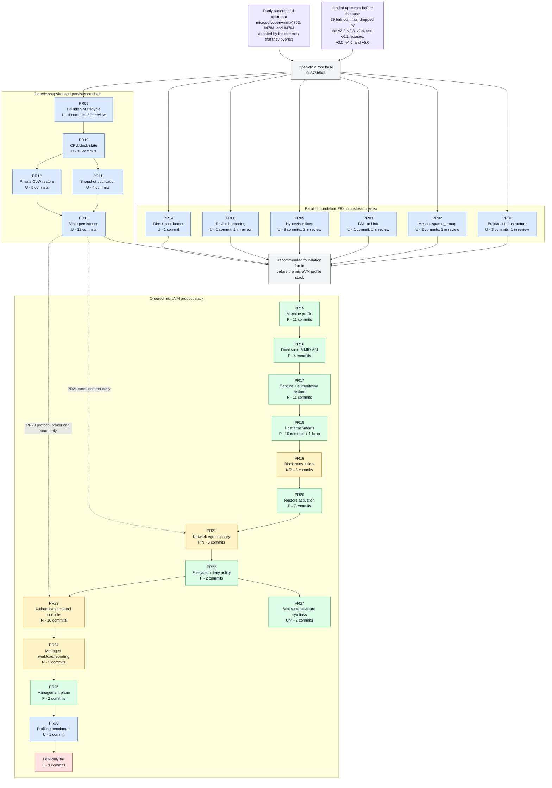

# OpenVMM Micro-VM PR Strategy

## Scope

- OpenVMM fork base: `9a875b563d62eaca040137c0227224c9a17e944d`, upstream main on 2026-11-18.
  The `feature/microvm/release/v7.1` rebase moved the chain there from
  `e6b458cc032208448d16c529ef973f0cee7c23e1`, upstream main on 2026-11-13, where the
  `feature/microvm/release/v7.0` reorganization had moved it; see
  [Upstream status](#upstream-status).
- Mapped fork tip: `c928e8dc1e1673a37c83c10fe145f6611a505cec`, position 126. The graph, PR
  summary, and commit mapping below cover positions 001-126 and the PR18 fixup at position 302.
- NVX's pinned OpenVMM revision: `f391801def5a22404581066e33cbc3e2e816c4a2`, position 323, the head
  of microsoft/openvmm#5175, whose commit follows position 322, `b909d6a20`, the head of
  `feature/microvm/dev`, where microsoft/openvmm#5173 landed position 322 on position 321,
  `7747ece2c`, where microsoft/openvmm#5172 landed position 321 on position 320,
  `ccece742e`, where microsoft/openvmm#5171 landed position 320 on position 319,
  `b929c2d26`, where microsoft/openvmm#5170 landed position 319 on position 318,
  `ee647f75c`, where microsoft/openvmm#5168 landed positions 317 and 318 on position 316,
  `85c3698f9`, the head of the `feature/microvm/release/v7.1` branch of microsoft/openvmm. The
  v7.1 rebase moved the 315 commits of `feature/microvm/dev` at NVX's pin before it, `6e5303f94`,
  onto `9a875b563` without dropping any: the 296 of `feature/microvm/release/v7.0` and the 19 that
  microsoft/openvmm#5129, microsoft/openvmm#5131, microsoft/openvmm#5132, microsoft/openvmm#5134,
  microsoft/openvmm#5136, microsoft/openvmm#5140, and microsoft/openvmm#5141 landed after it. It
  added a fixup at its tip, position 316. Every commit keeps its position, and only positions 060
  and 277, which conflicted with upstream, and position 007, whose context upstream changed, changed
  their patches; see [Conflicts of the v7.1 rebase](#conflicts-of-the-v71-rebase). The pin is 197
  commits past the mapped tip on the same first-parent chain. Positions 127-301 and 303-323 are not
  yet assigned to PRs, position 302 is a PR18 fixup, and position 317 backports upstream's
  microsoft/openvmm#5160, which the next rebase drops; see [Commits after the mapped
  tip](#commits-after-the-mapped-tip).
- Upstream main: `715927303600a54911a836ed6f53dc338e15c05f` (2026-11-18), one commit past the
  fork base; see [Upstream main past the fork base](#upstream-main-past-the-fork-base).

## Upstream status

The `feature/microvm/release/v7.1` rebase moved the 315-commit chain of `feature/microvm/dev`,
through NVX's previous pin `6e5303f94`, from `e6b458cc0` onto `9a875b563`, 14 upstream commits
later. Upstream had landed none of its commits, so it dropped none, and every commit kept its
position. Replaying the chain conflicted at position 060 with microsoft/openvmm#4941, which boots an
x64 Linux child through a native MSHV root in Petri, and at position 277 with
microsoft/openvmm#4942, which handles MSHV's invalid VP register exits;
[Conflicts of the v7.1 rebase](#conflicts-of-the-v71-rebase) lists them. Position 007 replayed with
new context beside microsoft/openvmm#4942's error variants, and the other 312 commits replayed with
unchanged patches. A fixup at its tip, position 316, adapts the lock file entries that positions 069
and 133 add to microsoft/openvmm#4941, which no textual conflict exposed.

The `feature/microvm/release/v7.0` reorganization moved the 315-commit chain of
`feature/microvm/dev`, through NVX's previous pin `fe61f9cbf`, from `7d90c4104` onto `e6b458cc0`,
eight upstream commits later. Upstream had landed none of its commits, so it dropped none.
Replaying the chain had conflicts at three positions, two with microsoft/openvmm#4862, upstream's
USB command line, and one with microsoft/openvmm#5070, which gates the Patina nightly jobs on a
label, and the generated workflows of one more needed regenerating;
[Conflicts of the v7.0 rebase](#conflicts-of-the-v70-rebase) lists them. No upstream change broke
the chain without a textual conflict. The reorganization then folded the 19 fixups of the v6.1
line into the commits that they fix, moved two `vmcore` timer commits that PR10's RTC fixups need
into PR10, and formatted the `virt_kvm` x86-64 files of six commits, which `cargo fmt` does not
reach; see [The v7.0 reorganization](#the-v70-reorganization).

The `feature/microvm/release/v6.1` rebase moved the 268-commit chain of `feature/microvm/dev`,
through NVX's previous pin `5ca20ee08`, from `ba105dd7f` onto `7d90c4104`, 44 upstream commits
later. It dropped v6.0 positions 002, 008, 009, 014, and 051-053, whose changes upstream had
landed, all but 002 after review changes; [Landed upstream](#landed-upstream) lists them.
Replaying the remaining 261 commits had conflicts at 16 positions, 11 of them with
microsoft/openvmm#4553, upstream's SaveVM and RestoreVM, which changes the snapshot manifest and
publication of PR11, and the generated workflows of one more needed regenerating;
[Conflicts of the v6.1 rebase](#conflicts-of-the-v61-rebase) lists them. Eight fixups at its tip,
v6.1 positions 262-269, adapted the chain to upstream changes that no textual conflict exposed. The
patches of 220 replayed commits are unchanged, and those of 25 more differ only in context.

The `feature/microvm/release/v6.0` reorganization kept the 223-commit chain of
`feature/microvm/dev`, through NVX's previous pin `3f2ab4c2f`, on `ba105dd7f`, which upstream main
had not passed, so it dropped no commit and nothing conflicted with upstream. It folded the PR20
fixup at v5.1 position 148 into v6.0 position 097 and the PR12 fixup at v5.1 position 221 into
v6.0 positions 035 and 036, combined v5.1 positions 222 and 223 into v6.0 position 220, and
checked that every commit builds; the pin's tree is the tree of `3f2ab4c2f`. See
[The v6.0 reorganization](#the-v60-reorganization).

The `feature/microvm/release/v5.1` rebase moved the 219-commit chain of `feature/microvm/dev`,
through NVX's previous pin `db42fde04`, from `61994293a` onto `ba105dd7f`, nine upstream commits
later. Upstream had landed none of its commits, so it dropped none, and every commit kept its
position. Replaying the chain conflicted only at v5.1 position 183, now position 177, which
[Conflicts of the v5.1 rebase](#conflicts-of-the-v51-rebase) lists; the other 218 commits replayed
with unchanged patches, and no upstream change broke the chain without a textual conflict, so the
rebase added no fixups.

The `feature/microvm/release/v5.0` reorganization moved the 220-commit chain of
`feature/microvm/dev`, through NVX's previous pin `e1ca353eb`, from `c6d3da0ff` onto `61994293a`,
61 upstream commits later. It dropped v4.0 positions 004, 017, and 217, whose changes upstream had
landed, and v4.0 position 023, whose stop before teardown microsoft/openvmm#4863 supersedes;
[Landed upstream](#landed-upstream) lists them. Replaying the remaining commits had conflicts at 31
positions, which [Conflicts of the v5.0 rebase](#conflicts-of-the-v50-rebase) lists, and 15
fixups adapted commits to upstream changes that no textual conflict exposed. The reorganization
then folded those fixups into the commits that they fix, retired PR09's bounded quiesce
transactions of v4.0 position 021, folded the snapshot quiesce without a deadline of v4.0 position
216 and PR13's fixups at v4.0 positions 218 and 219 into the commits that they change, and fixed
what checking each commit found; see [The v5.0 reorganization](#the-v50-reorganization).

The `feature/microvm/release/v4.0` reorganization moved the 205-commit chain of
`feature/microvm/release/v3.0`, through NVX's previous pin `35e76265f`, from `b2676222b` onto
`c6d3da0ff`, 30 upstream commits later. It dropped v3.0 positions 010, 012, 017, and 022-025,
whose changes upstream had landed, and position 016, whose stop cancellation
microsoft/openvmm#4835 supersedes; [Landed upstream](#landed-upstream) lists them. Replaying the
remaining commits had conflicts at 16 positions, which
[Conflicts of the v4.0 rebase](#conflicts-of-the-v40-rebase) lists, and two fixups adapted
v4.0 positions 017 and 128 to upstream changes that no textual conflict exposed. The
reorganization then retired the fallible device start of v3.0 position 027, folded
microsoft/nvx#1232's awaited device restoration into the chain, and added the ABI restart at v4.0
positions 197-210; see [The v4.0 reorganization](#the-v40-reorganization).

The `feature/microvm/release/v3.0` reorganization moved the chain of
`feature/microvm/release/v2.4` from `27fe0c64f` onto `b2676222b`, two upstream commits later.
Upstream had landed v2.4 position 016 in a revised form as microsoft/openvmm#4583, so the
reorganization dropped it. microsoft/openvmm#4829 makes cancelled `pal_async` event waits
reusable and changes no file of the chain except `Cargo.lock`, where it adds a line that the chain
does not touch. Replaying the remaining 385 commits had no conflicts. The reorganization then
regrouped them into 200 commits without changing the tree: the pin's tree, `652f88f95`, is
the tree of that replay, the rebase of `feature/microvm/release/v2.4` onto `b2676222b` without
position 016; see [The v3.0 reorganization](#the-v30-reorganization).

The `feature/microvm/release/v2.4` rebase moved the 380-commit chain of
`feature/microvm/release/v2.3` from `22c0485be` onto `27fe0c64f`, 76 upstream commits later. It
dropped the ten commits whose changes upstream had landed, v2.3 positions 003, 005, 009, 012,
015, 017, 023, 030, 031, and 036, and resolved conflicts at 45 positions, which
[Conflicts of the v2.4 rebase](#conflicts-of-the-v24-rebase) lists at their v3.0 positions. It
added sixteen fixups at its tip, v2.4 positions 371-386, which adapted the chain to upstream
changes that no textual conflict exposed; the v3.0 reorganization folded them into the commits
that they fix.

The `feature/microvm/release/v2.3` rebase moved the 334-commit chain of
`feature/microvm/release/v2.2` from `790132851` onto `22c0485be`, 23 upstream commits later. It
dropped position 074, whose change microsoft/openvmm#4661 had landed upstream, resolved seven
commits that conflicted, and added four fixups at its tip, v2.4 positions 324-327, which the
v3.0 reorganization folded too.

The `microvm/v2.2` rebase moved the 320-commit chain of `microvm/v2.1` from `e1cdbd916` onto
`790132851`, 75 upstream commits later. It dropped the eight fork commits that had landed
upstream in between and adapted the remaining 312 to upstream API changes where they needed it,
which changed the diffs of 50 of them.

### Landed upstream

| Dropped by | Former position | Fork commit | Roadmap PR | Upstream PR | Upstream commit |
| --- | ---: | --- | --- | --- | --- |
| v6.1 | 002 | `707747c16` - flowey: distinguish native Windows and WSL nextest paths | PR01 | microsoft/openvmm#4595 | `5d3ab02f0` |
| v6.1 | 008 | `299a04d4f` - pal: query Unix socket peer credentials | PR03 | microsoft/openvmm#4591 | `42d4fe619` |
| v6.1 | 009 | `a0e70d99e` - pal: resolve the process token user SID | PR04 | microsoft/openvmm#4604 | `6937acefb` |
| v6.1 | 014 | `5ed5f7a22` - serial_socket: keep Windows named-pipe listeners reconnectable | PR06 | microsoft/openvmm#4609 | `f5ef11b8a` |
| v6.1 | 051 | `6cea1ae18` - loader: let static ELF loading reuse a caller buffer | PR14 | microsoft/openvmm#4554, which supersedes it | `e4728b7f4` |
| v6.1 | 052 | `4ccef3c27` - loader: add an Intel MP 1.4 table builder | PR14 | microsoft/openvmm#4554 | `e4728b7f4` |
| v6.1 | 053 | `b585c7300` - loader: add firmware-less Linux direct boot with MP tables | PR14 | microsoft/openvmm#4554 | `e4728b7f4` |
| v5.0 | 004 | `6476a457f` - consomme: make TCP window-reopen validation deterministic | PR01 | microsoft/openvmm#4598 | `19485f88e` |
| v5.0 | 017 | `ea1153ef4` - consomme: bound active TCP, UDP, and ICMP flows | PR07 | microsoft/openvmm#4600 | `e89a7e22d` |
| v5.0 | 023 | `0692a461c` - openvmm_core: stop the devices before tearing down the VM | PR09 | microsoft/openvmm#4863, which supersedes it | `0c9697277` |
| v5.0 | 217 | `62b427a38` - serial_socket: report read errors as EOF and drop the connection | PR06 | microsoft/openvmm#4605 | `48e0681e9` |
| v4.0 | 010 | `1a8bc4363` - pal: add handle-relative file access that does not follow reparse points | PR04 | microsoft/openvmm#4593 | `789d51653` |
| v4.0 | 012 | `d25e0e13f` - pal_async: fix named-pipe reconnect and already-connected listen | PR04 | microsoft/openvmm#4585 | `03e8ae741` |
| v4.0 | 016 | `47102941e` - virtio_blk: let stop cancellation win over a ready queue and drain accepted I/O | PR06 | microsoft/openvmm#4835, which supersedes it | `79e67ae36` |
| v4.0 | 017 | `41460f3f7` - virtiofs: make handle and inode ID allocation fallible | PR06 | microsoft/openvmm#4594 | `389e4e57a` |
| v4.0 | 022 | `38998a580` - openvmm_helpers: split the snapshot module without behavior changes | PR08 | microsoft/openvmm#4616 | `0812555fe` |
| v4.0 | 023 | `313b5fe0b` - net_tap: move the transmit path into its own module | PR08 | microsoft/openvmm#4617 | `c696625c6` |
| v4.0 | 024 | `238c6cc96` - net_consomme: move queue transmit processing into a module | PR08 | microsoft/openvmm#4620 | `3bb37a191` |
| v4.0 | 025 | `c1bd1e0a5` - virtio_console: move the direct receive loop into its own module | PR08 | microsoft/openvmm#4621 | `2a17dfdd5` |
| v3.0 | 016 | `f5231b2d2` - chipset: preserve IOAPIC line levels across restore | PR06 | microsoft/openvmm#4583 | `db4331e53` |
| v2.4 | 003 | `0213cf65d` - flowey: skip reinstalling an identical, possibly running cargo-nextest binary | PR01 | microsoft/openvmm#4608 | `03a2fc597` |
| v2.4 | 005 | `a91dc86fb` - lxutil: tolerate inherited extended attributes in tests | PR01 | microsoft/openvmm#4587 | `a1d71b899` |
| v2.4 | 009 | `15a895dd8` - sparse_mmap: add private copy-on-write file views | PR02 | microsoft/openvmm#4557 | `d8acf2a7c` |
| v2.4 | 012 | `4a7ab405c` - pal: add Unix extent cloning and sparse-extent seeking | PR03 | microsoft/openvmm#4590 | `c62489737` |
| v2.4 | 015 | `074de3406` - pal: add sparse-file range queries, zeroing, and block cloning | PR04 | microsoft/openvmm#4596 | `8f1c36ba5` |
| v2.4 | 017 | `50460c27a` - pal: query named-pipe peers and create protected pipes | PR04 | microsoft/openvmm#4582 | `65db52693` |
| v2.4 | 023 | `938b14343` - chipset: fast-forward periodic PIT counting over long intervals | PR06 | microsoft/openvmm#4586 | `023329997` |
| v2.4 | 030 | `135c503ba` - consomme: cover the pending DNS request limit with a test | PR07 | microsoft/openvmm#4601 | `cd93f761f` |
| v2.4 | 031 | `90734a2ff` - consomme: cover IPv4 fragment rejection with a test | PR07 | microsoft/openvmm#4602 | `3d9cb006a` |
| v2.4 | 036 | `6794f12d0` - openvmm_entry: skip raw console mode when stdin is not a terminal | PR08 | microsoft/openvmm#4606 | `769f2f61f` |
| v2.3 | 074 | `f6e6ff738` - loader_defs: name the boot_params ACPI RSDP field | PR14 | microsoft/openvmm#4661 | `8beae2961` |
| v2.2 | 002 | `607e6c6a2` - nextest: scope a longer budget to the exhaustive ring-buffer loom test | PR01 | microsoft/openvmm#4584 | `9501bb481` |
| v2.2 | 017 | `c61d77644` - pal: create files and directories with explicit security descriptors | PR04 | microsoft/openvmm#4599 | `9fbf965c5` |
| v2.2 | 021 | `88865bf90` - virt_mshv: describe SNP guest workarounds without ACI-specific names | PR05 | microsoft/openvmm#4580 | `40cff1268` |
| v2.2 | 022 | `9b3ce6760` - kvm: preserve pending external interrupts across VP-state capture | PR05 | microsoft/openvmm#4522 | `392890680` |
| v2.2 | 029 | `947ae858b` - virtio: make interrupt tests wait for queue completion | PR06 | microsoft/openvmm#4592 | `5b4656a86` |
| v2.2 | 030 | `21c2206c9` - fuse: rate-limit guest-triggerable diagnostics | PR06 | microsoft/openvmm#4581 | `926827446` |
| v2.2 | 035 | `54c5c34cd` - virtio_console: rate-limit worker errors | PR06 | microsoft/openvmm#4614 | `77ce2aeac` |
| v2.2 | 039 | `dd349021e` - openvmm_entry: accept `delay:<ms>:<disk>` disk wrappers | PR08 | microsoft/openvmm#4610 | `6e0e4fdab` |

A former position counts in the branch that the rebase started from: `microvm/v2.1` for the v2.2
rebase, `feature/microvm/release/v2.2` for the v2.3 rebase, `feature/microvm/release/v2.3` for
the v2.4 rebase, `feature/microvm/release/v2.4` for the v3.0 reorganization,
`feature/microvm/release/v3.0` for the v4.0 reorganization, `feature/microvm/dev` at
`e1ca353eb`, whose first 210 commits are those of `feature/microvm/release/v4.0`, for the v5.0
reorganization, and `feature/microvm/dev` at `5ca20ee08`, whose first 220 commits are those of
`feature/microvm/release/v6.0`, for the v6.1 rebase.
microsoft/openvmm#4661 names the `acpi_rsdp_addr` field of `boot_params` exactly as position 074
did, so the v2.3 rebase dropped 074 as empty. microsoft/openvmm#4554 carried it ahead of v6.0
positions 051-053 until it merged.

The v6.1 rebase took upstream's versions of its drops and adapted the later commits to them.
microsoft/openvmm#4595 is identical to v6.0 position 002, and microsoft/openvmm#4591 adds tests to
v6.0 position 008's `credentials` module of `pal`, whose API the chain uses unchanged.
microsoft/openvmm#4604 resolves the token user SID in `pal::windows::security` itself rather than in
the `user_sid` module of v6.0 position 009, so the fixup at v6.1 position 262, which the v7.0
reorganization folded into positions 105 and 112, calls it there. microsoft/openvmm#4609 returns a
failed write, flush, or close of a Windows named pipe and returns its backend to listening, as v6.0
position 014 did, with reconnection tests of its own in place of 014's, so position 105's call of
`disconnect_current` in 014's test moved into upstream's. microsoft/openvmm#4554 merged the MP table
builder and the firmware-less Linux direct boot of v6.0 positions 052 and 053 after review moved the
boot into `loader::linux::mptable_boot`, rebuilt the table with `zerocopy` from the MP
specification's structures, numbered the I/O APIC after the processors, and loaded the kernel and
initrd through upstream's `load_kernel_and_initrd_x64`, without the buffer reuse that v6.0 position
051 added for it. Position 185's routing of every IOAPIC input moved onto that builder, and the
fixup at v6.1 position 263, which the v7.0 reorganization folded into positions 057 and 178, loads
the microVM through `mptable_boot`; see [Conflicts of the v6.1
rebase](#conflicts-of-the-v61-rebase).

microsoft/openvmm#4863 gives devices a consuming teardown. The VM worker's run drains pending
device removals, and its pause stops the state units before the worker tears down the chipset
devices and the partition, which is what v4.0 position 023, which had no upstream pull request,
made it do, so that commit was empty on the new base and the v5.0 reorganization dropped it.

microsoft/openvmm#4835 makes devices answer task-control requests promptly. Its virtio-blk
tests `stop_drains_one_accepted_write_exactly_once` and `stop_preempts_continuously_ready_queue`
cover what v3.0 position 016 made virtio-blk do, so the v4.0 rebase dropped 016, and its pull
request, microsoft/openvmm#4588, was closed. No later commit of the chain changes `virtio_blk`.

microsoft/openvmm#4583 saves each IOAPIC input's last observed level as edge-detector history, as
v2.4 position 016 did, but restores the redirection entries, routes, and input history without
evaluating the inputs, which 016 did. A restored asserted level-triggered input therefore raises
its interrupt when its producer republishes it, when the guest's EOI clears the remote IRR, or
when the guest writes its redirection entry, not during the restore itself.

Upstream merged most of the v2.4 drops after review changes, so the v2.4 rebase took upstream's
versions and adapted the later commits to them. microsoft/openvmm#4557 creates a copy-on-write
mappable without the chain's `executable` flag, and on Windows it refuses to unmap or map over part
of a written copy-on-write view. microsoft/openvmm#4582 answers a pipe's peer process through
`PipeExt::get_pipe_peer_process_id` instead of the chain's `pal::windows::pipe::peer` module, which
also had `is_pipe`. microsoft/openvmm#4586 fast-forwards more counting modes, and
microsoft/openvmm#4606 forwards console input in `repl.rs` instead of the `headless` module, which
position 112 creates for the chain's own use, and ends the run when a stdin that is not a terminal
ends, which position 112 confines to machines other than the microVM. microsoft/openvmm#4587 is
identical to v2.3 position 005.

microsoft/openvmm#4522 fixes the lost-PIC-interrupt bug of v2.1 position 022 in a different way.
Instead of tracking the queued vector in `kvm::VpRunner`, it injects PIC interrupts through the
vCPU's injected-interrupt slot (`KVM_SET_VCPU_EVENTS`), which the existing activity save/restore
already covers. Its saved state has no slot for v2.1 position 022's queued vector: KVM snapshots
from builds with position 022 persist a queued PIC vector as a pending `ExtInt` event. Current
builds reject restoring one with `KvmError::InvalidState`, so recapture KVM snapshots that those
builds captured.

Upstream also landed parts of commits that remain in the chain:

- microsoft/openvmm#4556 (`96647c331`) derives `Clone` for `ProtobufMessage` and `ProtobufAny`.
  Position 004 keeps its subject but now only adds `ProtobufAny::value_len` and checks a clone in
  the round-trip test.
- microsoft/openvmm#4524 (`9cf109547`) adds the generic `PartitionTimeControl` contract, MSHV and
  WHP implementations, and full-VM freeze/thaw lifecycle calls. Position 025 reuses the MSHV
  implementation, through fallible freeze and thaw helpers, instead of private plumbing. Positions
  023-027 keep the exact TSC-frequency exposure, snapshot downtime handling, and restored-vCPU
  synchronization that upstream lacks, and position 092 synchronizes only the VPs that a restore
  creates.
- microsoft/openvmm#4704 (`1c093df84`) adds the architectural `TscDeadline` VP state element, the
  `tsc_deadline` partition capability, and the KVM, MSHV, WHP, and OpenHCL register accessors that
  v2.4 position 038 also added. Position 022 now uses upstream's, so it keeps the `tsc_deadline`
  field of the CPU compatibility contract, the finalized MSHV partition's report of no TSC-deadline
  support, and the LAPIC timer helpers that position 142 deletes in favor of those that position 134
  adds for the time ABI. Upstream compares a restored deadline on partitions that can freeze time,
  as WHP can, whereas 020 never compared it, so the WHP state access of position 026, which reads
  the deadline before the APIC state, discards that read when it restores the deadline.
- microsoft/openvmm#4764 (`29f0adceb`) makes every lxutil volume resolve paths beneath its root
  without following a host symbolic link, as position 125 did for a confined volume, and
  microsoft/openvmm#4783 (`7c92b147e`) rejects unsafe opens. Position 125 now only adds
  `LxVolumeOptions::confine_paths`, which makes a Windows volume create LX symlinks, and runs its
  confinement tests against upstream's implementation. A share therefore needs `openat2`, Linux 5.6
  or later, where the chain fell back to opening each component with `O_NOFOLLOW`.

### Open upstream pull requests

As of 2026-11-18, every commit of PR01-PR03, PR05, PR06, and PR09 except positions 001, 003, 004,
and 012 is in an open upstream pull request; the commits that upstream has merged are under [Landed
upstream](#landed-upstream), and PR04, PR07, and PR08 have landed whole. Each pull request carries
one commit. Of those 10 pull requests, only microsoft/openvmm#4597, microsoft/openvmm#4613, and
microsoft/openvmm#4618 are ready for review: microsoft/openvmm#4607 has been a draft again since
2026-11-06, and the other six since 2026-11-10. None has an approving review.
microsoft/openvmm#4451, which proposed position 001, was closed without merging, and the remainder
of position 004 has not been proposed. microsoft/openvmm#4615, which proposed position 003, was
closed on 2026-11-10, since a Windows servicing release fixes the WHP behavior that it works around;
the chain keeps it. PR14's remaining commit, position 049, is in no pull request either:
microsoft/openvmm#4611, which proposed it, was closed on 2026-11-10, after review suggested
combining it with the commit that needs it. microsoft/openvmm#4619, microsoft/openvmm#4622, and
microsoft/openvmm#4623, which proposed the fallible unit start, device start, and VM resume of v3.0
positions 026-028, were closed in favor of microsoft/nvx#1232: position 011 now only rolls back a
partial start, v3.0 position 027 is retired, and position 012's resume stays fallible; see [The v4.0
reorganization](#the-v40-reorganization) and [The device restore
contract](#the-device-restore-contract). PR10-PR13 and PR15-PR27 have no upstream pull requests
yet.

On 2026-11-04, microsoft/nvx#1260 withdrew v4.0 position 021 from PR09, since the deadline of the
snapshot quiesce added no safety: microsoft/openvmm#4625, which proposed its bounded quiesce
transactions, was closed, and the v5.0 reorganization retired the commit and folded the quiesce
without a deadline into the commits that it changes; see [The v5.0
reorganization](#the-v50-reorganization). microsoft/openvmm#4872, opened on 2026-11-03, proposes
position 011's rollback of a partial start, with review changes that the chain lacks, apart from its
handling of a unit in a terminal state, its teardown after a failed restart, and its rollback's stop
in reverse dependency order, which position 011 carries, since the v7.0 reorganization folded the
PR09 fixups at v6.1 positions 234-236 into it. microsoft/openvmm#4626, which proposes position 014's
input gate without a deadline, as the chain now has it, builds on it. So does
microsoft/openvmm#4937, a draft since 2026-11-10, which makes `StateUnits::stop` fail instead of
panicking when a unit's task has ended, as position 236 does in the chain. Position 236 also adapts
the chain's own callers of `StateUnits::stop`, such as the microVM worker's snapshot quiesce, and
makes `VmRpc::Pause` fail where #4937's VM worker panics on a failed stop.

On 2026-11-05, microsoft/openvmm#4605 merged as `48e0681e9`, narrowed in review to the read path: a
read error is traced, drops the socket, and is reported as EOF, while writes keep upstream's
handling, which reports a broken pipe as a successful write and keeps the socket. Review settled
disconnect detection in virtio-console instead, with microsoft/openvmm#4778, which every fork base
since v2.4 includes. Position 039, which carried the pull request's first revision and drops the
socket and returns the error on any failed write, therefore has no upstream pull request. The chain
keeps it for output rather than disconnects: a virtio-console with the `Retain` policy of PR13's
position 040 and the portb console of PR15's position 055 keep the guest output written after their
peer leaves only when that write fails, and on Linux a write to an AF_UNIX peer that has closed
fails with `EPIPE`, which upstream's backend reports as successful. Dropping it as
microsoft/openvmm#4605's commit would make `Retain` consoles and portb lose that output on Linux.
The v5.0 reorganization therefore dropped v4.0 position 217, which cherry-picked `48e0681e9` for
PR06, and moved v4.0 position 015 into PR13 as position 039, ahead of the policy that needs it, with
v4.0 position 218, which explains and tests that write handling, folded into it. PR13's position 041
took the test of v4.0 position 219 that a `Retain` console keeps that output for the next peer.

microsoft/openvmm#4609, which v6.0 position 014 carried, had the same split, but its review kept
the write handling: since it merged as `f5ef11b8a` on 2026-11-11, a Windows named pipe returns a
failed write, flush, or close and drops its client, so a `Retain` console on a named pipe keeps
that output too. The v6.1 rebase therefore dropped 014 as landed.

On 2026-11-10, microsoft/openvmm#4553, upstream's SaveVM and RestoreVM for the management RPC, which
proposes no chain commit, merged as `64828d2b5`. It records a snapshot ID in the manifest's field
18, to which it moved the ID from field 8, the chain's `state_size_bytes`, after microsoft/nvx#1210
raised the clash, and it reserves fields 19 and 20 for `compatibility_bundle_digest` and
`memory_artifacts`, all three of which position 226 had kept free. It also changes `write_snapshot`
in the snapshot publication of `openvmm_helpers`, which PR11's positions 029-031 and later chain
commits change. The v6.1 rebase therefore gives the chain's `SnapshotManifest` upstream's
`snapshot_id`, which a microVM capture leaves zero, publishes upstream's snapshots through the
chain's staged publication, and keeps microVMs out of RestoreVM; see [Conflicts of the v6.1
rebase](#conflicts-of-the-v61-rebase). NVX's pin of the rebase has `nvx`'s reader of a template's
manifest, which refuses fields that it does not know, accept field 18. Positions 314 and 315 record
the field map that the two manifests share, and refuse a field 18 that is not a GUID of 16 bytes by
its field; see [Commits after the mapped tip](#commits-after-the-mapped-tip).

| Roadmap PR | Positions | Upstream pull requests, in position order |
| --- | ---: | --- |
| PR01 | 002 | microsoft/openvmm#4618 |
| PR02 | 005 | microsoft/openvmm#4558 |
| PR03 | 006 | microsoft/openvmm#4589 |
| PR05 | 007-009 | microsoft/openvmm#4536, microsoft/openvmm#4607, microsoft/openvmm#4613 |
| PR06 | 010 | microsoft/openvmm#4597 |
| PR09 | 011, 013, 014 | microsoft/openvmm#4872, microsoft/openvmm#4624, microsoft/openvmm#4626 |

Stacked pull requests carry their prerequisites' commits: microsoft/openvmm#4613 builds on
microsoft/openvmm#4536, and microsoft/openvmm#4626 builds on microsoft/openvmm#4872.
Most of these pull requests have gained review commits that the fork chain does not carry. When
one merges, the next rebase should drop its fork commit, as the `microvm/v2.2`,
`feature/microvm/release/v2.3`, `feature/microvm/release/v2.4`, and
`feature/microvm/release/v6.1` rebases and the v3.0, v4.0, and v5.0 reorganizations dropped the
39 above, and adapt later commits to the merged form.

The v3.0 reorganization folded fixups into positions 005, 008, 009, and 049, and the v4.0
reorganization changed positions 011 and 014, whose pull requests lack those changes; see [The v4.0
reorganization](#the-v40-reorganization) and [The v3.0 reorganization](#the-v30-reorganization). The
v5.0 reorganization adapted positions 002, 005, 010, 011, and 014 to upstream main, and folded into
position 014 the removal of its input gate's deadline, which microsoft/openvmm#4626 already lacks;
see [The v5.0 reorganization](#the-v50-reorganization). The v6.1 rebase adapted position 006 to
microsoft/openvmm#4591; see [Conflicts of the v6.1 rebase](#conflicts-of-the-v61-rebase).

### The device restore contract

microsoft/nvx#1232 asked to agree the contract between a device's restore, its preparation, and its
activation with the authors of microsoft/openvmm#4713 and microsoft/openvmm#4729, drafts since
October 2026, and to record the final architecture here. NVX settled the contract itself, reusing
their designs where they apply. The chain implements it as of position 312, without a new element,
field, or version of any saved state:

- **Restore** runs while the VM is stopped, and is awaited, through upstream's chipset and
  device-worker restore, microsoft/openvmm#4799, after PR09's position 013 checks the exact unit
  inventory. Each device validates its saved state, applies it, and prepares the host resources that
  the state refers to, as virtio-fs reopens the files that the guest held open, so the contract has
  no preparation step apart from the restore. So invalid state, a missing host resource, or a failed
  device worker fails the restore itself, before it reports readiness, even for a VM that stays
  paused. A virtio device's restore has no effect that the guest sees: it starts no queue, so it
  admits no host input and sends no queue notification, and since position 309 it drives no
  interrupt line. Position 308 programs each restored MSI-X vector without delivering, so that a
  vector delivers to its message after the start without the guest programming it again.
- **Start** runs what a restore prepared: each device starts its queues from their restored
  progress, after a legacy virtio-mmio or PCI INTx line goes to its restored level, and the VM
  confirms every device's start, through position 213, before any vCPU runs. The steps that can
  still fail are those that need a live host backend or a running queue, and each fails the start
  instead of being logged and dropped: virtio-net's endpoint creates its queues (position 207), each
  queue builds its wait and its ring, virtio-console checks its restored partial transmission
  against the queue that it starts, and a remote device worker answers the confirmation, which fails
  if the worker has ended (position 311). A failed start stops the devices that started again and
  keeps the state that the stop records: the progress of every queue (position 212), which includes
  the requests that a queue that did start completed before another failed, since the confirmation
  keeps the vCPUs from running but does not undo a device's I/O, and each device's saved private
  state in step with it (positions 307 and 312). It publishes no restore readiness and runs no vCPU,
  so that a later resume retries the start from that state, and a save, where the VM allows one,
  saves it.
- **Stop** releases each queue with its exact progress, which the transport keeps, so that an
  ordinary pause and resume keeps queue progress without a restore, as position 208 tests on both
  transports. A device keeps its host resources across a stop, and releases them as it is removed or
  the VM ends, as after a failed restore; position 208 also tests the removal of a restored device
  before its first start.

Each activation path follows this contract. The first run of a restored VM, paused or not, an
ordinary resume, the resume after a capture, and the start of the units again after a failed save
all go through the confirmed start; a unit that a hot-add adds to a running VM starts through
`start_stopped_units`, which returns the failure; a cold boot starts a device's queues when the
guest sets `DRIVER_OK`, and a queue that cannot start fails `DRIVER_OK`, which resets the device's
status, since the guest already runs; and a microVM refuses a worker restart (PR15's position 058).
Upstream's remote device proxy still panics when its worker ends during a stop, a reset, a poll, or
a teardown; only the TPM uses a remote device worker, and no microVM has one, so the chain leaves
that to upstream.

The chain departs from two upstream drafts, where they would not meet microsoft/nvx#1232 or would
change saved state, and adopts each at the rebase after it lands:

- microsoft/openvmm#4713 reconstructs virtio-net's queues at restore, in a device task parked under
  `TaskControl`, and keeps them across an ordinary pause with a retained pause, separate from the
  stop that releases them. It still creates the host backend's queues at activation, so the chain
  instead validates queue progress at restore and builds the queues at start, where a failure fails
  the confirmed start. The chain has no retained pause: microVM NICs, which have a static identity,
  keep their queue progress through the stop (PR13's position 046). The retained pause of other
  NICs, and the independent ring enable of vhost-user of microsoft/openvmm#4729, stay upstream's.
- microsoft/openvmm#4855 replays the level of every line set after its targets start. The chain
  holds only the virtio transports' level lines until their device starts (position 309).

RestoreVM follows the contract too: microsoft/openvmm#4553's RestoreVM, which the v6.1 rebase took,
restores a standard VM, whose resume callers handle the fallible resume of PR09's position 012, and
refuses a microVM, which restores through CreateVM. microsoft/openvmm#4676, an open upstream pull
request that adds an eager-copy RestoreVM, changes no device contract, so the chain takes it at the
rebase after it lands. No restore-at-start plumbing remains to remove: the v4.0 reorganization
stopped staging device state for activation; see [The v4.0 reorganization](#the-v40-reorganization).

### Conflicts of the v7.1 rebase

The `feature/microvm/release/v7.1` rebase replayed the 315 commits of `feature/microvm/dev` at
`6e5303f94`, whose first 296 commits are those of `feature/microvm/release/v7.0`, onto `9a875b563`
with conflicts at two positions, which it resolved in place. Every commit kept its position, so the
table lists each resolution at the position that the commit had in v7.0 too.

| Position | v7.1 commit | v7.0 commit | Upstream PR | Resolution |
| ---: | --- | --- | --- | --- |
| 060 | `65258e052` | 060 `22a67d85b` - petri, vmm_tests: add a microVM builder, portb harness, and cold-boot test | microsoft/openvmm#4941 | `uses_pipette_as_init` keeps upstream's condition, non-OpenHCL Linux direct boot or an mshv base initrd, and applies the commit's `microvm::uses_pipette_as_init` gate, which admits only the standard machine profile, to both before it requires a Pipette binary; its comment keeps upstream's wording and names the standard machine profile |
| 277 | `eaf039eed` | 277 `f636c7f1d` - virt: save a guest's user-wait, debug, and feature MSRs | microsoft/openvmm#4942 | `virt_mshv`'s `ErrorInner` keeps upstream's `InvalidVpRegisterValue` and `InvalidVpRegisterMessage` variants and the commit's x86-64 `UnsupportedState` variant after them |

Upstream changes also broke the chain without a textual conflict. A fixup at the tip adapts the
chain to them; fold it into the commits that it names at the next reorganization, or before
submission.

| Position | Fixup | Upstream PR | Fold into |
| ---: | --- | --- | --- |
| 316 | `85c3698f9` - cpu_profile, openvmm_helpers: name sha2 as upstream's lock file does | microsoft/openvmm#4941 | 069 and 133 |

microsoft/openvmm#4941 removed `sha2` 0.10 from `Cargo.lock`, which leaves 0.11.0 its only version,
so upstream's lock file names `sha2` without a version. PR17's position 069 and position 133, which
add `sha2` to the dependencies of `openvmm_helpers` and `cpu_profile`, still name it
`sha2 0.11.0`. `cargo check --locked` accepts that, since it compares the resolves, but any cargo
command that may update the lock file rewrites those two lines and leaves the checkout dirty.
Position 316 names `sha2` there as upstream does.

### The v7.0 reorganization

A v6.1 position in this section and in [Conflicts of the v7.0 rebase](#conflicts-of-the-v70-rebase)
counts in `feature/microvm/dev` at `fe61f9cbf`, whose first 269 commits are those of
`feature/microvm/release/v6.1`, and a position without a release is a v7.0 position. The
reorganization folded 19 commits and moved two, so v6.1 positions 001-015 keep their numbers; v6.1
positions 016-233 are positions 018-235, 237-239 are 236-238, 244-253 are 239-248, 255-258 are
249-252, 260 is 253, 272 is 254, and 274-315 are 255-296; and v6.1 positions 261 and 270 are
positions 016 and 017. A position from 016 on in a section on an earlier release counts in that
release.

The reorganization replayed the 315 commits onto `e6b458cc0`, resolving the conflicts at three
positions in place, and folded the 19 fixups of the v6.1 line into the commits that they fix,
re-expressed for the code that those commits have: v6.1 positions 234-236, 240-243, 254, and 259,
which pull requests added to `feature/microvm/dev` after v6.0; the v6.1 rebase's fixups at 262-269;
and v6.1 positions 271 and 273, which pull requests added after v6.1. It moved v6.1 positions 261
and 270, which make a periodic timer skip its missed periods at once and start at a given deadline,
into PR10 ahead of the RTC commit, whose fold restarts the RTC's timers at their saved deadlines
with them; each can still go upstream on its own, in that order. Each anchor keeps its author and
date, and its message lists the subjects that it folds. The pin's tree, `52504d232`, is the tree of
the replay without the folds, `07e36f824`, apart from five `virt_kvm` x86-64 files that the
reorganization formats, below, and the `feature/microvm/**` branch that position 123's
regeneration adds to the pull-request trigger that microsoft/openvmm#5070 gave the Patina nightly
workflow. The table lists where each change went.

| v6.1 position | Change | v7.0 positions |
| ---: | --- | --- |
| 234 | `dcc3065ad` - state_unit: handle a unit in a terminal state instead of panicking | 011, 015, 213 |
| 235 | `b62b21163` - openvmm_core: tear the VM down when a restart cannot resume it | 011 |
| 236 | `e1433b346` - state_unit: roll back a partial start without panicking on a lost unit | 011, 067, 213 |
| 240 | `459c28110` - virtio: keep a held input gate across a device reset | 014, 038, 041, 046, 083, 090, 108, 167 |
| 241 | `066b40f14` - microVM: refuse a decoded network prefix outside /1 to /30 | 078, 197 |
| 242 | `1ec79d60f` - microVM: refuse an unaligned or reversed decoded snapshot RAM range | 093, 142 |
| 243 | `67000c096` - openvmm_helpers: check paired scratch when opening a snapshot | 088, 232 |
| 254 | `93c4f651e` - virt_kvm: build the LAPIC timer KVM tests for musl | 248 |
| 259 | `3cad2668f` - chipset: keep the PIT restore tests within Linux's open file limit | 252 |
| 261 | `f2389fd16` - vmcore: skip a periodic timer's missed periods at once | 016, moved |
| 262 | `55adb5c93` - serial_socket, openvmm_entry: resolve user SIDs at upstream's path | 105, 112 |
| 263 | `b9a8f7f6e` - openvmm_core: load microVMs through upstream's MP-table boot module | 057, 178 |
| 264 | `7b98adc6d` - openvmm_entry, openvmm_helpers: read upstream's snapshots through OpenedSnapshot | 033 |
| 265 | `5460c8e05` - openvmm_entry, openvmm_helpers: record no snapshot ID in microVM captures | 071, 121 |
| 266 | `649aeacf0` - ttrpc: give the guest exit test's service upstream's SaveVM state | 120 |
| 267 | `4a1d9b07a` - Guide, openvmm_entry: describe upstream's snapshots with the chain's publication | 030, 034, 071 |
| 268 | `63688dd58` - vmm_tests: save the ttrpc interface test's VM with a VMBus NIC | 046 |
| 269 | `73cf40357` - openvmm_helpers: drop an independent snapshot copy's page cache | 030 |
| 270 | `fad381b7a` - vmcore: start a periodic timer at a given deadline | 017, moved |
| 271 | `67ac3e283` - chipset: keep the RTC's time and timer phases across a snapshot | 018, 019, 052, 195, 243 |
| 273 | `09cd771c0` - chipset: bound the RTC's restored and advanced time | 018, 019 |

- v6.1 positions 234-236 fold into PR09's position 011, which rolls back a partial start. With them,
  a reset, save, restore, or time advance fails, naming each unit in a terminal state, before it
  sends any unit a request, and a stop also stops the units whose start is uncertain but leaves them
  in that state (234); a worker restart that cannot start the VM again after a failed save tears the
  VM down (235); and the rollback stops the started units in reverse dependency order and leaves a
  unit whose stop is blocked or unanswered in a terminal state instead of panicking (236). PR10's
  position 015, which adds the time advance, takes 234's refusal of a time advance, and the comments
  of PR17's position 067 and of position 213, which confirms device starts, describe the rollback as
  234 and 236 leave it.
- v6.1 position 240 folds into each input gate that it keeps across a device reset: PR09's position
  014 documents it, PR13's positions 038, 041, and 046 keep the gate in the virtio transports, the
  console, and virtio-net, PR18's position 083 keeps virtio-fs's request admission closed, PR20's
  position 090 documents it for the post-restore gate, PR23's position 108 keeps the control
  console's host attachment gated, and the virtio-fs gate tests of position 167 reset the device's
  ring for another start.
- v6.1 positions 241-243 fold into the commits that add the checks that they complete: PR18's
  position 078 refuses a decoded network prefix outside /1 to /30, PR20's position 093 an unaligned
  or reversed decoded snapshot RAM range, and PR19's position 088 a paired scratch that is not a
  regular file of its recorded length when it opens a snapshot. Position 197, which always reserves
  the virtio-fs slot, gives 241's test a virtio-fs device; position 142, which makes the time ABI
  the only microVM time path, gives 242's test configuration the time ABI's parameters; and position
  232 adds 243's FIFO case to its test of a FIFO artifact.
- v6.1 position 254 folds into position 248, whose KVM tests use Linux's `SIGEV_THREAD_ID`, which
  the `libc` crate does not define for musl, and v6.1 position 259 into position 252, whose PIT
  restore tests create five PITs in all rather than two or three for each case, so that they stay
  within Linux's default limit of open files.
- The v6.1 rebase's fixups at v6.1 positions 262-269 fold into the positions that their own table
  names, renumbered: see [Conflicts of the v6.1 rebase](#conflicts-of-the-v61-rebase).
- v6.1 positions 271 and 273 fold into PR10's position 018, which persists and advances the RTC
  clock, so that the RTC keeps its time and the phases of its alarm, periodic, and update interrupts
  across a snapshot, restarting its periodic timer at its saved deadline through position 017, and
  holds a restored or advanced time within the range of the host clock. The fold conflicted with
  three later commits, which the reorganization resolved: position 019 adds its check of the
  interrupt state to the saved state's validation, which the fold has take the current time and
  check the saved time's range; position 052's RTC mode seam rebases the held clock on reset and
  builds the clock without one; and position 195, which drops the retired RTC transaction state,
  numbers the timer deadlines' fields 5-8. Position 243, which runs restored VM time from the
  instant that the TSCs resume, takes 271's comment on the RTC's held clock and its sentence of the
  timekeeping guide.
- Upstream's `decode_manifest_without_snapshot_id`, from microsoft/openvmm#4553, checks that an
  unsupported manifest version fails, with version 6, which position 131 makes supported for the
  time ABI, so it failed from v6.1 position 129 to v6.1 position 187. Position 131 has it decode
  version 7, and position 190, which makes the format's single version 2 and refuses version 6
  again, restores version 6, as the head has it.
- rustfmt rejected the layout of six commits' tests in the `virt_kvm` x86-64 files, which the v6.1
  chain already had: positions 260, 276, 277, 278, 282, and 289 take rustfmt's layout. `cargo xtask
  fmt`, like `cargo fmt`, formats the modules that rustfmt finds from each crate root, and does not
  reach those files, which `vmm_core/virt_kvm/src/arch.rs` declares in a `cfg_select!` since
  microsoft/openvmm#4883.
- Later commits that build on a folded change adapt to it, in their arguments, imports, tests, or
  Guide text: positions 082, 085-087, 102, 110, 158-160, 163, 169, 186, 190, and 225.

The chain has no merges, and every commit has a good signature. Against v6.1, a range diff finds the
patches of 225 commits unchanged, the 19 fixups folded, the patches of 58 commits changed by the
changes above, and those of 13 more changed only in their context. Every commit of the v7.0 chain
builds: `cargo check --locked --workspace --all-targets` passes at each one on x86_64 Linux and,
without `vtpm_util`, whose TPM needs OpenSSL and which upstream's Windows jobs exclude too, on
x86_64 Windows, as do `cargo xtask fmt --pass lints`, rustfmt on the files that the commit changes,
and, at positions 002, 122, 123, and 181, which change the pipelines, `cargo xtask fmt --pass
verify-flowey`. At position 296, `cargo xtask fmt` passes, Clippy with `-D warnings` passes on
both hosts, leaving out on Windows `guest_test_uefi` and `opentmk_executor`, which upstream's
Clippy job checks for their UEFI targets alone, and `vtpm_util`, the unit tests of the 26 packages
that the conflicts, the folds, and the formatting change or build on pass on both hosts, each
hypervisor's package on the host that has that hypervisor, and the microVM VMM tests pass on KVM
and WHP.

#### Conflicts of the v7.0 rebase

The reorganization's replay of the 315 commits onto `e6b458cc0` had conflicts at three positions,
which it resolved in place. The table lists each resolution at its v7.0 position.

| Position | v7.0 commit | v6.1 commit | Upstream PR | Resolution |
| ---: | --- | --- | --- | --- |
| 046 | `a1726ac71` | 044 `309dd7989` - virtio_net: persist drained queue state for static-identity NICs | microsoft/openvmm#4862 | Petri's check for PCIe devices that cannot be saved takes upstream's `pcie_device_supports_save_restore`, which refuses NVMe, GDMA, and the USB xHCI controllers, in place of the commit's match of NVMe and GDMA, and adds the commit's ports whose virtio-net NICs have no save/restore contract |
| 059 | `d7ce3ef13` | 057 `cd065f0c0` - openvmm_entry: expose `--machine microvm` | microsoft/openvmm#4862 | The command line's `pub mod microvm;` precedes upstream's import of `crate::usb::UsbBackend` |
| 122 | `49e738e3b` | 120 `4527dbc00` - ci: restrict privileged, self-hosted, and publishing jobs to microsoft/openvmm | microsoft/openvmm#5070 | The per-job hook no longer sets upstream's condition that admits a Patina nightly job's pull-request run only with the `needs-patina` label on a non-draft pull request, since it would replace the fork gate; the fork-gate helper gives every Patina nightly job that condition, and its self-hosted jobs the repository gate too, and a new flowey test, `patina_nightly_jobs_keep_the_patina_label_gate`, checks the condition on every job, as `release_pr_jobs_keep_the_release_label_gate` checks the release pull-request pipeline's; `cargo xflowey regen` reproduces the merged workflows, and `cargo xtask fmt --pass verify-flowey` passes |

Position 123, v6.1 position 121 `d9c7e801a` - ci: run the checkin gates on the feature/microvm
branches, replayed without a conflict, but its generated workflows did not trigger the Patina
nightly workflow on `feature/microvm/**`, whose pull-request trigger microsoft/openvmm#5070 adds.
The reorganization regenerated them with `cargo xflowey regen` from the commit's flowey sources,
which add `feature/microvm/**` to the branches of every checkin-gate pipeline's triggers, and its
message names the Patina nightly workflow with its label gate.

No other upstream change broke the chain without a textual conflict.

### Conflicts of the v6.1 rebase

A v6.0 position in this section counts in `feature/microvm/dev` at `5ca20ee08`, whose first 220
commits are those of `feature/microvm/release/v6.0`, and a position without a release is a v6.1
position. The v6.1 rebase dropped seven commits, so a commit's position is its v6.0 position less
the number of dropped commits before it: v6.0 positions 003-007 are positions 002-006, 010-013 are
007-010, 015-050 are 011-046, and 054-268 are 047-261. A position from 003 on in a section on an
earlier release counts in that release.

The `feature/microvm/release/v6.1` rebase replayed the 261 remaining commits onto `7d90c4104`
with conflicts at 16 positions, which it resolved in place. The table lists each resolution at its
v6.1 position.

| Position | v6.1 commit | v6.0 commit | Upstream PR | Resolution |
| ---: | --- | --- | --- | --- |
| 006 | `50018e52e` | 007 `432f59f81` - pal: bound Linux descriptor-table pre-expansion | microsoft/openvmm#4591 | Keeps upstream's `credentials` module beside the commit's Linux-only `fd_table` module, in name order |
| 027 | `9a8d99b0b` | 031 `f1d03f428` - openvmm_helpers: version the snapshot manifest format and bound its decoding | microsoft/openvmm#4553 | The manifest keeps upstream's `snapshot_id`, field 18, after the commit's fields, and the commit's `Default` gives it the zero GUID; the CLI save and the save-to-disk VMM test set their snapshot IDs and take the rest from `Default`; `write_snapshot` takes upstream's refusal of an existing destination, its cleanup, and its manifest-last order, checks the saved-state size limit before it claims the destination, and records `state_size_bytes` in the manifest that it writes last; the round-trip test checks both the ID and the recorded length |
| 028 | `119345ead` | 032 `f6cdb703a` - openvmm_helpers: publish snapshots atomically through durable staging | microsoft/openvmm#4553 | The commit's staged publication replaces upstream's in-place write, cleanup, and hard link, and keeps upstream's public `check_snapshot_destination`, which SaveVM calls before it pauses the VM; upstream's tests stay, apart from `write_snapshot_creates_dir`, which the commit removes since the parent must exist: the existing-snapshot test backs the manifest's 1024 bytes of RAM, and the cleanup test fails while it copies `memory.bin`, after `state.bin` is staged, and checks that no staging directory remains; the guides describe the copy and the staged rename, with upstream's advice to keep the backing file outside the snapshot directory |
| 032 | `fff152a23` | 036 `49a1a98b9` - openvmm: restore RAM through a private CoW mapping and retain generation handles | microsoft/openvmm#4553 | The management RPC's launch keeps upstream's saved state and shared memory, which RestoreVM prepares from the snapshot, and passes the commit's defaults for other management launches, a shared mapping and no restore guards, so RestoreVM still runs guest RAM in place from `memory.bin` |
| 057 | `cd065f0c0` | 064 `87811096f` - openvmm_entry: expose `--machine microvm` | microsoft/openvmm#5018, microsoft/openvmm#4147, microsoft/openvmm#4554 | Upstream's `supports_acpi_power_button`, which decides from the load mode and gives the microVM's MP-table boot no power button, replaces the commit's check of the machine profile in the helper that microsoft/openvmm#5018 removed; the microVM's load mode precedes upstream's IGVM branch, without the restore branch that microsoft/openvmm#4147 removed; the Linux direct boot guide keeps upstream's description of `load_x86_mptable`, which `--machine microvm` now uses, before the commit's layout |
| 069 | `f8a051525` | 076 `652724750` - openvmm_entry: capture guest-requested microVM snapshots | microsoft/openvmm#4553 | The CLI's save keeps upstream's return of the snapshot ID and refuses a microVM first, as the commit has it; the snapshots guide takes the commit's description of the RAM file's promotion and publication, with upstream's advice to keep the backing file outside the snapshot directory and its statement that existing data is never overwritten |
| 086 | `7868666b8` | 093 `65f8b0d31` - openvmm: add clone and resume tiers with single-use resume claims | microsoft/openvmm#4553 | The manifest's tier, restore policy, and consumed sections, fields 15-17 until position 198 numbers them 13-15, precede upstream's `snapshot_id`, field 18, in the manifest and in its `Default` |
| 103 | `56b65cb4f` | 110 `1414c1a56` - serial_socket: report Unix and named-pipe peer identities | microsoft/openvmm#4609 | Upstream's named-pipe tests replace the reconnect test of v6.0 position 014, which the rebase dropped; the commit's call of `disconnect_current`, a no-op once the client has gone, moves into upstream's `reconnects_after_client_close`, after the failed write leaves the backend listening, and upstream's `reconnects_after_close_failure` stays as it is |
| 117 | `669e4aecd` | 124 `5fde97978` - vmservice: create, capture, and restore microVMs over the management RPC | microsoft/openvmm#4553 | CreateVM parses its microVM settings with the commit's `CreateVm` and creates the VM through upstream's `create_vm_inner`, which takes them beside upstream's restore parameters; RestoreVM restores only a standard VM and refuses a microVM, which restores from its authoritative manifest through CreateVM; a microVM refuses upstream's memory backing file; the worker takes upstream's restored state and shared memory, or else the microVM's, and the controller upstream's backing file, or else the microVM's RAM file; the service keeps upstream's SaveVM state beside the commit's pending readiness; the ttrpc test's upstream-built configuration fills the new virtio-fs fields with defaults |
| 118 | `9ef38e9ec` | 125 `502f72235` - ttrpc: propagate nonzero guest exit status | microsoft/openvmm#4553 | Upstream's `save_vm` stays ahead of the controller-event handler, which takes the commit's fallible signature |
| 120 | `4527dbc00` | 127 `75d359f4c` - ci: restrict privileged, self-hosted, and publishing jobs to microsoft/openvmm | microsoft/openvmm#5057 | The commit's fork gates take the runner, `.0`, of upstream's `(GhRunner, NextestProfile)` pools wherever microsoft/openvmm#5057 made the pool functions return one; `cargo xflowey regen` reproduces the merged workflows, and `cargo xtask fmt --pass verify-flowey` passes |
| 183 | `3a891414e` | 190 `282c72377` - microVM: route every IOAPIC input in the MP table | microsoft/openvmm#4554 | The commit's routing of IOAPIC inputs 16 and up moves onto upstream's `zerocopy` table builder: `MpTableConfig::ioapic_inputs` and `Error::TooFewIoApicInputs` join upstream's, the entry count adds the inputs past the ISA IRQs, and each of those inputs gets an `IoInterruptEntry` of its own number, active high and edge triggered through a new `spec::INTERRUPT_FLAG_EDGE_TRIGGERED`, aimed at upstream's I/O APIC, whose ID follows the processors' instead of being 0; upstream's tests pass 24 inputs, or 16 where they pin the ISA-only bytes, and the commit's tests expect upstream's I/O APIC ID |
| 221 | `68cb32387` | 228 `d6addf8c1` - vmservice: carry microVM blocks, network, RAM file, and share policy | microsoft/openvmm#4553 | The commit's `MemoryConfig.backing_file_path`, field 10, is upstream's, which is `optional` and which a standard VM takes for SaveVM, so the microVM conversion reads the optional value and a standard request no longer refuses it; CreateVM converts a microVM request as the commit does, and builds a standard VM through the commit's `create_standard_vm`, which takes upstream's restore parameters and returns the restored snapshot's ID beside the launch; RestoreVM builds a standard request from its configuration, refuses a microVM, and launches through the commit's `launch_vm`, which records the backing file that SaveVM needs for a standard VM only, beside upstream's saved-snapshot state |
| 224 | `03c6c0cef` | 231 `98e5b3ca5` - openvmm_helpers: reserve the manifest fields that upstream assigns | microsoft/openvmm#4553 | The manifest carries upstream's `snapshot_id` in field 18, which the commit only reserved, and the commit's reservation of fields 19 and 20 joins upstream's comment; the Guide's rule for extending the format still keeps 18-20 from new fields |
| 227 | `32b73e83b` | 234 `f41a1ecfc` - openvmm_helpers: don't publish a snapshot over an empty directory | microsoft/openvmm#4553 | The snapshots guide keeps upstream's statement that existing data is never overwritten beside the commit's refusal of a destination that appears during the capture |
| 232 | `9cb3c8206` | 239 `b5d20bf84` - petri: let a microVM test be its snapshot controller | microsoft/openvmm#4553 | Petri's worker launch takes upstream's saved state and then the commit's microVM snapshot channels |

Position 121, v6.0 position 128 `88c55fa8f` - ci: run the checkin gates on the feature/microvm
branches, replayed its generated workflows without a conflict, but the merge displaced the SIVM
IGVM build and publish steps that microsoft/openvmm#4940 adds, so the rebase regenerated the three
workflows from the commit's flowey sources with `cargo xflowey regen`, which leaves the commit's
patch as it was.

Upstream changes also broke the chain without a textual conflict. Eight fixups at the tip adapt
the chain to them; fold each into the commits that it names at the next reorganization, or before
submission.

| Position | Fixup | Upstream PR | Fold into |
| ---: | --- | --- | --- |
| 262 | `55adb5c93` - serial_socket, openvmm_entry: resolve user SIDs at upstream's path | microsoft/openvmm#4604 | 103 and 110 |
| 263 | `b9a8f7f6e` - openvmm_core: load microVMs through upstream's MP-table boot module | microsoft/openvmm#4554 | 055 and 176 |
| 264 | `7b98adc6d` - openvmm_entry, openvmm_helpers: read upstream's snapshots through OpenedSnapshot | microsoft/openvmm#4553 | 031 |
| 265 | `5460c8e05` - openvmm_entry, openvmm_helpers: record no snapshot ID in microVM captures | microsoft/openvmm#4553 | 069 and 119 |
| 266 | `649aeacf0` - ttrpc: give the guest exit test's service upstream's SaveVM state | microsoft/openvmm#4553 | 118 |
| 267 | `4a1d9b07a` - Guide, openvmm_entry: describe upstream's snapshots with the chain's publication | microsoft/openvmm#4553 | 028, 032, and 069 |
| 268 | `63688dd58` - vmm_tests: save the ttrpc interface test's VM with a VMBus NIC | microsoft/openvmm#4553 | 044 |
| 269 | `73cf40357` - openvmm_helpers: drop an independent snapshot copy's page cache | microsoft/openvmm#4553 | 028 |

Position 262 calls the token user SID queries of microsoft/openvmm#4604 in
`pal::windows::security`, where upstream merged them, from the peer identities and the control
console of PR23's positions 103 and 110. Position 263 loads the microVM's kernel and computes
its e820 RAM ranges through upstream's `loader::linux::mptable_boot` instead of the chain's
`loader::linux::microvm`, for PR15's position 055 and the device DMA ranges of position 176.
Position 264 has RestoreVM open its snapshot once with PR12's `OpenedSnapshot`, which checks that
`memory.bin` has the manifest's length, instead of upstream's path-based `read_snapshot`, which
position 031 replaced; it checks the expected snapshot ID against that manifest and closes the
snapshot's artifacts before the restore maps `memory.bin`. Position 265 gives the manifests that
the microVM capture of PR17's position 069 and the benchmark of PR26's position 119 build field by
field the zero snapshot ID, which the manifest defines as none, since only RestoreVM, which
refuses a microVM, checks an expected ID. Position 266 initializes upstream's SaveVM state in the
service of the guest exit test of PR25's position 118, and position 267 describes upstream's SaveVM
and the command line's save with the staged copy of PR11's position 028, which never hard-links
the memory backing file into the snapshot, and the command line's restore with the private
copy-on-write mapping of PR12's position 032, which leaves the snapshot unchanged. RestoreVM still
runs `memory.bin` in place, and so restores a snapshot once, as upstream's guide says. Position 268
gives the save and restore iteration of upstream's ttrpc interface test a VMBus NIC and moves the
test's virtio-frontend NIC to its third iteration, which does not save: PR13's position 044 lets
virtio-net save only a NIC bound to a static identity and feature contract, which the management
RPC does not configure, so SaveVM refused the test's VM on KVM and MSHV in OpenVMM CI. Position
269 has `copy_exact`, from PR11's position 028, drop the page cache of each independent copy that
it makes, of `memory.bin` or of a paired scratch image, once the copy is flushed. On MSHV, with the
snapshot on ext4, the VM that the ttrpc interface test restores through RestoreVM stopped as soon
as it resumed, on a memory intercept that an interrupt's delivery caused and that the emulator
refuses, unless the snapshot hard-linked the backing file, as upstream's does, or the copy's pages
had left the page cache; on tmpfs, it passed either way. NVX's templates publish `memory.bin` by
hard link wherever the filesystem allows one and pair no scratch, so their captures and clones
make no such copy.

The chain has no merges, and every commit has a good signature. Against v6.0, a range diff finds
the patches of 220 commits unchanged, those of the 16 resolved commits changed, and those of 25
more changed only in their context. At the 16 resolved commits, the eight fixups, and positions
002, 121, and 179, which change the pipelines, rustfmt on the files that the commit changes and
`cargo xtask fmt --pass lints` pass on x86_64 Linux and x86_64 Windows, and
`cargo xtask fmt --pass verify-flowey` passes at positions 002, 120, 121, and 179. There,
`cargo check --locked --workspace --all-targets` passes at positions 002, 006, 027, 028, and
266-269 on both hosts, and from position 032 to position 265 it fails only with the breaks that the
fixups at positions 262-266 repair; on Windows, it and Clippy leave out `guest_test_uefi` and
`opentmk_executor`, which upstream's Clippy job checks for their UEFI targets alone, and
`vtpm_util`, whose TPM needs OpenSSL, as upstream's Windows jobs do. At position 267,
`cargo xtask fmt` passes, Clippy with `-D warnings` passes on both hosts, the unit tests of the 20
packages that the conflicts and fixups change or build on pass on Linux and, apart from a
`sparse_mmap` test that fails on upstream main on that host too, on Windows, and the microVM VMM
tests pass on WHP; position 268 changes only a VMM test, whose package's Clippy passes there. At
position 269, Clippy and the unit tests of `openvmm_helpers` pass on both hosts, and the ttrpc
interface test, which failed on MSHV at position 268 with its snapshot on ext4, passes there twice.

### The v6.0 reorganization

A v5.1 position in this section counts in `feature/microvm/dev` at `3f2ab4c2f`, the head of
`feature/microvm/release/v5.1`, and a position without a release is a v6.0 position. The v6.0
reorganization renumbered the positions after 147: v5.1 position N is position N-1 for N from 149
to 220, so a position from 149 on in a section on an earlier release counts in that release.

The reorganization replayed the 223 commits of `feature/microvm/dev` at `3f2ab4c2f` on their own
fork base, `ba105dd7f`, which upstream main has not passed: upstream had landed none of their
changes, and none conflicted with upstream. It folded the two fixups that the roadmap assigned to
mapped PRs into the commits that they fix, re-expressed for the code that those commits have, and
combined the two commits of microsoft/openvmm#4984, which landed together and the second of which
revises the first. The pin's tree, `7575cbccb`, is the tree of `3f2ab4c2f`. Position 219, which is
v5.1 position 220 renumbered, has the tree of v5.1 position 221, `0e46a01ed`, rather than that of
v5.1 position 220, since the fold moved v5.1 position 221's change ahead of it, into positions 035
and 036. The table lists where each change went.

| v5.1 position | Change | v6.0 positions |
| ---: | --- | --- |
| 148 | `8c0a0251f` - microVM: let platform snapshots opt into restore-time vCPU activation | 097, 099, 116, 147 |
| 221 | `0e46a01ed` - openvmm_helpers: leave the change time out of snapshot file generations | 035, 036, 076, 092, 093 |
| 222 | `5799877f0` - virt: read on while the guest TSC's offset is wide | 220 |
| 223 | `3f2ab4c2f` - virt: read the guest TSC offset until it is within its bound | 220 |

- v5.1 position 221 folds into PR12's position 035, which adds the file generation that it changes:
  the Linux generation of an opened snapshot file keeps the device, inode, length, and modification
  time, but not the change time, which removing the other link of an automatic `memory.bin` moves.
  Its test publishes the snapshot through `write_snapshot_from_owned_memory_file`, the owned-RAM
  publication that PR11's position 033 adds, and 035's snapshot format guide no longer says that
  Linux records the change time. Position 036 takes 221's sentence of that guide in place of the
  one on observable metadata changes that it adds, which PR19's position 093 rewraps. PR17's
  position 076, which names the RAM file of a microVM capture `.openvmm-microvm-memory-`, gives the
  test's RAM file that name, and PR19's position 092, which replaces
  `write_snapshot_from_owned_memory_file` with `write_snapshot_from_owned_memory_and_scratch_files`,
  has the test publish through the new function, as 221's test does.
- v5.1 position 148 folds into PR20's position 097. 097's platform tier check still checks the TSC
  and LAPIC tokens of the platform command line, so its `maxcpus=` check follows the processor
  capacity's among them, the allowlist accepts `maxcpus=` between `nr_cpus=` and
  `lapic_timer_hz=`, the test helper that builds the worker's platform command line takes the TSC
  frequency and builds it with `build_microvm_command_line`, and the tests validate with
  `validate_manifest_version`. At 097, the snapshots guide's sentence on platform snapshots ends
  with each clone's own prefix, and PR20's position 099, which adds `--restore-memory`, adds its
  comparison with expanding RAM. PR23's position 116 keeps `maxcpus=` ahead of the control
  console's token and builds the helper's command line with `build_microvm_control_command_line`,
  and position 147, which removes the clock tokens, takes the check, the allowlist, the helper, the
  tests, and the CLI and snapshots guides as v5.1 position 148 left them.
- v5.1 positions 222 and 223 combine into position 220, with 223's subject: 223 replaced 222's
  limit of 64 reads with a search that reads until a read is within the bound and fails the start
  after 10 seconds of the host TSC. Position 220 keeps 222's author and date, and its message gives
  the measurements of both.

Replaying the chain with the folds conflicted at four positions, all in files that the folds
change, which the reorganization resolved as the list says: position 036 in the snapshot format
guide, position 093 in that guide and in the test imports of `restore.rs`, position 116 in the
platform allowlist and the test helper, and position 147 in the tier check, the test helper, and
the CLI and snapshots guides. Only the patches of positions 035, 036, 076, 092, 093, 097, 099, 116,
147, and 220 changed; positions 115 and 184 differ only in the context of their hunks.

Every commit of the v6.0 chain builds: `cargo check --locked --workspace --all-targets` passes at
each one on x86_64 Linux and, without `vtpm_util`, whose TPM needs OpenSSL and which upstream's
Windows jobs exclude too, on x86_64 Windows, as do `cargo xtask fmt --pass lints`, rustfmt on the
files that the commit changes, and, at each commit that changes the pipelines, positions 002, 003,
127, 128, and 186, `cargo xtask fmt --pass verify-flowey`. `openvmm_helpers`' unit tests pass at
each position whose patch the folds changed, on Linux and Windows, and the folded tests fail at
positions 035 and 097 without the fixes that they test.

### Conflicts of the v5.1 rebase

The `feature/microvm/release/v5.1` rebase replayed the 219 commits of `feature/microvm/dev` at
`db42fde04`, whose first 212 commits are those of `feature/microvm/release/v5.0`, onto `ba105dd7f`
with a conflict at one position, which it resolved in place. Every commit kept its position, so the
table lists the resolution at the position that the commit had in v5.0 too. It is position 182 in
v6.0, position 175 in v6.1, and position 177 in v7.0.

| Position | v5.1 commit | v5.0 commit | Upstream PR | Resolution |
| ---: | --- | --- | --- | --- |
| 183 | `7bc9f7fd3` | 183 `0efa13a45` - guestmem, virtio: admit only a set of ranges to a device's memory | microsoft/openvmm#4944 | `GuestMemoryInner` keeps upstream's separate kernel and user lock capabilities next to the commit's restriction, and a restricted view copies both from the memory that it restricts; the view's backing forwards upstream's `lock_kernel_gpns` and `lock_user_gpns` instead of `lock_gpns`, and the restriction test locks through `lock_user_gpns`, as its `lock_gpns` calls without kernel access did, from the commit's place in `mod tests` rather than at the end of upstream's new `lock_mode_tests`, where the merge appended it |

### The v5.0 reorganization

A v4.0 position in this section and in
[Conflicts of the v5.0 rebase](#conflicts-of-the-v50-rebase) counts in `feature/microvm/dev` at
`e1ca353eb`, whose first 210 commits are those of `feature/microvm/release/v4.0`;
[Exact commit-to-PR mapping](#exact-commit-to-pr-mapping) and
[Commits after the mapped tip](#commits-after-the-mapped-tip) name the v4.0 position of each
commit. A position without a release counts in v5.0, as in v5.1; see
[The v6.0 reorganization](#the-v60-reorganization) for the positions from 149 on.

Besides the rebase, the v5.0 reorganization retired PR09's bounded quiesce transactions and folded
the snapshot quiesce without a deadline into the commits that it changes, moved PR13's write
handling ahead of the console policy that needs it, and folded every fixup into the commit that it
fixes. The pin's tree is the tree of the replay with its fixups, apart from the pipeline workflows,
which the reorganization regenerated where the replay merged them wrongly, and the fixes of
positions 079 and 112, below. Every commit of the v5.0 chain builds:
`cargo check --locked --workspace --all-targets` passes at each one on x86_64 Linux and, without
upstream's `vtpm_util`, whose TPM needs OpenSSL and which upstream's Windows jobs exclude too, on
x86_64 Windows, as do `cargo xtask fmt --pass lints`, rustfmt on the files that the commit changes,
and, at each commit that changes the pipelines, `cargo xtask fmt --pass verify-flowey`.

microsoft/nvx#1260 withdrew v4.0 position 021, PR09's bounded quiesce transactions, since the
deadline of the snapshot quiesce added no safety, and v4.0 position 216, which
microsoft/openvmm#4921 landed on `feature/microvm/dev`, removed them with the capture's other
bounds. The reorganization retired v4.0 position 021 and folded v4.0 position 216 into the commits
that it changes, so that no commit adds a bound that a later one removes:

- PR09's position 018 adds the input gate without a deadline, as microsoft/openvmm#4626 proposes
  it, in a private module.
- PR17's position 071 adds the snapshot-request port, and position 076 its handles in OpenVMM and
  petri, without the input gate's timeout. The worker of position 072 quiesces a capture by
  stopping the state units and rolls back a capture that fails by starting them again, with the
  start rollback of PR09's position 015, so the controller of position 076 has no uncertain
  quiesce to handle. Position 076 adds no `--snapshot-quiesce-timeout-ms` option, and tests that
  the capture options take no timeout; the dispatcher test of position 073 builds the RPCs and the
  port without durations.
- The post-restore input gate of PR20's position 095 quiesces input without a timeout, and the
  console flush of PR24's position 119 has none either.
- The management RPC of PR25's position 124 never adds the timeout field. Position 204, which
  gives the microVM fields upstream-compatible numbers, reserves the field's number, 3, and the
  names that v4.0 gave it.
- The boot console flush test of position 207 calls the flush without a duration, and position
  211, which logs the units that a state change waits for, also adds the test of a slow input
  quiesce that reads that log, and the CLI guide's sentence about it.

The fold changed the patches of 30 commits: positions 018, 019, 071-073, 076, 079, 082-084, 087,
089, 091-095, 099, 106, 119, 124, 125, 139, 147, 163, 167, 177, 204, 207, and 211. The others
that it changed adapt to those changes, in their imports, arguments, tests, or Guide text, or only
in their context.

Position 041, v4.0 position 015, moved from PR06's place into PR13, ahead of the `Retain` policy
of position 042, and v4.0 position 218, which explains and tests why a failed write drops the
connection, folded into it, so that its message gives the output-retention reason. The test runs
on Linux only, since on Windows the first write after an AF_UNIX peer closes is accepted and the
next fails with `ConnectionReset`. v4.0 position 219, which tests that a `Retain` console keeps
that output for the next peer, folded into position 043, re-expressed for the direct-mode test
harness there, to which PR23's position 113 later adds a `Default` implementation and the write
interception that the test extends; see [Open upstream pull requests](#open-upstream-pull-requests).

Checking each commit found four more problems, which the reorganization fixed in the commits that
introduced them:

- Upstream's `TestVp` of microsoft/openvmm#4871 does not implement the `advance_tsc` that PR10's
  position 029 adds to `ControlVp`, so `vmm_core`'s tests did not build from position 029 to
  position 146. Position 029 gives `TestVp` the method, which position 147 removes with the rest of
  `advance_tsc`.
- rustfmt rejected the layout of the one-element list that the fold left in position 082's microVM
  option test, and an import order in position 097's MSHV TSC tests, which the v4.0 chain already
  had.
- Clippy of Rust 1.97, which upstream main now requires, rejects a needless borrow of a format
  argument in a test of position 112's broker.
- Position 079 made `--restore-snapshot` conflict with `--kernel` and `--initrd` for every machine,
  so upstream's new test that a restore builds the ACPI power button of its boot command line,
  from microsoft/openvmm#4924, failed. Clap's conflicts are upstream's again, and a microVM restore
  refuses, in the microVM's own validation, a kernel or initrd that differs from its default, with
  a test. Positions 177 and 179, whose tests and validation comments had used `--kernel` as an
  option that conflicts with `--restore-snapshot`, use `--snapshot-destination` instead.

#### Conflicts of the v5.0 rebase

The `feature/microvm/release/v5.0` rebase replayed the 216 remaining commits onto `61994293a`
with conflicts at 31 positions, which it resolved in place. The table lists each resolution at its
v5.0 position.

| Position | v5.0 commit | v4.0 commit | Upstream PR | Resolution |
| ---: | --- | --- | --- | --- |
| 003 | `824eead65` | 003 `301082446` - flowey: keep caller temp directories for native local VMM-test runs | microsoft/openvmm#4817 | Takes upstream's manifest, which already makes `tempfile` a regular dependency, with the commit's `test_with_tracing` development dependency |
| 013 | `96ffa21cb` | 014 `d58f66764` - virtiofs: bound guest payload allocations and rate-limit diagnostics | microsoft/openvmm#4836, microsoft/openvmm#4885 | `read_dir_with`, to which upstream's `read_dir` now delegates, checks the reply size before it locks the directory and reserves fallibly; `forget` keeps upstream's atomic update with the commit's rate-limited warning |
| 015 | `bb55a304c` | 018 `a1a72fa96` - state_unit: roll back a partial start instead of panicking | microsoft/openvmm#4538 | The PCI resource assignment's start keeps upstream's comment that it freezes the SMMU capabilities, with the commit's start |
| 018 | `0efc9061b` | 022 `cc2108a97` - vmcore: add device input quiesce and resume | microsoft/openvmm#4863 | `quiesce_input` and `resume_input` precede upstream's rewritten stop documentation, and the device worker handles their requests next to upstream's running flag and teardown request |
| 019 | `c2b9feb0e` | 024 `a6bd7a70f` - vmcore, state_unit: advance guest time across stopped downtime | microsoft/openvmm#4863 | `ChangeDeviceState` and the erased chipset device take the commit's `advance_time` and `advances_time` after upstream's teardown, and a dynamic device's unit advances time before upstream takes its driver for the removal handle |
| 040 | `77d460b89` | 045 `b11f00541` - virtio: forward input quiesce and resume through transports | microsoft/openvmm#4945 | The device task's commands and their handling take the commit's input quiesce and resume next to upstream's teardown |
| 047 | `d82897c56` | 051 `a3d5e9d22` - consomme: add an exact static IPv4 and gateway identity | microsoft/openvmm#4669 | `ConsommeParams` and `ConsommeHandle` carry upstream's parameters and DNS switch with the commit's identity and overrides; the resolver applies the identity and the overrides after upstream's CIDR and parameters, so that they cannot make the identity inexact and the host-local access override wins over upstream's parameter; the RPC's handles come from upstream's `build_consomme_handle`, which sets none of the commit's fields |
| 063 | `1bf092dff` | 067 `4bb8bd81c` - openvmm_core: reject host save, pulse save/restore, and worker restart for microVMs | microsoft/openvmm#4863 | The event loop rejects a microVM's unsupported RPCs before upstream defers RPCs that wait for a pending device removal, so that a rejection never waits for one |
| 064 | `346d4cc40` | 068 `474b41571` - openvmm_entry: expose `--machine microvm` | microsoft/openvmm#4856 | The portb and shutdown devices join upstream's chipset build, which now follows the load mode, and the microVM rejects VMGS after it; `acpi_power_button_enabled` is false for `--machine microvm`, whose machine contract admits no chipset device beyond its own |
| 072 | `6fc32aff9` | 076 `43ca4535e` - openvmm_core: establish the post-OUT snapshot boundary in the worker | microsoft/openvmm#4863 | The worker's event loop races the commit's snapshot boundary with upstream's device removal |
| 073 | `8550ae2b1` | 077 `401676126` - openvmm_core: fence management mutations during snapshot boundaries | microsoft/openvmm#4883 | `openvmm_core`'s lock entry takes the commit's `chipset` dependency without the `cfg-if` dependency that upstream removed |
| 078 | `7ce646403` | 082 `8bf1c4069` - openvmm_core: validate restored CPU and clock contracts and apply host downtime | microsoft/openvmm#4863 | Declares the commit's `clock` module next to upstream's `device_removal` module |
| 081 | `df9ce2bf0` | 085 `0a3b8d226` - openvmm_entry: add connect= serial backends with bounded timeouts | microsoft/openvmm#4889 | The serial parser's rejection test keeps upstream's `listen=tcp:` cases and adds the commit's bare `connect` |
| 088 | `82776b0cf` | 092 `81e72c373` - virtiofs: persist microVM FUSE namespaces, handles, and directory cookies | microsoft/openvmm#4836 | A microVM's directory read takes its persisted-cookie path in upstream's `read_dir` wrapper, before upstream's `read_dir_with` |
| 095 | `f57d6a19e` | 099 `cc78e4691` - openvmm: gate external input until post-restore repair completes | microsoft/openvmm#4863 | The worker's event loop races the commit's restore gate expiry with upstream's device removal and the snapshot boundary |
| 110 | `af611dcb5` | 114 `f2dbfa315` - serial_socket: report Unix and named-pipe peer identities | microsoft/openvmm#4605 | The commit's Linux-only peer-identity test joins upstream's unconditional test module, gated on Linux, as v4.0 position 217 had it |
| 117 | `f3130df35` | 121 `8254c78a0` - openvmm_entry: add authenticated microVM control-console endpoints | microsoft/openvmm#4856 | `end_of_stdin` follows the console input forwarding, and the REPL's tests stay in the module that upstream moved to the end of the file |
| 124 | `4f169ab2d` | 128 `064573568` - vmservice: create, capture, and restore microVMs over the management RPC | microsoft/openvmm#4856, microsoft/openvmm#4873, microsoft/openvmm#4669 | `VMConfig` keeps upstream's `guest_watchdog` field 22 with the commit's `machine_profile`; the standard profile's base chipset follows upstream's choice by `disable_hv`; the chipset takes the commit's portb split of the serial ports, then upstream's ACPI power button, which an MP-table boot does not support, and guest watchdog; the per-NIC Consomme RPC map stays upstream's |
| 127 | `d2cb7dae8` | 131 `9e71e43ce` - ci: restrict privileged, self-hosted, and publishing jobs to microsoft/openvmm | microsoft/openvmm#4902 | The shared VMM-test artifact and OpenHCL build jobs gate upstream's AMD v6 1ES pool on the repository, and `cargo xflowey regen` regenerates the four workflows |
| 129 | `e641bf33d` | 133 `965a34e60` - vmservice: keep NVX wire-tag compatibility | microsoft/openvmm#4873 | `VMConfig` keeps upstream's `guest_watchdog` field 22 next to the commit's `vmgs` field 24, so no number repeats |
| 138 | `ccff33cac` | 142 `ffd43376f` - cpu_profile: fingerprint backend CPU surfaces and pin CPU profiles | microsoft/openvmm#4883, microsoft/openvmm#4817 | `virt_kvm`'s lock entry takes the commit's `cpu_profile` dependency without the `cfg-if` dependency that upstream removed, and the new `cpu_profile` crate depends on `sha2` 0.11.0 by its version, since upstream's lock holds `sha2` 0.10.9 too |
| 139 | `b4f3afaae` | 143 `63335024f` - openvmm: preflight, capture, and restore the time ABI clocks | microsoft/openvmm#4863, microsoft/openvmm#4817 | The worker's event loop races the commit's restore events with upstream's device removal, and `openvmm_core` depends on `sha2` 0.11.0 by its version |
| 143 | `b362d940a` | 147 `9bdad46fd` - virt_mshv, virt_whp: deliver LAPIC vectors written to a halted VP's IRR | microsoft/openvmm#4893 | The commit's pending-vector tests join upstream's page-aligned buffer tests in one test module |
| 146 | `f4f5d9724` | 150 `058421168` - virt: complete the time ABI's topology leaves and VP 0's CPUID view | microsoft/openvmm#4817 | `openvmm_core`'s lock entry drops its `sha2` 0.11.0 dependency, as the commit drops `sha2` |
| 147 | `470bfc2ba` | 151 `4273d4891` - openvmm: make the NVX time ABI the only microVM time path | microsoft/openvmm#4863 | Removes the commit's retired `clock` module and keeps upstream's `device_removal` module |
| 157 | `94566f5dd` | 161 `6391930dd` - openvmm: preserve snapshot VM clock cut across save/restore | microsoft/openvmm#4863 | Adds the commit's `VMTIME_UNIT_NAME` after upstream's constants, without the VPCI eject helpers that upstream moved into its `device_removal` module |
| 161 | `acd94d986` | 165 `e7c38705d` - virt: publish host UTC and its clock correction in time ABI 2 | microsoft/openvmm#4538 | The PCI resource assignment starts the units through the commit's `start_units`, which measures the TSC offset first, under upstream's comment that the start freezes the SMMU capabilities |
| 169 | `935149d32` | 173 `b1a5a0e82` - microVM: select egress rules by protocol and port range, and add IPv6 | microsoft/openvmm#4669, microsoft/openvmm#4600 | `ConsommeParams` adds the commit's `gateway_ipv6` before upstream's UDP and ICMP idle timeouts; upstream's `build_consomme_handle` sets no static IPv6 identity, and the commit's addressing test handle sets upstream's default parameters and internal DNS |
| 175 | `e23b4676a` | 179 `7d5b21c09` - microVM: publish guest listeners to private networks and host loopback | microsoft/openvmm#4600, microsoft/openvmm#4669 | The UDP flows keep upstream's flow limit check next to the commit's listener peer lookup, and upstream's `build_consomme_handle` publishes no guest listener |
| 187 | `5cb534d56` | 191 `560a9ffa1` - ci: run the Windows Server 2025 KVP test on Linux KVM | microsoft/openvmm#4938 | On upstream's regrouped test artifacts, the Linux KVM job downloads the emulation host's artifacts and the Windows Server 2025 image, and the Linux MSHV job keeps upstream's filter and excludes the Server 2025 KVP test |
| 204 | `9f67da154` | 208 `bec51b3ac` - vmservice: give the microVM fields upstream-compatible numbers | microsoft/openvmm#4873 | `machine_profile` and `cpu_profile` follow upstream's `guest_watchdog` field 22, so they take 23 and 24 |

Other upstream changes broke commits without a textual conflict. The reorganization folded each
fix into the commit that it fixes:

| Position | v5.0 commit | v4.0 commit | Upstream PR | Fix |
| ---: | --- | --- | --- | --- |
| 006 | `078fdf174` | 007 `596f9c28e` - sparse_mmap: flush file-backed ranges with bounded concurrency | microsoft/openvmm#4866 | Upstream already adds `test_with_tracing` as a development dependency, so the commit no longer adds it a second time, as the merge had |
| 020 | `8928f7136` | 025 `10d06284f` - chipset: persist and advance the RTC clock | microsoft/openvmm#4864 | Advancing the clock updates the interrupt line through upstream's renamed `sync_interrupt_line_level` |
| 048 | `6b9194eee` | 052 `3f7c036d2` - virtio_net: persist drained queue state for static-identity NICs | microsoft/openvmm#4669 | The management RPC's virtio NIC frontend, which upstream added, saves no queue state and has no static identity or effective features |
| 062 | `dc5ee4ad5` | 066 `4afdb2716` - openvmm_core: boot microVMs through MP-table direct load | microsoft/openvmm#4856 | `supports_acpi_power_button`, which upstream matches on every direct-boot mode, gives MP-table boot no ACPI power button |
| 073 | `8550ae2b1` | 077 `401676126` - openvmm_core: fence management mutations during snapshot boundaries | microsoft/openvmm#4666 | A snapshot boundary also refuses upstream's `AddHvsockListener` and `RemoveHvsockListener` |
| 074 | `27f608991` | 078 `6ce9a1691` - openvmm_helpers: define the authoritative microVM machine contract | microsoft/openvmm#4817 | `openvmm_helpers` depends on `sha2` 0.11.0 by its version, since upstream's lock now holds `sha2` 0.10.9 too |
| 079 | `ea3d738bb` | 083 `b09ea1b9d` - openvmm_entry: restore microVMs authoritatively | microsoft/openvmm#4924 | Upstream's test that a restore builds the ACPI power button of its boot command line passes the commit's new `MicrovmRestore` argument, as its default |
| 083 | `fd56833b1` | 087 `0fd958133` - openvmm: attach a portable Consomme NIC to microVMs | microsoft/openvmm#4669 | The microVM's Consomme handle sets upstream's default parameters and internal DNS, which keep Consomme's behavior |
| 105 | `ab288b6a0` | 109 `c75757e59` - virtio_net: install and prefilter the egress policy | microsoft/openvmm#4669 | The management RPC's virtio NIC frontend installs no egress policy |
| 117 | `f3130df35` | 121 `8254c78a0` - openvmm_entry: add authenticated microVM control-console endpoints | microsoft/openvmm#4856 | The headless REPL test's controller has no ACPI power button |
| 128 | `db0da392b` | 132 `caf65a036` - ci: run the checkin gates on the feature/microvm branches | microsoft/openvmm#4852, microsoft/openvmm#4902 | The textual merge of the regenerated workflows restored the old base's Rust 1.95.0 and runner pools, so `cargo xflowey regen` regenerates them |
| 139 | `b4f3afaae` | 143 `63335024f` - openvmm: preflight, capture, and restore the time ABI clocks | microsoft/openvmm#4871 | Upstream's `TestVp` gets the LAPIC timer check and advance that the commit adds to `ControlVp`, as unreachable stubs |
| 156 | `7b46154ae` | 160 `3f1221d1e` - vmm_core: preserve halt state across snapshots | microsoft/openvmm#4871 | The halt latch test joins upstream's test module in `vp_set.rs` |
| 162 | `abab4db6d` | 166 `3e1ea0376` - vmservice: select the microVM CPU profile over the management RPC | microsoft/openvmm#4873 | `cpu_profile` takes field 25, since upstream's `guest_watchdog` has field 22, until position 204 numbers it 24 |
| 175 | `e23b4676a` | 179 `7d5b21c09` - microVM: publish guest listeners to private networks and host loopback | microsoft/openvmm#4600 | Upstream's UDP flow-limit tests build their flows with the commit's `translated_peers` |
| 183 | `0efa13a45` | 187 `135d5f7f6` - guestmem, virtio: admit only a set of ranges to a device's memory | microsoft/openvmm#4948 | The restriction test names `AccessType` through the import that upstream's test module now has |
| 212 | `f1e1d8545` | 220 `e1ca353eb` - net_consomme: give a port forward that cannot bind a stable code | microsoft/openvmm#4669 | The resolver test's Consomme handle sets upstream's default parameters and internal DNS |

### The v4.0 reorganization

This section and [Conflicts of the v4.0 rebase](#conflicts-of-the-v40-rebase) number positions,
and name commits, as `feature/microvm/release/v4.0` did;
[Exact commit-to-PR mapping](#exact-commit-to-pr-mapping) and
[Commits after the mapped tip](#commits-after-the-mapped-tip) name the current position of each
v4.0 position.

The v4.0 reorganization made three changes besides the rebase: it moved microsoft/nvx#1232's
awaited device restoration into the chain in place of the fallible-start design, it added 14
commits that give each ABI that the chain introduces a single version, and it folded three smaller
fixes into the commits that they fix. Every commit of the v4.0 chain builds:
`cargo check --locked --workspace --all-targets` passes at each one, without warnings, on x86_64
Linux and x86_64 Windows.

microsoft/nvx#1232 restores a device's private state while the VM is stopped, so that a device that
cannot restore fails the restore itself, before any VP runs, rather than a later start. Upstream's
awaited chipset restore, microsoft/openvmm#4799, which the fork base includes, carries it through
the chipset and the device workers. The chain therefore no longer needs a fallible start to report
restore errors:

- v3.0 position 026, now position 018, keeps `StateUnits::start`'s rollback of a partial start
  and its refusal to start a unit in a terminal state, but a unit's own `start` cannot fail again,
  as upstream's cannot. A unit task that does not answer leaves its unit in the terminal state
  instead of panicking.
- v3.0 position 027, which made chipset device starts fallible through the device workers, is
  retired: device workers start their devices without an acknowledgement, as upstream's do.
- v3.0 position 053, now position 044, restores device-private state into the stopped device
  task and waits for it, on the virtio-mmio transport, whose save and restore become asynchronous,
  as on PCI. It no longer stages the state for activation at start, at `DRIVER_OK`, at a device
  configuration access, or at a queue kick, and queue kicks signal the queue event directly again,
  as upstream's do. A queue that fails to start at resume stops the queues that did and marks the
  device `DEVICE_NEEDS_RESET`, notifying a driver that has set `DRIVER_OK`. Since the serialized
  kicks are gone, the virtio-blk over virtio-mmio boot test keeps upstream's unstable marking.
- Position 165, time ABI 2, measures the guest TSC offset in the VM's start path, before the state
  units start, instead of in the `time-abi` unit's start, so that a failed measurement fails the
  start; the partition unit no longer depends on the `time-abi` unit. Position 139 likewise starts
  the `time-abi` unit infallibly.
- v3.0 position 028, now position 019, keeps the VM resume fallible: the post-restore input gate,
  the restore readiness event, the TSC offset measurement, and a unit task that does not answer
  fail it. The hardware reseal unit of microsoft/openvmm#4415 keeps its infallible start.

After the v4.0 reorganization, a queue or host backend that failed to start after a successful
restore still let the resume succeed: the device marked itself `DEVICE_NEEDS_RESET`, which a
driver that has set `DRIVER_OK` sees, and the host logged the failure. Until v5.0 position 213,
virtio-net's host backend did not even do that: its coordinator created the endpoint queues after
the start and only logged a failure, leaving workers that wait for a queue forever. v5.0 position
213 creates them in the queue start, and v5.0 position 215 documented in the Guide that neither
the resume nor the restore readiness event waited for the queues to start. microsoft/nvx#1232
requires that a partially activated VM never report success. Preparing the queues at restore, as
microsoft/openvmm#4713 proposes, would not meet it alone, since microsoft/openvmm#4713 still creates
their host backends at activation. v5.0 position 219 instead confirms each device's start before
the VM runs: `StateUnits::start` awaits a confirmation of each unit's start, which reports success
by default, before it starts the unit's dependents, and the virtio transports confirm with their
device task's answer. Since the partition depends on the chipset devices, a device that fails to
start fails the resume before any vCPU runs, stops again with the units that started, and keeps the
progress of its queues, which v5.0 position 218 preserves, and a restore publishes no readiness
event. The starts themselves stay notifications, as upstream's are, so v3.0 position 027's fallible
device start stays retired.

The fold changed the patches of 27 commits, positions 018, 021, 022, 024, 044, 045, 047, 051,
052, 072, 093, 094, 110, 111, 118, 128, 139, 143, 151, 165, 168-170, 174, 179, 185, and 188,
which define, implement, or call state-unit and device starts, save or restore virtio-mmio
devices, or measure the TSC offset. It left the pin's tree as microsoft/nvx#1232's implementation
on the rebased chain has it, apart from the boot test's unstable marking and the three smaller
fixes. Position 051 drops an unnecessary qualification of `UdpSocket` in its static IPv4 test,
which upstream's test module now imports, instead of position 179 dropping it. Positions 052 and
094 no longer add `chipset_device` as a development dependency of `virtio_net` and `virtiofs`,
which only the virtio-mmio register tests that the fold rewrote used. And position 165's comment
says that the VM, not the `time-abi` unit, measures the offset that time samples use.

Positions 197-210 then give each ABI that the chain introduces a single version, without decoders
of earlier versions: microVM ABI 1 and boot layout 1; time ABI 1, with time sample 1 and restore
packet 1, whose single layout carries the network settings that packet 6 had and, as before, every
restore's fresh entropy, which made the `--restore-entropy` switch a no-op that position 199
removes; snapshot manifest version 2, since upstream's manifest is version 1,
with the magic `OPENVMM_SNAPSHOT_V2`; one saved-state schema each for virtio-console, virtio-fs,
and the egress policy digest; an IPv6 identity for every NIC; a required VM-time cut; a
filesystem slot that every microVM reserves; the management RPC's microVM fields after upstream's
field numbers; and snapshot fields numbered without gaps. The chain's earlier commits still
introduce and revise those ABIs in steps, so these 14 commits, rather than the commits that
introduced each version, retire the earlier versions.

#### Conflicts of the v4.0 rebase

The `feature/microvm/release/v4.0` rebase replayed the 197 remaining commits onto `c6d3da0ff`
with conflicts at 16 positions, which it resolved in place. The table lists each resolution at its
v4.0 position.

| Position | v4.0 commit | v3.0 commit | Upstream PR | Resolution |
| ---: | --- | --- | --- | --- |
| 004 | `6476a457f` | 004 `7b7d7c3b7` - consomme: make TCP window-reopen validation deterministic | microsoft/openvmm#4847 | Keeps the commit's deterministic window-reopen test in place of upstream's bounded-send-buffer flood test |
| 014 | `d58f66764` | 018 `3f6941671` - virtiofs: bound guest payload allocations and rate-limit diagnostics | microsoft/openvmm#4594, microsoft/openvmm#3440 | `read_dir` checks the reply size first, then takes upstream's lock and sandbox revalidation, then reserves fallibly; `lib.rs` takes upstream's reservation types with the commit's `guest_buffer` |
| 017 | `ea1153ef4` | 021 `6425cf88a` - consomme: bound active TCP, UDP, and ICMP flows | microsoft/openvmm#4620 | Takes upstream's `process_tx` call, which upstream moved into `egress.rs`, and adds the commit's TCP, UDP, and ICMP connection limits to its dropped-packet accounting |
| 018 | `a1a72fa96` | 026 `fa02eed4b` - state_unit: make unit start fallible and roll back partial starts | microsoft/openvmm#4845 | A start first clears upstream's `restore_allowed`, as upstream's start does, then rolls back a partial start; upstream's edge-pruning and failing-unit tests unwrap the start |
| 024 | `a6bd7a70f` | 033 `3dcf87849` - vmcore, state_unit: advance guest time across stopped downtime | microsoft/openvmm#4845 | Keeps upstream's failing-unit tests and adds the commit's time unit before `test_state_change` |
| 046 | `c72a9d0d6` | 055 `569c31998` - virtio_console: add attachment identities and reconnect and disconnect policies | microsoft/openvmm#4835 | The receive loop keeps upstream's `StopCheck` parameter before the commit's direct-mode destructuring |
| 047 | `10b776837` | 056 `a29e7173e` - virtio_console: persist buffered direct-console I/O | microsoft/openvmm#4835 | The direct receive loop checks for a stop before it delivers staged input, and the test's mock keeps upstream's write gate with the commit's controls |
| 050 | `25140a413` | 059 `0f7048709` - net_consomme: quiesce endpoint queues | microsoft/openvmm#4847 | `ConsommeQueue` keeps upstream's enabled receive offloads with the commit's input quiescing |
| 052 | `3f7c036d2` | 061 `0afebc9dd` - virtio_net: persist drained queue state for static-identity NICs | microsoft/openvmm#4847 | Petri's `with_virtio_nic` delegates to upstream's `with_virtio_nic_rx_gso`, which builds the commit's NIC with RX GSO off |
| 054 | `c10e1b7c2` | 063 `be2ec6c40` - virtiofs: track inode aliases through link, rename, and unlink | microsoft/openvmm#4594 | Upstream's dedup-key eviction of type-replaced keys makes the commit's `evict_dedup_key` unused, so it is gone; `inode.rs` keeps upstream's tests |
| 090 | `d2274f94f` | 099 `d0b79eaad` - virtiofs: add the fixed microVM filesystem profile | microsoft/openvmm#4594 | The microVM preflights run first, then upstream's ID reservations, whose inode and file reservations gain the microVM's handle limit |
| 092 | `81e72c373` | 101 `f11af4bb1` - virtiofs: persist microVM FUSE namespaces, handles, and directory cookies | microsoft/openvmm#4594 | `create` reserves IDs as upstream does, and a test-only `insert_file` reserves and inserts for the commit's tests |
| 107 | `eecd4ad25` | 116 `e0228e079` - net_consomme: enforce the egress policy on final transmitted bytes | microsoft/openvmm#4620, microsoft/openvmm#4854 | The egress check builds on upstream's moved transmit path without partial checksums, and the commit's egress tests move into `tests/egress.rs` next to upstream's test module |
| 117 | `e45d33646` | 126 `a699e9b52` - virtio_console: attach the broker to serial I/O with receive credits | microsoft/openvmm#4835 | The receive loop keeps upstream's `StopCheck` with the commit's broker dispatch; a reset test waits on a bounded timer for the host to detach, since upstream checks for a stop before work |
| 135 | `3cdf4fe38` | 144 `82686c983` - virtiofs: allow symlink creation on read-write microVM shares | microsoft/openvmm#4594 | Symlink creation validates its target and path, then reserves the inode as upstream does |
| 179 | `7d5b21c09` | 188 `ccf3a2849` - microVM: publish guest listeners to private networks and host loopback | microsoft/openvmm#4846, microsoft/openvmm#4854 | TCP listeners keep upstream's optional socket with the commit's admission check, and the commit's UDP publication tests build packets without partial checksums |

Two fixups, which the rebase folded, adapted commits that no textual conflict exposed: position
017's TCP connection-limit tests take the `test_with_tracing` test attribute that upstream's TCP
test module now uses, and upstream's graceful-shutdown tests of microsoft/openvmm#4688 build the
management RPC server with the fields that position 128 adds.

### The v3.0 reorganization

This section and
[Conflicts of the v2.4 rebase](#conflicts-of-the-v24-rebase) number positions, and name
commits, as `feature/microvm/release/v3.0` did; [Exact commit-to-PR mapping](#exact-commit-to-pr-mapping)
and [Commits after the mapped tip](#commits-after-the-mapped-tip) name the current position of
each v3.0 position.

The reorganization regrouped the chain without changing what it adds to upstream. Fixups fold into
the commits that they fix, apart from the few that the list after the table names. A fixup that
fixes several commits splits by file, or by hunk or line within a file, so that each commit carries
its own part: partition scrub's resets name each field in the commit that adds it, and each microVM
option test's x86_64 gate goes with the commit that adds the test. Where the code that a fixup
changes differs in the commit that it fixes, the fold re-expresses the fixup for that code and
carries it through the later commits: v2.4 position 309's transmit loop replaces position
058's one-packet transmit path before position 117 adds the egress check to it, position
038 uses upstream's `TscDeadline` and its WHP accessors from the start, and the MSHV tests of
positions 041, 147, 157, and 164 call upstream's `partition_create_args` with
its creation options from the commits that add them. The table lists where each fix went.

| v2.4 position | Fix | v3.0 positions |
| ---: | --- | --- |
| 141 | `77394aa60` - virt_mshv: synchronize restored TSCs only on created VPs | 110 |
| 142 | `f8f122375` - openvmm_core: instantiate only the requested VP prefix on MSHV restore | 110, 137 |
| 144 | `03dbd8e8a` - openvmm_entry: compile connect_serial without the RPC features | 094 |
| 145 | `33bc51c01` - openvmm_entry: gate RPC-only microVM helpers behind the RPC features | 137 |
| 148 | `e41a95b1b` - openvmm_entry: flush portb output before a guest-requested snapshot | 132, 137, 138 |
| 213 | `f81f3c54d` - state_unit: advance time only in the units that keep their own | 033, 034 |
| 309 | `a239e34fc` - net_tap: write every packet of a transmit batch | 058, 117 |
| 310 | `edc0f89a2` - vmm_tests: poll portb when the ttrpc microVM guest has no hvc0 | 137 |
| 311 | `ec2c26920` - virt_mshv: initialize the ExtINT flag only for x86_64 guests | 015 |
| 312 | `9d332bb8c` - virt_whp: query the TSC frequency for the aarch64 hv1 emulator | 042 |
| 313 | `c8eb19272` - virt_whp: build the deferred-registration fault path for x86_64 only | 052 |
| 314 | `8d3bcb9df` - openvmm_core: gate the microVM's x86_64-only items for aarch64 guests | 075, 076, 080, 152, 172 |
| 315 | `1ca441da2` - openvmm_core: reject MP-table boot for aarch64 guests | 075 |
| 316 | `96658eb2c` - openvmm_entry: gate the microVM checks of x86_64-only options | 077, 096 |
| 317 | `9a0c10c11` - microVM: fix the macOS clippy build | 047, 077, 105, 130, 145, 180 |
| 318 | `9704505d8` - virt_hvf: name the ID register type in the policy test | 162 |
| 319 | `bd0bf48f8` - openvmm_entry: make the fatal error message test backtrace-independent | 152 |
| 320 | `97e43dc27` - openvmm_entry: run the microVM option tests only for x86_64 guests | 077, 104, 106, 112, 119, 121, 130, 133, 177, 179, 180, 181, 182, 183, 184, 187, 188 |
| 321 | `257290a47` - vmm_tests: run the ttrpc microVM test only on x86_64 hosts | 137 |
| 324 | `442f69804` - virt: adopt upstream's TscDeadline VP state element | 038, 042, 160 |
| 325 | `7d19d47f6` - virt_mshv: adapt the microVM partition to partition scrub | 014, 015, 110, 147, 156 |
| 326 | `1f856cc8c` - vmm_core: build the ACPI builder tests with level-triggered IRQs | 067 |
| 327 | `eb3b80b3a` - underhill_core: make the hardware reseal unit's start fallible | 026 |
| 328 | `1887a8370` - sparse_mmap: flush writable file views whole, in one ascending pass | 007, 089 |
| 330 | `5ebf53bdb` - virtio_console: time host authentication only while host input is read | 126, 130 |
| 334 | `6057b9e3c` - virtiofs: factor the integration test harness for input-gate tests | 186 |
| 335 | `6af3a4d49` - virtiofs: wait for request admission instead of ending a queue worker | 101, 103, 108, 186 |
| 371 | `2b10020f8` - state_unit: pass upstream's dependency sets to the chain's transactions | 030, 033 |
| 372 | `0ae3fc7c5` - virtio: await the PCI transport's save and restore in saved-state tests | 053 |
| 373 | `6a5a6f40d` - virt_mshv: adapt the chain to upstream's nested virtualization | 014, 041, 147, 157, 160, 164 |
| 374 | `0fff37663` - serial_socket, openvmm_entry: use upstream's named-pipe peer API | 123, 130 |
| 375 | `f0432967b` - openvmm: create copy-on-write mappables with upstream's signature | 048, 050, 139 |
| 376 | `f04b01d5f` - openvmm_entry: keep RX GSO off on the microVM NIC | 096 |
| 377 | `d37530633` - openvmm_entry: accept one microVM console in virtio_consoles | 137, 175 |
| 378 | `db5cbc830` - virtio_blk: import what the blocking-write test disk needs | 016 |
| 379 | `6206bb816` - net: enable no receive offloads in the chain's endpoint tests | 058, 116, 117, 188 |
| 380 | `43c45af53` - petri: adapt upstream's Incubator changes to the chain's petri | 055, 078 |
| 381 | `f0b5b7f84` - openvmm_entry: name Path through the RPC module's import in a test | 137 |
| 382 | `b2bab5bbc` - vmm_tests: give the backend contract tests the chain's partition options | 052, 145 |
| 383 | `b06fbd19f` - ci: regenerate the workflows from upstream's pipeline changes | 140 |
| 384 | `647171110` - virtio_console: attach the broker's replacement host on its own connection | 126 |
| 385 | `967da81f2` - openvmm_entry: keep a microVM running past the end of its stdin | 130 |
| 386 | `998b9f240` - vmm_tests: finalize the backend contract tests' partition memory | 014 |

Some changes stay apart from the commits that they fix, or moved:

- v2.4 position 329 fixes PR20's position 110, but it changes the platform tier check that
  position 160 rewrites for manifest version 6, so it follows that commit as position
  161. Folding it needs the fix re-expressed for 110's version of the check. Its test helper
  also clears the scratch restore mode that position 180 adds, so that statement moved into
  position 180.
- v2.4 position 143 restores listener endpoint rebinding for both the boot listener of PR18 and
  the control listener of PR23, and it builds on PR23's position 130, so it stays a commit of
  its own, position 131, at the end of PR23.
- v2.4 position 335's integration tests drive a microVM queue through the microVM share API that
  positions 183 and 184 complete, so they and the test harness of v2.4 position 334
  follow position 185 as position 186, while 335's admission wait folds into
  position 101.
- v2.4 position 137 gives upstream's power-exit test of the management RPC server the field that
  v2.4 position 136 adds, so that line moved into position 137.
- v2.4 position 301, which stops the devices before the VM worker tears down the partition and
  guest memory, changes only upstream code, so it moved into PR09 as position 032; v2.4
  position 308, which runs the check-in gates on the `feature/microvm` branches, joined the fork
  tail as position 141.

The v2.4 commits after the mapped tip, apart from the fixes that folded into earlier commits,
became the 56 commits that [Commits after the mapped tip](#commits-after-the-mapped-tip) lists, by
concept: the time ABI v1 series and its CPU profiles, the later CPU profiles, VM time, the time ABI
checks, time ABI 2, and the host filesystem, storage, network, device DMA, and command-line
features. Each combines a series of commits that revised one another. Combining a series kept
apart the commits that can go upstream on their own: positions 171, 191, and
196.

Upstream's backend contract test fixture, which microsoft/openvmm#4705 added after position
090 was written, builds a partition configuration. Position 090 adds
`versioned_cpu_contract` to that configuration and position 160 removes it, so the fixture
sets the field in the commits between them. It is the only change that the reorganization made for
its own sake, and it leaves the pin's tree unchanged.

Every commit of the v3.0 chain builds: `cargo check --locked --workspace --all-targets` passes
at each one on x86_64 Linux and x86_64 Windows. Before the reorganization, most of the chain's
intermediate commits did not build on the current upstream base, because the tip's fixups
adapted them only at the end: from v2.4 position 038 on, for example, `virt` defined
`TscDeadline` twice.

#### Conflicts of the v2.4 rebase

The `feature/microvm/release/v2.4` rebase replayed the chain onto `86427897a`, the upstream main
of 2026-10-31, with conflicts at 45 positions, which it resolved in place. It merged `Cargo.lock`
by keeping both sides' entries, checked with `cargo metadata --locked`. When upstream main gained
microsoft/openvmm#4587, a second pass moved the chain onto `a1d71b899` without its position 005.
When upstream main then gained microsoft/openvmm#4833, which fixes the build of its `net_dio` test
exactly as a fixup at the chain's tip had, a third pass moved the chain onto `27fe0c64f` without
that fixup. Neither pass had conflicts, and neither changed the tree. The table lists each
resolution at the v3.0 position that now holds it.

| Position | v3.0 commit | v2.4 commit | Upstream PR | Resolution |
| ---: | --- | --- | --- | --- |
| 008 | `d0bb3db2a` | 008 `4ef8c34b4` - pal: bound Linux descriptor-table pre-expansion | microsoft/openvmm#4590 | Declares the commit's `fd_table` module next to upstream's `fs` module |
| 010 | `1a8bc4363` | 010 `167b61f99` - pal: add handle-relative file access that does not follow reparse points | microsoft/openvmm#4596 | Declares the commit's `relative` module next to upstream's `sparse` module |
| 014 | `8a7dea926` | 014 `6557e809a` - virt: add Partition::finalize_memory; create the MSHV BSP after finalization | microsoft/openvmm#4753 | Keeps upstream's nested-virtualization check, and the capabilities that finalization builds take `nested_virt` from a new `CreationConfig` field |
| 016 | `47102941e` | 017 `c88f61b52` - virtio_blk: let stop cancellation win over a ready queue and drain accepted I/O | microsoft/openvmm#4751 | Upstream's tests take `disk_hook` instead of `disklayer_ram`, and the commit's blocking-write test keeps `parking_lot` and adds `async-channel`; fixup 378 restores the imports that its test disk needs |
| 017 | `41460f3f7` | 018 `784f589c5` - virtiofs: make handle and inode ID allocation fallible | microsoft/openvmm#4764, microsoft/openvmm#4783 | `open` takes upstream's validated open options with the fallible handle insert, and `InodeMap::insert` stays fallible after upstream's eviction of a dedup key whose file type changed |
| 018 | `3f6941671` | 019 `ddb756a73` - virtiofs: bound guest payload allocations and rate-limit diagnostics | microsoft/openvmm#4783 | `virtiofs` depends on both upstream's `thiserror` and the commit's `tracelimit` |
| 021 | `6425cf88a` | 022 `4388e26cd` - consomme: bound active TCP, UDP, and ICMP flows | microsoft/openvmm#4602 | Declares the commit's `limits` test module next to upstream's `fragments` module |
| 025 | `c1bd1e0a5` | 026 `c9f5240b5` - virtio_console: move the direct receive loop into its own module | microsoft/openvmm#4778 | The moved receive loop takes upstream's disconnect detection, which polls for a disconnect without a receive queue and while it waits for one |
| 026 | `fa02eed4b` | 027 `7fcfadd68` - state_unit: make unit start fallible and roll back partial starts | microsoft/openvmm#3846 | The rollback of a partial start waits on upstream's ordered dependency sets, and upstream's edge-pruning test unwraps the fallible start |
| 028 | `7496e02e8` | 029 `b96679a2e` - openvmm: make VM resume fallible | microsoft/openvmm#4468 | The fallible resume keeps upstream's `resume_vm` OpenTelemetry span |
| 038 | `876e1a7ca` | 038 `5c2580b5d` - virt: add portable TSC-deadline VP state and APIC-timer advance | microsoft/openvmm#4753 | The finalized capabilities set both upstream's `nested_virt` and the commit's `tsc_deadline` |
| 046 | `fd5eb056e` | 046 `223416953` - openvmm_helpers: publish snapshots atomically through durable staging | microsoft/openvmm#4732 | `Cargo.lock` lists both upstream's `pal_async` and the commit's `pal` for `openvmm_helpers` |
| 051 | `e7aaeab26` | 051 `49630526a` - openvmm: signal restore readiness to a local socket or pipe | microsoft/openvmm#4606 | Declares the commit's `launch` and `restore_ready` REPL modules without the `headless` module of v2.3 position 036, which upstream's version of that change does not have |
| 053 | `3d11ed01e` | 053 `d426451b2` - virtio: add device-private saved state with deferred activation and serialized kicks | microsoft/openvmm#4799 | The PCI transport's saved state adds the commit's `device_state` to upstream's explicit config-space save, and `save_restore.rs` keeps upstream's async adapter tests with the commit's test |
| 055 | `569c31998` | 055 `125e5a5a6` - virtio_console: add attachment identities and reconnect and disconnect policies | microsoft/openvmm#4778 | Keeps the imports of upstream's disconnect detection with the commit's task control, and the crate documentation describes both |
| 056 | `a29e7173e` | 056 `f9e0903e5` - virtio_console: persist buffered direct-console I/O | microsoft/openvmm#4778, microsoft/openvmm#4532 | The staged receive loop polls upstream's disconnect detection without a receive queue and while staged input waits for a guest buffer; the snapshot guides list upstream's virtio-rtc and the commit's virtio-console |
| 058 | `4931d8ab0` | 058 `3059fd408` - net_tap: quiesce queues and retain pending transmit ownership | microsoft/openvmm#4545 | `TapQueue` keeps upstream's receive-offload state and read buffer with the commit's transmit state and input quiescing, and both sides' tests |
| 061 | `0afebc9dd` | 061 `ebfd28f5b` - virtio_net: persist drained queue state for static-identity NICs | microsoft/openvmm#4545, microsoft/openvmm#4792 | virtio-net carries both upstream's `enable_rx_gso` and the commit's `save_restore`; petri adds NICs with RX GSO off next to upstream's private virtio devices, and the test harness gives upstream's mock endpoint its new channels |
| 063 | `be2ec6c40` | 063 `63ccb7158` - virtiofs: track inode aliases through link, rename, and unlink | microsoft/openvmm#4764, microsoft/openvmm#4783 | `InodeMap` keeps upstream's dedup-key eviction next to the commit's alias methods, and the commit's dedup-key rebuild keeps the newest inode per key so as not to undo it |
| 077 | `d386b6bfe` | 077 `a92e6d272` - openvmm_entry: expose `--machine microvm` | microsoft/openvmm#4766 | Upstream's `open_vmgs` replaces the VMGS destructuring, after the commit's microVM VMGS check |
| 078 | `310048ce1` | 078 `d83592d5d` - petri, vmm_tests: add a microVM builder, portb harness, and cold-boot test | microsoft/openvmm#4665, microsoft/openvmm#4792 | Pipette runs as init when both upstream's conditions and the machine profile allow it; the builder keeps upstream's new methods with the commit's, and the microVM command line takes upstream's `rdinit` |
| 087 | `2fccba420` | 087 `5fc3f7c3f` - openvmm_helpers: define the authoritative microVM machine contract | microsoft/openvmm#4732 | `Cargo.lock` lists both upstream's `pal_async` and the commit's `sha2` for `openvmm_helpers` |
| 097 | `619ce0e45` | 097 `adea4e3ed` - openvmm: persist the microVM NIC and restore a fresh endpoint generation | microsoft/openvmm#4532 | The snapshot format guide keeps upstream's virtio-rtc with the commit's microVM NIC example |
| 099 | `d0b79eaad` | 099 `259117fbb` - virtiofs: add the fixed microVM filesystem profile | microsoft/openvmm#4764, microsoft/openvmm#4783 | The strict-path volume builds on upstream's constructor, and inode `open` keeps the commit's confinement check but no longer adds `O_NOFOLLOW`, which upstream's `LxVolume::open` rejects and applies itself |
| 101 | `f11af4bb1` | 101 `67b3d7887` - virtiofs: persist microVM FUSE namespaces, handles, and directory cookies | microsoft/openvmm#4783 | A restored handle reopens with upstream's validated host options, without the guest-only flags that upstream's `LxVolume::open` applies itself or rejects |
| 117 | `65e32fee9` | 117 `e9e0fdeb6` - net_tap: enforce the egress policy on TAP transmit | microsoft/openvmm#4545 | TAP endpoints and queues carry upstream's receive-offload state with the commit's egress policy, and the tests run both sides' trials |
| 118 | `906bd0de9` | 118 `be3595b94` - virtio_net: install and prefilter the egress policy | microsoft/openvmm#4545, microsoft/openvmm#4746 | The adapter carries upstream's `enable_rx_gso` with the commit's egress policy, and `TxPacketError` adds the commit's variants without the one that upstream removed |
| 120 | `d6ee19e65` | 120 `8b19f06ea` - virtiofs: enforce denied subtrees by object identity | microsoft/openvmm#4764 | The strict-path constructor builds on upstream's `VirtioFsVolume::new` and sets the commit's denied-subtree fields |
| 130 | `5ec16d5ee` | 130 `d0c81d202` - openvmm_entry: add authenticated microVM control-console endpoints | microsoft/openvmm#4606 | Creates the `headless` REPL module of v2.3 position 036, which upstream's version of that change does not have, without its raw-mode helpers; the documentation sync heuristics take upstream's list with the commit's entries |
| 137 | `ddd66b91c` | 136 `1b85b7165` - vmservice: create, capture, and restore microVMs over the management RPC | microsoft/openvmm#4752, microsoft/openvmm#4753, microsoft/openvmm#4766 | `VMConfig` keeps upstream's `vmgs` and moves upstream's `nested_virt` to field 23, since the chain uses field 20; `CreateVm` prepares a microVM and rejects its VMGS before it builds upstream's VMGS, PCIe topology, and MMIO overrides |
| 138 | `8bf88a785` | 137 `1f1edd232` - ttrpc: propagate nonzero guest exit status | microsoft/openvmm#4785 | Upstream's server returns the guest's exit status at once; the commit's handler still marks the VM halted and answers a pending `WaitVM`, successfully only for status 0, and a failed output drain still ends the server with its error |
| 139 | `83f0740aa` | 138 `dbcfce404` - openvmm_helpers: add a publication and private-restore benchmark | microsoft/openvmm#4732 | Dev-dependencies keep upstream's `pal_async` with the commit's `sparse_mmap` |
| 142 | `1be1c24d3` | 140 `ba4e62fe0` - vmservice: keep NVX wire-tag compatibility | microsoft/openvmm#4696, microsoft/openvmm#4766 | `DevicesConfig` keeps upstream's repeated `virtio_consoles` at field 6, which decodes the former single field, and `VMConfig` moves upstream's `vmgs` to field 24, as `disable_hv` takes field 21 |
| 143 | `b4e47fc38` | 146 `a91864166` - lxutil: add path confinement that never follows symbolic links | microsoft/openvmm#4764, microsoft/openvmm#4783 | Upstream's lxutil never follows a host symbolic link, so the commit drops its own Unix resolver and per-component fallback, keeps `confine_paths` for Windows LX links, and runs its tests against upstream's implementation, which reports `ENOTDIR` or `ELOOP` |
| 144 | `82686c983` | 147 `f94922de6` - virtiofs: allow symlink creation on read-write microVM shares | microsoft/openvmm#4764, microsoft/openvmm#4783 | Inode `open` keeps upstream's options without `O_NOFOLLOW` and adds the commit's checks; the symlink tests accept upstream's `ENOTDIR`, and the security model says that a share needs `openat2` on Linux |
| 147 | `7047f020c` | 153 `43c78328b` - virt_mshv: implement the NVX time ABI backend | microsoft/openvmm#4753 | Partition creation runs upstream's nested-virtualization check and then the time ABI's, which never both apply, as nested virtualization requires `hv_config` and the time ABI rejects it |
| 164 | `99f06acae` | 269 `6abfbb272` - virt: serve AMD's HWCR and DE_CFG and per-VP 0x8000001E under AMD profiles | microsoft/openvmm#4753 | Keeps upstream's unimplemented-MSR action for nested virtualization before the time ABI's identity-MSR routing, which now takes the profile's vendor |
| 179 | `be760ed24` | 273 `adf000e6d` - virtiofs: add a per-subtree access policy to microVM shares | microsoft/openvmm#4764 | The strict-path volume still builds on upstream's constructor, with the policy and pinned identities that replace the denied paths, and the commit's `exchanged_path` helper precedes upstream's inode tests |
| 183 | `15f62a20d` | 283 `9b88cabd9` - microVM: share several host directories through one virtio-fs slot | microsoft/openvmm#4764 | `add_child` keeps upstream's `CreateError` and returns the commit's `EINVAL` for a microVM aggregate through it |
| 184 | `7797b12e2` | 287 `da5f32344` - microVM: export single host files as aggregate virtio-fs children | microsoft/openvmm#4764 | `VirtioFsVolume` keeps upstream's `supports_stable_file_id` next to the commit's `root_entry` |
| 184 | `7797b12e2` | 288 `c4c6e01f0` - microVM: model aggregate child kinds and exposed files explicitly | microsoft/openvmm#4764 | `VirtioFsVolume` keeps upstream's `supports_stable_file_id` next to the commit's `exposed_file` |
| 175 | `675ba0818` | 322 `7dfc57a46` - vmservice: select the microVM CPU profile over the management RPC | microsoft/openvmm#4753, microsoft/openvmm#4766 | The gRPC reference lists upstream's `nested_virt` and `vmgs` at fields 23 and 24 with the commit's `cpu_profile` at field 22 |
| 189 | `805f5d721` | 331 `b8ada6d09` - disk_zerofill: present a fixed geometry over a shorter or absent disk | microsoft/openvmm#4732 | `openvmm_resources` depends on both upstream's `disk_vmdk` and the commit's `disk_zerofill` |
| 191 | `55f9e50dd` | 340 `7601b67cf` - disk_blob: bound the time that an HTTP blob request may take | microsoft/openvmm#4732 | The storage backend table keeps upstream's `FlatVmdkDisk` row with the commit's `BlobDisk` row |
| 191 | `55f9e50dd` | 341 `fa32ac888` - disk_blob: retry HTTP blob requests that fail transiently | microsoft/openvmm#4732 | The storage backend table keeps upstream's `FlatVmdkDisk` row with the commit's `BlobDisk` row |

Replaying v2.4 position 139 also changed more than its context without a conflict: its generated
workflows merged back to the runner image and bootstrap packages that upstream had replaced,
while the pipeline sources kept upstream's. v2.4 position 383 regenerated them, and the v3.0
reorganization folded it into position 140.

microsoft/openvmm#4703 (`284127421`) resets MSHV partitions through the partition scrub ioctl
and moves partition reset into `virt_mshv`'s `lib.rs`. Positions 014, 015,
110, 147, and 156 name the fields that they add in upstream's reset, position
014 reads capabilities from the finalized partition state, and a VP reset also clears a
pending PIC ExtINT, since the PIC is reset as well.
microsoft/openvmm#4415 (`2ed16e8fc`) adds an OpenHCL hardware reseal state unit whose start
returns nothing, which position 026 makes fallible with `StateUnit::start`.

### Upstream main past the fork base

As of 2026-11-18, upstream main is one commit past the fork base: `715927303`
(microsoft/openvmm#5082) merges the guest-architecture and platform cfgs of 41 files into
`cfg_select!` blocks and formats them. It conflicts with the pin in 12 hunks of 10 files, each at
a cfg that it rewrites beside code that the chain adds or changes: `underhill_core`'s `worker.rs`,
`membacking`'s `va_mapper.rs`, `openvmm_core`'s `partition.rs` and `worker/dispatch.rs`, the
`lib.rs` of `openvmm_entry` and `openvmm_resources`, the KVM x86-64, MSHV, and WHP backends, and
the `virt_backend_tests` VMM tests, which positions 003 through 305 change. The v7.1 rebase
deferred it, so the next rebase resolves it.

Of the 14 commits that upstream main had past the v7.0 base, `e6b458cc0`, the v7.1 rebase
resolved `9b05d16fd` (microsoft/openvmm#4941) at position 060 and `20582cf41`
(microsoft/openvmm#4942) at position 277; see
[Conflicts of the v7.1 rebase](#conflicts-of-the-v71-rebase). The other 12 merged with the chain
without conflicts.

## Legend

| Class | Meaning |
| --- | --- |
| U | Independently upstreamable |
| P | Upstreamable as part of an accepted microVM profile |
| N | NVX product policy; fork-only unless generalized |
| F | Fork-only |

Solid arrows in the diagram are the recommended landing/stacking order. Dashed arrows show work
that can start before the product stack reaches that PR. Purple nodes mark upstream changes that
supersede or partially overlap fork work. "In review" counts a node's commits that are in open
upstream pull requests.

## PR Dependency and Submission Graph



## Actual branch DAG

The physical branch is one first-parent chain:

```text
9a875b563
  -> PR01 [001-003] -> PR02 [004-005] -> PR03 [006]
  -> PR05 [007-009] -> PR06 [010]
  -> PR09 [011-014] -> PR10 [015-027] -> PR11 [028-031]
  -> PR12 [032-036] -> PR13 [037-048] -> PR14 [049]
  -> PR15 [050-060] -> PR16 [061-064] -> PR17 [065-075]
  -> PR18 [076-085] -> PR19 [086-088] -> PR20 [089-095]
  -> PR21 [096-101] -> PR22 [102-103] -> PR23 [104-113]
  -> PR24 [114-118] -> PR25 [119-120] -> PR26 [121]
  -> fork tail [122-124] -> PR27 [125-126]
  -> c928e8dc1 (mapped tip)
  -> time ABI v1 and CPU profiles [127-143] -> CPU profiles [144-149]
  -> VM time [150-152] -> time ABI checks [153-154]
  -> time ABI 2 [155] -> management and test profiles [156-157]
  -> host filesystem [158-160] -> storage [161-162]
  -> network [163] -> host filesystem [164-168]
  -> network [169] -> storage [170-172]
  -> network [173-174] -> host filesystem [175]
  -> network [176] -> device DMA [177-178]
  -> command lines [179] -> KVP test [180-181]
  -> sandbox block roles [182] -> virtio feature masks [183-184]
  -> IOAPIC interrupt lines [185-186] -> ABI restart [187-200]
  -> boot console exit drain [201] -> portb without host input [202-203]
  -> long Windows paths [204] -> state change wait logging [205]
  -> port forward bind code [206] -> virtio queue starts after restore [207-209]
  -> storage generation block identity [210-211]
  -> device start confirmation [212-213] -> long Windows report paths [214]
  -> guest TSC offset within its bound [215]
  -> Granite Rapids CPU profile [216-218]
  -> second Turin CPU profile [219]
  -> microVM consoles without TCP [220]
  -> undelivered portb output kept [221]
  -> restore listener of a disconnected boot console [222]
  -> management RPC with the command line's microVM settings [223]
  -> staged manifest removed before a failed capture resumes [224]
  -> earlier snapshot formats refused before decoding [225]
  -> manifest fields reserved for upstream [226]
  -> unknown paired-scratch restore mode refused [227]
  -> clone's activation record carried in the restore packet [228]
  -> no-replace snapshot publication on every target [229]
  -> kernel tuning admitted on platform command lines [230]
  -> memory-expansion ranges placed without overflow [231]
  -> FIFO artifacts refused without waiting for a writer [232]
  -> device input gated without closing devices to the vCPUs [233]
  -> quiesced microVM run again only through its rollback [234-235]
  -> state changes failed rather than panicking on a lost unit [236-237]
  -> PCI restore tests before the first start [238]
  -> direct-claimed scratch attached in place [239]
  -> clock tokens split at Linux's whitespace [240]
  -> 365-day maximum snapshot downtime [241]
  -> restored VM time run from the TSCs' restart [242-243]
  -> LAPIC timer restores without drift or a downtime refire [244-246]
  -> LAPIC timer captures that keep a taken timer from refiring [247-248]
  -> restore phase logs through a host clock step back [249]
  -> PIT low/high counts without a control word [250]
  -> PIT time below 100 ns counted once [251]
  -> PIT restore rejecting a control word with RW = 0 [252]
  -> RTC port reads wider than a byte zero-extended [253]
  -> microVM RPC options parsed on a big stack [254]
  -> IOAPIC MMIO reads wider than 4 bytes zero-extended [255]
  -> restored IOAPIC id checked against the ID register's 4 bits [256]
  -> restored host CPU profile checked against the derivation policy [257]
  -> XSAVE lengths that overflow saturated [258]
  -> KVM's XSAVE buffer checked against a restored profile's layout [259]
  -> restored EFER's SVME checked against the guest's CPUID [260]
  -> SYSENTER MSRs held in the fields that name them [261]
  -> restored XSAVE component checked against the caps [262]
  -> restored APIC timer's delivery mode checked to be Fixed [263]
  -> save refused for a state that the elements cannot hold [264]
  -> KVM save refused for a vCPU whose GIF is clear [265]
  -> contract test that a new KVM VP can be saved [266]
  -> injected #BP or #OF refused on restore [267]
  -> INIT or SIPI that a stopped VP has not accepted reported [268]
  -> capture refused while a VP holds an INIT or a SIPI [269]
  -> ICMP echo replies relayed to the guest on Linux hosts [270]
  -> queued connections to a published port accepted without another wakeup [271]
  -> guest's IA32_SPEC_CTRL saved and restored [272]
  -> contract test that a restore keeps the guest's SPEC_CTRL controls [273]
  -> WHP hardware test of the SPEC_CTRL state under a host profile [274]
  -> SPEC_CTRL profile test built only for x86-64 guests [275]
  -> AMD's legacy PMU registers hidden from a time ABI guest [276]
  -> guest's user-wait, debug, and feature MSRs saved and restored [277]
  -> guest's machine-check state saved and restored [278]
  -> Guide's description of the VP state elements that hold a guest's MSRs [279]
  -> AMD's HWCR refused under an Intel CPU profile [280]
  -> VP thread's PKRU of 0 raised so that saves keep the guest's [281]
  -> XSAVE area's init components restored as init [282]
  -> short or malformed XSAVE area refused on restore [283]
  -> reserved remote-read MSI delivery mode dropped before KVM [284]
  -> KVM save refused for a vCPU in SMM or with an SMI pending [285]
  -> vCPU taken out of SMM when its activity is set [286]
  -> two pending NMIs saved and restored on KVM [287]
  -> backends that hold one pending NMI refuse a count of them [288]
  -> queued exception saved once and a pending one that KVM would drop refused on KVM [289]
  -> restore check that accepts what KVM documents it keeps [290]
  -> saved activity that holds the kind of its interrupt shadow [291]
  -> kind of an interrupt shadow saved and restored on KVM [292]
  -> backends that cannot hold the kind of an interrupt shadow refuse it [293]
  -> comments and Guide that say what an STI shadow restored as a MOV SS shadow loses [294]
  -> restore that refuses an element that the partition lacks before it sets any state [295]
  -> contract tests that each backend refuses an element that its partition lacks [296]
  -> restored halted or idle VP kept suspended on WHP, with contract tests [297]
  -> fixture accessor of those contract tests built on Windows only [298]
  -> restored VP's suspending instruction checked through the page tables in guest memory [299]
  -> restored VP with a pending NMI left to take it [300]
  -> RAM of a KVM VM mapped into its SMM address space [301]
  -> PR18 fixup [302]
  -> IA32_UMWAIT_CONTROL saved and restored on WHP and MSHV [303]
  -> IA32_BNDCFGS saved and restored where the guest's CPUID has MPX [304]
  -> AMD's VM_CR, VM_HSAVE_PA, and OSVW MSRs saved and restored on KVM [305]
  -> MSHV and WHP save refused for a VP that delivers a software interrupt [306]
  -> restored NIC's queue lifecycle kept through a failed start [307]
  -> restored MSI-X vectors programmed without delivering [308]
  -> restored virtio interrupt lines held until the device starts [309]
  -> restore and start failure tests of virtio-fs and remote devices [310-311]
  -> the queue progress that a failed start keeps documented [312]
  -> microVM snapshot rollback refused outside a snapshot boundary [313]
  -> snapshot manifest's field map with upstream recorded in the Guide [314]
  -> malformed snapshot ID refused by its field before the rest of the manifest decodes [315]
  -> v7.1 rebase fixup [316]
  -> upstream's EOF for a disconnected named pipe's event query, microsoft/openvmm#5160 [317]
  -> offsets found in I/O regions that end at the top of their address space [318]
  -> chipset devices wired only once their state unit spawns [319]
  -> empty buffers skipped in virtio-fs descriptor chains [320]
  -> FUSE data sizes checked before their data is allocated [321]
  -> FUSE request lengths too short for their header refused [322]
  -> virtio-fs SETATTR times with out-of-range nanoseconds refused [323]
  -> f391801de (NVX pin)
```

For upstream review, PR01-PR03, PR05, PR06, and PR14 can be rebased independently onto current
upstream main, and most of their commits are already in upstream review; see
[Open upstream pull requests](#open-upstream-pull-requests). PR04, PR07, and PR08 have landed.
PR09-PR13 form the generic dependency chain shown above. The recommended product queue then fans
those foundations into PR15 and keeps PR15-PR26 ordered. PR21's generic enforcement commits can be
prepared after PR13, and PR23's protocol and broker commits too, since the peer credentials and
user SIDs that they take from PR03 and PR04 have landed upstream.
The fork tail, positions 122-124, remains outside the upstream queue. PR27 can be prepared once
PR22 lands; its generic confinement commit can be submitted independently if preferred. The v6.0
reorganization folded the PR20 and PR12 fixups into the commits that they fix, and the v7.0
reorganization folded the fixups of PR09, PR10, PR13, and PR18-PR20, of two later commits, and of
the v6.1 rebase, and moved the two periodic timer commits that PR10's RTC commit builds on into
PR10, as positions 016 and 017, which can go upstream on their own in that order; see
[The v6.0 reorganization](#the-v60-reorganization) and
[The v7.0 reorganization](#the-v70-reorganization). Fold position 302 into PR18's position 078
before submission, which adds the network identity, its parser, and the check of a decoded
identity's prefix in `validate_machine_config`; at positions 163-192, which leave the IPv6
identity optional, its comparison accepts an identity without one, as a restore of an earlier
snapshot builds it. Its test's configuration folds into PR20's position 093, which makes it one
that `validate_machine_config` accepts, and its IPv6 cases into position 193, which gives every
NIC an IPv6 identity. Fold the v7.1 rebase's fixup at position 316 into the commits that
[Conflicts of the v7.1 rebase](#conflicts-of-the-v71-rebase) names before submission, PR17's
position 069 and position 133.

## Commits after the mapped tip

The NVX pin extends the chain past position 126 without merges. Of its 197 later commits, position
302 is a PR18 fixup, position 316 is the fixup of the v7.1 rebase, position 317 backports an
upstream commit, and the others are not yet classified or assigned to PRs.
Each of positions 127-181 combines the v2.4 commits that the table lists, as v3.0 positions 145-160
and 162-200 did, which developed one concept; "(part)" marks a v2.4 fixup that split across
commits. Positions 182-186 followed the v3.0 reorganization, positions 187-200 are the ABI restart
of the v4.0 reorganization, positions 201-206 followed it, positions 207-213 followed the v5.0
reorganization, positions 214 and 215 followed the v5.1 rebase, positions 216-253 followed the
v6.0 reorganization, positions 254-296 followed the v6.1 rebase, positions 297-315 followed the
v7.0 reorganization, position 316 is the v7.1 rebase's fixup, and positions 317-323 followed the
v7.1 rebase, so they combine none, apart from position 215, which combines v5.1 positions 222 and
223, and the commits that the v7.0 reorganization folded into them. Each commit has the position
that it had in v7.0, since the v7.1 rebase dropped none. Each commit's v6.1 position is its v6.0
position less seven, the number of commits that the v6.1 rebase dropped before it, and its v6.0
position is its v5.1 position through 147 and one less from v5.1 position 149 on, and positions
297-323 have no earlier position; see
[The v7.0 reorganization](#the-v70-reorganization),
[Conflicts of the v6.1 rebase](#conflicts-of-the-v61-rebase), and
[The v6.0 reorganization](#the-v60-reorganization). A v6.1 position counts in
`feature/microvm/dev` at `fe61f9cbf`, whose first 269 commits are those of
`feature/microvm/release/v6.1`, a v6.0 position counts in `feature/microvm/dev` at `5ca20ee08`,
whose first 220 commits are those of `feature/microvm/release/v6.0`, and a v4.0 position counts in
`feature/microvm/dev` at `e1ca353eb`, whose first 210 commits are those of
`feature/microvm/release/v4.0`.

| Position | Commit | v6.1 position | v6.0 position | v5.1 position | v4.0 position | v3.0 position | v2.4 positions | Topic |
| ---: | --- | ---: | ---: | ---: | ---: | ---: | --- | --- |
| 127 | `d4b521a4c` | 125 | 132 | 132 | 136 | 145 | 149, 150, 382 (part), 317 (part) | virt: add the NVX time ABI v1 scaffolding |
| 128 | `314100b26` | 126 | 133 | 133 | 137 | 146 | 151, 152 | virt_kvm: implement the NVX time ABI backend |
| 129 | `8db6f8b1c` | 127 | 134 | 134 | 138 | 147 | 153, 325 (part), 373 (part) | virt_mshv: implement the NVX time ABI backend |
| 130 | `e664d1118` | 128 | 135 | 135 | 139 | 148 | 154, 157, 159, 160 | openvmm_core: add the time ABI platform behind --x-time-abi-v1 |
| 131 | `a5d79da08` | 129 | 136 | 136 | 140 | 149 | 155, 158 | openvmm_helpers: add snapshot manifest version 6 for the time ABI |
| 132 | `d53d40b61` | 130 | 137 | 137 | 141 | 150 | 156 | chipset: serve restore packet v4 and time samples on portb |
| 133 | `93ace61db` | 131 | 138 | 138 | 142 | 151 | 161, 162, 163, 164, 166, 167, 179 | cpu_profile: fingerprint backend CPU surfaces and pin CPU profiles |
| 134 | `6e904754e` | 132 | 139 | 139 | 143 | 152 | 165, 314 (part), 168, 169, 170, 171, 173, 174, 175, 176, 180, 319 | openvmm: preflight, capture, and restore the time ABI clocks |
| 135 | `4c55ccdd5` | 133 | 140 | 140 | 144 | 153 | 172 | virt_whp: implement the NVX time ABI backend |
| 136 | `e42084a4c` | 134 | 141 | 141 | 145 | 154 | 177 | openvmm_entry: add the --cpu-fingerprint tool |
| 137 | `115b116aa` | 135 | 142 | 142 | 146 | 155 | 178, 181, 182, 183, 184, 185 | openvmm: carry the selected CPU profile in the time ABI configuration |
| 138 | `f0dfc7600` | 136 | 143 | 143 | 147 | 156 | 186, 187, 325 (part), 196 | virt_mshv, virt_whp: deliver LAPIC vectors written to a halted VP's IRR |
| 139 | `36bb93ba7` | 137 | 144 | 144 | 148 | 157 | 188, 189, 190, 191, 192, 193, 373 (part), 194, 195, 197, 198, 199 | openvmm: program the complete effective CPUID of time ABI CPU profiles |
| 140 | `ff491f7ee` | 138 | 145 | 145 | 149 | 158 | 200, 201, 202, 203, 204, 205, 206, 207, 208, 209, 210, 211, 212 | virt: make the CPUID entries that a CPU profile omits read zero |
| 141 | `a0c4d2f18` | 139 | 146 | 146 | 150 | 159 | 214, 215, 216, 217, 218, 219, 220, 221, 222, 223, 224, 225, 226, 227, 228, 229, 230, 231, 232, 233, 234, 235 | virt: complete the time ABI's topology leaves and VP 0's CPUID view |
| 142 | `9f5a2f22b` | 140 | 147 | 147 | 151 | 160 | 236, 237, 238, 373 (part), 239, 240, 241, 242, 243, 244, 324 (part) | openvmm: make the NVX time ABI the only microVM time path |
| 143 | `500853515` | 141 | 148 | 149 | 153 | 162 | 245, 246, 247, 248, 249, 250, 318, 251, 252, 253, 254, 255, 256, 257, 258, 259 | virt: build the time ABI effective CPUID in one place |
| 144 | `29b065e8f` | 142 | 149 | 150 | 154 | 163 | 262, 263, 264 | openvmm: pin an Alder Lake CPU profile and add opt-in host profiles |
| 145 | `cea926f15` | 143 | 150 | 151 | 155 | 164 | 267, 268, 269, 270, 271, 373 (part), 272 | cpu_profile: pin AMD Milan, Genoa, and Turin CPU profiles |
| 146 | `677574b68` | 144 | 151 | 152 | 156 | 165 | 274 | virt_whp: let WHP answer CPUID leaves 0 and 1 without exits |
| 147 | `b9ddde064` | 145 | 152 | 153 | 157 | 166 | 278 | openvmm_core: fall back from --cpu-profile auto to a host profile |
| 148 | `526167a70` | 146 | 153 | 154 | 158 | 167 | 338, 339 | cpu_profile: pin amd.genoa.v2 for Genoa hosts without the TSA immunities |
| 149 | `2b3093b49` | 147 | 154 | 155 | 159 | 168 | 350, 351 | cpu_profile: verify pinned profiles, including their CPU time bits |
| 150 | `6b45b9251` | 148 | 155 | 156 | 160 | 169 | 290 | vmm_core: preserve halt state across snapshots |
| 151 | `37bd6ddc9` | 149 | 156 | 157 | 161 | 170 | 291, 292 | openvmm: preserve snapshot VM clock cut across save/restore |
| 152 | `be496c868` | 150 | 157 | 158 | 162 | 171 | 358, 359 | vmcore: map VM times beyond the host clock to its latest time |
| 153 | `12677f19f` | 151 | 158 | 159 | 163 | 172 | 299, 314 (part) | openvmm: make the time ABI documentation standalone |
| 154 | `2e5aeadee` | 152 | 159 | 160 | 164 | 173 | 352, 353, 354, 355, 356, 357 | openvmm_core: name every CPUID difference in E_CPU_SURFACE errors |
| 155 | `6607b5e50` | 153 | 160 | 161 | 165 | 174 | 363, 364, 365, 366, 367, 368 | virt: publish host UTC and its clock correction in time ABI 2 |
| 156 | `2ef49cd99` | 154 | 161 | 162 | 166 | 175 | 322, 377 (part) | vmservice: select the microVM CPU profile over the management RPC |
| 157 | `9b062e160` | 155 | 162 | 163 | 167 | 176 | 323 | petri, vmm_tests: fall back to the host CPU profile where auto's is unsupported |
| 158 | `955d6c946` | 156 | 163 | 164 | 168 | 177 | 260, 261, 320 (part) | virtiofs: perform microVM share requests as the guest caller |
| 159 | `4903fabcd` | 157 | 164 | 165 | 169 | 178 | 265, 266 | microVM: attach a second virtio-fs share with its own slot |
| 160 | `beaed8803` | 158 | 165 | 166 | 170 | 179 | 273, 320 (part) | virtiofs: add a per-subtree access policy to microVM shares |
| 161 | `7a018577f` | 159 | 166 | 167 | 171 | 180 | 275, 276, 277, 317 (part), 320 (part), 329 (part) | openvmm_entry: bind microVM snapshots to their generation and scratch |
| 162 | `2e10de705` | 160 | 167 | 168 | 172 | 181 | 279, 320 (part) | openvmm_entry: permit RAM-backed microVM overlays without scratch |
| 163 | `02a20fb1f` | 161 | 168 | 169 | 173 | 182 | 280, 320 (part), 281, 282 | microVM: select egress rules by protocol and port range, and add IPv6 |
| 164 | `4b97578d2` | 162 | 169 | 170 | 174 | 183 | 283, 320 (part), 284, 285, 286 | microVM: share several host directories through one virtio-fs slot |
| 165 | `daacfda5a` | 163 | 170 | 171 | 175 | 184 | 287, 320 (part), 288, 289 | microVM: export single host files as aggregate virtio-fs children |
| 166 | `63c507fb6` | 164 | 171 | 172 | 176 | 185 | 293 | virtiofs: test RENAME_EXCHANGE node names and snapshots |
| 167 | `1a1630600` | 165 | 172 | 173 | 177 | 186 | 334, 335 (part) | virtiofs: test microVM queues that start or stop with host input gated |
| 168 | `6dd078ab4` | 166 | 173 | 174 | 178 | 187 | 294, 320 (part), 295 | microVM: accept host paths with commas in --mount |
| 169 | `8679181cf` | 167 | 174 | 175 | 179 | 188 | 296, 320 (part), 297, 379 (part), 298, 300 | microVM: publish guest listeners to private networks and host loopback |
| 170 | `0b2e35094` | 168 | 175 | 176 | 180 | 189 | 331 | disk_zerofill: present a fixed geometry over a shorter or absent disk |
| 171 | `4d230d673` | 169 | 176 | 177 | 181 | 190 | 332, 333 | microVM: let a platform restore present a shorter distro and no scratch |
| 172 | `c22bb0848` | 170 | 177 | 178 | 182 | 191 | 340, 341, 342 | disk_blob: bound, retry, and inspect HTTP blob requests |
| 173 | `b88545b8a` | 171 | 178 | 179 | 183 | 192 | 336, 337 | microVM: let a platform restore install a new policy on a NIC template |
| 174 | `711659389` | 172 | 179 | 180 | 184 | 193 | 360 | microVM: reject explicit host-loopback access on a /30 IPv4 network |
| 175 | `db8d8892e` | 173 | 180 | 181 | 185 | 194 | 343, 344 | microVM: let a platform restore attach an aggregate to a dormant slot |
| 176 | `8cb74019a` | 174 | 181 | 182 | 186 | 195 | 369, 370 | microVM: install a new network policy at an untiered restore |
| 177 | `960f3ac75` | 175 | 182 | 183 | 187 | 196 | 345, 346 | guestmem, virtio: admit only a set of ranges to a device's memory |
| 178 | `e99ba14d7` | 176 | 183 | 184 | 188 | 197 | 347, 348, 349 | microVM: restrict virtio device DMA to the RAM ranges of the e820 map |
| 179 | `349086da7` | 177 | 184 | 185 | 189 | 198 | 302, 303, 304, 305, 306, 307 | microVM: refuse command lines that the guest kernel would truncate |
| 180 | `578e1db3b` | 178 | 185 | 186 | 190 | 199 | 361 | vmm_tests: Fix kvp test flakiness by updating windows version |
| 181 | `2806c5a64` | 179 | 186 | 187 | 191 | 200 | 362 | ci: run the Windows Server 2025 KVP test on Linux KVM |
| 182 | `2b976b3bc` | 180 | 187 | 188 | 192 | 201 | - | microVM: remove the runtime and custom sandbox block roles (microsoft/openvmm#4839) |
| 183 | `d3fd85308` | 181 | 188 | 189 | 193 | 202 | - | microVM: give every virtio device class an exact feature mask (microsoft/openvmm#4840) |
| 184 | `6ff5a9fb4` | 182 | 189 | 190 | 194 | 203 | - | microVM: drop access-platform and the console size in microVM ABI 3 (microsoft/openvmm#4840) |
| 185 | `a3b1ee89b` | 183 | 190 | 191 | 195 | 204 | - | microVM: route every IOAPIC input in the MP table (microsoft/openvmm#4842) |
| 186 | `413bf6cca` | 184 | 191 | 192 | 196 | 205 | - | microVM: give each virtio slot its own IOAPIC input in ABI 3 (microsoft/openvmm#4842) |
| 187 | `977f738bd` | 185 | 192 | 193 | 197 | - | - | microVM: restart the microVM ABI and boot layout at version 1 |
| 188 | `ff03520f7` | 186 | 193 | 194 | 198 | - | - | microVM: restart the time ABI, time sample, and restore packet at version 1 |
| 189 | `25e845b28` | 187 | 194 | 195 | 199 | - | - | openvmm_entry: remove the no-op --restore-entropy switch |
| 190 | `81114200f` | 188 | 195 | 196 | 200 | - | - | openvmm_helpers: make the snapshot manifest version 2 |
| 191 | `8339f275c` | 189 | 196 | 197 | 201 | - | - | virtio_console: give the saved state a single schema version |
| 192 | `1e82b045c` | 190 | 197 | 198 | 202 | - | - | net_backend_resources: give the egress policy digest a single encoding |
| 193 | `89b8f71fa` | 191 | 198 | 199 | 203 | - | - | microVM: give every NIC an IPv6 identity |
| 194 | `4bc7c3b41` | 192 | 199 | 200 | 204 | - | - | virtiofs: restart the microVM saved-state schema at 1 |
| 195 | `e9a6c8757` | 193 | 200 | 201 | 205 | - | - | chipset: drop the retired RTC transaction state |
| 196 | `f34a8d4a6` | 194 | 201 | 202 | 206 | - | - | openvmm: require the snapshot's VM-time cut |
| 197 | `c73f06640` | 195 | 202 | 203 | 207 | - | - | microVM: always reserve the virtio-fs slot |
| 198 | `1837ec180` | 196 | 203 | 204 | 208 | - | - | vmservice: give the microVM fields upstream-compatible numbers |
| 199 | `61f8c5a91` | 197 | 204 | 205 | 209 | - | - | microVM: drop the history from the layout and snapshot helpers |
| 200 | `5f637290c` | 198 | 205 | 206 | 210 | - | - | openvmm_helpers: number the snapshot's fields without gaps |
| 201 | `97a9ac2d5` | 199 | 206 | 207 | 211 | - | - | microVM: drain the boot console's terminal output at guest exit (microsoft/openvmm#4894) |
| 202 | `252e045ff` | 200 | 207 | 208 | 212 | - | - | vmm_tests: drive the microVM guests without portb input (microsoft/openvmm#4886) |
| 203 | `46d114380` | 201 | 208 | 209 | 213 | - | - | microVM: remove portb's host input (microsoft/openvmm#4887) |
| 204 | `6962ebd1a` | 202 | 209 | 210 | 214 | - | - | pal: support long paths in secure file and directory creation (microsoft/openvmm#4916) |
| 205 | `e0c9d2565` | 203 | 210 | 211 | 215 | - | - | state_unit: log the units that a state change waits for (microsoft/openvmm#4921) |
| 206 | `a8b143090` | 204 | 211 | 212 | 220 | - | - | net_consomme: give a port forward that cannot bind a stable code (microsoft/openvmm#4951) |
| 207 | `89613f15f` | 205 | 212 | 213 | - | - | - | virtio_net: fail the queue start when the endpoint cannot create queues (microsoft/openvmm#4953) |
| 208 | `9ef263fc8` | 206 | 213 | 214 | - | - | - | virtio: test removal before start and stop/start queue progress (microsoft/openvmm#4954) |
| 209 | `95dda3f8b` | 207 | 214 | 215 | - | - | - | virtio: document how a queue that fails to start after restore is reported (microsoft/openvmm#4955) |
| 210 | `98f1e1b3b` | 208 | 215 | 216 | - | - | - | microVM: identify snapshot blocks only by storage generation (microsoft/openvmm#4970) |
| 211 | `0b70028d9` | 209 | 216 | 217 | - | - | - | microVM: check the storage generation of a restore's sandbox blocks (microsoft/openvmm#4970) |
| 212 | `62681c27d` | 210 | 217 | 218 | - | - | - | virtio: keep the progress of queues that a failed start stops (microsoft/openvmm#4968) |
| 213 | `3a197e1ec` | 211 | 218 | 219 | - | - | - | vmcore: confirm device starts before the VM runs (microsoft/openvmm#4969) |
| 214 | `9238359cc` | 212 | 219 | 220 | - | - | - | microVM: publish the outcome report below long Windows paths (microsoft/openvmm#4981) |
| 215 | `ad2a1398c` | 213 | 220 | 222, 223 | - | - | - | virt: read the guest TSC offset until it is within its bound (microsoft/openvmm#4984) |
| 216 | `2128a3646` | 214 | 221 | - | - | - | - | cpu_profile: clear AMX's features without its XSAVE state (microsoft/openvmm#4986) |
| 217 | `efa4e1d20` | 215 | 222 | - | - | - | - | cpu_profile: clear AVX10, whose leaf 0x24 keeps no data (microsoft/openvmm#4986) |
| 218 | `1a1fcff88` | 216 | 223 | - | - | - | - | cpu_profile: pin intel.graniterapids.v1 for Granite Rapids (microsoft/openvmm#4986) |
| 219 | `b96d2f1ff` | 217 | 224 | - | - | - | - | cpu_profile: pin amd.turin.v2 for Turin hosts without the TSA immunities (microsoft/openvmm#4987) |
| 220 | `83660da29` | 218 | 225 | - | - | - | - | openvmm_entry: refuse TCP endpoints for microVM consoles (microsoft/openvmm#4988) |
| 221 | `f4d643a2a` | 219 | 226 | - | - | - | - | chipset: keep undelivered microVM portb output (microsoft/openvmm#4989) |
| 222 | `960a1adc1` | 220 | 227 | - | - | - | - | microvm: let a restore attach a listener to a disconnected boot console (microsoft/openvmm#4991) |
| 223 | `62d7a8311` | 221 | 228 | - | - | - | - | vmservice: carry microVM blocks, network, RAM file, and share policy (microsoft/openvmm#4992) |
| 224 | `7486bfbc3` | 222 | 229 | - | - | - | - | openvmm_helpers: don't resume beside a restorable staged snapshot (microsoft/openvmm#4993) |
| 225 | `516e32269` | 223 | 230 | - | - | - | - | openvmm_helpers: refuse earlier snapshot formats before decoding them (microsoft/openvmm#4994) |
| 226 | `24c1d407c` | 224 | 231 | - | - | - | - | openvmm_helpers: reserve the manifest fields that upstream assigns (microsoft/openvmm#4994) |
| 227 | `5ddd8c6f4` | 225 | 232 | - | - | - | - | openvmm_helpers: refuse an unknown paired-scratch restore mode (microsoft/openvmm#4995) |
| 228 | `17db6eadf` | 226 | 233 | - | - | - | - | microvm: carry a clone's activation record in the restore packet (microsoft/openvmm#4996) |
| 229 | `d3a18c887` | 227 | 234 | - | - | - | - | openvmm_helpers: don't publish a snapshot over an empty directory (microsoft/openvmm#4997) |
| 230 | `ffc0a9cda` | 228 | 235 | - | - | - | - | openvmm_helpers: admit kernel tuning on platform command lines (microsoft/openvmm#5001) |
| 231 | `c93930c69` | 229 | 236 | - | - | - | - | openvmm_helpers: compute memory-expansion ranges without overflow (microsoft/openvmm#5003) |
| 232 | `9d301f342` | 230 | 237 | - | - | - | - | openvmm_helpers: refuse a FIFO artifact without waiting for a writer (microsoft/openvmm#5004) |
| 233 | `e3aa8f301` | 231 | 238 | - | - | - | - | vmotherboard: gate a device's input without closing it to the vCPUs (microsoft/openvmm#5005) |
| 234 | `694756508` | 232 | 239 | - | - | - | - | petri: let a microVM test be its snapshot controller (microsoft/openvmm#5010) |
| 235 | `dbfac876a` | 233 | 240 | - | - | - | - | openvmm_core: run a quiesced microVM again only through its rollback (microsoft/openvmm#5010) |
| 236 | `75c279458` | 237 | 244 | - | - | - | - | state_unit: fail a stop instead of panicking when a unit is lost (microsoft/openvmm#5013) |
| 237 | `cb4f66967` | 238 | 245 | - | - | - | - | state_unit: fail a reset, save, restore, or time advance on a lost unit (microsoft/openvmm#5013) |
| 238 | `c12829b63` | 239 | 246 | - | - | - | - | virtio: test PCI re-save before start and missing queue progress (microsoft/openvmm#5016) |
| 239 | `f7f9cbe9e` | 244 | 251 | - | - | - | - | microVM: attach direct-claimed scratch in place instead of linking it (microsoft/openvmm#5042) |
| 240 | `4af87117a` | 245 | 252 | - | - | - | - | virt: split clock-token command lines at every Linux whitespace byte (microsoft/openvmm#5044) |
| 241 | `aa2943e2b` | 246 | 253 | - | - | - | - | virt: accept a snapshot downtime of up to 365 days (microsoft/openvmm#5046) |
| 242 | `29fe05e24` | 247 | 254 | - | - | - | - | virt: report when the synchronized TSC set lets the TSCs run (microsoft/openvmm#5052) |
| 243 | `0209ace72` | 248 | 255 | - | - | - | - | openvmm: run restored VM time from the instant the TSCs resume (microsoft/openvmm#5052) |
| 244 | `0f5865b49` | 249 | 256 | - | - | - | - | virt_kvm: share the guest RAM of the real-mode KVM tests (microsoft/openvmm#5053) |
| 245 | `e73090f03` | 250 | 257 | - | - | - | - | virt_kvm: do not fire an expired LAPIC timer whose interrupt is pending (microsoft/openvmm#5053) |
| 246 | `68c089cac` | 251 | 258 | - | - | - | - | vmm_core, virt: run a restored LAPIC timer from the time ABI anchors (microsoft/openvmm#5053) |
| 247 | `4079e8532` | 252 | 259 | - | - | - | - | kvm: deliver the interrupts that KVM holds without running the VP (microsoft/openvmm#5055) |
| 248 | `86e0d1ad9` | 253 | 260 | - | - | - | - | virt_kvm: keep a restore from firing a taken one-shot LAPIC timer again (microsoft/openvmm#5055) |
| 249 | `b1ecff06c` | 255 | 262 | - | - | - | - | microVM: saturate the time ABI restore's logged phase durations (microsoft/openvmm#5056) |
| 250 | `28dd823d9` | 256 | 263 | - | - | - | - | chipset: start each PIT low/high count with its low byte (microsoft/openvmm#5061) |
| 251 | `d54458e3b` | 257 | 264 | - | - | - | - | chipset: keep the sub-100 ns part of the PIT's last tick time (microsoft/openvmm#5065) |
| 252 | `3bc53c1f6` | 258 | 265 | - | - | - | - | chipset: reject a saved PIT control word with RW = 0 (microsoft/openvmm#5067) |
| 253 | `5257bd401` | 260 | 267 | - | - | - | - | chipset: zero-extend wide reads of the RTC's ports (microsoft/openvmm#5072) |
| 254 | `cbbd386b7` | 272 | - | - | - | - | - | openvmm_entry: parse the microVM options on a big stack on every host (microsoft/openvmm#5077) |
| 255 | `6dbca9a60` | 274 | - | - | - | - | - | chipset: zero-extend wide IOAPIC MMIO reads (microsoft/openvmm#5084) |
| 256 | `b2cb15875` | 275 | - | - | - | - | - | chipset: reject a restored IOAPIC id that the ID register cannot hold (microsoft/openvmm#5087) |
| 257 | `dd541e79d` | 276 | - | - | - | - | - | cpu_profile: refuse a restored host profile outside the derivation policy (microsoft/openvmm#5094) |
| 258 | `901697805` | 277 | - | - | - | - | - | virt: saturate the XSAVE lengths that overflow (microsoft/openvmm#5095) |
| 259 | `e21e717c9` | 278 | - | - | - | - | - | virt_kvm: refuse an XSAVE layout that KVM cannot hold (microsoft/openvmm#5095) |
| 260 | `2dd72ba30` | 279 | - | - | - | - | - | virt_kvm: refuse a restored EFER.SVME for a guest whose CPUID has no SVM (microsoft/openvmm#5097) |
| 261 | `1e2ddc824` | 280 | - | - | - | - | - | virt: hold each SYSENTER MSR in the field that names it (microsoft/openvmm#5100) |
| 262 | `e18ba965d` | 281 | - | - | - | - | - | virt_kvm: refuse a restored XSAVE component outside the caps (microsoft/openvmm#5101) |
| 263 | `360009b17` | 282 | - | - | - | - | - | virt_kvm: reject a restored APIC timer whose delivery mode is not Fixed (microsoft/openvmm#5102) |
| 264 | `8514c7e0b` | 283 | - | - | - | - | - | virt: let a backend refuse to save a state that it cannot hold (microsoft/openvmm#5105) |
| 265 | `3b156a48f` | 284 | - | - | - | - | - | virt_kvm: refuse to save a vCPU whose GIF is clear (microsoft/openvmm#5105) |
| 266 | `1a7fa3923` | 285 | - | - | - | - | - | vmm_tests: check that a new KVM VP can be saved (microsoft/openvmm#5105) |
| 267 | `9cf73f25b` | 286 | - | - | - | - | - | virt_kvm: refuse to restore an injected #BP or #OF (microsoft/openvmm#5106) |
| 268 | `2b84aa555` | 287 | - | - | - | - | - | virt_kvm: report an INIT or a SIPI that a stopped VP has not accepted (microsoft/openvmm#5107) |
| 269 | `a267d418f` | 288 | - | - | - | - | - | vmm_core: refuse a snapshot capture while a VP holds an INIT or a SIPI (microsoft/openvmm#5107) |
| 270 | `08200bb48` | 289 | - | - | - | - | - | consomme: relay ICMP echo replies on Linux hosts (microsoft/openvmm#5108) |
| 271 | `d8c584997` | 290 | - | - | - | - | - | consomme: poll a TCP listener again after it accepts a connection (microsoft/openvmm#5109) |
| 272 | `d1da71495` | 291 | - | - | - | - | - | virt: save and restore a guest's IA32_SPEC_CTRL (microsoft/openvmm#5110) |
| 273 | `8ee750138` | 292 | - | - | - | - | - | vmm_tests: check that a restore keeps a guest's SPEC_CTRL controls (microsoft/openvmm#5110) |
| 274 | `67e22e3c5` | 293 | - | - | - | - | - | virt_whp: check that WHP takes SPEC_CTRL under a host profile (microsoft/openvmm#5110) |
| 275 | `1bef0a705` | 294 | - | - | - | - | - | virt: build the SPEC_CTRL profile test only for x86-64 guests (microsoft/openvmm#5110) |
| 276 | `a56eac9a9` | 295 | - | - | - | - | - | virt_kvm: hide AMD's legacy PMU from a time ABI guest (microsoft/openvmm#5114) |
| 277 | `eaf039eed` | 296 | - | - | - | - | - | virt: save a guest's user-wait, debug, and feature MSRs (microsoft/openvmm#5114) |
| 278 | `067334405` | 297 | - | - | - | - | - | virt_kvm: save the machine-check state of a VP (microsoft/openvmm#5114) |
| 279 | `44a83e439` | 298 | - | - | - | - | - | Guide: describe the VP state elements that hold a guest's MSRs (microsoft/openvmm#5114) |
| 280 | `24e9740fc` | 299 | - | - | - | - | - | virt_kvm: raise #GP for AMD's HWCR under an Intel CPU profile (microsoft/openvmm#5115) |
| 281 | `37623b424` | 300 | - | - | - | - | - | virt_kvm: raise a VP thread's PKRU of 0 so that saves keep the guest's (microsoft/openvmm#5117) |
| 282 | `cd13f526e` | 301 | - | - | - | - | - | virt_kvm: restore the init components of an XSAVE area as init (microsoft/openvmm#5118) |
| 283 | `62d8ba613` | 302 | - | - | - | - | - | virt_kvm: refuse to restore a short or malformed XSAVE area (microsoft/openvmm#5119) |
| 284 | `ddb174c79` | 303 | - | - | - | - | - | virt_kvm: drop interrupts in the reserved remote-read delivery mode (microsoft/openvmm#5120) |
| 285 | `ab0614217` | 304 | - | - | - | - | - | virt_kvm: refuse to save a vCPU in SMM or with an SMI pending (microsoft/openvmm#5121) |
| 286 | `419ffe3f7` | 305 | - | - | - | - | - | virt_kvm: take a vCPU out of SMM when its activity is set (microsoft/openvmm#5121) |
| 287 | `ca2f1ee23` | 306 | - | - | - | - | - | virt_kvm: save and restore two pending NMIs (microsoft/openvmm#5122) |
| 288 | `445469dfe` | 307 | - | - | - | - | - | virt: refuse a pending NMI count that a backend cannot hold (microsoft/openvmm#5122) |
| 289 | `ee7af6979` | 308 | - | - | - | - | - | virt_kvm: save a queued exception once and refuse one KVM would drop (microsoft/openvmm#5123) |
| 290 | `39c220726` | 309 | - | - | - | - | - | virt: let a restore's check accept what a hypervisor documents it keeps (microsoft/openvmm#5123) |
| 291 | `980a7f353` | 310 | - | - | - | - | - | virt: let a saved activity hold the kind of its interrupt shadow (microsoft/openvmm#5125) |
| 292 | `b76acd835` | 311 | - | - | - | - | - | virt_kvm: keep the kind of an interrupt shadow across a save and restore (microsoft/openvmm#5125) |
| 293 | `76f382c05` | 312 | - | - | - | - | - | virt: refuse an interrupt shadow kind that a backend cannot hold (microsoft/openvmm#5125) |
| 294 | `d8e178b87` | 313 | - | - | - | - | - | virt: say what an STI shadow restored as a MOV SS shadow loses (microsoft/openvmm#5125) |
| 295 | `416abf320` | 314 | - | - | - | - | - | virt: refuse to restore an element that the partition lacks (microsoft/openvmm#5126) |
| 296 | `6065e6616` | 315 | - | - | - | - | - | vmm_tests: check that each backend refuses unsupported restore state (microsoft/openvmm#5126) |
| 297 | `7f2d3f771` | - | - | - | - | - | - | virt_whp: keep a restored halted VP halted (microsoft/openvmm#5129) |
| 298 | `4e1b8f4b7` | - | - | - | - | - | - | vmm_tests: build the fixture's memory accessor on Windows only (microsoft/openvmm#5129) |
| 299 | `f196bbb74` | - | - | - | - | - | - | virt_whp: resuspend a restored VP without the hypervisor's translation (microsoft/openvmm#5129) |
| 300 | `468f4f7e4` | - | - | - | - | - | - | virt_whp: let a restored VP with a pending NMI take it (microsoft/openvmm#5129) |
| 301 | `ec3dc1b2a` | - | - | - | - | - | - | virt_kvm: map RAM into KVM's SMM address space (microsoft/openvmm#5131) |
| 302 | `c02849eec` | - | - | - | - | - | - | microVM: refuse a decoded network identity other than the derived one (microsoft/openvmm#5132); fold into 078, its test's configuration into 093, its IPv6 cases into 193 |
| 303 | `064f61c76` | - | - | - | - | - | - | virt_whp, virt_mshv: save and restore a guest's IA32_UMWAIT_CONTROL (microsoft/openvmm#5134) |
| 304 | `e27cafe18` | - | - | - | - | - | - | virt: save and restore a guest's IA32_BNDCFGS (microsoft/openvmm#5134) |
| 305 | `b61856239` | - | - | - | - | - | - | virt, virt_kvm: save and restore AMD's VM_CR, VM_HSAVE_PA, and OSVW (microsoft/openvmm#5134) |
| 306 | `93afcb91c` | - | - | - | - | - | - | virt_mshv, virt_whp: refuse to save a pending software interrupt (microsoft/openvmm#5134) |
| 307 | `4d2df168d` | - | - | - | - | - | - | virtio_net: keep the saved queue lifecycle through a failed start (microsoft/openvmm#5136) |
| 308 | `30e82a832` | - | - | - | - | - | - | pci_core: program the delivery of restored MSI-X vectors (microsoft/openvmm#5136) |
| 309 | `3124efac2` | - | - | - | - | - | - | virtio: hold restored interrupt lines until the device starts (microsoft/openvmm#5136) |
| 310 | `77f95c44e` | - | - | - | - | - | - | virtiofs: test a transport restore of a file gone from the host (microsoft/openvmm#5136) |
| 311 | `482b25067` | - | - | - | - | - | - | chipset_device_worker: test requests to an ended device worker (microsoft/openvmm#5136) |
| 312 | `64a70211f` | - | - | - | - | - | - | vmcore, virtio: say that a failed start keeps its queues' progress (microsoft/openvmm#5136) |
| 313 | `6c3877b34` | - | - | - | - | - | - | openvmm_core: roll back a microVM snapshot only at its boundary (microsoft/openvmm#5140) |
| 314 | `e61ccb214` | - | - | - | - | - | - | Guide: record the snapshot manifest's field map with upstream (microsoft/openvmm#5141) |
| 315 | `848f60122` | - | - | - | - | - | - | openvmm_helpers: refuse a malformed snapshot ID by its field (microsoft/openvmm#5141) |
| 316 | `85c3698f9` | - | - | - | - | - | - | cpu_profile, openvmm_helpers: name sha2 as upstream's lock file does (v7.1 rebase fixup for microsoft/openvmm#4941); fold into 069 and 133 |
| 317 | `2a5e77698` | - | - | - | - | - | - | pal_async: treat disconnected pipe event query as EOF (microsoft/openvmm#5160, backported by microsoft/openvmm#5168 from upstream's `0474df224`); the next rebase drops it |
| 318 | `ee647f75c` | - | - | - | - | - | - | vmotherboard: find offsets in an I/O region that ends at the top (microsoft/openvmm#5168) |
| 319 | `b929c2d26` | - | - | - | - | - | - | vmotherboard: wire a chipset device only once its unit spawns (microsoft/openvmm#5170) |
| 320 | `ccece742e` | - | - | - | - | - | - | virtiofs: skip empty buffers in a request's descriptor chain (microsoft/openvmm#5171) |
| 321 | `7747ece2c` | - | - | - | - | - | - | fuse: check a request's data size before allocating its data (microsoft/openvmm#5172) |
| 322 | `b909d6a20` | - | - | - | - | - | - | fuse: refuse a request whose length cannot hold its header (microsoft/openvmm#5173) |
| 323 | `f391801de` | - | - | - | - | - | - | virtiofs: refuse SETATTR times with out-of-range nanoseconds (microsoft/openvmm#5175) |

The remarks that say whether commits apply to upstream main record what was found on upstream main
when each commit was mapped: the v3.0 reorganization's base, `b2676222b`, for the commits that it
regrouped, and later fork bases, up to `7d90c4104` for v6.1 positions 270-315, for later commits,
and `c0694c4da`, upstream main on 2026-11-16, for positions 297-306, `c4419be15`, upstream main on
2026-11-17, for positions 307-312, `2640ad182`, upstream main later that day, for positions
313-315, `715927303`, upstream main on 2026-11-18, for positions 317-321, and `5cf28492b`, upstream
main on 2026-11-19, for positions 322 and 323.
They name the positions that the commits have now, but neither the v7.1 rebase on `9a875b563` nor
the v7.0 reorganization on `e6b458cc0` checked them again, nor did the v6.1 rebase check the earlier
ones on `7d90c4104`.

Some of these commits change mapped work rather than add to it. Position 142 removes the legacy
microVM clock paths, changing files that PR10 and PR17 also change, and makes manifest version 6 the
only snapshot format, changing files that PR11 and PR17 also change. Position 171 changes the
sandbox block attachment of PR19's position 087 and the restore of position 161. Position 173
changes the snapshot network policy and the forward refusal of PR21's position 101 and the snapshot
refusals of position 169. Position 175 changes the dormant-slot restore of PR18's position 085, as
the aggregates of position 164 restricted it. Position 182 removes the `runtime` and `custom`
sandbox block roles that PR19's position 086 adds, with the slots and IRQs that PR16's position 062
places for them and the shared-status words that PR16's position 064 gives them, which stay
unassigned, and the role names and layer counts of PR19's position 087's snapshot capture and
restore. Positions 183 and 184 change the feature masks of the devices that PR16's position 062
places, the console's fall-through among them, and that PR18's positions 077, 078, and 082, PR19's
position 086, and PR23's position 111 give the NIC, the filesystem, the sandbox blocks, and the
consoles and record in the snapshot contract. Position 184 also moves the microVM ABI version of
PR17's position 069 to 3, which PR20's position 090 and PR25's position 119 check. Position 185
extends the MP table builder that microsoft/openvmm#4554 merged in place of v6.0 position 052, its
tests, those of upstream's firmware-less direct boot, and those of PR14's position 049, to route
every IOAPIC input, and passes the microVM's 24 inputs from the loader of PR15's position 057.
Position 186 moves every virtio slot from the ISA IRQ that PR16's position 062 gives it, and the NIC
from the backend-specific IRQ that PR18's position 078 selects, to the IOAPIC input of its window,
which changes the interrupts and discovery tokens that PR17's position 069 records in the snapshot
contract and that the slots of PR18, PR19, and PR23 use. Position 201 extends the portb exit drain
of PR24's position 114 to the relay that copies the boot console of PR16's position 062 to the
terminal, and gives the management RPC's drain of PR25's position 119 no such relay. Position 202
makes the guests of the microVM cold-boot test and portb harness of PR15's position 060, of the
check of PR17's position 075 that an unconfigured snapshot request continues, and of the management
RPC's microVM test of PR25's position 119 run without portb's host input, and removes the harness's
input. Position 203 then removes that input: the receive path of the portb console of PR15's
position 055, which PR20's position 089 shares with the restore records and PR20's position 090
gates, and the console input that PR15's position 059 gives the device on the CLI. Since those reads
also noticed a departed peer of a listening endpoint, position 203 has the device poll the backend
for it instead. Position 205 documents and tests that the input quiesce of PR09's position 014 logs
each unit that has not answered, as the CLI guide now says of a capture. Position 208 adds tests to
the virtio saved-state tests of PR13's position 037, and position 209 extends the restore
descriptions that PR18's position 084 and PR25's position 119 add to the CLI and management RPC
guides, and the restore section of the snapshot guide after the readiness event of PR12's position
035, which PR20's position 090 gates. Position 210 removes the SHA-256 identity of sandbox blocks,
with the whole-file hashing and the verified copy that PR19's position 087 adds, and the
`--snapshot-block-identity` option and default that position 161 adds, whose storage generation
becomes a bound block's only identity. It also has the block contract of position 161 record a
platform capture's layers unbound, which PR19's position 088 did in the capture, and changes
position 171's test of an absent scratch. Position 211 adds a restore-time check of that generation
to position 161's restore. Position 212 changes the failed start that PR13's position 037 gives the
virtio device task, which now keeps the progress of the queues that it stops. Position 213 changes
PR09's position 011, whose start now confirms each unit's start before it starts the unit's
dependents, and PR13's position 037, whose transports now leave a start's answer to that
confirmation instead of taking it in `poll_device`, and replaces one of position 037's tests; it
adds its confirmation next to the input quiesce of PR09's position 014 in the files that position
014 changes, and rewrites position 209's documentation. Position 214 changes the outcome report
publication of PR24's position 117, which on Windows now publishes the report through the
extended-length form of its path, and moves the extended-length encoding that position 204 gives
`pal`'s secure creation into `pal`'s file system module, which both now use. Position 220 removes
the TCP endpoints of microVM consoles, which the CLI guide described: the TCP listener that PR16's
position 062 gives the microVM's virtio console; the TCP client, the checks of loopback addresses
and stable ports, and the `tcp` identities of the boot console's attachment, its restore, and the
snapshot contract of PR17's position 069, which PR18's position 077 adds; the `Tcp` backend kind of
the console attachments of PR13's position 040; and the TCP backends that the management RPC's
restore of PR25's position 119 rebuilds. Position 221 changes the output of the portb console of
PR15's position 055, which dropped the output that it held when a write to its endpoint failed with
an error other than a broken pipe, and whose stop wrote that output to an endpoint without a peer,
which discards it; the sentence of the CLI guide on that output, which PR25's position 120 adds; and
the test endpoint and tests of position 203. Position 222 lets a restore attach a listener to a
disconnected boot console, which the restore of PR18's position 077 kept disconnected: it extends
the restore of the boot console's attachment that position 077 adds and PR23's position 112
generalizes, beside the listener rebinding of PR23's position 113, whose alignment of the machine
contract in the restore check of PR17's position 074 it extends; the disconnect policy that the
virtio console's handle of PR16's position 062 takes from the attachment; the validation of the
console attachments of PR13's position 040, which now accepts a listener that discards output while
disconnected; and the management RPC's restore of PR25's position 119, which now takes the
disconnect policy from the attachment, as the CLI's does. Position 223 replaces the management RPC's
microVM module of position 119, which the fork tail's position 124 and positions 156, 198, 220, and
222 change, with a conversion of a request into the options of the microVM CLI of PR15's position
059, whose launch, capture, and restore it then runs: it adds to the protocol that position 119
extends and position 198 renumbers the fields of the sandbox blocks and tiers of PR19's positions
086-088, of the NIC and policy of PR18's position 078 and PR21's position 101, of a RAM backing
file, which microsoft/openvmm#4553 has since added to the same field for SaveVM, of the share policy
of PR22's position 103 and positions 158, 160, 164, and 165, and of a boot console with no endpoint;
it changes the CLI's configuration builder, which takes portb's endpoint from the RPC, and its
storage builder and network endpoint, which take the microVM's resources; and it removes the exports
and accessors that only position 119's module used, the console restore that positions 220 and 222
changed among them. Position 224 changes the rollback of a failed publication that PR11's position
030 adds and its position 031 extends with the live RAM alias: the cleanup of the staging directory
now removes its manifest first, and a cleanup that cannot prove the manifest gone returns position
031's uncertain outcome, on which the controller of PR17's position 071 terminates the source, where
position 030 let it resume beside a snapshot that restore could open. It also rewords that outcome's
message, the controller's log, and the sentences on a failed publication that position 071 adds to
the snapshot and snapshot format guides. Position 225 changes the manifest's decoding, which PR11's
position 029 bounds and checks and PR12's position 033 moves to the snapshot directory that it
opens: positions 190 and 200 restarted the manifest at version 2 and numbered its fields without
gaps, which gives some fields of earlier formats other types, so restore now decodes the version and
then the magic, each alone, and refuses any other with `E_SNAPSHOT_VERSION` before it decodes the
rest, and the version and magic checks of position 029's header check become helpers that both
share. It also says why in the manifest section of the snapshot format guide, which position 190
rewrote. Position 226 adds a comment to the manifest's fields, which position 200 numbers, and a
sentence to the snapshot format guide's rule for extending the manifest, that keep fields 18-20 for
upstream's SaveVM and RestoreVM, microsoft/openvmm#4553; since the v6.1 rebase, field 18 holds
upstream's `snapshot_id`, and upstream reserves 19 and 20. Position 227 changes the restore-mode
match that position 161 adds to the capture-tier check of PR19's position 088: restore runs that
check before the machine contract's shape check, so the match now refuses a mode that it does not
know with the shape check's error, where it panicked on the assumption that the shape check had
refused the mode. Position 228 lets a platform restore end the restore packet with its clone's
activation record: it defines bit 5 of the packet's flags, which position 188 reserved when it
restarted the packet at version 1, beside the network settings of position 176; adds
`--restore-activation-record`, which the restore preparation of PR17's position 074 reads before any
vCPU runs, only for the platform tier of PR19's position 088, and with the post-restore gate of
PR20's position 090; adds the field that the management RPC's conversion of position 223 turns into
that option, in the protocol that PR25's position 119 extends; and adds a test of the restore packet
that the portb device of PR15's position 055 serves since position 132. Position 229 changes the
no-replace rename of the snapshot publication that PR11's position 030 adds, which renamed without
replacing only in Linux glibc builds and replaced an empty destination directory elsewhere: every
target now renames through `pal`, which the commit gives a no-replace rename on Unix and on Windows,
the latter on the extended-length encoding that position 214 moves into `pal`'s file system module.
It also adds a test beside position 030's test of a destination created after staging, and extends
the snapshot guide's sentence that PR17's position 071 adds. Position 230 changes the platform
tier's check of a snapshot's command line, which PR19's position 088 adds and PR20's position 092,
PR23's position 111, and positions 142 and 163 change: the allowlist of the command line's tokens
also admits a closed set of kernel tuning parameters, and the check refuses a command line that
repeats one of them, after position 092's check of the boot-online processor count. It also extends
the `--snapshot-tier` entry that position 088 adds to the CLI reference. Position 231 changes how
the canonical memory-expansion ranges that PR20's position 094 adds to the machine contract of
PR17's position 069 compute their start, which overflowed for a base RAM of at least 2^64 - 4 GiB,
and adds a test beside position 094's tests of the memory capacity. Position 232 changes the
artifact openers of the snapshot file system module that PR11's position 030 adds, with the
path-based opener and the type check, and its position 031 extends with the directory-relative
opener, through which PR12's position 033 restores: on Unix both now open with `O_NONBLOCK`, so that
position 030's type check refuses a FIFO without waiting for a writer, and then make a regular
file's descriptor blocking again. It also adds tests beside position 030's tests of the module and
position 033's tests of a restore's artifacts, and extends the restore paragraph that PR12's
position 034 adds to the snapshot format guide. Position 233 changes the input gate that PR09's
position 014 adds: the chipset device unit, which changed a device's gate with the device's mutex
closed, as it changes the device's other states, now makes the gate's synchronous part under the
device's ordinary lock and awaits the rest without the device, since the vCPUs run through a gate
change. It changes the gate's methods of `ChangeDeviceState`, the erased chipset devices, and the
remote device proxy, which position 014 adds, and the virtio transports' forwarding of the gate,
which PR13's position 038 adds, and adds tests of the unit, both virtio transports, and the proxy.
Positions 234 and 235 change the snapshot boundary of PR17. Position 234 lets a VMM test be the
snapshot controller: it gives the snapshot-request port's handle in petri, which PR17's position 071
adds without a channel, and petri's launch of the VM worker, which position 067 gives the boundary's
parameters, a boundary's channels, which the petri microVM support of PR15's position 060 keeps for
the test, and adds such a test beside position 060's cold-boot test. Position 235 has the snapshot
quiesce and the boundary's release, which position 067 adds to the VM worker, refuse a VM outside a
boundary and the boundary of a quiesced VM, so that only position 067's rollback runs a quiesced VM
again. It extends the snapshot guide's paragraph on the RPCs that a boundary refuses, which position
071 adds, and adds tests beside position 234's. Position 236 has `StateUnits::stop` fail, rather
than panic, when a unit does not answer, leaving that unit in a new terminal state, and moves the
ordered stop of PR09's position 011's rollback into a module that the stop and the rollback share.
It changes the callers that the chain adds or changes: the restart and the teardown of the VM
worker, which position 011 changes; the snapshot quiesce and boundary of PR17's position 067, whose
quiesce error it extends, the boundary's request filter of position 068, and the VM controller's
capture of position 071; the restore readiness failure of PR12's position 035 and the gate timeout
of PR20's position 090; and, in OpenHCL, the stops of a pause, a save, a restart, and servicing,
beside the start that position 011 makes fallible. It makes `VmRpc::Pause` failable, as position 012
makes `VmRpc::Resume`, and has position 011's tests of a terminal unit check the stop's result.
Position 237 has a reset, a save, a restore, and the time advance of PR10's position 015 fail,
rather than panic, when a unit does not answer, leaving that unit in a terminal state of the
operation, which position 011's check of terminal units then refuses, and adds tests in a new file.
Position 238 adds the PCI counterparts of two MMIO tests to the virtio saved-state tests of PR13's
position 037, which positions 208 and 213 also extend, and corrects the module documentation of the
virtio-net saved-state tests that PR13's position 046 adds, which still described the deferred
restore of device-private state that position 037's rewrite for microsoft/nvx#1232 retired. Position
239 changes the direct-claimed scratch restore that position 161 adds to the paired scratch restore
of PR19's position 087, which hard-linked a checkpoint's scratch into a private directory before the
claim of position 088: the restore now opens the opened generation's scratch for writing through the
snapshot directory that position 033 opens, with a writable variant of that position's
directory-relative openers, which position 232 makes refuse a FIFO without waiting, and carries the
handle in the restore inputs of PR17's position 074 to the sandbox blocks of PR19's position 086,
whose storage builder attaches it through the part of position 087's block attachment that takes an
opened file. It removes position 161's link helper and the path-based opener of a given length that
position 087 adds and only that helper used, replaces position 161's test of the link, extends
position 232's test of the openers, adds tests beside those that position 142 adds to the microVM
restore module, and changes the CLI reference's sentence on direct-claimed scratch, which position
161 adds. Position 242 has the synchronized TSC set of the time ABI backends of positions 128, 129,
and 135 report the host instant from which the TSCs run, which the time ABI restore of position 134
passes, with position 243, to the time advance that PR10's position 015 adds:
`StateUnits::advance_time`, `StateUnit::advance_time`, and `VmTimeKeeper::advance` take that
instant, from which the keeper's next start runs VM time, and the chipset's state unit, whose time
advance position 015 adds, takes it too. Position 243 also has the tests of positions 011, 236, and
237 pass an instant, and extends the snapshot guide's paragraph on the VM-time cut that positions
151 and 196 write. Assigning the later commits therefore means revisiting those PRs, not only
appending new ones.

Position 172, by contrast, changes only `disk_blob`, which upstream main and the fork base have
alike and no other commit of the chain changes, so it can go upstream on its own. Position 177
likewise changes only `guestmem` and the virtio queue's check, and can go upstream on its own;
position 178 builds on the fork's virtio-mmio shared interrupt-status transport, MP-table loader,
and microVM worker. Position 149 changes only `cpu_profile`, the fork's CPU profile crate that the
time ABI series adds, one of its test helpers in `virt_mshv`, and the snapshot guide, so it builds
on that fork-only code. Position 154 changes only the CPU checks of the VM worker's time ABI and the
snapshot guide's description of them. Position 152 changes only the VM time keeper of `vmcore`,
whose `vmtime.rs` upstream main and the fork base have alike, and applies to upstream main as it is,
so it can go upstream on its own. Position 174 changes only how the microVM options bind their
network policy to the NIC's identity and the CLI and Consomme references, so it builds on the
fork-only commits of positions 169 and 173. Position 180 makes the change of microsoft/openvmm#4803
unchanged, and position 181 stages the Server 2025 image for the x64 Linux KVM job, which runs the
test, and excludes the test and its image from the x64 Linux MSHV job, where Server 2025's required
initial reset fails. microsoft/openvmm#4803 was closed without merging, so the chain keeps both
until upstream fixes the test's flakiness. Position 155 moves the time ABI to version 2: it changes
the time ABI backends of KVM, MSHV, and WHP, the portb device's time sample, the restore packet, and
the microVM worker's time-abi unit, all of which the time ABI series added, so it follows that
series upstream. Position 176 changes the tier check of position 173's restore that installs a new
policy and extends restore packet 5 of position 155, so it builds on those fork-only commits.
Position 182 changes only the microVM profile, CLI, and snapshot contract that PR16 and PR19 add,
and their Guide pages, so it does not apply to upstream main and follows those PRs upstream.
Positions 183 and 184 likewise change only the microVM profile, its worker's device configuration,
its snapshot contract, and its management RPC profile, which PR16-PR20, PR23, and PR25 add, and
their Guide pages: replaying them on `b2676222b` conflicts in all nine of their files, so they
follow those PRs upstream. Positions 185 and 186 change the MP-table loader of PR14 and the microVM
profile, worker, CLI, and snapshot contract of PR15-PR19 and PR23, and their Guide pages: replaying
them on `b2676222b` conflicts in 16 of their 17 files, so they follow those PRs upstream. The 17th,
the IOAPIC's `chipset` tests, which position 185 extends with a save and restore of the inputs past
the ISA IRQs, applies to upstream main without conflicts.

Positions 187-200 change only ABIs that the chain introduces: the microVM ABI and boot layout, the
time ABI, its time samples and restore packet, the snapshot manifest and machine contract, the saved
states of virtio-console, virtio-fs, and the RTC, the egress policy digest, the NIC's identity, the
virtio-fs slot, and the management RPC's microVM fields, so they follow the PRs that introduce those
ABIs upstream.

Position 201 changes only the microVM CLI's output drain and host consoles, the anonymous serial
pair that they use, and the CLI guide: replaying it on upstream main, `ba105dd7f`, conflicts in five
of its seven files, four of which upstream main lacks, so it follows those PRs upstream. Positions
202 and 203 change only the microVM portb device, its CLI and test harness, the VMM tests of PR15,
PR17, and PR25, and their Guide pages: replaying them on upstream main conflicts in all nine of
their files, six of which upstream main lacks, so they follow those PRs upstream.

Position 204 makes the secure file and directory creation of `pal`, which upstream main has, take
long Windows paths, and adds tests of it to `pal` and to the snapshot publication of
`openvmm_helpers`. microsoft/openvmm#4604, which landed PR04, also changes that `pal` file, and
PR11's positions 029-031, PR17's position 071, PR19's position 087, and positions 134, 142, and 161
that publication file, but position 204 changes nothing that they add. Replaying it on upstream main
conflicts only in the publication file, whose new tests use the paired scratch of PR19's position
087 and the exact-file RAM of PR11's position 031. Its `pal` change alone applies to upstream main
without conflicts, and `pal` builds there and passes its tests on Windows, so that change can go
upstream on its own.

Position 205 changes `state_unit`'s state change requests and their tests and, since the v5.0
reorganization folded into it the test that a slow input quiesce names its unit, the input quiesce
of PR09's position 014, its tests, and the CLI guide. Replaying it on upstream main conflicts in
four of its seven files: `state_unit`'s `lib.rs`, which PR09's positions 011, 013, and 014 and
PR10's position 015 also change, the input quiesce module and its tests, which position 014 adds and
upstream main lacks, and the CLI guide. So it follows PR09 upstream.

Position 206 leads the error with which the Consomme resolver, which upstream main has, reports a
port forward that it cannot bind with the stable code `E_PORT_FORWARD_BIND`, renames the helper with
which position 134's fatal error finds the first code of an error chain, and gives the code in the
Guide's sentences on the forwards of positions 169, 173, and 176 and on the time ABI codes of
position 142. It changes nothing that a mapped PR adds, but its resolver test builds a Consomme
handle with the fields that PR13's position 045 and positions 163 and 169 add. Replaying it on
upstream main conflicts in all four of its files, one of which, the verification module of position
134, upstream main lacks, so it follows those commits upstream.

Position 207 changes virtio-net's queue start and coordinator, which upstream main has, and changes
nothing that PR13's position 046 or PR21's position 100 add to the same files. Replaying it on
upstream main, `ba105dd7f`, conflicts only where its coordinator field joins the input-gate field of
position 046 and where its test module joins those of positions 046 and 100, and its test starts the
receive queue with position 046's harness, so it follows PR13 upstream unless those lines are
adapted. Position 208 changes only the virtio saved-state tests of PR13's position 037, which
upstream main lacks, so it follows PR13 upstream. Position 209's documentation of
`VirtioDevice::start_queue` applies to upstream main without conflicts but refers to the
`restore_device` that PR13's position 037 adds, and its Guide paragraphs conflict there, since they
extend those of PR12, PR18, PR20, and PR25, so it follows those PRs upstream.

Positions 210 and 211 change only the microVM snapshot capture, publication, and restore, their CLI,
block contracts, and manifest validation, and the Guide pages that describe them: replaying them on
upstream main conflicts in all 13 of their files, eight of which upstream main lacks, those that
PR11's position 030, PR15's position 059, PR17's positions 069, 071, and 074, PR19's position 086,
and PR25's position 119 add, so they follow those PRs upstream.

Positions 212 and 213 build on the chain too. Replaying position 212 on upstream main conflicts in
two of its three files: the device task, whose failed start PR13's position 037 adds, and the list
of the virtio test modules that the chain extends. Replaying position 213 on upstream main after it
conflicts in 15 of its 19 files, four of which upstream main lacks: `state_unit`'s start module and
its tests, which PR09's position 011 adds, the virtio saved-state tests of PR13's position 037, and
position 212's tests. Only `state_unit`'s requests, the virtio test transports, the chipset device
unit, and the device worker's request loop apply there. So both follow PR09 and PR13 upstream.

Position 214 builds on the chain too. Replaying it on upstream main conflicts in two of its three
files: the outcome report module, which PR24's position 117 adds and upstream main lacks, and
`pal`'s security module, whose encoding position 204 adds. Only its addition to `pal`'s file system
module applies there. So its report change follows PR24 upstream, and its `pal` change follows
position 204's.

Position 215 changes only the time ABI's measurement of the guest TSC offset, which reads on while
the offset's uncertainty, half its tightest bracket, is over 50 µs, until a read is within that
bound, and fails the start with `E_TSC_ANCHOR` if none is within it after 10 seconds. It changes
`virt`'s TSC module, which position 155 adds, the backend trait of position 127, and the MSHV and
WHP backends of positions 129 and 135, files that no other commits than positions 127-155 and 188
change, and the paragraph on time samples that position 155 adds to the Guide's snapshots page, in
the section that position 142 adds. It changes nothing that a mapped PR adds. Replaying it on
upstream main conflicts in all five of its files: upstream main lacks the four of the time ABI and
that section of the snapshots page, so it follows the time ABI series upstream.

Positions 216-218 change only the CPU profiles. Positions 216 and 217 clear AMX's features without
AMX's XSAVE states, and AVX10, in the derivation policy of position 133, which positions 145 and 148
extended. Position 218 pins `intel.graniterapids.v1` as positions 144, 145, and 148 pinned theirs,
in the generations, static data, fixtures, and tests of the `cpu_profile` crate, which position 133
adds and positions 141, 144, 145, 148, and 149 change. It also extends the test of the topology
leaves of the effective CPUID that position 141 adds, moves the tests of the fallback of positions
147 and 157 in `openvmm_core` and petri to another unserved CPU, adds the profile to the WHP
partition tests that position 148 last extended, and lists it on the Guide's snapshots page, in the
section that position 142 adds and position 215 last changed. They change nothing that a mapped PR
adds. Replaying them on upstream main conflicts in all nine of their files that existed before them:
upstream main lacks the `cpu_profile` crate, the time ABI, and that section of the snapshots page,
so they follow the time ABI series upstream.

Position 219 changes only the CPU profiles. It pins `amd.turin.v2`, a second revision of the Turin
profile of position 145, as position 148 pinned `amd.genoa.v2`, in the static data, fixtures, and
tests of the `cpu_profile` crate, which position 133 adds and positions 141, 144, 145, 148, 149, and
216-218 change. It also adds the revision to the WHP partition tests that position 218 last
extended, and lists it on the Guide's snapshots page, in the section that position 142 adds and
position 218 last changed. It changes nothing that a mapped PR adds. Replaying it on upstream main
conflicts in all seven of its files that existed before it, for the same reasons, so it follows the
time ABI series upstream.

Position 220 changes only the endpoints of the microVM consoles: their attachments, which PR13's
position 040 adds and no other commit changes; the microVM CLI's options, configuration, and module,
which PR15's position 059 adds, and its console module, which PR18's position 077 adds and PR23's
positions 112 and 113 and PR25's position 119 change; the management RPC's microVM module, which
position 119 adds; the snapshot contract, which PR17's position 069 adds; and the CLI guide's
`--virtio-console`, serial backend, and `--host-loopback` entries. Many later commits also change
the CLI's files, the management RPC's module, and the snapshot contract. Replaying it on upstream
main conflicts in all eight of its files, seven of which upstream main lacks, those that positions
040, 059, 069, 077, and 119 add, so it follows PR13, PR15, PR17, PR18, and PR25 upstream.

Position 221 changes only `chipset`'s microVM module, which PR15's positions 055 and 056, PR17's
position 066, PR19's position 087, PR20's positions 089, 090, 092, and 094, PR24's position 114, and
positions 132, 134, 142, 155, 176, 188, 190, and 203 also change, and the CLI guide. In the module
it changes only the write and the stop of the portb console, which position 055 adds and position
203 last changed, and position 203's test endpoint; in the guide, only the sentence on portb's
output in the `--snapshot-destination` entry, which PR25's position 120 adds. Replaying it on
upstream main conflicts in both of its files: upstream main lacks the module and that entry, so it
follows PR15 and PR25 upstream.

Position 222 changes only the restore of the microVM boot console's attachment: the console module,
which PR18's position 077 adds and PR23's positions 112 and 113, PR25's position 119, and position
220 change; the restore check, which PR17's position 074 adds; the microVM CLI's configuration and
module, which PR15's position 059 adds; the management RPC's microVM module, which position 119
adds; the resolver of the console attachments, which PR13's position 040 adds and no other commit
changes; and the `--virtio-console none` entry of the CLI guide and the restore section of the
snapshot guide. Replaying it on upstream main conflicts in all eight of its files: upstream main
lacks the six that positions 040, 059, 074, 077, and 119 add, and those sections of the guides, so
it follows PR13, PR15, PR16, PR17, PR18, PR23, and PR25 upstream.

Position 223 changes the management RPC's microVM module and protocol, which PR25's position 119
adds and the fork tail's position 124 and positions 156, 198, 220, and 222 change, and the RPC's
server module, which upstream main has and many chain commits, position 119 among them, change; the
microVM CLI's configuration, console, network, restore, and storage modules, which PR15's position
059, PR17's position 074, PR18's positions 077 and 078, and PR19's position 086 add, and many later
commits change; the CLI's options and entry point, the snapshot restore module that PR12's position
034 adds, the TTRPC VMM tests, whose microVM module position 119 adds, and the gRPC reference.
Replaying it on upstream main conflicts in 16 of its 17 files: upstream main lacks the microVM
modules, options, fields, and tests that those positions add, so it follows PR12, PR15, PR17, PR18,
PR19, PR21, PR22, and PR25 upstream.

Position 224 changes only the snapshot publication of `openvmm_helpers`, which PR11's positions
029-031, PR17's position 071, PR19's position 087, and positions 134, 142, 161, 204, and 210 also
change, the microVM controller's capture, which position 071 adds, and the sentences on a failed
publication that position 071 adds to the snapshot and snapshot format guides. In the publication
file it changes only the cleanup and rollback of the staging directory that positions 030 and 031
add, and their tests. Replaying it on upstream main conflicts in all four of its files: upstream
main lacks the controller, the staging of positions 030 and 031, and those sentences, so it follows
PR11 and PR17 upstream.

Positions 225 and 226 change only the snapshot manifest of `openvmm_helpers`, its format checks, and
its restore, which PR11's positions 029 and 030, PR12's position 033, PR17's positions 069 and 071,
PR19's positions 087 and 088, and positions 131, 142, 161, 179, 190, 199, 200, and 210 also change,
and the snapshot format guide's sections on the manifest. In those files they change only the
manifest's decoding and header check, which positions 029 and 033 add, and comment on the fields
that position 200 numbers, and they add tests that use the machine contract of PR17's position 069.
Replaying them on upstream main conflicts in all four of their files: upstream main lacks the format
magic and header check of position 029, the restore of position 033, the machine contract of
position 069, and the fields that position 200 numbers, so they follow PR11, PR12, and PR17
upstream.

Position 227 changes only the capture-tier check of the microVM snapshot module of
`openvmm_helpers`, which PR17's position 069 adds and many later commits change, and adds a test to
the snapshot restore of `openvmm_helpers`, which PR11's position 029, PR12's position 033, PR17's
position 071, PR19's positions 087 and 088, and positions 142, 161, 179, 190, 199, 210, and 225 also
change; the test uses the paired-scratch manifest of PR19's position 087 and the resume claim of
position 088. Replaying it on upstream main conflicts in both of its files: upstream main lacks the
microVM snapshot module of position 069 and the tiers and paired scratch that positions 087, 088,
and 161 add to the restore, so it follows PR17 and PR19 upstream.

Position 228 changes the restore packet of the time ABI series in `chipset_resources`, which
position 127 adds and positions 155, 176, and 188 change, and adds a test to the portb device that
serves it, which PR15's positions 055 and 056, PR17's position 066, PR19's position 087, PR20's
positions 089, 090, 092, and 094, PR24's position 114, and positions 132, 134, 142, 155, 176, 188,
190, 203, and 221 also change. It changes the microVM CLI of PR15's position 059, the restore
preparation of PR17's position 074, the management RPC's microVM conversion of position 223 and the
protocol of PR25's position 119, and their Guide pages. Replaying it on upstream main conflicts in
all nine of its files: upstream main lacks the time ABI series, the microVM CLI and restore of PR15
and PR17, and the conversion of position 223, so it follows that series, PR15, PR17, PR19, PR20, and
PR25 upstream.

Position 229 changes the snapshot publication of `openvmm_helpers`, which PR11's positions 029-031,
PR17's position 071, PR19's position 087, and positions 134, 142, 161, 204, 210, and 224 also
change, and the file system module that PR11's position 030 adds to it, which PR11's position 031,
PR12's position 033, PR19's positions 087 and 088, and positions 161 and 210 also change. It adds
renames to `pal`'s Unix file system module, which no commit of the chain changes, and to its Windows
one, which position 214 changes, and extends a sentence that position 071 adds to the snapshot
guide. Replaying it on upstream main conflicts in four of its six files: upstream main writes
snapshots without the staging and the file system module of position 030, and lacks the
extended-length encoding of position 214 and that sentence; only the Unix rename and `pal`'s
manifest apply there. So it follows PR11 and PR17 upstream, and its Windows rename follows position
214's `pal` change.

Position 230 changes only the platform tier's check of the microVM snapshot module of
`openvmm_helpers`, which PR17's position 069 adds, PR19's position 088 gives the platform tier, and
PR20's position 092, PR23's position 111, and positions 142 and 163 change, and adds tests to that
module, which use the paired-scratch manifest of PR19's position 087, the platform tier of position
088, and the worker's platform command line of PR20's position 092. It also extends the
`--snapshot-tier` entry that position 088 adds to the CLI reference of PR15's position 059.
Replaying it on upstream main conflicts in both of its files: upstream main lacks the microVM
snapshot module of position 069, the tiers of position 088, and the microVM CLI of position 059, so
it follows PR15, PR17, and PR19 upstream.

Position 231 changes only the memory-expansion ranges of the microVM snapshot module of
`openvmm_helpers`, which PR17's position 069 adds and PR20's position 094 extends with those ranges,
and adds a test to that module, which uses the expandable-memory manifest of position 094. Replaying
it on upstream main conflicts in its only file: upstream main lacks the microVM snapshot module of
position 069 and the memory expansion of position 094, so it follows PR17 and PR20 upstream.

Position 232 changes only the artifact openers of the snapshot file system module of
`openvmm_helpers`, which PR11's positions 030 and 031 add and PR12's position 033, PR19's positions
087 and 088, and positions 161, 210, and 229 also change, and adds tests to that module and to the
snapshot restore, the latter on the paired-scratch manifest of PR19's position 087 and the resume
claim of position 088. It also extends the restore paragraph that PR12's position 034 adds to the
snapshot format guide. Replaying it on upstream main conflicts in all three of its files: upstream
main lacks the file system module of position 030, the directory-relative restore of position 033,
and that paragraph, so it follows PR11, PR12, and PR19 upstream.

Position 233 changes only the input gate that PR09's position 014 adds to `vmcore`'s device state,
the chipset device unit, the erased chipset devices, and the remote device proxy, whose files PR10's
position 015 and position 213 also change, and the gate's forwarding through the virtio transports,
which PR13's positions 037 and 038 add and PR16's positions 061 and 063 and positions 178 and 213
also change. It adds tests of the unit, the transports, and the proxy, those of the transports in a
new file. Replaying it on upstream main conflicts in eight of its nine files, all but that new one,
which applies cleanly: upstream main lacks the input gate of position 014 and its forwarding by
position 038, so it follows PR09 and PR13 upstream.

Position 234 changes only petri's microVM support, which PR15's position 060 adds and PR17's
position 071 extends with the snapshot-request port's handle, and which PR16's position 062, PR20's
position 089, PR24's position 114, and positions 132, 142, 155, 157, 202, and 218 also change;
petri's runtime functions, which PR15's position 060 extends with the portb waits after its
positions 054 and 058, and position 202 changes; petri's launch of the VM worker, whose boundary
parameters PR17's position 067 adds, and which PR09's position 012, PR12's positions 034 and 035,
PR15's position 060, PR17's positions 070 and 073, PR20's positions 090 and 092, and positions 134
and 142 also change; petri's start of the VM, which only PR13's position 046 also changes; and the
microVM VMM tests of position 060, which PR17's position 075 and position 202 also change. Replaying
it on upstream main conflicts in four of its five files, all but petri's start of the VM, which
applies cleanly: upstream main lacks the petri microVM support of position 060, the boundary
parameters of position 067, and the port's handle of position 071, so it follows PR15 and PR17
upstream.

Position 235 changes only the snapshot quiesce and the boundary's release of the VM worker's microVM
module, which PR15's position 051 adds, PR17's position 067 gives the snapshot boundary, and 27
other positions also change; extends the snapshot guide's paragraph on the RPCs that a boundary
refuses, which PR17's position 071 adds; and adds VMM tests beside position 234's. Replaying it on
upstream main conflicts in all three of its files: upstream main lacks the microVM module of
position 051, the boundary of position 067, that paragraph, and the tests of positions 060 and 234,
so it follows PR15, PR17, and position 234 upstream.

The v7.0 reorganization folded v6.1 positions 234-236, which changed the start rollback and the
terminal state of PR09's position 011 and the time advance of PR10's position 015, into those
positions, and v6.1 positions 240-243 into the PR13, PR18, PR19, and PR20 positions that they
changed, as [The v7.0 reorganization](#the-v70-reorganization) records.

Positions 236 and 237 build on the chain too. Replaying position 236 on upstream main conflicts in
12 of its 20 files, since upstream main lacks, among others, the rollback and terminal states of
position 011, the fallible resume of position 012, and the microVM worker, snapshot boundary, and
controller of PR15 and PR17; its new module and tests and its changes to OpenHCL, the VMRS dump, the
ttrpc server, the VM controller's disk snapshot, and petri apply cleanly. microsoft/openvmm#4937
proposes its change of `StateUnits::stop` for upstream's code, on microsoft/openvmm#4872, so it
follows PR09 upstream. Replaying position 237 conflicts in two of its three files, all but its new
test file: upstream main lacks the terminal state of position 011, which `state_unit`'s `lib.rs`
extends, and the time advance of PR10's position 015, so it follows PR09 and PR10 upstream.

Position 238 changes only tests: the virtio saved-state tests that PR13's position 037 adds and
positions 208 and 213 also change, and the module documentation of the virtio-net saved-state tests
that PR13's position 046 adds. Replaying it on upstream main conflicts in both of its files:
upstream main lacks both test modules, so it follows PR13 upstream.

Position 239 changes the restore-side snapshot access of `openvmm_helpers`, which PR12's position
033 adds, and the microVM restore and storage builder of `openvmm_entry`, which PR17's position 074
and PR19's positions 086 and 087 add, and adds a read-write open to `pal`'s handle-relative file
access, which upstream main has. Replaying it on upstream main conflicts in 6 of its 7 files, all
but that `pal` module: upstream main lacks the snapshot modules of PR11 and PR12, the microVM
restore of PR17, the sandbox blocks of PR19, and the direct-claimed scratch of position 161, so it
follows position 161 upstream, and its `pal` open, which applies to upstream main as it is, has no
other user.

Position 240 changes only the time ABI's check of the clock tokens of a microVM's kernel command
line, which position 130 adds to the time ABI module of `virt` that position 127 adds and positions
134, 137, 139, 140, 143, 144, 147, 153, 155, and 188 also change: it splits the command line at
every byte that Linux's `isspace` takes for whitespace, the vertical tab and 0xa0 among them, rather
than at ASCII whitespace, and adds tests beside position 130's. It changes nothing that a mapped PR
adds. Replaying it on upstream main conflicts in its only file: upstream main lacks the time ABI, so
it follows the time ABI series upstream.

Position 241 raises `MAX_DOWNTIME_NS`, the time ABI's longest accepted downtime, which position 127
adds to the time ABI module of `virt`, from 30 days to 365 days, the fixed duration of 31,536,000
seconds, and the downtime bound in the snapshot Guide's time compatibility list, which position 142
adds. The checks that compare the anchor downtime of position 134 and the VM-time downtime of
positions 151 and 196 with it are unchanged. Its tests extend those of positions 127, 134, and 151,
in `virt` and in the snapshot time module of `openvmm_helpers`, which positions 131, 134, 137,
139-145, 151, 153, 155, 188, 190, and 196 also change. It changes nothing that a mapped PR adds.
Replaying it on upstream main conflicts in all five of its files: upstream main lacks the time ABI,
so it follows the time ABI series upstream.

Positions 242 and 243 change the synchronized TSC set of the time ABI backends of positions 128,
129, and 135, the time ABI restore of position 134, and the time advance of PR10's position 015,
with its callers and tests. Replaying them on upstream main conflicts in 15 of their 16 files, all
but the Guide's timekeeping page, whose description of `VmTimeKeeper` upstream main has alike:
upstream main lacks the time ABI of positions 127-135, the time advance of position 015 and its
tests, the tests of positions 236 and 237, and the snapshot guide's paragraph on the VM-time cut
that positions 142, 151, and 196 write, so they follow PR10 and the time ABI series upstream.

Positions 244-246 change how a restore runs a one-shot LAPIC timer, and change nothing that a mapped
PR adds. Position 244 moves the guest RAM of the real-mode KVM tests of `virt_kvm`'s ExtINT module,
which upstream main has and position 133 also changes, into a test module that position 245's tests
share. Replaying it on upstream main conflicts only in the module list of `virt_kvm`'s x86-64
module, which PR10's positions 021 and 024, PR17's position 072, and positions 128, 133, 139, 142,
144, and 145 also change, where its test module joins the modules of positions 128 and 133; its new
module and its change of the ExtINT tests apply there.

Position 245 changes the KVM backend's `set_apic`, in a file that upstream main has and PR10's
position 024 and position 142 also change, and the Guide's timekeeping reference, which position 243
also changes. Replaying it on upstream main applies without conflicts, but its KVM tests use
position 244's guest RAM, position 134's LAPIC timer advance, position 127's TSC target, position
155's host TSC bracket, and the TSC accessors that PR10's position 024 adds to the `kvm` crate,
which upstream main lacks, so it follows them upstream.

Position 246 changes the time ABI restore of the LAPIC timers that position 134 adds to `virt`'s VP
snapshot module, the VP set, the partition unit, and the VM worker, which positions 141, 142, 150,
153, and 243 also change, and the snapshot guide's sentence on it that position 142 adds. It sets
each timer again after the synchronized TSC set, so that the timer runs as the TSCs do, as position
243's VM time does. It adds a LAPIC tick conversion to the rate module of position 127 and extends
position 245's KVM tests. Replaying it on upstream main conflicts in all 12 of its files, seven of
which upstream main lacks, those that PR10's positions 022 and 027, PR12's position 034, and
positions 127, 130, 134, and 244 add, so it follows the time ABI series upstream.

Positions 247 and 248 have the KVM backend tell a one-shot LAPIC timer whose interrupt the guest
took apart from one whose expiry KVM holds when it saves a VP, and change nothing that a mapped PR
adds. Position 247 adds a call to the `kvm` crate's VP runner that has KVM deliver the interrupts
that it holds without entering the guest, in a file that upstream main has and that PR10's position
024 and positions 128, 133, 142, and 143 also change, none of them in the runner's `KVM_RUN` and
exit decoding, which it changes and upstream main has. Replaying it on upstream main applies without
conflicts, and the `kvm` crate type-checks there, so it can go upstream on its own.

Position 248 adds a LAPIC timer module to `virt_kvm`'s x86-64 backend, which the VP run loop, the
partition, and the VP state's `apic` and `set_apic` use, in files that upstream main has and that
PR10's positions 021 and 024, PR17's position 072, and positions 128, 133, 139, 142, 144, 145, 243,
244, 245, and 246 also change, and rewrites the paragraph of the Guide's timekeeping reference that
position 245 adds. Replaying it on upstream main conflicts in that paragraph, in the module list of
the x86-64 module, and in the VP state module, whose KVM LAPIC page from position 245 its KVM tests
use, with position 244's guest RAM and position 247's delivery, so it follows positions 244, 245,
and 247 upstream. The v7.0 reorganization folded v6.1 position 254, which built its KVM tests for
musl, for which the `libc` crate defines no `SIGEV_THREAD_ID`, into position 248.

Position 249 changes only the time ABI's logs of how long the phases of a restore take: the restore
clock event of the VM worker's time ABI, which position 139 adds and position 141 gives its
concurrent LAPIC and VM-time phases, and the synchronized TSC sets of the MSHV and WHP backends of
positions 129 and 135. It computes each of their phases that is the difference of two readings with
a helper that it adds to `virt`'s time ABI module of position 127, which gives 0 where the host's
monotonic clock stepped back past the phase's start and the subtraction panicked, in files that
positions 130, 133, 134, 137, 140, 142-145, 147, 148, 151, 153-155, 188, 196, 215, 218, 219,
240-243, and 246 also change. It changes nothing that a mapped PR adds. Replaying it on upstream
main conflicts in all four of its files: upstream main lacks the time ABI, so it follows the time
ABI series upstream.

Position 250 makes the PIT's count writes in the low-then-high access mode take each count's low
byte first, in `Timer::write`, code that upstream main has, and adds three tests, in a file that
PR10's position 020 and position 134 also change, neither of them in the code that it changes. It
changes nothing that a mapped PR adds. Replaying it on upstream main applies without conflicts, and
`chipset` type-checks there with its tests, which pass, so it can go upstream on its own.

Position 251 keeps the part of the PIT's last tick time below VM time's 100 ns resolution, which
`PitDevice::evaluate` dropped and counted again, in the PIT's evaluation, wakeup, reset, and saved
state, code that upstream main has, and adds six tests that extend the test helper of position 250,
in a file that PR10's position 020 and positions 134 and 250 also change. It changes none of the
code of positions 020 and 134, and nothing that a mapped PR adds. Replaying it on upstream main
conflicts in that file, which lacks position 250's helper; after position 250, it conflicts only
where its tests follow position 134's test, so it follows position 250 upstream.

Position 252 makes `PitDevice::restore` reject a saved control word with RW = 0, the counter latch
command, before it changes any state, in code that upstream main has, and adds two tests on position
250's test helper, in a file that PR10's position 020 and positions 134, 250, and 251 also change.
It changes none of the code of positions 020 and 134, and nothing that a mapped PR adds. Replaying
it on upstream main conflicts in that file where it adds its error, its tests' import, and its tests
next to code of positions 134, 250, and 251, which upstream main lacks; its check applies there. It
follows position 251 upstream. The v7.0 reorganization folded v6.1 position 259, which kept its
tests from creating PITs for each case and so exhausting Linux's default limit of open files, into
position 252.

Position 253 makes the RTC's `io_read` zero-extend a read of port `0x70` or `0x71` that is wider
than a byte, whose upper bytes kept what the backend's buffer held, in code that upstream main has,
and adds a test, in a file that PR10's position 018, PR15's position 052, and position 195 also
change, none of them in the code that it changes. It changes nothing that a mapped PR adds.
Replaying it on upstream main applies without conflicts, and `chipset` type-checks there with its
tests, which pass, so it can go upstream on its own.

Position 254 changes only `microvm_options`, which position 223 adds to the CLI's options module, so
that it builds a management RPC request's options on a thread with a 4 MiB stack on every host
rather than only on Windows: the RPC calls it on its worker thread, whose 2 MiB stack clap's
construction of the options overflows in debug builds. It moves that thread into a helper, which
`on_big_stack`, which upstream main has, also uses on Windows. It changes nothing that a mapped PR
adds. Replaying it on upstream main conflicts in its only file, which lacks position 223's
`microvm_options`, so it follows position 223 upstream.

Position 255 makes the IOAPIC's `mmio_read` zero-extend a read of its index or data register that is
wider than 4 bytes, which panicked the vCPU thread, and so OpenVMM, because it copied the register's
low bytes into the whole buffer, in code that upstream main has, and adds a test to the device's
tests, in a file whose saved-state tests position 185 also changes, none of the code that it
changes. It changes nothing that a mapped PR adds. Replaying it on upstream main applies without
conflicts, and `chipset` type-checks there with its tests, which pass, so it can go upstream on its
own.

Position 256 makes the IOAPIC's `restore` reject a saved id that the ID register's 4-bit id field
cannot hold, which made the next read of that register panic the vCPU thread, and so OpenVMM,
because the field's setter panics on a larger value, in code that upstream main has: it adds
`IoApicId::MAX_ID` and a check that runs before `restore` changes the device. It adds tests to the
device's saved-state tests, which position 185 also extends, without changing any of its code, and
changes nothing that a mapped PR adds. Replaying it on upstream main conflicts only in those tests,
at their imports and at their end, where position 185 adds an import and a test, and its first test
reads the routes that position 185 makes the tests' routing record, so its tests follow position 185
upstream, and its change to the device itself applies without conflicts.

Position 257 makes the restore of a host CPU profile refuse a profile that the derivation policy
would change, which let a snapshot's own copy of its profile give the guest the VMX or SVM that
every derived profile withholds. In the `cpu_profile` crate, which position 133 adds and positions
140, 141, 143-145, 147-149, 153, and 216-219 change, it adds `policy_violations`, which applies to
the profile the derivation policy, the stateless-feature clears, and the XSAVE allowances that
position 133 adds and positions 145, 148, 216, and 217 extend, and has `host_profile_for_restore`,
which position 144 adds, refuse a profile that differs. It extends the host profile tests of the
restore preflight and of the worker's selection of the CPU profile, which position 144 adds to the
snapshot time module of `openvmm_helpers` and the time ABI module of `openvmm_core`, which positions
131 and 130 add, without changing their code. It also describes the refusal on the Guide's snapshots
page, in the paragraph on a restore's CPU profile requirements, which positions 143, 144, 147, and
149 write in the section that position 142 adds, and in the limit on CPU profiles that positions
142, 143, 147, and 190 write. It changes nothing that a mapped PR adds. Replaying it on upstream
main conflicts in all seven of its files: upstream main lacks the `cpu_profile` crate, the time
ABI's modules of `openvmm_helpers` and `openvmm_core`, and that section of the snapshots page, so it
follows the time ABI series upstream.

Position 258 makes the lengths that `virt`'s `XsaveCapabilities` computes for the XSAVE areas that a
CPUID describes, `standard_len_for` and `compact_len_for`, saturate at `u32::MAX`, since a leaf 0xd
whose components end past 2^32 bytes overflowed them and panicked a debug build, in code that
upstream main has and no commit of the chain changes. It adds two tests, in a file that PR10's
positions 021 and 023 and position 142 also change, none of them in the code that it changes. It
changes nothing that a mapped PR adds. Replaying it on upstream main applies without conflicts, and
`virt` type-checks there with its tests, which pass, so it can go upstream on its own.

Position 259 has the KVM backend refuse, as it builds a partition, an XSAVE layout that its VP state
code cannot hold, which a restored CPU profile can describe and which only the profile support check
refuses, after the build: a standard length past the 4096 bytes of the buffer of `KVM_GET_XSAVE`, or
a compact length that is short of its components or not in whole words. In `virt_kvm`'s x86-64
module it adds `partition_capabilities`, which replaces the derivation of the capabilities that
position 128 writes in `build`, from the time ABI's CPUID through position 127's identity leaves,
and `check_xsave_layout`, which refuses a layout with `XSaveLengthTooLarge`, a new error of the
capabilities of `virt`'s x86 module, or with the existing `XSaveLengthTooSmall`. It also gives
`KvmError::Capabilities` its cause as its source, and adds tests of the capabilities of every
profile that position 133 pins, from its effective CPUID and position 143's backend CPUID, and of
layouts that no CPU describes, which rely on position 258's saturated lengths. It changes files that
PR10's positions 021, 023, and 024, PR17's position 072, and positions 128, 133, 139, 142, 144, 145,
244, 248, and 258 also change, only position 128's derivation in the code that it changes, and
nothing that a mapped PR adds. Replaying it on upstream main conflicts only where it replaces
position 128's derivation in `build`, and its other changes apply there, but its tests use what
positions 127, 133, and 143 add, which upstream main lacks, so it follows positions 127, 128, 133,
143, and 258 upstream.

Position 260 makes the KVM backend's `set_registers` refuse a restored EFER that has SVME set when
the partition's CPUID has no SVM, before it changes any register, since `KVM_SET_SREGS` took any
EFER before Linux 7.3, 6.18.52, and 6.12.112 and so gave such a guest SVM, in code that upstream
main has and no commit of the chain changes. Nothing else sets EFER from a restored state. It adds
`check_restored_efer` and a unit test to `virt_kvm`'s VP state module, a KVM-only form of
`backend_test!` and a `registers` module of contract tests to `virt_backend_tests`, which upstream
main has, and a sentence to the Guide's page on VMM tests. It changes files that PR01's position
002, PR05's positions 007 and 008, PR10's position 024, and positions 142, 245, 246, and 248 also
change, none of them in `set_registers`, the macro, or the Guide's section on the backend contract
tests, and adds only to the imports that positions 024 and 142 change and to the `tests` module that
position 245 adds. It changes nothing that a mapped PR adds. Replaying it on upstream main conflicts
only at the end of the VP state module, where its unit test extends the `tests` module that position
245 adds, so that test follows position 245 upstream, and the rest of the commit applies there
without conflicts.

Position 261 makes `VirtualMsrs`, the virtual MSRs of a VP, hold IA32_SYSENTER_ESP in `sysenter_esp`
and IA32_SYSENTER_EIP in `sysenter_eip`. Its `get_values` and `set_values` paired the registers with
the fields in the opposite order of `names`, so that on KVM, MSHV, and WHP, which save the type
through them, each field held the other's register, while OpenHCL's TDX and SNP processors fill the
fields by name. It pairs them in the order of `names` and swaps the two fields and their numbers, 3
and 4, so that the type encodes the same bytes as before, and it documents on `HvRegisterState` that
`names`, `get_values`, and `set_values` list the same registers in the same order, in code that
upstream main has and no commit of the chain changes. It adds three tests at the end of the VP state
module's `tests` module, which position 134 adds and position 246 extends. It changes the VP state
module, which PR10's positions 022 and 024 and positions 134, 142, and 246 also change, none of them
in `VirtualMsrs`, and nothing that a mapped PR adds. Replaying it on upstream main conflicts only
where its tests extend that `tests` module, which upstream main lacks, so they follow positions 134
and 246 upstream, and the rest of the commit applies there without conflicts.

Position 262 makes the KVM backend's `set_xsave` refuse a restored XSAVE area whose XSTATE_BV
selects a component that the partition's caps lack. `KVM_SET_XSAVE` took such a component when the
host's KVM supports it, and the next save dropped it, so that the restored state was not the
snapshot's, in code that upstream main has and no commit of the chain changes. It restores through
`xsave::restore`, in a new module of `virt_kvm`'s x86-64 module, which checks XSTATE_BV against the
caps' features, with x87 and SSE, before it writes anything, and adds five unit tests and an ignored
test that restores each component into a real VP. It changes files that PR10's positions 021 and
024, PR17's position 072, and positions 128, 133, 139, 142, 144, 145, 244-246, 248, 259, and 260
also change, none of them in `set_xsave`, and nothing that a mapped PR adds. Replaying it on
upstream main applies without conflicts, and `virt_kvm` type-checks there with its tests, which
pass, the ignored one included, so it can go upstream on its own.

Position 263 makes the KVM backend's `set_apic` reject a LAPIC page whose unmasked timer entry has a
delivery mode other than Fixed, which KVM would fire as an INIT, a startup IPI, an NMI, or an SMI,
or as a wake of a halted VP, none of which the saved state holds, in code that upstream main has. It
adds `check_restorable_apic_timer`, which `set_apic` calls first, a unit test, a KVM-only contract
test of `virt_backend_tests` in a module of its own, and a paragraph and a sentence of the Guide. It
changes files that PR01's position 002, PR05's positions 007 and 008, PR10's positions 018 and 024,
and positions 142, 243, 245, 246, 248, 260, and 262 also change, and adds to no line that a mapped
PR adds. Replaying it on upstream main conflicts in `vp_state.rs`, at the start of `set_apic`, whose
timer reset position 248 adds, and from the end of the `AccessVpState` implementation on, which
positions 245, 246, 248, and 260 add; in the Guide's KVM timekeeping section, which positions 245
and 248 extend; in the Guide's page of the contract tests, whose `kvm_only` sentence is position
260's; and in the contract tests' `main.rs`, beside the attribute that position 008 drops. So it
follows positions 008, 245, 246, 248, and 260 upstream.

Position 264 lets a backend refuse to save a state that it cannot hold. The state traits that
`virt`'s `state_trait!` generates gain `check_saveable`, whose default accepts every state and which
`save_all` calls before it reads any element, so that a refusal reads nothing, in code that upstream
main has and no commit of the chain changes. It adds two tests, in a `tests` module of its own at
the end of the file. It changes `state.rs`, which only position 261 also changes, in the
documentation of `HvRegisterState`, and nothing that a mapped PR adds. Replaying it on upstream main
applies without conflicts, and `virt` type-checks there with its two tests, which pass, so it can go
upstream on its own.

Position 265 has the KVM backend refuse to save a vCPU of an AMD or Hygon CPU whose global interrupt
flag (GIF) is clear, or whose GIF KVM cannot report, since the saved state has no GIF and a restore
would run the vCPU with it set, in code that upstream main has: a KVM that uses virtual GIF and
predates Linux 7.1 lets a guest without SVM clear it with `CLGI`. `KvmVpStateAccess` overrides the
check that position 264 adds. The `kvm` crate gains the `KVM_GET_NESTED_STATE` ioctl,
`Processor::nested_state_header`, and `NestedStateHeader`, which reads GIF from the nested state's
flags; `virt_kvm`'s x86-64 module gains a `gif` module with the check, its unit tests, and two
ignored tests that need `/dev/kvm`; `KvmError` gains `GifClear`; and the Guide's snapshots page
gains a paragraph on the refusal. It changes files that PR10's positions 021 and 024, PR11's
position 030, PR12's positions 033-035, PR13's positions 041 and 046, PR17's positions 071, 072, and
074, PR18's positions 077, 079, 084, and 085, PR19's positions 087 and 088, PR20's positions 089,
090, 092, and 094, PR23's positions 108 and 113, PR24's position 118, and 58 positions that no PR
has yet also change, and it adds to no line that a mapped PR adds. Replaying it on upstream main
conflicts in four of its files, where it adds beside what upstream main lacks: in the Guide's
snapshots page, its paragraph sits in the saving section that position 071 writes; in
`vm/kvm/src/lib.rs`, its test follows the MSR filter tests that position 128 adds; in `virt_kvm`'s
x86-64 module, `mod gif;` sits between `mod fingerprint;` of position 133 and `mod lapic_timer;` of
position 248; and in its `lib.rs`, `GifClear` follows the time ABI's variants of position 128. Its
ignored test that runs `CLGI` also uses the guest RAM that position 244 shares among the real-mode
tests. So it follows positions 071, 128, 133, 244, and 248 upstream, after position 264.

Position 266 adds a KVM-only contract test, `save::kvm::saves_a_new_vp`, in a module of its own of
`virt_backend_tests`. It requires that a new VP's `check_saveable` and `save_all` succeed, which on
an AMD host shows that position 265's read of the nested state accepts a new vCPU. It registers with
the `kvm_only` form of `backend_test!` that position 260 adds and calls the check that position 264
adds. It changes the contract tests' `main.rs`, which PR05's position 008 and positions 260 and 263
also change, by the `mod` line of its module, and nothing that a mapped PR adds. Replaying it on
upstream main conflicts there, beside the `registers` module that position 260 adds, and its new
file needs that form of `backend_test!`, so it follows positions 260, 264, and 265 upstream.

Position 267 makes the KVM backend's `set_activity` refuse an injected soft exception, #BP or #OF,
which `KVM_SET_VCPU_EVENTS` accepts although delivering one takes the length of the instruction that
raised it, which the ioctl does not carry, so that `KVM_GET_VCPU_EVENTS` never reports one as
injected and a restore lost it or, in a debug build, panicked in the read-back check of
`restore_all`, in code that upstream main has and no commit of the chain changes. It adds
`check_restorable_interruption`, which `set_activity` calls beside its refusal of a pending ExtINT,
a unit test, and a KVM-only contract test, `activity::kvm::refuses_an_injected_soft_exception`, in a
module of its own of `virt_backend_tests`, which registers with the `kvm_only` form of
`backend_test!` that position 260 adds. It changes files that PR05's position 008, PR10's position
024, and positions 142, 245, 246, 248, 260, 262, 263, 265, and 266 also change, and adds to no line
that a mapped PR adds. Replaying it on upstream main conflicts in `vp_state.rs`, from the end of the
`AccessVpState` implementation on, which positions 245, 246, 248, 260, and 263 add, where its
function and its unit test sit, and in the contract tests' `main.rs`, beside the `apic` module that
position 263 adds and the attribute that position 008 drops; its call in `set_activity` applies
there without conflicts. So it follows positions 008, 245, 246, 248, 260, and 263 upstream.

Position 268 lets a backend report that a stopped VP holds an INIT or a SIPI that it has not
accepted yet, so that a snapshot capture can refuse it. KVM holds such an event until the VP runs,
and accepts it when it reads the VP's MP state, which the activity element of a save does after the
registers, so a save of a VP that another VP sent an event after it stopped held registers from
before the event and the rest of its state from after it, in code that upstream main has and no
commit of the chain changes. `Processor` gains `has_pending_init_sipi`, whose default reports none
and which the `openvmm_core` VP wrapper forwards; the KVM backend reports a latched INIT, which
`KVM_GET_VCPU_EVENTS` returns without accepting it, and a pending SIPI, which `KVM_GET_MP_STATE`
accepts, as `KVM_RUN` would, so that the move of the VP's registers shows it. It adds a `virt_kvm`
module with the detection and five ignored tests that need `/dev/kvm`, and two KVM-only contract
tests, `init_sipi::kvm::reports_an_init_that_it_has_not_accepted` and
`reports_a_sipi_that_a_waiting_vp_has_not_accepted`, in a module of its own of `virt_backend_tests`,
which register with the `kvm_only` form of `backend_test!` that position 260 adds. It changes files
that PR05's position 008, PR10's positions 021, 023, and 024, PR12's position 036, PR15's position
057, PR17's positions 072 and 073, and 16 positions that no PR has yet also change, and adds to no
line that a mapped PR adds. Replaying it on upstream main conflicts in `virt_kvm`'s x86-64 module,
where `mod init_sipi;` sits in the list between `mod gif;` of position 265 and `mod lapic_timer;` of
position 248, which upstream main lacks along with `mod fingerprint;` of position 133; its ignored
tests also use the guest RAM that position 244 shares among the real-mode tests, and its contract
tests need that form of `backend_test!`. So it follows positions 133, 244, 248, 260, and 265
upstream.

Position 269 has a guest-requested microVM capture refuse to save while a VP holds an INIT or a SIPI
that it has not accepted. After the capture has stopped every state unit, and before the time ABI's
LAPIC timer checks that position 134 adds read any VP, `quiesce_for_snapshot` asks every VP, through
the VP set, whether it holds one, and a VP that does fails the capture with a rollback-safe error
that names it, so that the guest continues and can request the capture again; a backend that reports
none, which is every backend but KVM, passes. It uses position 268's method and follows the shape of
position 134's LAPIC timer checks: `PartitionUnit` gains `check_no_pending_init_sipi`, the VP set a
fan-out in a module of its own, and `SnapshotRequest`, `StateEvent`, and `ControlVp` a variant or a
method each. It adds three unit tests of the fan-out and a paragraph to the Guide's snapshots page,
after the one that position 265 adds. It changes files that PR10's position 027, PR11's position
030, PR12's positions 033-035, PR13's positions 041 and 046, PR15's positions 051, 057, and 058,
PR16's positions 062 and 064, PR17's positions 065, 067, 068, 070-072, and 074, PR18's positions
077-079, 082, 084, and 085, PR19's positions 086-088, PR20's positions 089-094, PR23's positions
108, 110, and 113, PR24's position 118, and 56 positions that no PR has yet also change, and adds to
no line that a mapped PR adds; the two lines of `snapshot.rs`'s module documentation that it
rewrites are position 142's. Replaying it on upstream main conflicts in all four of those files.
`microvm.rs` and `snapshot.rs` do not exist there, since positions 051 and 027 add them: its call
sits in `quiesce_for_snapshot` of position 067, after the stop that position 236 rewrites and before
the time ABI's checks of position 142, and its variant, method, and handler in `snapshot.rs` sit
before the LAPIC timer checks of position 134. In `vp_set.rs`, its module sits between the modules
of positions 065 and 091, its method, variant, and handler beside those checks, and its tests after
the halt-latch test of position 150. In the Guide's snapshots page, its paragraph sits after the GIF
paragraph of position 265, in the block that positions 071 and 235 write. So it follows positions
027, 051, 065, 067, 071, 091, 134, 142, 150, 235, 236, 265, and 268 upstream.

Position 270 makes the IPv4 echo relay of Consomme return to the guest the echo replies that answer
its requests, on Linux hosts, where it returned none, and only those, on every host. A Linux host's
unprivileged datagram ICMP socket delivers the ICMP message without its IPv4 header, and with the
identifier of its own binding, but `poll_conn` read every delivery as a raw IPv4 packet, and a
Windows host's raw socket delivers every ICMP message that reaches the host, all of which the relay
forwarded, in code that upstream main has and no commit of the chain changes. A new `icmp/echo.rs`
holds `PendingEchoes`, the table of the echo requests of a flow that await replies: it gives each
request a sequence number of its own on the host, and each request that leaves through a raw socket
the flow's own identifier, both random to start with, and turns what a socket delivers into the
reply that the guest receives. `poll_conn` and `handle_icmp` use it, and `handle_icmp` drops the
guest's other ICMP messages with the new `DropReason::UnsupportedIcmpv4`, which `net_consomme`'s
`process_tx` counts as an unknown transmit. It adds 18 unit tests in a module of their own, one of
which sends an echo through a real host socket, adapts the flow-limit and driver-refresh tests of
`icmp.rs`, and rewrites the Guide's ICMP section. It changes files that PR13's position 045, PR21's
positions 098 and 101, and positions 163, 169, and 174 also change, none of them in the ICMP relay
or the Guide's ICMP section, and adds to no line that a mapped PR adds. Replaying it on upstream
main applies without conflicts, and `consomme` and `net_consomme` type-check there with their tests,
which pass, so it can go upstream on its own.

Position 271 makes the listener of a published port in Consomme accept every connection that waits
for it. `poll_tcp` accepts one connection per poll, and a successful accept leaves the listener's
readiness set and registers no wakeup for the next one, so a connection that waited behind the
accepted one, or arrived after it, stayed in the host's accept queue until something unrelated woke
the endpoint, such as the guest's announcement of its listeners, which repeats every two seconds. A
client that the listener refuses, whose connect the host had completed, hung for up to that long
before its reset. `poll_tcp` now wakes the endpoint after each accept, and the wake that the
flow-limit path of upstream's microsoft/openvmm#4600 issued for the same reason becomes redundant
and goes. It adds one unit test, which uses `InboundAdmission`, `bind_tcp_port_with_admission`, and
the `connections_refused` counter that position 169 adds. It changes files that PR13's position 045
and positions 163 and 169 also change, and changes no line that a mapped PR adds. Replaying it on
upstream main conflicts in `tcp.rs` and `tcp/tests.rs`: its wake sits beside the admission check
that position 169 adds, and its test follows the tests of position 169. So it follows position 169
upstream, and cannot go on its own.

Position 272 makes a snapshot keep the guest's `IA32_SPEC_CTRL`, which no element of a VP's saved
state held, so that a restore into new vCPUs left it at 0 on KVM, MSHV, and WHP alike, and a guest
that had enabled IBRS, STIBP, or SSBD ran with the controls clear until it next wrote the MSR, in
code that upstream main has and no commit of the chain changes. `SpecCtrl`, field 16 of
`VpSavedState`, is a new optional element, and `X86PartitionCapabilities::spec_ctrl`, which
`from_cpuid` derives from the guest's CPUID with `enumerates_spec_ctrl`, gates it: Intel's IBRS,
STIBP, or SSBD in `CPUID.(7,0):EDX`, or AMD's in `CPUID.0x80000008:EBX`, which of the pinned CPU
profiles only the Skylake-SP and Alder Lake ones enumerate. KVM, MSHV, and WHP read and write the
MSR as a register. KVM clears the capability on a host whose `KVM_GET_MSR_INDEX_LIST` lacks the MSR
and for an SNP guest, MSHV for an isolated one, and OpenHCL does not save the MSR. The element needs
no version, as upstream's microsoft/openvmm#4704 needed none for the TSC-deadline element: a saved
state without it restores the reset value, as before, and an earlier build ignores it. The commit
adds six unit tests, a comment above `state_trait!` that lists what the next optional element needs,
a section of the Guide's snapshot format, and a paragraph of its snapshots page. It changes files
that PR05's positions 007-009, PR10's positions 021-026, PR11's positions 029 and 030, PR12's
positions 033-035, PR13's positions 041 and 046, PR17's positions 071, 072, and 074, PR18's
positions 077, 079, and 083-085, PR19's positions 087 and 088, PR20's positions 089, 090, 092, and
094, PR21's position 101, PR23's positions 108 and 113, PR24's position 118, and 74 positions that
no PR has yet also change, and it changes no line that a mapped PR adds: the one block of
`from_cpuid` that it re-indents is upstream's. Replaying it on upstream main conflicts in six of its
files, where it adds beside what upstream main lacks: in the Guide's snapshots page, its paragraph
sits in the time and CPU compatibility section that position 142 writes, between lines of positions
154 and 188; in `state.rs` and `x86/vp.rs`, its tests sit at the end of the test modules that
positions 264 and 134 add, after the tests of position 261 in the latter; in `virt_kvm`'s x86-64
module, `msr_index_list` sits beside `cpu_surface` of position 139, and its gate in `build` sits in
the capabilities code that positions 024, 128, and 139 write; in `virt_mshv`'s x86-64 module,
`spec_ctrl: false` sits beside the TSC-deadline comment of position 022; and `finalize.rs` does not
exist there, since position 008 adds it, and positions 022 and 025 extend it where the gate sits. So
it follows positions 008, 022, 024, 025, 128, 134, 139, 142, 154, 188, 261, and 264 upstream.

Position 273 adds a contract test, `speculation::spec_ctrl_survives_a_save_and_restore`, in a module
of its own of `virt_backend_tests`, with the capability probe `Capabilities::spec_ctrl` that its
`requires` clause reads. The test enables the controls that the guest-free fixture's VP takes, saves
the VP through the mesh encoding, clears the MSR, restores the saved state, and requires the
controls back, so it fails for a saved state that leaves the element out. It reports ignored where
the fixture's default CPUID enumerates no control, as on the Azure virtual machines of NVX's hosts,
whose hypervisors hide the MSR, and the Guide's description of the suite says so. It changes files
that PR01's position 002, PR05's positions 007 and 008, and 5 positions that no PR has yet also
change, and adds to no line that a mapped PR adds. Replaying it on upstream main applies without
conflicts, but it uses the capability and the accessors that position 272 adds, so it follows
position 272 upstream, and cannot go on its own.

Position 274 adds a WHP hardware test, ignored without WHP like its neighbors, to the `whp_tests`
module of the time ABI backend:
`host_profile_partition_takes_spec_ctrl_where_it_enumerates_a_control`. It builds the time ABI
partition of the host's CPU profile, requires WHP's CPUID to enumerate the SPEC_CTRL controls as the
profile does, and, where it does, reads 0 from the VP's `WHvX64RegisterSpecCtrl` and sets and reads
back IBRS, STIBP, SSBD, all three, and 0; elsewhere it skips. WHP's default partition does not
present the controls, so only a partition with a profile's processor features holds the MSR. It
changes `time_abi.rs`, which 17 positions that no PR has yet also change, and adds to no line that a
mapped PR adds. Replaying it on upstream main conflicts in `time_abi.rs`, which does not exist
there, since position 135 adds it, with the `Partition` fixture and `partition` helper of positions
137, 139, 143, and 144 that its test uses; the test also calls `enumerates_spec_ctrl` of position
272. So it follows positions 135, 137, 139, 143, 144, and 272 upstream.

Position 275 builds position 272's unit test of the SPEC_CTRL capability of every pinned profile,
`spec_ctrl_state_is_present_for_the_profiles_that_enumerate_a_control`, only for x86-64 guests. The
test calls `time_abi::cpuid` and `time_abi::identity`, which exist only for x86-64 guests, but
`virt`'s `x86` module and its tests build for every guest architecture, so the unit tests of `virt`
did not compile, and clippy failed, for the aarch64 guests, such as `aarch64-apple-darwin` and
`aarch64-unknown-linux-gnu`, which the CI jobs and the development hosts of x86-64 do not build. It
adds a `cfg` attribute and a comment to that test, in `vmm_core/virt/src/x86/mod.rs`, which PR10's
positions 021 and 023 and positions 142, 258, 259, and 272 also change, and it adds to no line that
a mapped PR adds. It fixes position 272, which no PR maps yet, so it is not a fixup of a PR yet, and
folds into position 272 when that position goes into one. Replaying it on upstream main conflicts in
that file, since the test that it changes follows the other tests of position 272. So it follows
position 272, and the positions that position 272 follows, upstream.

Position 276 hides AMD's legacy performance counters, `PerfEvtSel0-3` and `PerfCtr0-3` (`0xc0010000`
through `0xc0010007`), from a time ABI guest of an AMD CPU profile on KVM. The guest has no PMU, but
a KVM whose virtual PMU is on serves the counters to every AMD guest and keeps their state in the
vCPU, where no element of the saved state reaches it, so a restore dropped what a guest had
programmed, and what the guest saw depended on the host. The time ABI's MSR filter denies the eight
registers in that case, and `KvmTimeAbi::hides_msr` answers them with #GP, as for the MSRs that the
time ABI hides already; `time_abi_msr_filter` now matches on the vendor, so that a vendor's range is
a change of one arm. Without the time ABI no filter is installed, and nothing changes. The commit
adds a test, changes two, and adds a sentence to the Guide's snapshots page. It changes files that
PR11's position 030, PR12's positions 033-035, PR13's positions 041 and 046, PR17's positions 071
and 074, PR18's positions 077, 079, 084, and 085, PR19's positions 087 and 088, PR20's positions
089, 090, 092, and 094, PR23's positions 108 and 113, PR24's position 118, and 57 positions that no
PR has yet also change, and it changes only lines that positions 137 and 145, which no PR has yet,
added, so it changes no line that a mapped PR adds. Replaying it on upstream main conflicts in both
of its files: `time_abi.rs` does not exist there, since position 128 adds it, and the sentence of
the Guide sits in the time and CPU compatibility section that position 142 writes, beside lines of
positions 145 and 155. So it follows positions 128, 137, 142, 145, and 155 upstream.

Position 277 makes a snapshot keep the guest's `IA32_UMWAIT_CONTROL`, `IA32_DEBUGCTL`,
`IA32_MISC_ENABLE`, `MSR_MISC_FEATURES_ENABLES`, and `IA32_POWER_CTL`, which KVM keeps in the vCPU
and no element of a VP's saved state held, so that a restore into a new vCPU gave the guest the
values that the VMM gives a new one, and a VM reset did not return them to their reset values. It
adds three optional elements of `VpSavedState`, `umwait_control`, `debug_ctl`, and `misc_msrs`, in
fields 17 through 19, each gated by a capability of `X86PartitionCapabilities`. `from_cpuid` derives
`umwait_control` from the guest's WAITPKG; the KVM backend sets it, and the other two, for the MSRs
that the host's `KVM_GET_MSR_INDEX_LIST` lists, except `IA32_DEBUGCTL`, which every KVM has and only
kernels since commit `3700f0788da6` list, and never for an SNP guest; MSHV, WHP, and OpenHCL hold
none of them. `MISC_ENABLE`'s reset value moves from `hv1_emulator` to `x86defs`. The elements need
no version, as position 272's needed none. The commit adds their accessors to the `AccessVpState`
implementations of KVM, MSHV, WHP, and OpenHCL that position 272 extended, five unit tests of `virt`
and six of `virt_kvm`, and the backend contract tests of a module of its own of
`virt_backend_tests`. It changes files that PR01's position 003, PR05's positions 007-009, PR10's
positions 021-026, PR12's position 036, PR17's position 072, PR20's positions 092 and 093, and 32
positions that no PR has yet also change, and it changes only lines that position 272, which no PR
maps yet, adds, so it changes no line that a mapped PR adds. Replaying it on upstream main conflicts
in 14 of its files, where it adds beside what upstream main lacks: the accessors of the OpenHCL,
MSHV, WHP, and KVM backends and `virt_kvm`'s `regs.rs` sit beside the SPEC_CTRL lines of position
272, and in `virt_kvm`'s `vp_state.rs` and `virt_mshv`'s x86-64 module also beside lines of
positions 142 and 022, respectively; `virt`'s `x86/mod.rs` sits beside lines of positions 272 and
275, and its `x86/vp.rs` beside lines of positions 134 and 272; `virt_kvm`'s x86-64 module sits
beside lines of positions 024, 244, 248, 265, 268, and 272; the capability probe of `native.rs` sits
beside position 273's; and `finalize.rs` does not exist there, since position 008 adds it. So it
follows positions 008, 022, 024, 134, 142, 244, 248, 265, 268, 272, 273, and 275 upstream.

Position 278 makes a snapshot keep the guest's machine-check state, `IA32_MCG_STATUS`,
`IA32_MCG_CTL`, and the control, status, address, miscellaneous, and CMCI control registers of each
bank, which KVM keeps in the vCPU and no element held, so that restoring the CMCI entry of the
LAPIC's local vector table did not restore the bank controls behind it, and recorded errors were
lost. It adds an optional element, `machine_check`, in field 20, with the KVM side in the new
`machine_check.rs`. KVM lists `IA32_MCG_STATUS` and `IA32_MCG_CTL` but not the registers of the
banks, so the capability follows `IA32_MCG_STATUS` and the number of banks is the one that the
vCPU's `IA32_MCG_CAP` reports. A restore sets the banks that the saved state lists, puts the others
back as `bind` left them, and refuses a state that lists more banks than the vCPU has before it
writes anything; the state at reset lists none, so it resets every bank, and a VM reset now does.
The element needs no version. The commit adds three unit tests of `virt_kvm`, five against
`/dev/kvm`, and two backend contract tests. It changes files that PR05's positions 007-009, PR10's
positions 021-026, PR17's position 072, PR20's position 092, and 29 positions that no PR has yet
also change, and it changes only lines that position 277 adds, so it changes no line that a mapped
PR adds. Replaying it on upstream main conflicts in 13 of its files, where it adds beside lines of
position 277, which upstream main lacks, in the `AccessVpState` implementations, the capability
list, and the test modules, and, in some, beside lines of other positions: those of position 272 in
`x86/vp.rs`, of positions 248, 265, and 268 in `virt_kvm`'s x86-64 module, of position 142 in its
`vp_state.rs`, and of position 022 in `virt_mshv`'s x86-64 module. The `msr_state.rs` of `virt_kvm`
and the one of `virt_backend_tests` do not exist there, since position 277 adds them. So it follows
position 277, and the positions that position 277 follows, upstream.

Position 279 describes the VP state elements that hold a guest's MSRs in the Guide. The snapshot
format page lists elements 16 through 20 with the MSRs that each holds, says how a partition decides
which it has, the guest's CPUID for two and the backend for the others, which on KVM follows the
host's MSR list except for `IA32_DEBUGCTL`, with the kernel commit that lists it, and for the
machine-check banks, says that a saved state restores only into a partition that has every element
that it holds, what a snapshot or a build from before the elements does, and which guest-writable
state has no element and why (`IA32_BNDCFGS`, `MSR_VM_HSAVE_PA`, and AMD's legacy performance
counters). The snapshots page adds a bullet to its limitations, and the guide to the VMM tests names
the contract cases. It changes files that PR01's position 002, PR05's position 007, PR11's positions
029 and 030, PR12's positions 033-035, PR13's positions 041 and 046, PR17's positions 071 and 074,
PR18's positions 077, 079, and 083-085, PR19's positions 087 and 088, PR20's positions 089, 090,
092, and 094, PR21's position 101, PR23's positions 108 and 113, PR24's position 118, and 59
positions that no PR has yet also change, and it adds to no line that a mapped PR adds. Replaying it
on upstream main conflicts in all three of its files, where it adds beside what upstream main lacks:
the table follows the paragraph of position 272 in the snapshot format, the note in the guide to the
VMM tests follows that of position 273, and the bullet of the snapshots page sits beside a line of
position 257. So it follows positions 257, 272, and 273, and the positions that they follow,
upstream.

Position 280 makes a time ABI guest of an Intel CPU profile on KVM take a #GP for AMD's `HWCR`
(`0xc0010015`), as an Intel CPU does. KVM took the guest's write for any guest CPU, kept the
`McStatusWrEn` and `TscFreqSel` bits in the vCPU, where no element of the saved state reaches them,
and read them back, so a restore dropped what the guest had written. The time ABI's MSR filter now
denies `HWCR` under an Intel profile, in the `Intel` arm that position 276 left empty, and
`KvmTimeAbi::hides_msr` answers it with #GP, as for the MSRs that the time ABI hides already. An AMD
profile, every other register, and every host-initiated access are unchanged, and no element, field,
or version of the saved state changes. The commit adds a unit test and three tests against
`/dev/kvm`, changes two tests, and adds a sentence to the Guide's snapshots page. It changes files
that PR11's position 030, PR12's positions 033-035, PR13's positions 041 and 046, PR17's positions
071 and 074, PR18's positions 077, 079, 084, and 085, PR19's positions 087 and 088, PR20's positions
089, 090, 092, and 094, PR23's positions 108 and 113, PR24's position 118, and 59 positions that no
PR has yet also change, and it changes only lines that positions 145 and 276, which no PR has yet,
added, so it changes no line that a mapped PR adds. Replaying it on upstream main conflicts in both
of its files: `time_abi.rs` does not exist there, since position 128 adds it, and the sentence of
the Guide sits in the time and CPU compatibility section that position 142 writes, beside lines of
positions 145, 155, and 276. So it follows positions 128, 142, 145, 155, and 276, and the positions
that position 276 follows, upstream.

Position 281 keeps the guest's PKRU in a save of a KVM VP whose thread runs with a PKRU of 0. KVM
keeps a guest's PKRU in the vCPU, and `KVM_GET_XSAVE` reports it only if bit 9 of `XSTATE_BV` is set
in the guest FPU that the last `KVM_RUN` saved, which XSAVE writes from `XINUSE[9]`, and the
processor may clear that for a PKRU of 0, so a save after a `KVM_RUN` on such a thread could drop
the guest's PKRU. `KvmProcessorBinder::bind` now gives its thread Linux's default PKRU,
`0x5555_5554`, which leaves key 0 open, where the thread's PKRU is 0 and CPUID reports PKU and
OSPKE, with the new `pkru` module, and leaves any other PKRU as it is. No element, field, or version
of the saved state changes. The commit adds four unit tests and one test against `/dev/kvm` that is
ignored without a host with PKU. It changes `mod.rs`, which PR10's positions 021 and 024, PR17's
position 072, and 15 positions that no PR has yet also change, and it only adds lines, so it changes
no line that a mapped PR adds. Replaying it on upstream main conflicts in `mod.rs`: the `mod` list
there lacks the modules that the chain adds, and the line of `pkru` sits beside lines of positions
244, 248, 277, and 278. So it follows positions 244, 248, 277, and 278, and the positions that they
follow, upstream.

Position 282 makes a restore of an XSAVE area write the init state that the area names, on every KVM
host. `KVM_SET_XSAVE` keeps a VP's PKRU on a host with PKU, and its MXCSR on a kernel that uses
neither XSAVES nor XSAVEC, when the area's `XSTATE_BV` leaves the component out, and a kernel
without XSAVE loads the legacy bytes that `XSTATE_BV` marks init, so a VM reset, a restore onto a VP
that has run, or a crafted snapshot left state that a save did not show, in the `xsave::restore`
that position 262 adds. It now writes the buffers that the new `Buffers` builds: the bytes of a
legacy component that `XSTATE_BV` leaves out as init bytes, a seed first where KVM would keep PKRU
or MXCSR, which makes KVM write their init values, and the area itself last, so that the VP's XSAVE
state is the area's own. No element, field, or version of the saved state changes. The commit adds
five unit tests, two of the conversions' bytes and three against a model of the hosts' kernels, and
one test against `/dev/kvm` whose PKRU part runs only on a host with PKU. It changes `xsave.rs`,
which only position 262 changes, and it changes only lines that position 262, which no PR has yet,
added, so it changes no line that a mapped PR adds. Replaying it on upstream main conflicts in
`xsave.rs`, which does not exist there, since position 262 adds it. So it follows position 262,
which applies there on its own.

Position 283 makes a restore of a short or malformed XSAVE area fail with an error, where it
panicked the VM worker, in debug and release builds. `virt`'s `Xsave::write_standard`, which the
`Buffers::new` that position 282 adds calls on the area of the saved state, unwrapped its reads of
the legacy area and of the header, and sliced the area at each component that its `XCOMP_BV` and
`XSTATE_BV` both select, without checking either bound, in code that upstream main has and no commit
of the chain changes; only a crafted or damaged saved state holds such an area. It now returns
`Result<(), XsaveError>`, a new error of `virt`'s x86 VP module, and checks the area's length, each
selected component's place in the area, and the buffer's length before it writes a byte, with one
iterator that places the components for the check and the copy. `Buffers::new` returns the error,
and `KvmError` gains `Xsave`, which wraps it, so `restore_all` fails with the state error of the
xsave element before any `KVM_SET_XSAVE`. No element, field, or version of the saved state changes.
The commit adds five unit tests of `write_standard`, one of `Buffers::new`, and a KVM-only contract
test of `virt_backend_tests` in a module of its own, which registers with the `kvm_only` form of
`backend_test!` that position 260 adds. It changes files that PR05's position 008, PR10's positions
022 and 024, and 19 positions that no PR has yet also change, and it changes no line that a mapped
PR adds: it rewrites `write_standard`, which upstream main has and no commit of the chain changes,
changes lines that positions 262 and 282, which no PR has yet, added, and adds the rest. Replaying
it on upstream main conflicts in three files, none of them in `write_standard`, which its patch
rewrites there without conflicts: the `xsave.rs` of `virt_kvm` does not exist there, since position
262 adds it; in `lib.rs`, the new variant follows the `GifClear` of position 265; and in `vp.rs`,
its tests follow those that positions 134 and 277 add. Its contract test also needs the `kvm_only`
form of `backend_test!`, and upstream main's other caller of `write_standard`, in `set_xsave` of
`vp_state.rs`, which position 262 replaces with `xsave::restore`, would have to handle the result.
So it follows positions 134, 260, 262, 265, 277, and 282, and the positions that they follow,
upstream.

Position 284 makes the KVM backend drop an interrupt in the reserved delivery mode 011, remote read,
that comes by a direct MSI, an irqfd route, or an IO-APIC route, where it handed the mode to KVM,
which takes it as its paravirtual kick: KVM sets the target VP's `pv_unhalted`, so
`KVM_GET_MP_STATE` reports a halted VP as runnable, which the saved state holds, and a running VP's
next HLT returns at once, an early return that the saved state does not hold, so a restored VP halts
at an HLT where the saved one returned. `KvmMsi::new`, which `request_msi`, `KvmX86MsiRouteBuilder`,
and `set_irq_route` call, in code that upstream main has and no commit of the chain changes, now
returns `None` for the mode, so each of them drops the request with the rate-limited log that it
already has, as it does for an address outside the MSI window, and the messages of `request_msi` and
`set_irq_route` now say that the delivery mode can be the reason. The other seven modes reach KVM
unchanged, including 110, which KVM takes as a startup IPI and which the INIT and SIPI contract
tests of position 268 send as an MSI, and MSHV and WHP already reject the mode for an MSI and for an
IO-APIC input. No element, field, or version of the saved state changes. The commit adds two unit
tests of `KvmMsi::new` and one test against `/dev/kvm`, which is ignored, to `mod.rs`, and the `msi`
module of `virt_backend_tests`, whose contract test runs on KVM, MSHV, and WHP, and whose irqfd twin
is KVM-only. It changes files that PR05's position 008, PR10's positions 021 and 024, PR17's
position 072, and 22 positions that no PR has yet also change, and it changes no line that a mapped
PR adds: it rewrites two log strings, which upstream main has and no commit of the chain changes,
and adds the rest. Replaying it on upstream main conflicts in two files, neither in `KvmMsi::new`
nor in the three callers, which its patch changes there without conflicts: in `mod.rs`, the imports
of its tests sit among those that position 259 adds, and in `main.rs`, the `mod msi;` sits between
the `mod init_sipi;` and the `mod msr_state;` that positions 268 and 277 add. Its test against
`/dev/kvm` also uses the `test_guest` module that position 244 adds, which moves the `GuestRam` that
upstream main keeps in the tests of `extint.rs`, and its irqfd twin needs the `kvm_only` form of
`backend_test!` that position 260 adds. So it follows positions 244, 259, 260, 268, and 277, and the
positions that they follow, upstream.

Position 285 has the KVM backend refuse to save a vCPU that is in system management mode (SMM) or
has a system management interrupt (SMI) pending, where a save succeeded. A guest can send an SMI as
an interrupt in the SMI delivery mode, and KVM holds one that reaches a stopped vCPU as a pending
SMI until the vCPU runs; it reports both states in the `smi` field of `KVM_GET_VCPU_EVENTS`, which
no element of the saved state reads, so a restore lost the SMI, or ran the registers of the SMM
handler outside SMM. The `check_saveable` that position 265 overrides, and that `save_all` calls
before it reads any element, now also reads the events, after the GIF check, and refuses such a vCPU
with a new `KvmError::SmmState`, which names it. The read leaves the SMI with the vCPU, so a capture
that rolls back keeps it, and a latched INIT stays with the capture's check of positions 268 and
269. The commit adds a `virt_kvm` module, `smm`, with the check, two unit tests, and two ignored
tests that need `/dev/kvm`; a KVM-only contract test, `save::kvm::refuses_a_vp_with_an_smi_pending`;
and two paragraphs to the Guide's snapshots page. It rewrites a sentence of `init_sipi.rs`'s module
documentation that said that nothing else notices an INIT that SMM blocks. The Guide and the
module's documentation also say that, with RAM mapped only in KVM's normal address space as OpenVMM
maps it, an SMI that a vCPU takes ends its VM, as observed on Linux 6.18.57, and that a change that
maps memory for SMM must revisit the refusal; the observation was of a minimal VM with that layout,
not of the OpenVMM process. No element, field, or version of the saved state changes. It changes
files that PR10's positions 021 and 024, PR11's position 030, PR12's positions 033-035, PR13's
positions 041 and 046, PR17's positions 071, 072, and 074, PR18's positions 077, 079, 084, and 085,
PR19's positions 087 and 088, PR20's positions 089, 090, 092, and 094, PR23's positions 108 and 113,
PR24's position 118, and 71 positions that no PR has yet also change, and it changes no line that a
mapped PR adds: it rewrites lines of `check_saveable` that position 265 adds and the sentence that
position 268 adds, and adds the rest. Replaying it on upstream main conflicts in five of its files,
where it adds beside what upstream main lacks: `init_sipi.rs` and `save.rs` do not exist there,
since positions 268 and 266 add them; in `vp_state.rs`, `check_saveable` does not exist there, since
position 265 adds it; in `lib.rs`, `SmmState` follows the `Xsave` of position 283 and the `GifClear`
of position 265, which follow the time ABI's variants of position 128; and in the Guide's snapshots
page, its paragraphs sit after the INIT and SIPI paragraph of position 269, in the block that
positions 071 and 235 write. Its `mod smm;` applies in `mod.rs` without conflicts. Its contract test
also needs the `kvm_only` form of `backend_test!` that position 260 adds, and the `check_saveable`
hook that position 264 adds. So it follows positions 071, 128, 235, 260, 264, 265, 266, 268, 269,
and 283, and the positions that they follow, upstream.

Position 286 makes setting the activity of a KVM vCPU take the vCPU out of SMM, where it left a vCPU
that had run as it was. A restore and a reset set the state of a vCPU outside SMM, with no SMI
pending and no INIT latched, as a saved state describes it, but KVM changes a vCPU's SMM state, its
pending SMI, and its latched INIT only when the events that are set mark them valid
(`KVM_VCPUEVENT_VALID_SMM`), and `set_activity` never did. So the reset of a guest that reboots, or
a restore onto a vCPU that had run, left it in SMM, with its SMI pending, or with its INIT latched,
and the next read of its MP state accepted the INIT, which reset the registers that the restore had
just set. `set_activity` now calls the new `smm::leave` before it sets the MP state. It gets the
vCPU's events first, because KVM replaces an SMI that is pending but not one that it has been asked
to inject, which getting the events makes pending, and sets them with `KVM_VCPUEVENT_VALID_SMM` and
no SMM state, so the other events are as they were. It runs before the MP state is set, because a
vCPU in SMM cannot wait for a SIPI: `KVM_SET_MP_STATE` refuses it, and a vCPU with an SMI pending,
until Linux 6.16, and `KVM_RUN` since Linux 6.17, by the kernel's source and not by a run on a host
before 6.17. A restore into a new vCPU, as every microVM restore is, changes nothing. No element,
field, or version of the saved state changes. The commit adds two ignored tests that need `/dev/kvm`
to the `smm` module of position 285, and four KVM-only contract tests to `activity.rs`:
`activity::kvm::setting_the_activity_drops_an_smi`, `setting_the_activity_drops_a_latched_init`,
`refusing_an_activity_keeps_an_smi`, and `reset_drops_an_smi`. It changes files that PR10's position
024 and 13 positions that no PR has yet also change, and it changes no line that a mapped PR adds:
it rewrites a line of `smm.rs`'s module documentation, which position 285 adds, and adds the rest.
Replaying it on upstream main conflicts in `smm.rs` and `activity.rs`, which do not exist there,
since positions 285 and 267 add them; its call in `set_activity` applies in `vp_state.rs` without
conflicts, but calls the `smm` module of position 285. Its contract tests need the `kvm_only` form
of `backend_test!` that position 260 adds and the `check_saveable` hook of position 264, which
position 265 overrides. So it follows positions 260, 264, 265, 267, and 285 upstream.

Position 287 makes the KVM backend save and restore two pending NMIs, where a restore gave a vCPU
one. KVM holds a second NMI that reaches a vCPU before it has run as a second pending NMI: it
injects one at once and the other once the guest's handler for the first returns, so
`KVM_GET_VCPU_EVENTS` reports two pending NMIs while no NMI is blocked and none is being injected,
and one otherwise, from Linux 6.4 on; by the sources of Linux 5.16, 6.1, and 6.3, an earlier kernel
reports only whether an NMI is pending. `Activity` held that Boolean alone and `set_activity` wrote
one pending NMI, so a restored guest took one NMI where the captured guest would have taken two,
which a guest-free test on nvx-kvm-test (Linux 6.18.57) observed as two pending NMIs at the source
and one at the destination. `Activity` gains `nmi_pending_count`, an optional field under mesh
number 7 that is `Some(2)` for two pending NMIs and `None` for every other state, so a state with at
most one pending NMI encodes as it always did and no version changes: a saved state of an earlier
build has no count and restores one NMI as before, and an earlier build ignores the count in a later
state, so it restores two pending NMIs as one and the guest loses an NMI, silently, as the Guide
says. KVM's `activity` reports the count, and its `set_activity` writes it after refusing a count
that KVM would cut down to what it holds, with the other refusals and so before the `smm::leave`
that position 286 adds, which a refused activity must not run. The commit adds a wire test of the
field, with a mirror of the earlier `Activity` that pins the bytes; a unit test of the refusal; two
KVM-only contract tests in `activity.rs`, one of which restores into the VP of a second partition
and so registers with `petri::multitest!`; a subsection of the Guide's snapshot format and a
paragraph of its snapshots page; and the field's initializers and bindings in WHP's `apic.rs` and in
the SNP and TDX backends of OpenHCL. It changes files that PR10's positions 022 and 024, PR11's
positions 029 and 030, PR12's positions 033-035, PR13's positions 041 and 046, PR17's positions 071
and 074, PR18's positions 077, 079, and 083-085, PR19's positions 087 and 088, PR20's positions 089,
090, 092, and 094, PR21's position 101, PR23's positions 108 and 113, PR24's position 118, and 72
positions that no PR has yet also change, and it changes no line that a mapped PR adds: it rewrites
one line of `set_activity`, `pending: nmi_pending.into()`, which upstream main has and no commit of
the chain changes, and adds the rest. Replaying it on upstream main conflicts in five files, where
it adds beside what upstream main lacks: in the Guide's snapshot format, its subsection follows the
section that position 272 adds and position 279 extends; in its snapshots page, its paragraph sits
among text that positions 176, 209, and 213 write; in `vp.rs`, its tests follow the test module that
position 134 adds and the tests that positions 272, 277, and 283 add, while the field applies
without conflicts; in `vp_state.rs`, its refusal and its function follow the
`check_restorable_interruption` that position 267 adds, while its change to `activity` and its write
of the count apply without conflicts; and `activity.rs` does not exist there, since position 267
adds it. The initializers in `apic.rs`, `snp/mod.rs`, and `tdx/mod.rs` apply without conflicts. Its
contract tests also need the `kvm_only` form of `backend_test!` that position 260 adds, and the
`send` helper and the imports that position 286 adds to `activity.rs`. So it follows positions 134,
260, 267, 272, 279, and 286, and the positions that they follow, upstream.

Position 288 makes the backends that hold at most one pending NMI refuse a restore of a count of
them, where a restore that ignored the count would drop the second NMI without a word. MSHV, and WHP
with its offloaded APIC, keep the pending NMI in a bit of the APIC page, WHP's emulated APIC and
OpenHCL's SNP and TDX backends in a Boolean, and OpenHCL's mshv backend neither saves nor restores
it yet, as its TODOs say, so none has a field for position 287's count. `set_activity` of MSHV and
WHP now returns their `UnsupportedState` error, which position 277 adds for the elements that they
cannot hold, naming `nmi_pending_count`, and OpenHCL's three backends return their `Unimplemented`
error, before they change any state. Only a damaged or crafted saved state reaches it, since a
restore requires the backend that captured the snapshot and only KVM saves a count. No element,
field, or version of the saved state changes. The commit adds the `nmi` module of
`virt_backend_tests`, which builds on Windows too and whose contract test runs on KVM, MSHV, and
WHP: a restore of two pending NMIs and a halt must either read back as given or fail and leave the
activity as it was. It also adds a clause to the field's documentation and rewrites the sentences of
the Guide's two pages that position 287 adds. It changes files that PR05's position 008, PR10's
positions 022 and 024, PR11's positions 029 and 030, PR12's positions 033-035, PR13's positions 041
and 046, PR17's positions 071 and 074, PR18's positions 077, 079, and 083-085, PR19's positions 087
and 088, PR20's positions 089, 090, 092, and 094, PR21's position 101, PR23's positions 108 and 113,
PR24's position 118, and 73 positions that no PR has yet also change, and it changes no line that a
mapped PR adds: it rewrites lines that position 287 adds, and adds the rest. Replaying it on
upstream main conflicts in six files, where it edits or adds beside what upstream main lacks: in the
Guide's two pages, the text that position 287 adds; in `snp/mod.rs` and `tdx/mod.rs`, the binding of
`nmi_pending_count` that position 287 adds; in `vp.rs`, the field's documentation, which position
287 adds; and in `main.rs`, `mod nmi;` sits between upstream's `mod native;` and the `mod
registers;` that position 260 adds, among the `mod` lines that positions 260, 263, 266-268, 273,
277, 283, and 284 add. Its changes to `x64.rs`, to the `vp_state.rs` of `virt_mshv`, and to
`apic.rs` apply without conflicts, and `nmi.rs` is a new file. So it follows positions 277 and 287
upstream.

Position 289 makes the KVM backend save an exception that it has queued but not injected yet once,
and refuse a pending exception that KVM would drop, where a save recorded it twice and a restore
lost an exception that it was given alone. OpenVMM does not enable `KVM_CAP_EXCEPTION_PAYLOAD`, so
`KVM_GET_VCPU_EVENTS` reports such an exception as pending and injected both, and
`KVM_SET_VCPU_EVENTS` restores an exception only as injected and drops one that it is given as
pending, as two ignored tests that need `/dev/kvm` observe on Linux 6.18.57, and as the sources of
Linux 6.18 say. `activity` now records an exception, queued or injected, as the pending interruption
alone, with no pending event, and `set_activity` restores as injected the pending exception that an
earlier save recorded beside the same injected one, with no payload, and refuses any other pending
exception, with the other refusals, before it changes any activity state and so before the
`smm::leave` that position 286 adds, which a refused activity must not run. No element, field, or
version of the saved state changes: a saved state of an earlier build restores as before, and an
earlier build restores a later state's pending interruption as the injected exception, as it
restored the pair. The commit adds unit tests of the new functions, the two ignored tests, two
KVM-only contract tests in `activity.rs`, a paragraph of the Guide's snapshots page, and a passage
of its snapshot format's "Fields of an element". It changes files that PR10's position 024, PR11's
positions 029 and 030, PR12's positions 033-035, PR13's positions 041 and 046, PR17's positions 071
and 074, PR18's positions 077, 079, and 083-085, PR19's positions 087 and 088, PR20's positions 089,
090, 092, and 094, PR21's position 101, PR23's positions 108 and 113, PR24's position 118, and 70
positions that no PR has yet also change, and it changes no line that a mapped PR adds: it rewrites
two lines of a comment in `set_activity` that position 267 adds and lines that upstream main has and
no commit of the chain changes, and adds the rest. Replaying it on upstream main conflicts in four
files, where it edits or adds beside what upstream main lacks: in the Guide's snapshot format, its
paragraph follows the subsection that position 287 adds, and the text that position 288 adds to it,
in the section that position 272 adds and position 279 extends; in its snapshots page, its paragraph
follows the paragraph that position 287 adds and position 288 extends, and precedes text that
position 176 writes, in a block that positions 209 and 213 also write; in `vp_state.rs`, its refusal
sits beside the calls that positions 267, 287, and 286 add, its functions precede the
`check_restorable_interruption` that position 267 adds, and its change to `activity` sits beside the
`nmi_pending_count` that position 287 adds; and `activity.rs` does not exist there, since position
267 adds it. Its contract tests also need the `kvm_only` form of `backend_test!` that position 260
adds. So it follows positions 176, 209, 213, 260, 267, 272, 279, 286, 287, and 288, and the
positions that they follow, upstream.

Position 290 makes the debug check of `restore_all` accept what a hypervisor documents that it keeps
differently from how it is given, where it asserted equality and so panicked after a restore that
had succeeded. KVM drops the reserved bits 8-11 of a segment's attributes, sets the accessed bit of
the segment registers but the LDTR as it writes them on a CPU with VMX that runs the guest
unrestricted, and reads it set of the data segments that are present on an SVM CPU, while the
backend clears it of a segment that is not present, so a state that an earlier save, another host,
or a crafted snapshot holds reads back differently; it makes SYSENTER_EIP and SYSENTER_ESP canonical
at the width of the host's virtual addresses, or keeps their low 32 bits on SVM for a guest CPU that
is not Intel-compatible, keeps SYSENTER_CS in 32 bits on VMX, and keeps the low 32 bits of TSC_AUX
for a guest CPU that is not Intel-compatible, all by the sources of Linux 6.18; and it restores the
exception that position 289 describes as the injected one alone. `StateElement` gains `restore_eq`,
whose default is equality, `restore_all` asserts it in a debug build and prints both states, and
`Registers`, `Activity`, `VirtualMsrs`, and `TscAux` override it, each only when the new
`X86PartitionCapabilities::normalizes_restored_state`, an in-memory field that only the KVM backend
sets, says that the hypervisor normalizes, so MSHV, WHP, and OpenHCL compare as before; everything
else of those elements, the count of pending NMIs of position 287 included, is compared exactly. No
production VP saved-state element, serialized field, saved-state type, or version changes. The
commit adds unit tests of each override and of the macro, whose test backend keeps less than it is
given, and two KVM-only contract tests, in the new `restore.rs`, that restore a crafted VP state
with `restore_all`. It changes files that PR05's positions 007-009, PR10's positions 021-025, PR17's
position 072, PR20's position 092, and 36 positions that no PR has yet also change, and it changes
no line that a mapped PR adds: it rewrites two lines of `state.rs` that upstream main has and no
commit of the chain changes, the declaration of `StateElement` and the assertion of `restore_all`,
and adds the rest. Replaying it on upstream main conflicts in four files, where it adds beside what
upstream main lacks: its tests of `state.rs` and `vp.rs` follow the test modules that positions 264
and 134 add; in `virt_kvm`'s `mod.rs`, its line follows the `caps.nested_virt` that position 024
adds, in the `build` that position 259 also changes; and in `main.rs`, `mod restore;` sits between
the `mod registers;` that position 260 adds and the `mod save;` that position 266 adds, among the
`mod` lines that positions 260, 263, 266-268, 273, 277, 283, 284, and 288 add. The rest of its
changes to `state.rs` and `vp.rs`, and its changes to `x86/mod.rs` and to the `mod.rs` of
`virt_mshv`, apply without conflicts, and `restore.rs` is a new file. Its contract tests also need
the `kvm_only` form of `backend_test!` that position 260 adds, and its `Activity` override names the
`nmi_pending_count` that position 287 adds. So it follows positions 024, 134, 259, 260, 264, 266,
and 287, and the positions that they follow, upstream.

Position 291 lets a VP's saved activity hold the kind of its interrupt shadow, where it held only
whether the VP had one, so that no backend could save the kind or restore it and KVM restored every
shadow as a MOV SS shadow. The shadow that an `STI` leaves when it sets `IF` and the one that a `MOV
SS` or `POP SS` leaves differ at the next instruction boundary: the MOV SS shadow also blocks NMIs
and suppresses certain debug exceptions, and the STI shadow does not. `Activity` gains the optional
field `interrupt_shadow_kind`, number 8, of the new `InterruptShadowKind`, whose one variant, `Sti`,
names the only kind that restoring `None` does not set, since that sets the MOV SS shadow, the safe
one. A backend reports `Some(Sti)` for an STI shadow and `None` for every other shadow, a MOV SS
shadow, AMD's one kind of shadow, and the one bit that Hyper-V's interrupt state register has for
both kinds included, as position 287's `nmi_pending_count` is reported only when it is 2, so every
state that an earlier build can save encodes as it did and reads back from its restore as it was
saved. The field needs no version: a saved state of an earlier build has none and restores as
before, and an earlier build ignores it in a later state. The commit changes no backend behavior:
`Activity`'s conversion from and to Hyper-V's registers writes no kind and reads `None`, WHP's
literals say `None`, and KVM and OpenHCL's SNP and TDX backends report `None` and ignore the field
for now. It adds a wire test that mirrors the activity of the build before the field, shows that
each build reads the other's states, and pins the field's bytes, a test that the registers hold no
kind, and the kind in the test of the `restore_eq` that position 290 adds, which compares it
exactly. It changes files that PR10's positions 022 and 024, and 23 positions that no PR has yet,
also change, and it changes no line that a mapped PR adds: it rewrites three lines of the comment of
`restore_eq` that position 290 adds, and adds the rest. Replaying it on upstream main conflicts in
five files, where it adds or edits beside what upstream main lacks: in `vp.rs`, its field follows
the `nmi_pending_count` that position 287 adds, with its documentation, its lines of `set_values`
and `at_reset` follow the `nmi_pending_count` lines that position 287 adds to them, its edits of
`restore_eq` sit in the code and the comment that position 290 adds, and its tests follow the test
module that position 134 adds and the tests that position 290 adds; in `virt_kvm`'s `vp_state.rs`,
its line in `activity` follows the `nmi_pending_count` line that position 287 adds, in the activity
that position 289 changes, and its binding in `set_activity` follows the one that position 287 adds;
in `virt_whp`'s `apic.rs`, its two lines follow the `nmi_pending_count` lines that position 287
adds; and in OpenHCL's SNP and TDX backends, its lines follow the `nmi_pending_count` lines that
positions 287 and 288 add. So it follows positions 134, 287, 288, 289, and 290, and the positions
that they follow, upstream.

Position 292 makes the KVM backend save the kind of an interrupt shadow and restore it, where
`activity` turned KVM's `interrupt.shadow` into a Boolean and `set_activity` wrote it back as 1, a
MOV SS shadow, while VMX reports the shadow that an `STI` leaves as 2, so that a VP that KVM had
stopped in an STI shadow restored in a MOV SS shadow, as two ignored tests that need `/dev/kvm`
observe on Linux 6.18.57, and as the sources of Linux 6.18 say. A new `shadow` module converts
between KVM's value and the activity's `interrupt_shadow` and `interrupt_shadow_kind`: the shadow
that VMX reports as the STI bit alone is saved as `Some(Sti)` and restores as an STI shadow, and
every other shadow, a MOV SS shadow and SVM's one shadow, which KVM reports as both bits and sets
for any value but 0, is saved without a kind and restores as a MOV SS shadow, as every restore did.
So every state that an earlier build can save is saved as before and reads back as saved, and the
check of the `restore_eq` that position 290 adds needs no allowance for it. `set_activity` also
refuses a kind without a shadow, with its other refusals, in a function of its own, before it
changes any activity state and so before the `smm::leave` that position 286 adds, and it accepts the
kind on SVM, where it reads back with none, since an AMD capture holds no kind and a snapshot
restore refuses the snapshot of another vendor's CPU generation. No element, field, or version of
the saved state changes beyond the optional field of position 291. The commit adds unit tests of the
module and of the refusal, two ignored tests that need `/dev/kvm`, which run a real-mode guest that
stops with each kind of shadow, two KVM-only contract tests, one in `activity.rs` and one in
`restore.rs` that restores with `restore_all`, a case of the `refusing_an_activity_keeps_an_smi`
that position 286 adds, a paragraph of the Guide's snapshots page, and a passage of its snapshot
format's "Fields of an element", whose introduction it extends. It changes files that PR10's
positions 021 and 024, PR11's positions 029 and 030, PR12's positions 033-035, PR13's positions 041
and 046, PR17's positions 071, 072, and 074, PR18's positions 077, 079, and 083-085, PR19's
positions 087 and 088, PR20's positions 089, 090, 092, and 094, PR21's position 101, PR23's
positions 108 and 113, PR24's position 118, and 81 positions that no PR has yet also change, and it
changes no line that a mapped PR adds: it rewrites three lines of the Guide's introduction that
position 287 adds, three lines of `activity` and `set_activity` that position 291 adds, and two
lines of them that upstream main has and no commit of the chain changes, and adds the rest.
Replaying it on upstream main conflicts in six files, where it edits or adds beside what upstream
main lacks, and two of them, `activity.rs` and `restore.rs`, do not exist there, since positions 267
and 290 add them: in the Guide's snapshot format, its paragraph follows the paragraph that position
289 adds, and it rewrites lines of the subsection that position 287 adds, in the section that
position 272 adds and position 279 extends; in its snapshots page, its paragraph follows the
paragraph that position 289 adds and precedes text that position 176 writes, in a block that
positions 033, 034, 071, 090, 113, 209, 213, 222, 224, 229, 235, 265, 269, 285, 287, and 288 also
write; in `virt_kvm`'s `mod.rs`, its `mod shadow;` precedes the `mod smm;` that position 285 adds;
and in `vp_state.rs`, its import precedes the `use super::xsave;` that position 262 adds, its
changes to `activity` and `set_activity` replace lines that position 291 adds and sit beside the
`nmi_pending_count` lines that position 287 adds, in the activity that position 289 changes, and its
function follows the functions that positions 267, 287, and 289 add. Its contract tests also need
the `kvm_only` form of `backend_test!` that position 260 adds, and its case of
`refusing_an_activity_keeps_an_smi` needs the test that position 286 adds. So it follows positions
176, 209, 213, 260, 262, 267, 272, 279, 285, 286, 287, 289, 290, and 291, and the positions that
they follow, upstream.

Position 293 makes the backends that cannot hold the kind of an interrupt shadow refuse it, where a
restore that ignored it would give the VP a shadow that differs from the saved one without a word.
MSHV, WHP, and OpenHCL's mshv backend keep the shadow in the one bit that Hyper-V's interrupt state
register has for both kinds, OpenHCL's TDX backend reads both kinds of its VMCS as one Boolean and
restores a MOV SS shadow, and its SNP backend does not hold the shadow yet. `set_activity` of MSHV
and WHP now returns the `UnsupportedState` error that they have, naming `interrupt_shadow_kind`,
beside the refusal of `nmi_pending_count` that position 288 adds, and OpenHCL's mshv, SNP, and TDX
backends return `Unimplemented("interrupt_shadow_kind")`, before any state changes, and the SNP and
TDX backends bind the kind, which they ignored. Only a damaged or crafted saved state reaches the
refusal, since a restore requires the backend that captured the snapshot and only KVM on an Intel
CPU saves a kind. KVM on an AMD CPU sets its one shadow for the kind, which reads back with none, as
position 292's comment says. That the VMCS of TDX holds the kind, so that its backend could save and
restore it, is not in this change. No element, field, or version of the saved state changes. The
commit adds one contract test, which runs on KVM, MSHV, and WHP, in the new `shadow.rs`, which
builds on Windows too, and adds a sentence to the Guide's snapshots page and extends a paragraph of
its snapshot format. It changes files that PR05's position 008, PR11's positions 029 and 030, PR12's
positions 033-035, PR13's positions 041 and 046, PR17's positions 071 and 074, PR18's positions 077,
079, and 083-085, PR19's positions 087 and 088, PR20's positions 089, 090, 092, and 094, PR21's
position 101, PR23's positions 108 and 113, PR24's position 118, and 76 positions that no PR has yet
also change, and it changes no line that a mapped PR adds: it rewrites two lines of the snapshot
format and one of the snapshots page that position 292 adds, and two lines each of the SNP and TDX
backends that position 291 adds, and adds the rest. Replaying it on upstream main conflicts in eight
files, where it adds beside what upstream main lacks: in the Guide's snapshot format and its
snapshots page, its text follows the paragraphs that position 292 adds, in the section and the block
that position 292's paragraphs sit in; in `virt_mshv`'s `vp_state.rs`, `virt_whp`'s `apic.rs`, and
OpenHCL's `mshv/x64.rs`, `snp/mod.rs`, and `tdx/mod.rs`, its refusal follows the refusal of
`nmi_pending_count` that position 288 adds; and in `main.rs`, `mod shadow;` sits between the `mod
save;` that position 266 adds and the `mod speculation;` that position 273 adds, among the `mod`
lines that positions 260, 263, 266-268, 273, 277, 283, 284, 288, and 290 add. `shadow.rs` is a new
file. So it follows positions 266, 273, 288, and 292, and the positions that they follow, upstream.

Position 294 corrects what the comments and the Guide of positions 291 and 292 say about the shadow
that a restore sets, and changes no code. An `STI` shadow that restores as a MOV SS shadow, as a
build that predates the kind restores a later snapshot's, holds an NMI off for one more instruction
and also loses an instruction breakpoint there, because an Intel CPU suppresses that breakpoint
under a MOV SS shadow, as KVM models in `kvm_is_code_breakpoint_inhibited`, where those said that it
only delays an NMI or a debug exception by an instruction; and a restore sets a MOV SS shadow only
for a state that has a shadow, where those said that a restore that is given no kind sets one. It
changes the doc comments of `InterruptShadowKind`, `Activity::interrupt_shadow_kind`, and
`shadow::to_kvm`, a comment of each of two KVM-only contract tests, and a paragraph of each of the
Guide's snapshot format and snapshots pages. It changes files that PR10's positions 022 and 024,
PR11's positions 029 and 030, PR12's positions 033-035, PR13's positions 041 and 046, PR17's
positions 071 and 074, PR18's positions 077, 079, and 083-085, PR19's positions 087 and 088, PR20's
positions 089, 090, 092, and 094, PR21's position 101, PR23's positions 108 and 113, PR24's position
118, and 73 positions that no PR has yet also change, and it changes no line that a mapped PR adds:
it rewrites 20 lines of `vp.rs` that position 291 adds, and 26 lines of the other five files that
position 292 adds. Replaying it on upstream main conflicts in six files, where it edits beside what
upstream main lacks, and `shadow.rs`, `activity.rs`, and `restore.rs`, which positions 292, 267, and
290 add, do not exist there: in `vp.rs`, its edits sit in the field and the enum that position 291
adds, after the `nmi_pending_count` that position 287 adds; in the Guide's snapshot format, they sit
in the paragraph that position 292 adds and position 293 extends, in the section that position 272
adds and position 279 extends; and in its snapshots page, in the paragraph that position 292 adds
and position 293 extends, in a block that positions 033, 034, 071, 090, 113, 176, 209, 213, 222,
224, 229, 235, 265, 269, 285, 287, 288, and 289 also write. So it follows positions 176, 209, 213,
267, 272, 279, 287, 290, 291, 292, and 293, and the positions that they follow, upstream.

Position 295 makes the generated `restore_all` refuse a saved state that holds an element that the
partition lacks, where it asserted that each element was present as it set them, so that a decoded
snapshot that held one, such as SynIC state for a microVM, whose partition has no Hyper-V
enlightenments, or an element for an MSR that the destination's KVM does not list, panicked after
`restore_all` had set the elements before it and, since OpenVMM builds with `panic = "abort"`,
aborted the process with no restore error. `restore_all` now checks every element of the saved state
against the partition before it sets or commits any of them, and fails with the new
`StateError::Unsupported`, which names the element in the phase `restore check` and has no source.
`StateError` becomes an enum, whose `Access` variant keeps the phase and the backend's error as its
source, so a backend failure reports as before. The check is per call, so a refusal for a later VP
leaves the VM state and the earlier VPs restored, as any other failed restore does. No element,
field, or version of the saved state changes, and `StateError` is an in-memory error. The commit
adds three unit tests of the macro, one of which fails without the check, adapts the test of
`check_saveable` that position 264 adds to the enum, and says in the Guide's snapshot format and
snapshots page, and in the rules comment of the VP state's `state_trait!`, that a restore refuses
such a state, where position 279 said that it stops on an assertion. It changes files that PR10's
positions 022 and 024, PR11's positions 029 and 030, PR12's positions 033-035, PR13's positions 041
and 046, PR17's positions 071 and 074, PR18's positions 077, 079, and 083-085, PR19's positions 087
and 088, PR20's positions 089, 090, 092, and 094, PR21's position 101, PR23's positions 108 and 113,
PR24's position 118, and 73 positions that no PR has yet also change, and it changes no line that a
mapped PR adds: it rewrites 11 lines of `state.rs` that upstream main has and no commit of the chain
changes, two lines of `state.rs` that position 264 adds, a line of the rules comment that position
277 adds, and a line each of the Guide's snapshot format and snapshots page that position 279 adds,
and adds the rest. Replaying it on upstream main conflicts in four files, where it edits or adds
beside what upstream main lacks: in `state.rs`, its paragraph of the macro's documentation follows
the one that position 264 adds for `check_saveable`, its edit of the line of `save_all` that calls
`check_saveable` rewrites a line that position 264 adds, its paragraph of `restore_all`'s
documentation precedes the one that position 290 adds, and its tests follow the test module that
positions 264, 272, and 290 add; in `vp.rs`, its bullet extends the comment on adding an element
that position 272 adds and position 277 extends; in the Guide's snapshot format, its text sits in
the section that position 272 adds and position 279 extends; and in its snapshots page, its
paragraph follows the one that position 292 adds, position 293 extends, and position 294 corrects,
and precedes text that position 176 writes, and its edit of the Limitations rewrites a line of the
bullet that position 279 adds. So it follows positions 176, 264, 272, 277, 279, 290, and 292-294,
and the positions that they follow, upstream.

Position 296 adds the contract tests of position 295's refusal, in the new `unsupported_state.rs`,
which builds on Linux and Windows. `refuses_unsupported_cpu_state` restores a saved state that holds
SynIC state, which the fixture's partition always lacks, and, where the backend, the host, or the
fixture's CPUID does not give the partition them, `IA32_SPEC_CTRL`, `IA32_UMWAIT_CONTROL`,
`IA32_DEBUGCTL`, the feature and power MSRs, and the machine-check state, one at a time and with
registers that differ from the VP's, and requires that the restore fails with
`StateError::Unsupported`, naming the element, and that the registers stay as they were.
`refuses_unsupported_vm_state` does the same for each element of the VM state, the hypercall MSRs,
the reference time, and the reference TSC page. Both run on KVM, MSHV, and WHP, and the commit adds
a paragraph to the Guide's page of the contract tests. It changes files that PR01's position 002,
PR05's positions 007 and 008, and 13 positions that no PR has yet also change, and it changes no
line that a mapped PR adds: it removes no line. Replaying it on upstream main conflicts in two
files, where it adds beside what upstream main lacks, and `unsupported_state.rs` is a new file: in
`main.rs`, `mod unsupported_state;` sits between the `mod time;` that upstream main has and the `mod
xsave;` that position 283 adds, among the `mod` lines that positions 260, 263, 266-268, 273, 277,
283, 284, 288, 290, and 293 add; and in the Guide's page of the contract tests, its paragraph
follows the ones that positions 273 and 279 add. Its tests also need the `StateError::Unsupported`
that position 295 adds, and `SpecCtrl`, `UmwaitControl`, `DebugCtl`, `MiscMsrs`, and `MachineCheck`
and the capabilities that name them, which positions 272, 277, and 278 add. So it follows positions
272, 273, 277, 278, 279, 283, and 295, and the positions that they follow, upstream.

Position 297 makes WHP keep a restored VP that was saved halted, or idle, suspended, where a VP that
was saved in `cli; hlt` ran on past the `hlt` when it first ran, although its activity read back as
halted, and a guest that halts with its interrupts disabled, as Linux does for an offlined
processor, expects no wake-up. With the hypervisor's APIC, WHP keeps a suspend state that the VMM
writes only until the VMM writes more of the VP's state, and `restore_all` writes the registers, the
activity, and then the APIC page, so a VP ran on after a restore into the VP that was saved and into
a new partition's alike. Only a VP that runs its own `hlt`, or its `rdmsr` of
`HV_X64_MSR_GUEST_IDLE` for an idle one, after the VMM's last write stays suspended, and a VP that
waits for a SIPI is not affected. `restore_activity` now records a halted or idle state in the VP's
run state, which `save_activity` reports until the VP runs, and `run_vp` calls the new
`resuspend_restored_vp` before it first runs the VP: where guest memory holds the `hlt`, or the
`rdmsr` of an idle VP whose RCX holds `HV_X64_MSR_GUEST_IDLE`, before RIP, it puts RIP back onto the
instruction, clears the activity, and sets the interrupt shadow, so that the VP suspends itself
again in the state that it was saved in. The shadow is needed: an NMI or an interrupt that the
restore queued, as that of an LAPIC timer that expired during the downtime, would be taken before
the instruction and return to it, and the VP would suspend again with nothing left to wake it. A VP
that has an interruption pending, or whose RIP does not follow the instruction, is left as the
restore wrote it, with a rate-limited warning, and the VPs of the user-mode APIC, whose halted state
the VMM keeps, are unchanged. No element, field, or version of the saved state changes. The commit
adds the contract tests of the restore in the new `suspend.rs`, which builds on Windows and runs on
WHP: eight cases run a real-mode guest of a few bytes, which the test writes into the fixture's RAM,
that halts, or idles, with its interrupts enabled or disabled, save the VP, restore it into the same
VP or into a new partition's, and require that the VP stays suspended until an NMI or a fixed
interrupt wakes it and then resumes after the instruction. Three of them also deliver the wake-up
before the VP first runs. Four of them fail without the change, and those three fail without the
interrupt shadow. The commit also gives the fixture a `memory` accessor, which position 298 builds
on Windows only, and says in the Guide's page of the contract tests, and in a comment of `msi.rs`,
that a test can run the VP and that WHP reports the halted state that it restored. It changes files
that PR01's positions 002 and 003, PR05's positions 007 and 008, PR10's positions 021 and 026,
PR12's position 036, PR17's position 072, PR20's position 093, and 26 positions that no PR has yet
also change, and it changes one line that a mapped PR adds: it rewrites the first line of the header
of `fixture.rs`, which PR05's position 008 adds, into two. It also rewrites four lines of the
comment in `msi.rs` that position 284 adds and a line of the Guide's page of the contract tests that
upstream main has and no commit of the chain changes, and adds the rest. Replaying it on upstream
main conflicts in four files, where it edits or adds beside what upstream main lacks: in
`fixture.rs`, its header rewrites the line that position 008 rewrites; in `main.rs`, `mod suspend;`
sits between the `mod speculation;` that position 273 adds and the `mod time;` that upstream main
has, among the `mod` lines that positions 260, 263, 266-268, 273, 277, 283, 284, 288, 290, 293, and
296 add; in `msi.rs`, which does not exist there, since position 284 adds it; and in the Guide's
page of the contract tests, its paragraph follows the ones that positions 273, 279, and 296 add. Its
changes to `virt_whp` apply without conflicts, and `cargo check -p virt_whp --all-targets` passes
with them on upstream main, but `suspend.rs` is a new file whose cases write their guest into the
RAM that only position 008 maps into the fixture's partition. So it follows positions 008, 273, 279,
284, and 296, and the positions that they follow, upstream.

Position 298 builds the `memory` accessor that position 297 adds to the fixture of the contract
tests on Windows only, as `suspend.rs`, the one module that calls it, is. The Linux builds of
`virt_backend_tests` found the accessor unused, and Clippy's `dead_code` check, which the quick
check of OpenVMM's pull request runs with `-D warnings` on `x86_64-unknown-linux-gnu`, failed on
it. The commit adds one `cfg` attribute to `fixture.rs`, so no code that a build for Windows
compiles changes. It fixes position 297, which no PR maps yet, so it is not a fixup of a PR yet, and
folds into position 297 when that position goes into one. It changes `fixture.rs`, which PR05's
position 008, PR12's position 036, PR17's position 072, and positions 127, 142, and 297 also change,
and adds to no line that a mapped PR adds. Replaying it on upstream main conflicts in `fixture.rs`,
since the accessor that it gates does not exist there. So it follows position 297, and the
positions that position 297 follows, upstream.

Position 299 makes position 297's check of the instruction before RIP read the page tables from
guest memory, where it asked the hypervisor to translate the address with `WHvTranslateGva`, which
fails with an unmapped GPA for a page, or a page table, that a lazy restore, as that of a
copy-on-write snapshot is, has not registered yet, so that the check failed and the VP ran past its
`hlt` as before. It walks the tables from the VP's registers and guest memory, as the emulator does
without nested virtualization, and leaves the translation to the hypervisor with nested
virtualization, as the emulator does. It also drops position 297's record of the suspend state
where the VMM sets a VP's activity itself, in the injection of an extint through the synic, in a
VTL2 write of the activity register, and in the start of VTL0 by VTL2, and says in the doc comment
of `resuspend_restored_vp` what a save reads when a stop cancels the run before the VP runs the
instruction. It adds a case to position 297's `suspend.rs`, which runs the guest in 64-bit mode
with paging, through page tables that are the fixture's page alone, and says in the Guide that one
case runs in 64-bit mode. It fixes position 297, which no PR maps yet, so it is not a fixup of a PR
yet, and folds into position 297 when that position goes into one. It changes files that PR01's
positions 002 and 003, PR05's position 007, PR10's positions 021 and 026, PR12's position 036,
PR17's position 072, PR20's position 093, position 297, and 19 positions that no PR has yet also
change, and it changes no line that a mapped PR adds: it rewrites 28 lines of `suspend.rs`, six of
`apic.rs`, two of `lib.rs`, and two of the Guide that position 297 adds, and adds the rest.
Replaying it on upstream main conflicts in four files, since it rewrites lines that position 297
adds, in `apic.rs`, `lib.rs`, and the Guide's page of the contract tests, and `suspend.rs` is the
new file of position 297; its additions to `vp.rs` and `hypercalls.rs` apply without conflicts, and
`cargo check -p virt_whp --all-targets` passes on upstream main with the `virt_whp` changes of
positions 297 and 299. So it follows position 297, and the positions that position 297 follows,
upstream.

Position 300 has position 297's `resuspend_restored_vp` leave a restored VP that holds an NMI
pending, and not masked, alone: the NMI wakes it, as it would the VP that was saved suspended, so
the VP takes the NMI as it first runs and resumes after its suspending instruction. Putting RIP
back onto the instruction, in the interrupt shadow, left such a VP suspended with its NMI still
pending on the AMD host of OpenVMM's CI, whose hypervisor does not wake it, and so failed the case
of position 297 that queues an NMI before the VP first runs. An interrupt still waits for the
instruction in the shadow, which that host passes, and an NMI that the guest has masked does not
wake the VP, so it is suspended again as before. It makes the cases of `suspend.rs` that queue an
NMI before the VP first runs require that the VP holds it as pending, and rewords the comment on
them. It fixes position 297, which no PR maps yet, so it is not a fixup of a PR yet, and folds into
position 297 when that position goes into one. It changes files that six positions that no PR has
yet, and positions 297 and 299, also change, and it changes no line that a mapped PR adds: it
rewrites seven lines of `apic.rs` and three of `suspend.rs` that position 297 adds, and one of
`suspend.rs` that position 299 adds, and adds the rest. Replaying it on upstream main conflicts in
`apic.rs`, beside the check that position 297 adds, and in `suspend.rs`, which is position 297's
new file. So it follows positions 297 and 299 upstream.

Position 301 has the KVM backend register each RAM slot of a VM without private memory in KVM's
address space 1, which a vCPU uses while in system management mode (SMM), as well as in address
space 0, so that a system management interrupt (SMI) that a guest sends itself enters SMM instead of
ending the VM. A vCPU that takes an SMI saves the state that it interrupts to SMRAM at SMBASE, which
is in RAM, through that address space, and KVM takes the address space from the upper 16 bits of the
slot ID, which `map_region` gave it as a dense slot index, so with no slot in address space 1 KVM
marked the whole VM dead: `KVM_RUN` failed with `EIO`, and so did every later ioctl, as position 285
recorded. `map_region` now sets each userspace-backed slot in both address spaces, `clear_slot`
clears both, and a slot that is unmapped, reused, or moved takes its mirror along, when
`KVM_CAP_MULTI_ADDRESS_SPACE` reports a second address space for the VM, which x86 does where KVM
has SMM built in and the VM has no private memory; a VM with guest_memfd-backed RAM, such as an SNP
VM, is unchanged. It mirrors all of RAM, not the default SMBASE alone, since a guest's handler can
relocate SMBASE. A vCPU can now be in SMM when a save is requested, as well as hold an SMI, and
position 285's refusal holds for both: no element, field, or version of the saved state changes. The
commit adds two ignored tests that need `/dev/kvm` to the `smm` module of position 285, one of
which relocates SMBASE and unmaps, reuses, and moves ranges of RAM, and a KVM-only contract test,
`smm::kvm::a_guest_smi_enters_smm_instead_of_killing_the_vm`, which runs a VP through `run_vp` and
checks that a save refuses it in the guest's handler. It rewrites the module documentation of
`smm.rs` and a paragraph of the Guide's snapshots page that position 285 adds, which said that
mapping memory for SMM would change them, lists the contract test in the Guide's section on the
backend contract tests, where positions 297 and 299 say that only `suspend.rs` runs a VP, and
documents the address space of a slot ID in the `kvm` crate. It also builds the fixture accessor
that positions 297 and 298 build on Windows only on Linux too, where its contract test needs it, and
lets a test choose the size of the fixture's RAM. It changes files that PR01's position 002, PR05's
positions 007 and 008, PR06's position 010, PR09's positions 013 and 014, PR10's positions 018, 021,
024, and 026, PR11's position 030, PR12's positions 032-036, PR13's positions 037, 041, and 046,
PR14's position 049, PR15's position 055, PR17's positions 067-069, 071, 072, and 074, PR18's
positions 077, 079, and 083-085, PR19's positions 087 and 088, PR20's positions 089, 090, 092, and
094, PR21's positions 096 and 101, PR23's positions 105, 108, and 113, PR24's positions 117 and 118,
and 97 positions that no PR has yet also change, and it changes no line that a mapped PR adds. It
rewrites 13 lines of `smm.rs` and 7 of the Guide's snapshots page that position 285 adds, one line
of the Guide's page on the VMM tests that position 297 adds and two that position 299 adds, two
lines of `fixture.rs` that position 297 adds and one that position 298 adds, and two lines each of
`memory.rs` and `fixture.rs` that upstream main has and no commit of the chain changes, and adds the
rest. Replaying it on upstream main conflicts in seven files, where it edits or adds beside what
upstream main lacks: `smm.rs` does not exist there, since position 285 adds it; in `mod.rs` and
`lib.rs`, the `smm_address_space` that it adds follows the `lapic_preemption_timer` that position
248 adds; in the Guide's snapshots page, its paragraph replaces one that position 285 adds, in the
block that positions 071, 235, 265, 269, and 285 write; in the Guide's page on the VMM tests, its
edits sit beside what positions 273, 279, 296, 297, and 299 write; in `fixture.rs`, its module
documentation rewrites what positions 008 and 297 write, and its accessor gate what positions 297
and 298 add; and in `main.rs`, its `mod smm;` sits among the `mod` lines that positions 260, 266,
273, 288, 290, 293, and 297 add. Its contract test also needs the `check_saveable` that position 264
adds, and the rest of its files apply without conflicts. So it follows positions 008, 071, 235, 248,
260, 264, 265, 266, 269, 273, 279, 285, 288, 290, 293, and 296-299, and the positions that they
follow, upstream.

Position 302 has the VM worker refuse a decoded network identity other than the one that
`MicrovmNetworkConfig`'s parser builds from its IPv4 address and prefix. The CLI and the snapshot
restore build every identity with that parser, which PR18's position 078 adds: it derives the
gateway, both MAC addresses, and, since position 163, the IPv6 identity, and refuses a guest address
that is its subnet's network, broadcast, or gateway address. `validate_machine_config`, which PR15's
position 057 adds, checked only the identity's prefix, which v6.1 position 241 added and the v7.0
reorganization folded into position 078, before the command-line check builds the guest's
`virtnet_*` tokens from the identity's fields. A launch message that OpenVMM's controller did not
build could therefore carry an identity that the guest cannot use, such as one with an IPv6 prefix
of /255, and the worker accepted it with a command line that names it. The commit adds
`validate_microvm_network_identity`, which runs the prefix check and then compares the identity
with the one that the parser derives, and has `validate_machine_config` call it in place of the
prefix check, in a line that position 078 adds.
Its test gives the configuration of PR20's position 093, which `validate_machine_config` accepts, 17
identities that the parser does not build, with the command lines that the controller builds for
them. It changes only `microvm.rs` of `openvmm_defs`, which PR15's position 050 adds and 37 other
positions also change, and no other line that a mapped PR adds. Replaying it on upstream main
conflicts in that file, which upstream main lacks. So it follows PR18 upstream, folded into position
078, with its test's configuration in PR20's position 093 and its IPv6 cases in position 193, which
gives every NIC an IPv6 identity.

Position 303 has the WHP and MSHV backends save and restore a guest's `IA32_UMWAIT_CONTROL`, which
Linux writes on every CPU at boot where the CPU profile enumerates WAITPKG, as the Alder Lake and
Granite Rapids profiles do. Position 277 gave KVM the `umwait_control` element and had both of the
Microsoft hypervisor's backends clear its capability and refuse its accessors, so a WHP or MSHV
snapshot restored the MSR as 0. The hypervisor keeps the MSR as a register of the VP, as it keeps
the `IA32_SPEC_CTRL` of position 272, so the commit maps `UmwaitControl` to WHP's register, reads
and writes it through the register state on both, and keeps the capability that the guest's CPUID
gives, which MSHV clears for an SNP guest. No element, field, or version of the saved state changes.
It says in the Guide which elements MSHV and WHP hold and why they hold no others: the hypervisor
drops a guest's writes of `IA32_DEBUGCTL` and `IA32_MISC_ENABLE`, raises #GP for the other feature
and power MSRs, and gives the guest no machine-check banks, as a guest showed on WHP and MSHV hosts.
It completes position 277 for WHP and MSHV, which no PR maps yet, so it is not a fixup of a PR yet,
and can fold into position 277 when that position goes into one. It changes files that PR01's
positions 002 and 003, PR05's positions 007 and 008, PR10's positions 021, 022, 025, and 026, PR11's
positions 029 and 030, PR12's positions 033-036, PR13's positions 041 and 046, PR17's positions 071,
072, and 074, PR18's positions 077, 079, and 083-085, PR19's positions 087 and 088, PR20's positions
089, 090, and 092-094, PR21's position 101, PR23's positions 108 and 113, PR24's position 118, and
82 positions that no PR has yet also change, and it changes no line that a mapped PR adds. It
rewrites two lines of the Guide's page on the snapshot format, one of its page on the VMM tests, and
two of its snapshots page that position 279 adds, two of the snapshots page that position 295 adds,
one line of MSHV's `finalize.rs` that position 272 adds, and two lines of `finalize.rs`, three of
MSHV's `vp_state.rs`, two of WHP's `lib.rs`, and three of WHP's `vp_state.rs` that position 277
adds, and adds the rest. Replaying it on upstream main conflicts in seven files, where it edits or
adds beside what upstream main lacks: in the three Guide pages, its edits sit in what positions 279,
295, and 296 write; in MSHV's `finalize.rs` and `vp_state.rs` and WHP's `vp_state.rs`, it rewrites
lines that positions 272 and 277 add; and in WHP's `regs.rs`, its mapping follows the one that
position 272 adds. Its change to WHP's `lib.rs` applies, since upstream main lacks the two lines of
position 277 that it removes. So it follows positions 272, 277, 279, 295, and 296, and the positions
that they follow, upstream.

Position 304 adds an optional VP state element, `bndcfgs`, in field 21 of the saved state, which
holds `IA32_BNDCFGS`, MPX's supervisor configuration, where the guest's CPUID enumerates MPX, as the
Skylake-SP profile does, with a capability that `from_cpuid` derives from `CPUID.(7,0):EBX[14]`.
Position 279 had said that no guest can write the MSR, since KVM had not exposed MPX since Linux
5.6, which is not so: Linux 5.6 dropped MPX for the kernel's own processes but still enables MPX's
state components for KVM's guests, and `vmx_set_msr` takes a guest's write where its CPUID has MPX.
KVM reads and writes the MSR as `0xd90`, which it lists exactly where it exposes MPX, so the
capability follows the list, as `umwait_control`'s does; MSHV and WHP read and write it as a
register; and OpenHCL leaves the capability clear and its accessors unimplemented. A saved state of
an earlier build lacks the field, so its restore leaves the MSR at 0, as before, and an earlier
build ignores it, so no version changes. The commit adds the field's wire bytes and both directions
of a build without it to the tests of `vp.rs`, the bit, its leaf gating, and the pinned profiles
that have it, KVM's gating, a KVM test of the MSR where the host lists it, a contract test,
`bndcfgs_survives_a_save_and_restore`, which runs on a host with MPX, and the element to
`refuses_unsupported_cpu_state`. It changes files that PR01's position 002, PR05's positions
007-009, PR10's positions 021-026, PR11's positions 029 and 030, PR12's positions 033-035, PR13's
positions 041 and 046, PR17's positions 071, 072, and 074, PR18's positions 077, 079, and 083-085,
PR19's positions 087 and 088, PR20's positions 089, 090, 092, and 094, PR21's position 101, PR23's
positions 108 and 113, PR24's position 118, and 95 positions that no PR has yet also change, and it
changes no line that a mapped PR adds. It rewrites 10 lines of the Guide's page on the snapshot
format that position 279 adds and eight that position 303 adds, two lines of the Guide's page on the
VMM tests and five of its snapshots page that position 303 adds, two lines of OpenHCL's `lib.rs` and
six of KVM's `msr_state.rs` that position 277 adds, two lines of MSHV's `finalize.rs` that position
303 adds, one line of the contract tests' `msr_state.rs` that position 278 adds, and one of
`unsupported_state.rs` that position 296 adds, and adds the rest. Replaying it on upstream main
conflicts in every file that it changes but `x86defs`'s `lib.rs`, whose constant applies, where it
edits or adds beside what upstream main lacks: what positions 272, 277, 278, 283, 296, and 303 add,
and in the Guide what position 279 writes. So it follows positions 272, 277-279, 283, 296, and 303,
and the positions that they follow, upstream.

Position 305 adds two optional VP state elements for the MSRs that KVM on an AMD host keeps for
every guest: `svm_msrs`, in field 22, which holds `VM_CR` and `VM_HSAVE_PA`, whatever the guest's
CPUID says, though no CPU profile enumerates SVM, and `osvw`, in field 23, which holds
`OSVW_ID_LENGTH` and `OSVW_STATUS` where the guest's CPUID enumerates OSVW, as every AMD profile
does. KVM lists `VM_HSAVE_PA` and not `VM_CR`, but lists `VM_HSAVE_PA` wherever the host can read
it, as an Intel host under Hyper-V can, so `svm_msrs` also needs KVM to run on SVM, as the vendor of
its supported CPUID shows, and `osvw` needs that CPUID to enumerate OSVW, since a recent kernel
keeps a vCPU's features within KVM's own. A restore refuses a `VM_HSAVE_PA` that no guest can write,
or a `VM_CR` that sets `SVMDIS` while the restored `EFER.SVME` is set, which KVM would refuse only
after it set `SVMDIS` and `LOCK`, before it writes either SVM MSR, and a VM reset puts back the OSVW
values that KVM gave the vCPU at bind, which the backend now records, rather than their reset value.
MSHV, WHP, and OpenHCL clear both capabilities, and the elements need no version, as position 304's
needs none. The commit adds the elements, the capabilities and their tests, KVM's gating and its
tests, KVM tests that its host keeps the SVM MSRs exactly where the capability says, and of both
pairs where KVM runs on SVM or supports OSVW, three contract tests, which run on an AMD host, and
the elements to `refuses_unsupported_cpu_state`. It rewrites position 279's remark in the Guide that
the SVM MSRs need no element. It changes files that PR01's positions 002 and 003, PR05's positions
007-009, PR10's positions 021-026, PR11's positions 029 and 030, PR12's positions 033-036, PR13's
positions 041 and 046, PR17's positions 071, 072, and 074, PR18's positions 077, 079, and 083-085,
PR19's positions 087 and 088, PR20's positions 089, 090, and 092-094, PR21's position 101, PR23's
positions 108 and 113, PR24's position 118, and 104 positions that no PR has yet also change, and it
changes no line that a mapped PR adds. It rewrites 15 lines of the Guide's page on the snapshot
format and two of its page on the VMM tests that position 279 adds, six lines of the page on the
snapshot format that position 304 adds, one line of the snapshots page that position 303 adds, one
line each of OpenHCL's `lib.rs`, the contract tests' `msr_state.rs`, and `unsupported_state.rs`, and
four of KVM's `msr_state.rs`, that position 304 adds, seven lines of `virt`'s `x86/mod.rs` that
position 272 adds, one line of KVM's `mod.rs` and 10 of its `msr_state.rs` that position 277 adds,
and one line of `x86/mod.rs` and two of KVM's `mod.rs` that upstream main has and no commit of the
chain changes, and adds the rest. Replaying it on upstream main conflicts in every file that it
changes but `x86defs`'s `lib.rs` and WHP's `lib.rs`, where it edits or adds beside what upstream
main lacks: what positions 128, 248, 272, 277, 278, 283, 296, 303, and 304 add, and in the Guide
what position 279 writes. So it follows positions 128, 248, 272, 277-279, 283, 296, 303, and 304,
and the positions that they follow, upstream.

Position 306 has the MSHV and WHP backends refuse to save a VP whose Hyper-V registers hold a
pending interruption or event that the saved activity cannot hold, instead of panicking: a software
interrupt (`INT n`), a privileged software exception (`INT1`), or a software exception (`INT3` or
`INTO`), which the hypervisor holds pending, with the length of the instruction that raised it,
while an intercept interrupts its delivery, an interruption of a type that Hyper-V does not define,
an event other than an exception or an extint, and a vector beyond 8 bits. The activity's
`HvRegisterState::set_values`, which upstream main has, panicked on each, so a capture at such a
moment panicked instead of failing. The commit adds `Activity::from_hv_values`, which converts the
four registers or names what it cannot hold, and the activity getters of MSHV and WHP use it, so a
save fails with `UnsupportedState`, and a guest-requested capture rolls back. No element, field, or
version of the saved state changes. It changes files that PR05's position 008, PR10's positions 022,
024, and 026, PR11's positions 029 and 030, PR12's positions 033-035, PR13's positions 041 and 046,
PR17's positions 071 and 074, PR18's positions 077, 079, and 083-085, PR19's positions 087 and 088,
PR20's positions 089, 090, 092, and 094, PR21's position 101, PR23's positions 108 and 113, PR24's
position 118, and 81 positions that no PR has yet also change, and it changes no line that a mapped
PR adds: it rewrites 52 lines of `vp.rs`, four of MSHV's `vp_state.rs`, two of WHP's `apic.rs`, and
three of WHP's `vp_state.rs` that upstream main has and no commit of the chain changes, and adds the
rest. Replaying it on upstream main conflicts in three files, where it edits or adds beside what
upstream main lacks: in the Guide's page on the snapshot format and its snapshots page, its
paragraphs sit beside what positions 071, 285, 289, 292, and 301 write, and in `vp.rs`, the
conversion that it rewrites builds the `nmi_pending_count` and `interrupt_shadow_kind` that
positions 287 and 291 add, and its tests follow one that position 291 adds. Its changes to
`virt_mshv` and `virt_whp` apply without conflicts, but call the conversion that it adds to `vp.rs`.
So it follows positions 071, 285, 287, 289, 291, 292, and 301, and the positions that they follow,
upstream.

Position 307 keeps the queue-pair lifecycle that a virtio-net NIC built for save and restore, as
each microVM NIC is, saves through a failed start of its queues. Since PR13's position 046, such a
NIC saves how many of its queues its last stop or restore stopped, and a restore checks that count
against the queue progress that the transport saves; but `prepare_queue_start` cleared the count as
each pair started, and a pair whose second queue failed to build stayed half open, so that the stop
that undid the start recorded a single queue. After a restored or paused NIC's start failed, as when
its endpoint could not create its queues, which position 207 makes fail the start, a save therefore
wrote a snapshot whose restore failed with "virtio-net queue lifecycle does not match transport
state", although a device whose start fails is to keep the private state that it saves in step with
the queue progress that the transport keeps. No microVM flow saves between a failed start and the
next start today, since a microVM refuses a host save and its guest cannot request a capture while
the VM is stopped, so the commit fixes the contract rather than a failure that NVX met.
`prepare_queue_start` now only checks the saved state, the next stop of a started pair records the
count again, and the start drops a pair whose second queue does not build before it fails. No
element, field, or version of the saved state changes. The commit adds a test that fails a restored
NIC's start, once in the endpoint's queue creation and once in its TX queue's, and requires that the
transport's stop of the started queue gets no progress, that the restore's validation accepts a save
of the stopped NIC with the restored queue progress, which it refused, and that the next start
resumes the queues where the restore left them; it fails without either half of the change. It also
says in the doc comment of `VirtioDevice::start_queue`, which positions 209 and 213 wrote, that a
device whose start fails keeps the private state that it saves, and in the Guide's snapshots page
that a save of the paused VM saves the restored state. It changes files that PR11's position 030,
PR12's positions 033-035, PR13's positions 037, 038, 041, and 046, PR16's position 063, PR17's
positions 071 and 074, PR18's positions 077, 079, 084, and 085, PR19's positions 087 and 088, PR20's
positions 089, 090, 092, and 094, PR21's position 100, PR23's positions 108 and 113, PR24's position
118, and 67 positions that no PR has yet also change, and it changes eight lines that a mapped PR
adds: it rewrites seven lines of `prepare_queue_start` in `saved_state.rs`, and the line of the test
harness that builds its NIC for save and restore, which PR13's position 046 adds. It also rewrites
12 lines of the activation tests that position 207 adds, one line of the Guide's snapshots page that
position 213 adds, and 11 lines of `lib.rs` that upstream main has and no commit of the chain
changes, and adds the rest. Replaying it on upstream main conflicts in five of its six files:
upstream main lacks `saved_state.rs` and the test harness, which position 046 adds, and the
activation tests of position 207, and its sentences extend the doc comment that positions 209 and
213 write and the Guide's paragraph that position 213 writes; its change to `lib.rs` applies without
conflicts. So it follows PR13's position 046 and positions 207, 209, and 213 upstream. The failed
start that it fixes is the one that positions 212 and 213 define, which keeps a restored device's
queue progress and state for a later start or save, and which position 207 makes an endpoint's
failure cause. No PR maps those positions yet, so it is not a fixup of a PR yet, and folds into
positions 212 and 213 when they go into one.

Position 308 has `pci_core`'s MSI-X capability program each vector's delivery as it restores it,
where it restored the vector table without enabling the vectors' MSI interrupts, so that a restored
PCI device delivered none of its MSI-X interrupts until the guest wrote its vector table again. A
microVM has no PCI device, so only OpenVMM's other VMs met this. A restore now enables the interrupt
of each enabled and unmasked vector at the address and data that it restores, and disables the
others, without delivering anything, and a save records the pending bit that the guest's read of the
pending bits would return, counting the interrupt that a masked vector holds on its route's event or
in its MSI interrupt, without taking that interrupt, so that the saved state keeps it for the
vector's unmask and the save changes nothing that the guest sees. No element, field, or version of
the saved state changes. The commit adds two tests of the capability, one that saves a vector that
is unmasked and one that is masked with an interrupt pending, restores them into another capability,
and requires that the restore delivers nothing, that the unmasked vector delivers to its message,
and that the masked one delivers as the guest unmasks it, and one that requires that a save leaves
the interrupts that masked vectors hold where they are, so that the saved capability delivers a
route's interrupt once, on the route, although another arrived after the save, and a virtio test, in
the new `restore_interrupt.rs`, that a restored PCI device delivers its queue's interrupt to the
vector that the guest programmed before the save; they fail without the change. It changes
`msix.rs`, which no commit of the chain changes, and the virtio tests' `tests.rs`, which declares
the new module and which PR13's position 037, PR16's position 063, and positions 177, 212, 213, and
233 also change, and it changes no line that a mapped PR adds: it rewrites one line of `msix.rs`
that upstream main has, and adds the rest. Replaying it on upstream main conflicts only in
`tests.rs`, among the modules that the chain declares there; its change to `pci_core` applies
without conflicts, and `cargo nextest run -p pci_core` passes with it on upstream main, but its
virtio test confirms the start that position 213 adds. So its `pci_core` change can go upstream on
its own, and its virtio test follows position 213 upstream.

Position 309 has the virtio transports hold their interrupt line from a restore until the device
starts, where the restore drove it while the interrupt controller that it reaches could still be
restoring: the virtio-mmio transport drove a legacy line to the restored status and a shared-status
line low, and the PCI transport drove its INTx line to the restored status. A line set drops a level
that reaches an interrupt controller while that controller restores, and the IOAPIC restores the
line levels that it saved, so a level that a transport drove during the restore could be lost, or
could change the level that a controller restored. A restore now restores the status without driving
the line, a change of the status during the hold, such as a configuration change, drives none
either, and the device's start drives a legacy virtio-mmio line or an INTx line to the restored
status before it starts the queues; a reset ends the hold. A shared-status line, which every microVM
slot uses, only pulses as the device raises the status, and the pulse for the status that the
restored word reports went out before the save, so neither the restore nor the start drives it. A
restore sends no MSI-X message either, since the queues' messages begin with the queues. No element,
field, or version of the saved state changes. The commit adds unit tests of the virtio-mmio
interrupt state, which require that a restore drives no legacy line until the start releases it,
once, and drives no shared-status line, and tests in position 308's `restore_interrupt.rs` that a
restored virtio-mmio device and a restored PCI device with INTx drive their line only as they start;
they fail without the change. It also says in the Guide's snapshots page that no virtio device
drives its interrupt line during a restore. It changes files that PR11's position 030, PR12's
positions 033-035, PR13's positions 037, 038, 041, and 046, PR16's positions 061 and 063, PR17's
positions 071 and 074, PR18's positions 077, 079, 084, and 085, PR19's positions 087 and 088, PR20's
positions 089, 090, 092, and 094, PR23's positions 108 and 113, PR24's position 118, positions 307
and 308, and 68 other positions that no PR has yet also change, and it changes four lines that a
mapped PR adds: it rewrites one line of `mmio.rs` and three lines of the virtio-mmio interrupt
module that PR16's position 063 adds, into which position 063 moved upstream's drive of the line at
restore. It fixes no defect of position 063, whose restore drove the line as upstream main's
transports do, so it is not a fixup of PR16. It also rewrites one line of the Guide's snapshots page
that position 209 adds, five that position 213 adds, and one that position 307 adds, five lines of
`restore_interrupt.rs` that position 308 adds, and two lines of `mmio.rs` and six of `pci.rs` that
upstream main has, and adds the rest. Replaying it on upstream main conflicts in three of its seven
files: upstream main lacks the virtio-mmio interrupt module, which position 063 adds, and position
308's test module, and its sentences of the Guide sit in the paragraph that positions 213 and 307
write. Its changes to `mmio.rs` and to the PCI transport, with the PCI transport's new interrupt
module, apply without conflicts, and with its PCI change alone, `cargo check -p virtio
--all-targets` and `cargo nextest run -p virtio` pass on upstream main. So its virtio-mmio change
follows PR16's position 063 upstream, and its PCI change can go upstream on its own, with a test
outside position 308's module.

Position 310 tests that the awaited restore of a microVM virtio-fs device's transport reopens the
host files that the guest held open: a virtio-mmio transport over a device that holds a file open
saves, the file is removed from the host, and the restore of another transport over the share fails
because the file cannot be reopened, before any queue starts. The filesystem's own tests restore
names that are gone, but none went through the transport's restore. The commit adds only the test,
to the microVM virtio-fs device module, which PR18's positions 081, 083, and 085, PR22's position
102, and positions 158-160, 164, and 175 also change, and changes no line. Replaying it on upstream
main conflicts in that module, which upstream main lacks, since PR18's position 081 adds it. So it
follows PR18's position 081, and the positions that it follows, upstream.

Position 311 tests that a remote chipset device whose worker has ended does not start: the
confirmation of its start, and the closing and the opening of its input gate, fail instead of
succeeding without the device. The commit adds only the test, to the tests of the device proxy,
which PR09's position 014 and positions 213 and 233 also change, and changes no line. Replaying it
on upstream main conflicts in the proxy, whose tests position 213 extends; the test also needs the
start confirmation of position 213 and the input gate of position 014. So it follows PR09's position
014 and positions 213 and 233, and the positions that they follow, upstream.

Position 312 corrects what positions 213 and 307 say that a failed start keeps.
`ChangeDeviceState::confirm_start`, which position 213 adds, said that a device whose start fails
keeps the state that it had before the start, so that stopping it leaves it as it was; position 307
said in the doc comment of `VirtioDevice::start_queue` that such a device keeps the private state
that it saves as it was before the start, and in the Guide's snapshots page that a save of the
paused VM saves the restored state that, as position 213 wrote there, the devices keep. A virtio
device whose second queue fails to start can have started its first one, which completes the
requests that were pending in it before the VM stops the device again, and the stop keeps that
queue's progress, as position 213's tests of a failed confirmation require. So a failed start leaves
the state that its stop records, which a save saves: the confirmation keeps the vCPUs from running,
but does not undo a device's I/O. The commit says so in the three places and changes no code. It
changes files that PR09's position 014, PR10's position 015, PR11's position 030, PR12's positions
033-035, PR13's positions 037, 038, 041, and 046, PR16's position 063, PR17's positions 071 and 074,
PR18's positions 077, 079, 084, and 085, PR19's positions 087 and 088, PR20's positions 089, 090,
092, and 094, PR23's positions 108 and 113, PR24's position 118, positions 307 and 309, and 67 other
positions that no PR has yet also change, and it changes no line that a mapped PR adds: it rewrites
two lines of `device_state.rs` that position 213 adds, three of `device.rs` that position 307 adds,
and three of the Guide's snapshots page that position 309 adds. Replaying it on upstream main
conflicts in all three of its files, since upstream main lacks the start confirmation of position
213 and the sentences of positions 307 and 309 that it rewrites. It corrects positions 213, 307, and
309, which no PR maps yet, so it is not a fixup of a PR yet, and folds into them when they go into
one.

Position 313 has the rollback of a failed capture, which PR17's position 067 adds to the VM worker,
refuse a VM that holds no snapshot boundary before it starts the VM's state units, so that a paused
VM runs again only through a resume, which first measures the time ABI's guest TSC offset and, for
a restored VM, gates its host input, publishes its readiness, and releases its vCPUs. The rollback
had started the state units of a paused VM and only then failed, for want of a boundary to release,
so a cold-booted VM ran without the offset, and a restored VM whose start had failed started its
devices without its input gate while its vCPUs stayed stopped. The VM controller of PR17's position
071 sends the rollback only after a quiesce at a boundary, so only another caller, such as a VMM
test, could send it there, as position 235 found of the quiesce and the boundary's release. The
commit extends the snapshot guide's paragraph on the order of the snapshot RPCs, which position 235
adds, and adds a VMM test beside position 235's tests, with the helpers of positions 060, 234, and
235. It changes files that PR11's position 030, PR12's positions 033-035, PR13's positions 041 and
046, PR15's positions 051, 057, 058, and 060, PR16's positions 062 and 064, PR17's positions 067,
068, 070-072, 074, and 075, PR18's positions 077-079, 082, 084, and 085, PR19's positions 086-088,
PR20's positions 089, 090, and 092-094, PR23's positions 108, 110, and 113, PR24's position 118, and
78 positions that no PR has yet also change, and it changes no line that a mapped PR adds: it
rewrites one line of the guide that position 235 adds, and adds the rest, in the rollback of
position 067 and beside the tests of position 235. Replaying it on upstream main conflicts in all
three of its files, where it edits or adds beside what upstream main lacks: the VM worker's microVM
module does not exist there, since PR15's position 051 adds it, nor do the microVM VMM tests, which
position 060 adds, and in the guide its sentence extends the paragraph of position 235. So it
follows positions 067, 234, and 235, and the positions that they follow, upstream.

Position 314 records the manifest's field map, which microsoft/nvx#1210 settles with upstream, in
the rule of the Guide's snapshot format page for extending the manifest: a table says that fields
1-7 of `SnapshotManifest` are those of upstream's manifest, version 1, 8-15 this format's, 16 and
17 free, 18 the `snapshot_id` of upstream's SaveVM, which microsoft/openvmm#4553 merged, 19 and 20
reserved upstream for `compatibility_bundle_digest` and `memory_artifacts`, and 21 and later free,
and the rule asks for the next free field number, never 19 or 20. It also says that the messages of
the device state in `state.bin` number their fields on their own, such as `virt.x86.VpSavedState`,
whose fields 21-23 positions 304 and 305 add. It changes no code. It changes a file that PR11's
positions 029 and 030, PR12's positions 033 and 034, PR13's positions 041 and 046, PR17's positions
071 and 074, PR18's positions 079 and 083, PR19's positions 087 and 088, PR21's position 101, and
27 positions that no PR has yet also change, and it changes no line that a mapped PR adds: it
rewrites one line of the rule that upstream main has and no commit of the chain changes, and three
that position 226 adds, and adds the rest. Replaying it on upstream main conflicts in the Guide's
page, whose rule lacks the reservation that position 226 adds. So it follows position 226, and the
positions that it follows, upstream.

Position 315 has restore decode a manifest's snapshot ID, field 18, alone, after the version and
the magic, which position 225 decodes alone, and refuse a field 18 of another wire type or length
than a GUID of 16 bytes as malformed, naming the ID and its field, before it decodes the rest, where
the decode of the whole manifest refused it only as a manifest that failed to decode. A manifest
without the field still reads with the zero ID, which stands for none, and a manifest of another
version still gets `E_SNAPSHOT_VERSION` whatever its field 18 holds. It adds a test of a malformed
ID and one of a missing ID to the restore tests, and says in the Guide's snapshot format page how
restore reads them, and that the ID, which the v6.1 rebase gave the manifest from
microsoft/openvmm#4553, needed no new version. It changes files that PR11's positions 029 and 030,
PR12's positions 033 and 034, PR13's positions 041 and 046, PR17's positions 069, 071, and 074,
PR18's positions 079 and 083, PR19's positions 087 and 088, PR21's position 101, and 33 positions
that no PR has yet, position 314 among them, also change, and it changes no line that a mapped PR
adds: it rewrites one line of the Guide's snapshot format page that position 225 adds, and adds the
rest. Replaying it on upstream main conflicts in its three files: `format.rs` does not exist there,
since PR11's position 029 adds it; its tests in `restore.rs` follow those of position 225 and use
its `read_errors_with_manifest`; and its sentences in the Guide's page follow one that position 225
writes. So it follows position 225, and the positions that it follows, upstream.

Position 317 is upstream's `0474df224`, which microsoft/openvmm#5160 merged on 2026-11-19, after
`715927303`, cherry-picked unchanged, with a note in its message. On Windows, `pal_async`'s
`PolledPipe::refresh_events` treats `ERROR_PIPE_NOT_CONNECTED`, which the query of a named pipe's
events can return once the server has disconnected the pipe, as `FILE_PIPE_DISCONNECTED`, so that a
pending read returns EOF. Without it, `pal_async`'s `client_read_completes_when_server_disconnects`
failed OpenVMM's `unit tests [x64-windows]` job, which NVX's `openvmm-ci` job requires, in each of
five runs for the first head of microsoft/openvmm#5168, which held only position 318. It changes a
file that no other commit of the chain changes, and it is not a fixup of a mapped PR. The next
rebase onto an upstream main that has it drops it as landed, and
[Landed upstream](#landed-upstream) then lists it.

Position 318 makes `offset_of`, which `vmotherboard` implements for the port I/O and MMIO regions
of chipset devices, find the offsets in a region whose last byte is the top of its address space,
such as 2 ports at `0xfffe` or an MMIO region that ends at `u64::MAX` (microsoft/nvx#1384). It
compared the address with the region's exclusive end, which does not fit the address type there, so
the first lookup in such a region panicked where overflow checks are on and otherwise found no
offset. It now compares the address's offset from the base with the region's length, in code that
upstream main has, and adds two tests beside the tests of the region's mapping, in a file that
PR10's position 015 also changes, none of the code that it changes. It changes nothing that a mapped
PR adds. No device of the microVM looks up an offset in its regions, so the microVM behaves as it
did. Replaying it on upstream main applies without conflicts, and `vmotherboard` type-checks there
with its tests, which pass, so it can go upstream on its own.

Position 319 has `ArcMutexChipsetServices::finalize`, which ends the add of a chipset device in
`vmotherboard`, make the device the chipset's EOI handler and PIC and a target of the line sets that
it asked for only once its state unit has spawned, the last step of the add that can fail
(microsoft/nvx#1387). It made them before the spawn, so an add that failed there, with `NameInUse`
when another unit had the device's name, left the device wired: the line sets went on driving it,
though no state unit started, stopped, saved, or restored it, and an interrupt controller added in
its place failed with `EoiHandlerAlreadySet`. It now checks first that the EOI handler and the PIC
are free and that the device can be a line target, then spawns the unit, and then wires the device
in the same order as before, so a failed add leaves the device none of them, and a successful one
leaves the chipset as before. It changes code that upstream main has, and adds two tests in a new
`tests` module, in a file that PR10's position 015 and position 318 also change, none of the code
that either changes. It changes nothing that a mapped PR adds. Every caller of the add, the
microVM's device loader among them, returns its error, so the microVM behaves as it did. Upstream
main has the defect: the tests fail there without the fix. Replaying it on upstream main applies
without conflicts, and `vmotherboard` type-checks there with its tests, which pass, so it can go
upstream on its own.

Position 320 has the payload reader and writer of `virtiofs`, which read a FUSE request from the
device-readable buffers of a descriptor chain and write its reply into the device-writable ones,
skip empty buffers (microsoft/nvx#1621), which a driver may place anywhere in a chain, since the
virtio specification forbids a device to assume any arrangement of descriptors. They moved to the
next buffer of their direction whether it was empty or not, and once per call, so a call that
reached an empty buffer in the middle of a request, or of the space for its reply, read or wrote
nothing, which ended the request or the reply there: a request whose header such a buffer split, or
that two empty buffers preceded, failed to parse, so the device signalled corruption and completed
the chain with no reply, arguments, a name, or data after such a buffer failed with `EINVAL` or
`EIO`, and a reply that reached such a buffer completed the chain with no bytes written. It changes
code that upstream main has, in a file that PR06's position 010 and PR18's position 081 also change,
none of the code that either changes, and adds three tests, and the harness helpers that they use,
in a file that position 167 also changes, none of the code that it changes. It changes nothing that
a mapped PR adds. NVX's Linux guest posts no empty buffer, since its virtio-fs driver adds a buffer
for arguments or data only when they hold some, so the microVM behaves as it did. Upstream main has
the defect: the tests fail there without the fix. Replaying it on upstream main applies without
conflicts, and `virtiofs` type-checks there with its tests, which pass, so it can go upstream on its
own.

Position 321 has `RequestReader::read_count`, with which the `fuse` crate's request decoder reads
the data of a `FUSE_WRITE`, `FUSE_SETXATTR`, or `FUSE_IOCTL` request, check the size that the
request declares against the data that it carries before it allocates the data (microsoft/nvx#1596).
It allocated and zeroed the declared size first, so an 85-byte `FUSE_WRITE` whose size is
`0xFFFFFFFF` made the decoder ask for 4 GiB, which aborts the VMM under a memory or address-space
limit, before the short read failed with `EINVAL`. It now fails with the same `EINVAL` before it
allocates, so the decoder allocates at most the data that the request carries, and a request that
carries its data decodes as before. It changes code that upstream main has, and adds two tests, with
`test_with_tracing` as a dev-dependency on every platform, in files that no earlier chain commit
changes. It changes nothing that a mapped PR adds. NVX's Linux guest sends the data that it
declares, so the microVM behaves as it did. Upstream main has the defect: without the fix,
`read_count_past_remaining_data_is_einval` fails there. Replaying it on upstream main applies
without conflicts, and `fuse` type-checks there with its tests, which pass, so it can go upstream on
its own.

Position 322 has `Request::read_operation`, with which the `fuse` crate's request decoder decodes a
request's operation, refuse a request whose header declares a length shorter than the header
(microsoft/nvx#1607), as it refuses one whose header declares more than the request carries. It
checked only that upper bound, so a `FUSE_INIT` whose length is below 40 underflowed the size of its
payload: where overflow checks are on, that panicked and aborted the VMM, and otherwise the length
wrapped, and the request decoded as `FUSE_INIT` with a payload read past its declared length, while
any other request with such a length decoded as if its length were valid. It now decodes such a
request as `Invalid`, which the session fails with `EIO`, and a request whose length holds its
header decodes as before. It changes code that upstream main has, whose subtraction of the header's
size came with the extended `FUSE_INIT` payload in microsoft/openvmm#3385, and adds two tests, in a
file that position 321 also changes, none of the code that it changes. It changes nothing that a
mapped PR adds. NVX's Linux guest sets each length to the header plus the arguments, so the microVM
behaves as it did. Upstream main has the defect: the tests fail there without the fix. Replaying it
on upstream main applies without conflicts, and `fuse` type-checks there with its tests, which pass,
so it can go upstream on its own.

Position 323 has `fuse_set_attr_to_lxutil`, with which `virtiofs` converts the attributes that a
`SETATTR` request sets, refuse with `EINVAL`, as `utimensat` does, a time whose nanoseconds are a
second or more (microsoft/nvx#1597). It passed the request's seconds and nanoseconds to
`Duration::new`, which carries whole seconds of nanoseconds into the seconds and panics when that
overflows, so a time of `u64::MAX` seconds and a second or more of nanoseconds aborted the VMM,
while with fewer seconds such nanoseconds carried silently into the seconds. Both `SETATTR`
handlers, on the node and on an open handle, now fail before they change any attribute, and a time
set to the current time or left unchanged ignores its fields as before. It changes code that
upstream main has, from its initial import: the conversion, in a file that no earlier chain commit
changes, and the handlers' calls of it, in `file.rs`, which PR06's position 010 and PR18's position
083 also change, and in `inode.rs`, which those, PR13's position 048, PR18's position 081, PR22's
position 102, PR27's position 126, and positions 160 and 165 also change, none of the code that
they change. It adds three tests, one in `lib.rs`, which PR06's position 010, PR13's position 048,
PR18's positions 081 and 083, PR27's position 126, and positions 158, 160, and 164 also change,
none of the code that they change. It changes nothing that a mapped PR adds. NVX's Linux guest
never sends such nanoseconds, since its kernel refuses them as `utimensat` does, so the microVM
behaves as it did. Upstream main has the defect, in the same calls of `Duration::new`. Replaying it
on upstream main conflicts in `inode.rs`, where the call that it changes follows the
`validate_confined_object()` check that PR27's position 126 adds, so it cannot go upstream on its
own as it is.

## PR summary

Each count is of v7.1 commits, which include the fixups that the v3.0, v4.0, v5.0, v6.0, and v7.0
reorganizations folded into them; see [The v7.0 reorganization](#the-v70-reorganization),
[The v6.0 reorganization](#the-v60-reorganization),
[The v5.0 reorganization](#the-v50-reorganization),
[The v4.0 reorganization](#the-v40-reorganization), and
[The v3.0 reorganization](#the-v30-reorganization).

| PR | Class | Topic | Actual positions | Actual commit range(s) | Count | Recommended direct dependency |
| --- | --- | --- | ---: | --- | ---: | --- |
| PR01 | U | Build and test infrastructure | 001-003 | `642f5c72d..75e56fa86` | 3 | Current upstream |
| PR02 | U | Host primitives: mesh and sparse_mmap | 004-005 | `09488bc5a..de5830e43` | 2 | Current upstream |
| PR03 | U | Host primitives: PAL on Unix | 006 | `89ae38c8c` | 1 | Current upstream |
| PR04 | U | Host primitives: PAL and PAL async on Windows | - | all landed upstream | 0 | Current upstream |
| PR05 | U | Hypervisor backend fixes | 007-009 | `01a59c75c..17c1d5148` | 3 | Current upstream |
| PR06 | U | Device fixes and hardening | 010 | `ab22332f9` | 1 | Current upstream |
| PR07 | U | Consomme resource bounding | - | all landed upstream | 0 | Current upstream |
| PR08 | U | Preparatory refactors | - | all landed upstream | 0 | Current upstream |
| PR09 | U | Fallible VM lifecycle | 011-014 | `d56e438a1..3f37fab5c` | 4 | Current upstream |
| PR10 | U | Portable CPU and clock state | 015-027 | `3e87fad8e..5f6158124` | 13 | PR09 |
| PR11 | U | Snapshot publication protocol | 028-031 | `c4ec3519b..f30da47bd` | 4 | PR10 |
| PR12 | U | Immutable private-CoW restore | 032-036 | `002f67201..dcb8436cb` | 5 | PR10 |
| PR13 | U | Generic virtio persistence | 037-048 | `fb0c836af..4b33617c6` | 12 | PR11 + PR12 |
| PR14 | U | Firmware-less direct boot, loader half | 049 | `631aea0ff` | 1 | Current upstream |
| PR15 | P | microVM machine profile and minimal chipset | 050-060 | `a6c338b95..65258e052` | 11 | Foundation fan-in |
| PR16 | P | Fixed virtio-MMIO ABI and shared interrupt status | 061-064 | `1fd06a7ad..ddac51484` | 4 | PR15 |
| PR17 | P | microVM snapshot capture and authoritative restore | 065-075 | `eefa0d9b4..2bf9417c8` | 11 | PR16 |
| PR18 | P | microVM host attachments and device persistence | 076-085; 302 (fixup) | `8311891a0..ad4d90921`; `c02849eec` | 11 | PR17 |
| PR19 | N/P | Sandbox block roles and snapshot tiers | 086-088 | `8bac7ff2d..e55e6f3c5` | 3 | PR18 |
| PR20 | P | Restore-time processor and memory activation | 089-095 | `5882ada56..1c0203d42` | 7 | PR19 |
| PR21 | P/N | Network egress policy | 096-101 | `545c4646e..07903debb` | 6 | PR20; core can start after PR13 |
| PR22 | P | Filesystem deny policy | 102-103 | `c6667715c..178c6c66c` | 2 | PR21 |
| PR23 | N | Authenticated control console | 104-113 | `0b29e9e70..6c630a536` | 10 | PR22; protocol/broker can start after PR13 |
| PR24 | N | Managed workload and outcome reporting | 114-118 | `3eec98a5b..443ac87dd` | 5 | PR23 |
| PR25 | P | Management plane | 119-120 | `8b3480db6..b40f77f22` | 2 | PR24 |
| PR26 | U | Profiling benchmark | 121 | `4a98fcf3a` | 1 | PR25 in the current stack |
| PR27 | U/P | Safe symlinks for writable microVM shares | 125-126 | `f483afc94..c928e8dc1` | 2 | PR22; position 125 can land independently |
| Fork tail | F | CI guards and NVX wire compatibility | 122-124 | `81bb943b1..91dc2f416` | 3 | PR26; do not submit upstream |

## Exact commit-to-PR mapping

Each entry, at the position that the commit had in v7.0 too, names the v6.1 position of the commit,
its v6.0 position, which it had in v5.0 and v5.1 too, the v4.0 position, the v3.0 and v2.4
positions that v4.0 recorded, and the v2.4, v5.1, and v6.1 fixups that it folds; "(part)" marks a
fixup that split across commits. Positions 016 and 017,
which followed the v6.0 reorganization and the v6.1 rebase, and position 302, which followed the
v7.0 reorganization, name their OpenVMM pull request instead of earlier positions. A v6.1 position
counts in `feature/microvm/dev` at `fe61f9cbf`, whose first
269 commits are those of `feature/microvm/release/v6.1`, a v6.0 position in `feature/microvm/dev`
at `5ca20ee08`, whose first 220 commits are those of `feature/microvm/release/v6.0`, and a v4.0
position in `feature/microvm/dev` at `e1ca353eb`, whose first 210 commits are those of
`feature/microvm/release/v4.0`. Landed entries name the commits and
positions of the branch that the rebase started from, `microvm/v2.1`,
`feature/microvm/release/v2.2`, `feature/microvm/release/v2.3`, `feature/microvm/release/v2.4`,
`feature/microvm/release/v3.0`, `feature/microvm/dev` at `e1ca353eb`, or `feature/microvm/dev` at
`5ca20ee08`, and the counts exclude them. Partial upstream overlap is called out without striking
the remaining fork work, and **open upstream** names the upstream pull request that carries a
commit.

<details>
<summary><strong>PR01 - Build and test infrastructure (U)</strong> - 3 commits + 5 landed upstream</summary>

- 001 `642f5c72d` - build: keep Winsock eagerly imported on Windows (v6.1 001, v6.0 001, v4.0 001, v3.0 001, v2.4 001; **not upstream**: microsoft/openvmm#4451 was closed without merging)
- 002 `e314e2aa8` - flowey: keep caller temp directories for native local VMM-test runs (v6.1 002, v6.0 003, v4.0 003, v3.0 003, v2.4 003; **open upstream**: microsoft/openvmm#4618)
- 003 `75e56fa86` - virt_whp, petri: enable native PCIe NVMe boot on WHP (v6.1 003, v6.0 004, v4.0 005, v3.0 005, v2.4 005; **not upstream**: microsoft/openvmm#4615 was closed, since a Windows servicing release fixes the WHP behavior that it works around)

Landed upstream and dropped from the chain:

- ~~`707747c16` - flowey: distinguish native Windows and WSL nextest paths~~
  (**landed upstream**: microsoft/openvmm#4595, merged as `5d3ab02f0`; v6.0 position 002)
- ~~`6476a457f` - consomme: make TCP window-reopen validation deterministic~~
  (**landed upstream**: microsoft/openvmm#4598, merged as `19485f88e`; v4.0 position 004)
- ~~`607e6c6a2` - nextest: scope a longer budget to the exhaustive ring-buffer loom test~~
  (**landed upstream**: microsoft/openvmm#4584, merged as `9501bb481`; v2.1 position 002)
- ~~`0213cf65d` - flowey: skip reinstalling an identical, possibly running cargo-nextest binary~~
  (**landed upstream**: microsoft/openvmm#4608, merged as `03a2fc597`; v2.3 position 003)
- ~~`a91dc86fb` - lxutil: tolerate inherited extended attributes in tests~~
  (**landed upstream**: microsoft/openvmm#4587, merged as `a1d71b899`; v2.3 position 005)

</details>

<details>
<summary><strong>PR02 - Host primitives: mesh and sparse_mmap (U)</strong> - 2 commits + 1 landed upstream</summary>

- 004 `09488bc5a` - mesh_protobuf: clone type-erased messages and expose encoded length (v6.1 004, v6.0 005, v4.0 006, v3.0 006, v2.4 006; **partly landed upstream**: microsoft/openvmm#4556, merged as `96647c331`, derives `Clone`; this commit now adds only `ProtobufAny::value_len` and a clone check)
- 005 `de5830e43` - sparse_mmap: flush file-backed ranges with bounded concurrency (v6.1 005, v6.0 006, v4.0 007, v3.0 007, v2.4 007; **open upstream**: microsoft/openvmm#4558; folds v2.4 328 (part))

Landed upstream and dropped from the chain:

- ~~`15a895dd8` - sparse_mmap: add private copy-on-write file views~~
  (**landed upstream**: microsoft/openvmm#4557, merged as `d8acf2a7c`; v2.3 position 009)

</details>

<details>
<summary><strong>PR03 - Host primitives: PAL on Unix (U)</strong> - 1 commit + 2 landed upstream</summary>

- 006 `89ae38c8c` - pal: bound Linux descriptor-table pre-expansion (v6.1 006, v6.0 007, v4.0 008, v3.0 008, v2.4 008; **open upstream**: microsoft/openvmm#4589)

Landed upstream and dropped from the chain:

- ~~`299a04d4f` - pal: query Unix socket peer credentials~~
  (**landed upstream**: microsoft/openvmm#4591, merged as `42d4fe619` with tests; v6.0 position 008)
- ~~`4a7ab405c` - pal: add Unix extent cloning and sparse-extent seeking~~
  (**landed upstream**: microsoft/openvmm#4590, merged as `c62489737`; v2.3 position 012)

</details>

<details>
<summary><strong>PR04 - Host primitives: PAL and PAL async on Windows (U)</strong> - 0 commits + 6 landed upstream</summary>

No commit of PR04 remains in the chain.

Landed upstream and dropped from the chain:

- ~~`a0e70d99e` - pal: resolve the process token user SID~~
  (**landed upstream**: microsoft/openvmm#4604, merged as `6937acefb` in `pal::windows::security` itself rather than in a `user_sid` module of it; v6.0 position 009)
- ~~`1a8bc4363` - pal: add handle-relative file access that does not follow reparse points~~
  (**landed upstream**: microsoft/openvmm#4593, merged as `789d51653`; v3.0 position 010)
- ~~`d25e0e13f` - pal_async: fix named-pipe reconnect and already-connected listen~~
  (**landed upstream**: microsoft/openvmm#4585, merged as `03e8ae741`; v3.0 position 012)
- ~~`074de3406` - pal: add sparse-file range queries, zeroing, and block cloning~~
  (**landed upstream**: microsoft/openvmm#4596, merged as `8f1c36ba5`; v2.3 position 015)
- ~~`c61d77644` - pal: create files and directories with explicit security descriptors~~
  (**landed upstream**: microsoft/openvmm#4599, merged as `9fbf965c5`; v2.1 position 017)
- ~~`50460c27a` - pal: query named-pipe peers and create protected pipes~~
  (**landed upstream**: microsoft/openvmm#4582, merged as `65db52693`; v2.3 position 017)

</details>

<details>
<summary><strong>PR05 - Hypervisor backend fixes (U)</strong> - 3 commits + 2 landed upstream</summary>

- 007 `01a59c75c` - virt_mshv: make RUN_VP cancellation race-free (v6.1 007, v6.0 010, v4.0 011, v3.0 013, v2.4 013; **open upstream**: microsoft/openvmm#4536)
- 008 `e50265e1a` - virt: add Partition::finalize_memory; create the MSHV BSP after finalization (v6.1 008, v6.0 011, v4.0 012, v3.0 014, v2.4 014; **open upstream**: microsoft/openvmm#4607; folds v2.4 325 (part), 373 (part), and 386)
- 009 `17c1d5148` - virt_mshv: persist and redeliver pending external interrupts (v6.1 009, v6.0 012, v4.0 013, v3.0 015, v2.4 015; **open upstream**: microsoft/openvmm#4613, stacked on microsoft/openvmm#4536; folds v2.4 325 (part) and 311)

Landed upstream and dropped from the chain:

- ~~`88865bf90` - virt_mshv: describe SNP guest workarounds without ACI-specific names~~
  (**landed upstream**: microsoft/openvmm#4580, merged as `40cff1268`; v2.1 position 021)
- ~~`9b3ce6760` - kvm: preserve pending external interrupts across VP-state capture~~
  (**landed upstream**: superseded by microsoft/openvmm#4522, merged as `392890680`; v2.1 position 022)

</details>

<details>
<summary><strong>PR06 - Device fixes and hardening (U)</strong> - 1 commit + 9 landed upstream</summary>

- 010 `ab22332f9` - virtiofs: bound guest payload allocations and rate-limit diagnostics (v6.1 010, v6.0 013, v4.0 014, v3.0 018, v2.4 019; **open upstream**: microsoft/openvmm#4597)

Position 039, which carried the first revision of microsoft/openvmm#4605, moved to PR13.

Landed upstream and dropped from the chain:

- ~~`5ed5f7a22` - serial_socket: keep Windows named-pipe listeners reconnectable~~
  (**landed upstream**: microsoft/openvmm#4609, merged as `f5ef11b8a` with the write handling that a `Retain` console on a named pipe needs; v6.0 position 014)
- ~~`62b427a38` - serial_socket: report read errors as EOF and drop the connection~~
  (**landed upstream**: microsoft/openvmm#4605, merged as `48e0681e9`, narrowed in review to the read path; v4.0 position 217, which cherry-picked it)
- ~~`47102941e` - virtio_blk: let stop cancellation win over a ready queue and drain accepted I/O~~
  (**superseded upstream**: microsoft/openvmm#4835, merged as `79e67ae36`, answers task-control requests promptly, which covers this commit's stop cancellation and drain; microsoft/openvmm#4588 was closed; v3.0 position 016)
- ~~`41460f3f7` - virtiofs: make handle and inode ID allocation fallible~~
  (**landed upstream**: microsoft/openvmm#4594, merged as `389e4e57a`; v3.0 position 017)
- ~~`f5231b2d2` - chipset: preserve IOAPIC line levels across restore~~
  (**landed upstream**: microsoft/openvmm#4583, merged as `db4331e53`; v2.4 position 016)
- ~~`938b14343` - chipset: fast-forward periodic PIT counting over long intervals~~
  (**landed upstream**: microsoft/openvmm#4586, merged as `023329997`; v2.3 position 023)
- ~~`947ae858b` - virtio: make interrupt tests wait for queue completion~~
  (**landed upstream**: microsoft/openvmm#4592, merged as `5b4656a86`; v2.1 position 029)
- ~~`21c2206c9` - fuse: rate-limit guest-triggerable diagnostics~~
  (**landed upstream**: microsoft/openvmm#4581, merged as `926827446`; v2.1 position 030)
- ~~`54c5c34cd` - virtio_console: rate-limit worker errors~~
  (**landed upstream**: microsoft/openvmm#4614, merged as `77ce2aeac`; v2.1 position 035)

</details>

<details>
<summary><strong>PR07 - Consomme resource bounding (U)</strong> - 0 commits + 3 landed upstream</summary>

No commit of PR07 remains in the chain.

Landed upstream and dropped from the chain:

- ~~`ea1153ef4` - consomme: bound active TCP, UDP, and ICMP flows~~
  (**landed upstream**: microsoft/openvmm#4600, merged as `e89a7e22d`; v4.0 position 017)
- ~~`135c503ba` - consomme: cover the pending DNS request limit with a test~~
  (**landed upstream**: microsoft/openvmm#4601, merged as `cd93f761f`; v2.3 position 030)
- ~~`90734a2ff` - consomme: cover IPv4 fragment rejection with a test~~
  (**landed upstream**: microsoft/openvmm#4602, merged as `3d9cb006a`; v2.3 position 031)

</details>

<details>
<summary><strong>PR08 - Preparatory refactors (U)</strong> - 0 commits + 6 landed upstream</summary>

No commit of PR08 remains in the chain.

Landed upstream and dropped from the chain:

- ~~`38998a580` - openvmm_helpers: split the snapshot module without behavior changes~~
  (**landed upstream**: microsoft/openvmm#4616, merged as `0812555fe`; v3.0 position 022)
- ~~`313b5fe0b` - net_tap: move the transmit path into its own module~~
  (**landed upstream**: microsoft/openvmm#4617, merged as `c696625c6`; v3.0 position 023)
- ~~`238c6cc96` - net_consomme: move queue transmit processing into a module~~
  (**landed upstream**: microsoft/openvmm#4620, merged as `3bb37a191`; v3.0 position 024)
- ~~`c1bd1e0a5` - virtio_console: move the direct receive loop into its own module~~
  (**landed upstream**: microsoft/openvmm#4621, merged as `2a17dfdd5`; v3.0 position 025)
- ~~`dd349021e` - openvmm_entry: accept `delay:<ms>:<disk>` disk wrappers~~
  (**landed upstream**: microsoft/openvmm#4610, merged as `6e0e4fdab`; v2.1 position 039)
- ~~`6794f12d0` - openvmm_entry: skip raw console mode when stdin is not a terminal~~
  (**landed upstream**: microsoft/openvmm#4606, merged as `769f2f61f`; v2.3 position 036)

</details>

<details>
<summary><strong>PR09 - Fallible VM lifecycle (U)</strong> - 4 commits + 1 landed upstream + 2 retired</summary>

- 011 `d56e438a1` - state_unit: roll back a partial start instead of panicking (v6.1 011, v6.0 015, v4.0 018, v3.0 026, v2.4 027; **open upstream**: microsoft/openvmm#4872, with review changes that the chain lacks, apart from those of the v6.1 commits that it folds; microsoft/openvmm#4619 proposed the fallible unit start that the v4.0 reorganization retired, in favor of microsoft/nvx#1232; see [The v4.0 reorganization](#the-v40-reorganization); folds v6.1 234 (part), 235, and 236 (part))
- 012 `b64c8e467` - openvmm: make VM resume fallible (v6.1 012, v6.0 016, v4.0 019, v3.0 028, v2.4 029; **closed upstream**: microsoft/openvmm#4623 was closed in favor of microsoft/nvx#1232, but the resume stays fallible: the post-restore input gate, the restore readiness event, and the time ABI's TSC offset measurement fail it)
- 013 `2fe879b41` - state_unit: record the exact unit inventory in saved state (v6.1 013, v6.0 017, v4.0 020, v3.0 029, v2.4 030; **open upstream**: microsoft/openvmm#4624)
- 014 `3f37fab5c` - vmcore: add device input quiesce and resume (v6.1 014, v6.0 018, v4.0 022, v3.0 031, v2.4 032; **open upstream**: microsoft/openvmm#4626, stacked on microsoft/openvmm#4872, without the input gate's deadline, which the v5.0 reorganization removed here too, by folding v4.0 position 216; folds v6.1 240 (part))

Landed upstream and dropped from the chain:

- ~~`0692a461c` - openvmm_core: stop the devices before tearing down the VM~~
  (**superseded upstream**: microsoft/openvmm#4863, merged as `0c9697277`, drains device removals and stops the state units before the VM worker tears down the chipset devices and the partition, so this commit, which had no upstream pull request, became empty; v4.0 position 023)

Retired by the v4.0 and v5.0 reorganizations:

- ~~`03291e1ea` - state_unit: add bounded quiesce transactions with rollback classification~~
  (**retired** by the v5.0 reorganization: microsoft/openvmm#4625 was closed in favor of microsoft/nvx#1260, and a snapshot quiesce stops the state units and a failed capture starts them again instead, with no deadline; v4.0 position 021)
- ~~`d94e7b9b3` - vmcore: add fallible device start through chipset device workers~~
  (**retired** by the v4.0 reorganization: microsoft/openvmm#4622 was closed in favor of microsoft/nvx#1232, and chipset device workers start their devices without an acknowledgement, as upstream's do; position 213 has them carry a separate confirmation of the start instead; v3.0 position 027)

</details>

<details>
<summary><strong>PR10 - Portable CPU and clock state (U)</strong> - 13 commits</summary>

- 015 `3e87fad8e` - vmcore, state_unit: advance guest time across stopped downtime (v6.1 015, v6.0 019, v4.0 024, v3.0 033, v2.4 033; folds v2.4 213 (part) and 371 (part), and v6.1 234 (part))
- 016 `6bd032ec4` - vmcore: skip a periodic timer's missed periods at once (v6.1 261, microsoft/openvmm#5073; moved here by the v7.0 reorganization, ahead of position 018, whose RTC restarts its periodic timer at its saved deadline; can go upstream on its own)
- 017 `e85870e64` - vmcore: start a periodic timer at a given deadline (v6.1 270, microsoft/openvmm#5077; moved here by the v7.0 reorganization, ahead of position 018, whose RTC restarts its periodic timer at its saved deadline through it; can go upstream on its own after position 016)
- 018 `19cc350df` - chipset: persist and advance the RTC clock (v6.1 016, v6.0 020, v4.0 025, v3.0 034, v2.4 034; folds v2.4 213 (part), and v6.1 271 (part) and 273 (part))
- 019 `64c4ffb54` - chipset: reject inconsistent RTC interrupt state on restore (v6.1 017, v6.0 021, v4.0 026, v3.0 035, v2.4 035; folds v6.1 271 (part) and 273 (part))
- 020 `5811d0122` - chipset: catch up the PIT after downtime (v6.1 018, v6.0 022, v4.0 027, v3.0 036, v2.4 036)
- 021 `b1bcc8f7f` - virt: define a canonical x86 CPU compatibility contract (v6.1 019, v6.0 023, v4.0 028, v3.0 037, v2.4 037)
- 022 `814ef3aa0` - virt: record TSC-deadline support and advance APIC timers (v6.1 020, v6.0 024, v4.0 029, v3.0 038, v2.4 038; **partly superseded upstream**: microsoft/openvmm#4704, merged as `1c093df84` before the fork base, adds the same `TscDeadline` state element and backend accessors, whose chain copies this commit no longer adds; folds v2.4 324 (part))
- 023 `bb1ed7453` - virt: add exact TSC-frequency helpers and snapshot clock hooks (v6.1 021, v6.0 025, v4.0 030, v3.0 039, v2.4 039)
- 024 `cbe1c4e8e` - virt_kvm: save and restore exact TSC and kvm-clock state (v6.1 022, v6.0 026, v4.0 031, v3.0 040, v2.4 040)
- 025 `a5ae10b28` - virt_mshv: synchronize restored vCPU clocks and expose the exact TSC frequency (v6.1 023, v6.0 027, v4.0 032, v3.0 041, v2.4 041; folds v2.4 373 (part))
- 026 `cc4275ed5` - virt_whp: synchronize restored vCPU clocks and keep SMP TSC reads coherent (v6.1 024, v6.0 028, v4.0 033, v3.0 042, v2.4 042; folds v2.4 312 and 324 (part))
- 027 `5f6158124` - vmm_core: advance VP TSC and APIC timers across downtime (v6.1 025, v6.0 029, v4.0 034, v3.0 043, v2.4 043)

</details>

<details>
<summary><strong>PR11 - Snapshot publication protocol (U)</strong> - 4 commits</summary>

- 028 `c4ec3519b` - openvmm_defs: add opt-in snapshot lifecycle profiling (v6.1 026, v6.0 030, v4.0 035, v3.0 044, v2.4 044)
- 029 `bc1c60754` - openvmm_helpers: version the snapshot manifest format and bound its decoding (v6.1 027, v6.0 031, v4.0 036, v3.0 045, v2.4 045)
- 030 `da1aa92a3` - openvmm_helpers: publish snapshots atomically through durable staging (v6.1 028, v6.0 032, v4.0 037, v3.0 046, v2.4 046; folds v6.1 267 (part) and 269)
- 031 `f30da47bd` - openvmm: publish the exact file-backed RAM handle (v6.1 029, v6.0 033, v4.0 038, v3.0 047, v2.4 047; folds v2.4 317 (part))

</details>

<details>
<summary><strong>PR12 - Immutable private-CoW restore (U)</strong> - 5 commits</summary>

- 032 `002f67201` - membacking: map guest RAM privately copy-on-write with fault accounting (v6.1 030, v6.0 034, v4.0 039, v3.0 048, v2.4 048; folds v2.4 375 (part))
- 033 `53a21ee90` - openvmm_helpers: open snapshots once and read artifacts relative to the directory (v6.1 031, v6.0 035, v4.0 040, v3.0 049, v2.4 049; folds v5.1 221 (part), and v6.1 264)
- 034 `9250dac33` - openvmm: restore RAM through a private CoW mapping and retain generation handles (v6.1 032, v6.0 036, v4.0 041, v3.0 050, v2.4 050; folds v2.4 375 (part) and v5.1 221 (part), and v6.1 267 (part))
- 035 `df6644ab2` - openvmm: signal restore readiness to a local socket or pipe (v6.1 033, v6.0 037, v4.0 042, v3.0 051, v2.4 051)
- 036 `dcb8436cb` - virt_whp: resolve unmapped-GPA faults and register restored RAM lazily (v6.1 034, v6.0 038, v4.0 043, v3.0 052, v2.4 052; folds v2.4 313 and 382 (part))

</details>

<details>
<summary><strong>PR13 - Generic virtio persistence (U)</strong> - 12 commits</summary>

- 037 `fb0c836af` - virtio: add device-private saved state and restore it while the device is stopped (v6.1 035, v6.0 039, v4.0 044, v3.0 053, v2.4 053; folds v2.4 372; rewritten by the v4.0 reorganization to restore device-private state into the stopped device, for microsoft/nvx#1232)
- 038 `cc9206aa0` - virtio: forward input quiesce and resume through transports (v6.1 036, v6.0 040, v4.0 045, v3.0 054, v2.4 054; folds v6.1 240 (part))
- 039 `28d07b2cb` - serial_socket: drop the connection on any write failure (v6.1 037, v6.0 041, v4.0 015, v3.0 019, v2.4 020; folds v4.0 218, which explains and tests the write handling; moved from PR06 by the v5.0 reorganization: it carried the first revision of microsoft/openvmm#4605, which merged narrowed to the read path as `48e0681e9`, and stays for the guest output that position 040's `Retain` policy and PR15's portb console keep for the next peer, so it goes upstream with this PR)
- 040 `ec13c36b2` - virtio_console: add attachment identities and reconnect and disconnect policies (v6.1 038, v6.0 042, v4.0 046, v3.0 055, v2.4 055; folds v2.4 380 (part))
- 041 `028933c64` - virtio_console: persist buffered direct-console I/O (v6.1 039, v6.0 043, v4.0 047, v3.0 056, v2.4 056; folds v4.0 219, which tests that a `Retain` console keeps output for the next peer, re-expressed for this commit's harness, and v6.1 240 (part))
- 042 `5d2338a2c` - net_backend: add an endpoint queue quiesce contract (v6.1 040, v6.0 044, v4.0 048, v3.0 057, v2.4 057)
- 043 `fce507c27` - net_tap: quiesce queues and retain pending transmit ownership (v6.1 041, v6.0 045, v4.0 049, v3.0 058, v2.4 058; folds v2.4 309 (part) and 379 (part))
- 044 `a1e933705` - net_consomme: quiesce endpoint queues (v6.1 042, v6.0 046, v4.0 050, v3.0 059, v2.4 059)
- 045 `79bd275c5` - consomme: add an exact static IPv4 and gateway identity (v6.1 043, v6.0 047, v4.0 051, v3.0 060, v2.4 060)
- 046 `4ecb587ee` - virtio_net: persist drained queue state for static-identity NICs (v6.1 044, v6.0 048, v4.0 052, v3.0 061, v2.4 061; folds v6.1 240 (part) and 268)
- 047 `c0a543f60` - fuse: save and restore negotiated session state (v6.1 045, v6.0 049, v4.0 053, v3.0 062, v2.4 062)
- 048 `4b33617c6` - virtiofs: track inode aliases through link, rename, and unlink (v6.1 046, v6.0 050, v4.0 054, v3.0 063, v2.4 063)

</details>

<details>
<summary><strong>PR14 - Firmware-less direct boot, loader half (U)</strong> - 1 commit + 4 landed upstream</summary>

- 049 `631aea0ff` - vmm_core: make level-triggered legacy IRQs explicit (v6.1 047, v6.0 054, v4.0 058, v3.0 067, v2.4 067; **not upstream**: microsoft/openvmm#4611 was closed after review suggested combining it with the commit that needs it; folds v2.4 326)

Landed upstream and dropped from the chain:

- ~~`6cea1ae18` - loader: let static ELF loading reuse a caller buffer~~
  (**superseded upstream**: microsoft/openvmm#4554, merged as `e4728b7f4`, loads the kernel and initrd through `load_kernel_and_initrd_x64`, which needs no shared buffer; v6.0 position 051)
- ~~`4ccef3c27` - loader: add an Intel MP 1.4 table builder~~
  (**landed upstream**: microsoft/openvmm#4554, merged as `e4728b7f4` with a table that `zerocopy` builds from the specification's structures; v6.0 position 052)
- ~~`b585c7300` - loader: add firmware-less Linux direct boot with MP tables~~
  (**landed upstream**: microsoft/openvmm#4554, merged as `e4728b7f4` as `loader::linux::mptable_boot`; v6.0 position 053)
- ~~`f6e6ff738` - loader_defs: name the boot_params ACPI RSDP field~~
  (**landed upstream**: microsoft/openvmm#4661, merged as `8beae2961`; v2.2 position 074)

</details>

<details>
<summary><strong>PR15 - microVM machine profile and minimal chipset (P)</strong> - 11 commits</summary>

- 050 `a6c338b95` - openvmm_defs: add machine-profile selection (v6.1 048, v6.0 055, v4.0 059, v3.0 068, v2.4 068)
- 051 `16d19ecd3` - virt: describe the deterministic microVM topology (v6.1 049, v6.0 056, v4.0 060, v3.0 069, v2.4 069)
- 052 `e040a7a58` - chipset: add an RTC mode seam (v6.1 050, v6.0 057, v4.0 061, v3.0 070, v2.4 070; folds v6.1 271 (part))
- 053 `89a56fbcd` - vm_manifest_builder: add the minimal microVM base chipset without ACPI (v6.1 051, v6.0 058, v4.0 062, v3.0 071, v2.4 071)
- 054 `05d872f0b` - vmm_core: add status-bearing guest power-off (v6.1 052, v6.0 059, v4.0 063, v3.0 072, v2.4 072)
- 055 `974bf5f96` - chipset: add the microVM portb console (v6.1 053, v6.0 060, v4.0 064, v3.0 073, v2.4 073)
- 056 `30099c8ab` - chipset: add the microVM shutdown and exit-status port (v6.1 054, v6.0 061, v4.0 065, v3.0 074, v2.4 074)
- 057 `9e3dcbf79` - openvmm_core: boot microVMs through MP-table direct load (v6.1 055, v6.0 062, v4.0 066, v3.0 075, v2.4 075; folds v2.4 315 and 314 (part), and v6.1 263 (part))
- 058 `78038439c` - openvmm_core: reject host save, pulse save/restore, and worker restart for microVMs (v6.1 056, v6.0 063, v4.0 067, v3.0 076, v2.4 076; folds v2.4 314 (part))
- 059 `936fb32ef` - openvmm_entry: expose `--machine microvm` (v6.1 057, v6.0 064, v4.0 068, v3.0 077, v2.4 077; folds v2.4 316 (part), 317 (part), and 320 (part))
- 060 `65258e052` - petri, vmm_tests: add a microVM builder, portb harness, and cold-boot test (v6.1 058, v6.0 065, v4.0 069, v3.0 078, v2.4 078; folds v2.4 380 (part))

</details>

<details>
<summary><strong>PR16 - Fixed virtio-MMIO ABI and shared interrupt status (P)</strong> - 4 commits</summary>

- 061 `1fd06a7ad` - virtio: allow feature masking for virtio-MMIO devices (v6.1 059, v6.0 066, v4.0 070, v3.0 079, v2.4 079)
- 062 `fc055e19d` - openvmm: place virtio devices at fixed microVM MMIO slots (v6.1 060, v6.0 067, v4.0 071, v3.0 080, v2.4 080; folds v2.4 314 (part))
- 063 `5050917eb` - virtio: add shared MMIO interrupt status and ACK doorbells (v6.1 061, v6.0 068, v4.0 072, v3.0 081, v2.4 081)
- 064 `ddac51484` - openvmm: use shared interrupt status for fixed microVM slots (v6.1 062, v6.0 069, v4.0 073, v3.0 082, v2.4 082)

</details>

<details>
<summary><strong>PR17 - microVM snapshot capture and authoritative restore (P)</strong> - 11 commits</summary>

- 065 `eefa0d9b4` - vmm_core: stop VPs at a deferred-I/O boundary (v6.1 063, v6.0 070, v4.0 074, v3.0 083, v2.4 083)
- 066 `8055aa4a3` - chipset: add the microVM snapshot-request port (v6.1 064, v6.0 071, v4.0 075, v3.0 084, v2.4 084)
- 067 `cc7a4014e` - openvmm_core: establish the post-OUT snapshot boundary in the worker (v6.1 065, v6.0 072, v4.0 076, v3.0 085, v2.4 085; folds v6.1 236 (part))
- 068 `69cbe3de9` - openvmm_core: fence management mutations during snapshot boundaries (v6.1 066, v6.0 073, v4.0 077, v3.0 086, v2.4 086)
- 069 `e698936c7` - openvmm_helpers: define the authoritative microVM machine contract (v6.1 067, v6.0 074, v4.0 078, v3.0 087, v2.4 087)
- 070 `967071f8c` - openvmm_core: propagate the guest TSC frequency for snapshot-capable cold boots (v6.1 068, v6.0 075, v4.0 079, v3.0 088, v2.4 088)
- 071 `32585c6f0` - openvmm_entry: capture guest-requested microVM snapshots (v6.1 069, v6.0 076, v4.0 080, v3.0 089, v2.4 089; folds v2.4 328 (part), and v6.1 265 (part) and 267 (part))
- 072 `144d19bf0` - virt: build a reproducible CPU and clock contract for microVM partitions (v6.1 070, v6.0 077, v4.0 081, v3.0 090, v2.4 090)
- 073 `591f6baca` - openvmm_core: validate restored CPU and clock contracts and apply host downtime (v6.1 071, v6.0 078, v4.0 082, v3.0 091, v2.4 091)
- 074 `28a204cc9` - openvmm_entry: restore microVMs authoritatively (v6.1 072, v6.0 079, v4.0 083, v3.0 092, v2.4 092)
- 075 `2bf9417c8` - vmm_tests: check that an unconfigured microVM snapshot request continues (v6.1 073, v6.0 080, v4.0 084, v3.0 093, v2.4 093)

</details>

<details>
<summary><strong>PR18 - microVM host attachments and device persistence (P)</strong> - 11 commits</summary>

- 076 `8311891a0` - openvmm_entry: add connect= serial backends with bounded timeouts (v6.1 074, v6.0 081, v4.0 085, v3.0 094, v2.4 094; folds v2.4 144)
- 077 `d39909a99` - openvmm: persist the microVM boot console and rebuild its attachment on restore (v6.1 075, v6.0 082, v4.0 086, v3.0 095, v2.4 095)
- 078 `e96f8f754` - openvmm: attach a portable Consomme NIC to microVMs (v6.1 076, v6.0 083, v4.0 087, v3.0 096, v2.4 096; folds v2.4 376 and 316 (part), and v6.1 241 (part))
- 079 `a950df2a0` - openvmm: persist the microVM NIC and restore a fresh endpoint generation (v6.1 077, v6.0 084, v4.0 088, v3.0 097, v2.4 097)
- 080 `461cd8ac3` - net_tap: support persistent TAP attachments (v6.1 078, v6.0 085, v4.0 089, v3.0 098, v2.4 098)
- 081 `41686521c` - virtiofs: add the fixed microVM filesystem profile (v6.1 079, v6.0 086, v4.0 090, v3.0 099, v2.4 099)
- 082 `9100e10f9` - openvmm_entry: expose `--mount` for the microVM HostFs slot (v6.1 080, v6.0 087, v4.0 091, v3.0 100, v2.4 100)
- 083 `89b7b8daf` - virtiofs: persist microVM FUSE namespaces, handles, and directory cookies (v6.1 081, v6.0 088, v4.0 092, v3.0 101, v2.4 101; folds v2.4 335 (part), and v6.1 240 (part))
- 084 `804ab23e3` - openvmm: snapshot the microVM filesystem and revalidate it on restore (v6.1 082, v6.0 089, v4.0 093, v3.0 102, v2.4 102)
- 085 `ad4d90921` - openvmm: reserve a dormant microVM filesystem slot (v6.1 083, v6.0 090, v4.0 094, v3.0 103, v2.4 103; folds v2.4 335 (part))
- 302 `c02849eec` - microVM: refuse a decoded network identity other than the derived one (microsoft/openvmm#5132; **fold into 078**, its test's configuration into 093, its IPv6 cases into 193)

</details>

<details>
<summary><strong>PR19 - Sandbox block roles and snapshot tiers (N/P)</strong> - 3 commits</summary>

- 086 `8bac7ff2d` - openvmm: add fixed-role microVM sandbox block slots (v6.1 084, v6.0 091, v4.0 095, v3.0 104, v2.4 104; folds v2.4 320 (part))
- 087 `2ee51e8d0` - openvmm: snapshot sandbox blocks with paired or fresh scratch (v6.1 085, v6.0 092, v4.0 096, v3.0 105, v2.4 105; folds v2.4 317 (part))
- 088 `e55e6f3c5` - openvmm: add clone and resume tiers with single-use resume claims (v6.1 086, v6.0 093, v4.0 097, v3.0 106, v2.4 106; folds v2.4 320 (part), and v6.1 243 (part))

</details>

<details>
<summary><strong>PR20 - Restore-time processor and memory activation (P)</strong> - 7 commits</summary>

- 089 `5882ada56` - chipset: expose a stable generation ID and restore entropy on portb (v6.1 087, v6.0 094, v4.0 098, v3.0 107, v2.4 107)
- 090 `ca6c90ca3` - openvmm: gate external input until post-restore repair completes (v6.1 088, v6.0 095, v4.0 099, v3.0 108, v2.4 108; folds v2.4 335 (part), and v6.1 240 (part))
- 091 `aa5c04360` - vmm_core: instantiate an active VP prefix (v6.1 089, v6.0 096, v4.0 100, v3.0 109, v2.4 109)
- 092 `5742c2e90` - openvmm: bring a restore-time processor prefix online (v6.1 090, v6.0 097, v4.0 101, v3.0 110, v2.4 110; folds v2.4 141, 142 (part), and 325 (part), and v5.1 148)
- 093 `9ce0106df` - openvmm_core: back expandable restore RAM with fresh private memory (v6.1 091, v6.0 098, v4.0 102, v3.0 111, v2.4 111; folds v6.1 242 (part))
- 094 `4619f89c9` - openvmm: add bounded restore-time memory expansion (v6.1 092, v6.0 099, v4.0 103, v3.0 112, v2.4 112; folds v2.4 320 (part))
- 095 `1c0203d42` - openvmm_entry: pre-expand the Linux descriptor table at startup (v6.1 093, v6.0 100, v4.0 104, v3.0 113, v2.4 113)

</details>

<details>
<summary><strong>PR21 - Network egress policy (P/N)</strong> - 6 commits</summary>

- 096 `545c4646e` - net_backend_resources: define a canonical bound IPv4 egress policy (v6.1 094, v6.0 101, v4.0 105, v3.0 114, v2.4 114)
- 097 `2fa9f3cc4` - net_backend: let endpoints accept a run-scoped egress policy (v6.1 095, v6.0 102, v4.0 106, v3.0 115, v2.4 115)
- 098 `eb76cb8b3` - net_consomme: enforce the egress policy on final transmitted bytes (v6.1 096, v6.0 103, v4.0 107, v3.0 116, v2.4 116; folds v2.4 379 (part))
- 099 `08b3eed54` - net_tap: enforce the egress policy on TAP transmit (v6.1 097, v6.0 104, v4.0 108, v3.0 117, v2.4 117; folds v2.4 309 (part) and 379 (part))
- 100 `66d7c1e28` - virtio_net: install and prefilter the egress policy (v6.1 098, v6.0 105, v4.0 109, v3.0 118, v2.4 118)
- 101 `07903debb` - openvmm: add microVM network egress policy and bind it into snapshots (v6.1 099, v6.0 106, v4.0 110, v3.0 119, v2.4 119; folds v2.4 320 (part))

</details>

<details>
<summary><strong>PR22 - Filesystem deny policy (P)</strong> - 2 commits</summary>

- 102 `c6667715c` - virtiofs: enforce denied subtrees by object identity (v6.1 100, v6.0 107, v4.0 111, v3.0 120, v2.4 120)
- 103 `178c6c66c` - openvmm: add --mount-deny and record denied paths in snapshots (v6.1 101, v6.0 108, v4.0 112, v3.0 121, v2.4 121; folds v2.4 320 (part))

</details>

<details>
<summary><strong>PR23 - Authenticated control console (N)</strong> - 10 commits</summary>

- 104 `0b29e9e70` - serial_core: expose local peer identity and active-peer eviction (v6.1 102, v6.0 109, v4.0 113, v3.0 122, v2.4 122)
- 105 `e9de5441c` - serial_socket: report Unix and named-pipe peer identities (v6.1 103, v6.0 110, v4.0 114, v3.0 123, v2.4 123; folds v2.4 374 (part), and v6.1 262 (part))
- 106 `70dbb9fab` - virtio_console: define the control-session record protocol (v6.1 104, v6.0 111, v4.0 115, v3.0 124, v2.4 124)
- 107 `bdac848b0` - virtio_console: add the control-session broker state machine (v6.1 105, v6.0 112, v4.0 116, v3.0 125, v2.4 125)
- 108 `e87ab71fd` - virtio_console: attach the broker to serial I/O with receive credits (v6.1 106, v6.0 113, v4.0 117, v3.0 126, v2.4 126; folds v2.4 330 (part) and 384, and v6.1 240 (part))
- 109 `e702c59ca` - virtio_console: save and restore broker state (v6.1 107, v6.0 114, v4.0 118, v3.0 127, v2.4 127)
- 110 `bbfae6720` - openvmm: reserve the dedicated microVM control-console slot (v6.1 108, v6.0 115, v4.0 119, v3.0 128, v2.4 128)
- 111 `5fb7392dd` - openvmm_helpers: record the control console in the microVM machine contract (v6.1 109, v6.0 116, v4.0 120, v3.0 129, v2.4 129)
- 112 `1034eb65a` - openvmm_entry: add authenticated microVM control-console endpoints (v6.1 110, v6.0 117, v4.0 121, v3.0 130, v2.4 130; folds v2.4 330 (part), 374 (part), 385, 317 (part), and 320 (part), and v6.1 262 (part))
- 113 `6c630a536` - openvmm_entry: restore listener endpoint rebinding (v6.1 111, v6.0 118, v4.0 122, v3.0 131, v2.4 143)

</details>

<details>
<summary><strong>PR24 - Managed workload and outcome reporting (N)</strong> - 5 commits</summary>

- 114 `3eec98a5b` - openvmm_entry: drain portb output before guest-requested exit (v6.1 112, v6.0 119, v4.0 123, v3.0 132, v2.4 131; folds v2.4 148 (part))
- 115 `d15f9c092` - openvmm: add a fixed non-root workload identity (v6.1 113, v6.0 120, v4.0 124, v3.0 133, v2.4 132; folds v2.4 320 (part))
- 116 `4f74c1bce` - openvmm: support a managed workload lifecycle (v6.1 114, v6.0 121, v4.0 125, v3.0 134, v2.4 133)
- 117 `700f41686` - openvmm_entry: write bounded microVM outcome reports (v6.1 115, v6.0 122, v4.0 126, v3.0 135, v2.4 134)
- 118 `443ac87dd` - Guide: describe teardown after a failed snapshot boundary (v6.1 116, v6.0 123, v4.0 127, v3.0 136, v2.4 135)

</details>

<details>
<summary><strong>PR25 - Management plane (P)</strong> - 2 commits</summary>

- 119 `8b3480db6` - vmservice: create, capture, and restore microVMs over the management RPC (v6.1 117, v6.0 124, v4.0 128, v3.0 137, v2.4 136; folds v2.4 137 (part), 142 (part), 145, 148 (part), 310, 321, 377 (part), and 381)
- 120 `b40f77f22` - ttrpc: propagate nonzero guest exit status (v6.1 118, v6.0 125, v4.0 129, v3.0 138, v2.4 137; folds v2.4 148 (part), and v6.1 266)

</details>

<details>
<summary><strong>PR26 - Profiling benchmark (U)</strong> - 1 commit</summary>

- 121 `4a98fcf3a` - openvmm_helpers: add a publication and private-restore benchmark (v6.1 119, v6.0 126, v4.0 130, v3.0 139, v2.4 138; folds v2.4 375 (part), and v6.1 265 (part))

</details>

<details>
<summary><strong>PR27 - Safe symlinks for writable microVM shares (U/P)</strong> - 2 commits</summary>

- 125 `f483afc94` - lxutil: add path confinement that never follows symbolic links (v6.1 123, v6.0 130, v4.0 134, v3.0 143, v2.4 146)
- 126 `c928e8dc1` - virtiofs: allow symlink creation on read-write microVM shares (v6.1 124, v6.0 131, v4.0 135, v3.0 144, v2.4 147)

</details>

<details>
<summary><strong>Fork-only tail (F)</strong> - 3 commits</summary>

- 122 `81bb943b1` - ci: restrict privileged, self-hosted, and publishing jobs to microsoft/openvmm (v6.1 120, v6.0 127, v4.0 131, v3.0 140, v2.4 139; folds v2.4 383)
- 123 `b0cc5afce` - ci: run the checkin gates on the feature/microvm branches (v6.1 121, v6.0 128, v4.0 132, v3.0 141, v2.4 308)
- 124 `91dc2f416` - vmservice: keep NVX wire-tag compatibility (v6.1 122, v6.0 129, v4.0 133, v3.0 142, v2.4 140)

</details>
