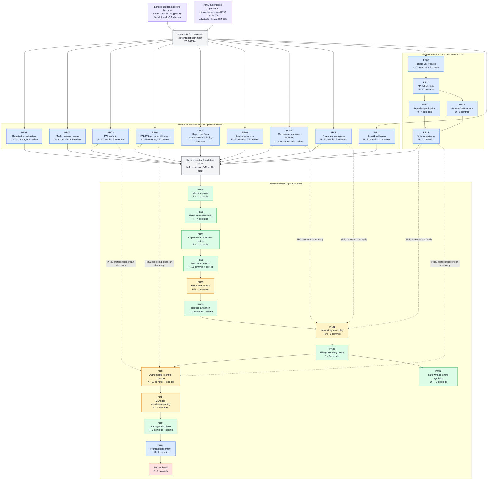

# OpenVMM Micro-VM PR Strategy

## Scope

- OpenVMM fork base: `22c0485be597f87a76771e1db03eaa823a685ffc`, upstream main on 2026-10-22.
  The `feature/microvm/release/v2.3` rebase, which NVX adopted in `622a9199b`, moved the
  chain there from `79013285114700cf3e13e2f39353d526791d833b`; see
  [Upstream status](#upstream-status).
- Mapped fork tip: `a0556d7d85ce1fff89f5b45a98f15c5c79cbb6fb`, position 157. The graph, PR
  summary, and commit mapping below cover positions 001-157 and the fixups at positions
  334-340, 344, and 345.
- NVX's pinned OpenVMM revision: `3d7512af653717aa9123595e993a56cb8587106a`, position 372.
  Positions 371 and 372, which microsoft/openvmm#4816 proposes for `feature/microvm/dev`, are two
  commits on position 370, `b58040ee4`, the head of `feature/microvm/dev` since
  microsoft/openvmm#4823 merged it. Position 370 is one commit on position 369, `5e0ab772e`, which
  microsoft/openvmm#4820 merged with position 368. Positions 368 and 369 are two commits on
  position 367, `bcfc47cff`, which microsoft/openvmm#4818 merged with position 366. Positions 366
  and 367 are two commits on position 365, `e4c741e18`, which microsoft/openvmm#4804 merged with
  positions 362-364. Positions 362-365 are four commits on position 361, `c32c57d12`, which
  microsoft/openvmm#4807 merged with position 360.
  Positions 360 and 361 are two commits on position 359, `bd2b27a2e`, which microsoft/openvmm#4794
  merged with positions 355-358. Positions 355-359 are five commits on position 354, `832d5bb48`,
  which microsoft/openvmm#4775 merged with position 353. Positions 353 and 354 are two commits on
  position 352, `b92daa350`, which microsoft/openvmm#4773 merged with positions 350 and 351.
  Positions 350-352 are three commits on position 349, `d2338ea22`, which microsoft/openvmm#4769
  merged with position 348. Positions 348 and 349 are two commits on position 347, `57d0a18b3`,
  which microsoft/openvmm#4767 merged with position 346. Positions 346 and 347 are two commits on
  position 345, `e68871cc6`, which microsoft/openvmm#4762 merged with position 344. Positions 344
  and 345 are two commits on position 343, `a12d9167f`, which microsoft/openvmm#4749 merged with
  positions 341 and 342. Positions 341-343 are three commits on position 340, `2b681564d`, which
  microsoft/openvmm#4735 merged with position 339. Positions 339 and 340 are two commits on
  position 338, `8a0d945ed`, which microsoft/openvmm#4734 merged, and position 338 is one commit on
  `79a501b63`, the head of the `feature/microvm/release/v2.3` branch of microsoft/openvmm. The pin
  is 215 commits past the mapped tip on the same first-parent chain. Positions 158-333, 341-343,
  and 346-370 are not yet assigned to PRs, and positions 371 and 372 port microsoft/openvmm#4803;
  see [Commits after the mapped tip](#commits-after-the-mapped-tip).
- Upstream main: `22c0485be597f87a76771e1db03eaa823a685ffc` (2026-10-22), the fork base.

## Upstream status

The `feature/microvm/release/v2.3` rebase moved the 334-commit chain of
`feature/microvm/release/v2.2` from `790132851` onto `22c0485be`, 23 upstream commits later. It
dropped position 074, whose change microsoft/openvmm#4661 had landed upstream, so positions from
075 on are one lower than in `feature/microvm/release/v2.2` and in earlier revisions of this
document. Seven commits conflicted with upstream and were resolved where they conflicted, and the
diffs of seven more changed only in context, at positions 049, 051, 071, 087, 182, 196, and 250.
Four fixups at the tip, positions 334-337, adapt the chain to upstream changes that no textual
conflict exposed; see [Rebase conflicts and fixups](#rebase-conflicts-and-fixups).

The `microvm/v2.2` rebase moved the 320-commit chain of `microvm/v2.1` from `e1cdbd916` onto
`790132851`, 75 upstream commits later. It dropped the eight fork commits that had landed
upstream in between and adapted the remaining 312 to upstream API changes where they needed it,
which changed the diffs of 50 of them.

### Landed upstream

| Dropped by | Former position | Fork commit | Roadmap PR | Upstream PR | Upstream commit |
| --- | ---: | --- | --- | --- | --- |
| v2.3 | 074 | `f6e6ff738` - loader_defs: name the boot_params ACPI RSDP field | PR14 | microsoft/openvmm#4661 | `8beae2961` |
| v2.2 | 002 | `607e6c6a2` - nextest: scope a longer budget to the exhaustive ring-buffer loom test | PR01 | microsoft/openvmm#4584 | `9501bb481` |
| v2.2 | 017 | `c61d77644` - pal: create files and directories with explicit security descriptors | PR04 | microsoft/openvmm#4599 | `9fbf965c5` |
| v2.2 | 021 | `88865bf90` - virt_mshv: describe SNP guest workarounds without ACI-specific names | PR05 | microsoft/openvmm#4580 | `40cff1268` |
| v2.2 | 022 | `9b3ce6760` - kvm: preserve pending external interrupts across VP-state capture | PR05 | microsoft/openvmm#4522 | `392890680` |
| v2.2 | 029 | `947ae858b` - virtio: make interrupt tests wait for queue completion | PR06 | microsoft/openvmm#4592 | `5b4656a86` |
| v2.2 | 030 | `21c2206c9` - fuse: rate-limit guest-triggerable diagnostics | PR06 | microsoft/openvmm#4581 | `926827446` |
| v2.2 | 035 | `54c5c34cd` - virtio_console: rate-limit worker errors | PR06 | microsoft/openvmm#4614 | `77ce2aeac` |
| v2.2 | 039 | `dd349021e` - openvmm_entry: accept `delay:<ms>:<disk>` disk wrappers | PR08 | microsoft/openvmm#4610 | `6e0e4fdab` |

A former position counts in the branch that the rebase started from: `microvm/v2.1` for the v2.2
rebase and `feature/microvm/release/v2.2` for the v2.3 rebase. microsoft/openvmm#4661 names the
`acpi_rsdp_addr` field of `boot_params` exactly as position 074 did, so the v2.3 rebase dropped
074 as empty. microsoft/openvmm#4554 still carries it, ahead of positions 074-076.

microsoft/openvmm#4522 fixes the lost-PIC-interrupt bug of v2.1 position 022 in a different way.
Instead of tracking the queued vector in `kvm::VpRunner`, it injects PIC interrupts through the
vCPU's injected-interrupt slot (`KVM_SET_VCPU_EVENTS`), which the existing activity save/restore
already covers. Fork builds that include `9b3ce6760`, such as those of `microvm/v2.1`, can save a
queued PIC vector as a pending `ExtInt` event. Current builds reject restoring one with
`KvmError::InvalidState`, so recapture KVM snapshots that those builds captured.

Upstream also landed parts of commits that remain in the chain:

- microsoft/openvmm#4556 (`96647c331`) derives `Clone` for `ProtobufMessage` and `ProtobufAny`.
  Position 008 keeps its subject but now only adds `ProtobufAny::value_len` and checks a clone
  in the round-trip test.
- microsoft/openvmm#4524 (`9cf109547`) adds the generic `PartitionTimeControl` contract, MSHV
  and WHP implementations, and full-VM freeze/thaw lifecycle calls. Position 051 now reuses the
  MSHV implementation, through fallible freeze and thaw helpers, instead of private plumbing.
  Positions 049-053 and the position 151 fixup keep the exact TSC-frequency exposure, snapshot
  downtime handling, and restored-vCPU synchronization that upstream lacks.
- microsoft/openvmm#4704 (`1c093df84`) adds the architectural `TscDeadline` VP state element,
  the `tsc_deadline` partition capability, and the KVM, MSHV, WHP, and OpenHCL register
  accessors that position 048 also added. The position 334 fixup removes the chain's copies;
  folded into 048, it leaves 048 with the `tsc_deadline` field of the CPU compatibility
  contract, the finalized MSHV partition's report of no TSC-deadline support, and the LAPIC
  timer helpers that position 250 deletes in favor of those that position 178 adds for the time
  ABI. Upstream compares a
  restored deadline on partitions that can freeze time, as WHP can, whereas 048 never compared
  it, so the WHP state access of position 052, which reads the deadline before the APIC state,
  now discards that read when it restores the deadline.

### Open upstream pull requests

As of 2026-10-23, every commit of PR01-PR09 and PR14 except positions 001 and 008 is in an open
upstream pull request. Each pull request carries one commit, except microsoft/openvmm#4554, which
carries positions 074-076 after the `boot_params` field that microsoft/openvmm#4661 has since
landed; its ELF and initrd validation was split out during review and landed as
microsoft/openvmm#4667 (`a87971184`). None of the 42 pull requests is a draft, and none has an
approving review yet. microsoft/openvmm#4451, which proposed position 001, was closed without
merging, and the remainder of position 008 has not been proposed. PR10-PR13 and PR15-PR27 have no
upstream pull requests yet.

| Roadmap PR | Positions | Upstream pull requests, in position order |
| --- | ---: | --- |
| PR01 | 002-007 | microsoft/openvmm#4595, microsoft/openvmm#4608, microsoft/openvmm#4618, microsoft/openvmm#4587, microsoft/openvmm#4598, microsoft/openvmm#4615 |
| PR02 | 009-010 | microsoft/openvmm#4557, microsoft/openvmm#4558 |
| PR03 | 011-013 | microsoft/openvmm#4589, microsoft/openvmm#4590, microsoft/openvmm#4591 |
| PR04 | 014-018 | microsoft/openvmm#4593, microsoft/openvmm#4596, microsoft/openvmm#4604, microsoft/openvmm#4582, microsoft/openvmm#4585 |
| PR05 | 019-021 | microsoft/openvmm#4536, microsoft/openvmm#4607, microsoft/openvmm#4613 |
| PR06 | 022-028 | microsoft/openvmm#4583, microsoft/openvmm#4586, microsoft/openvmm#4588, microsoft/openvmm#4594, microsoft/openvmm#4597, microsoft/openvmm#4605, microsoft/openvmm#4609 |
| PR07 | 029-031 | microsoft/openvmm#4600, microsoft/openvmm#4601, microsoft/openvmm#4602 |
| PR08 | 032-036 | microsoft/openvmm#4616, microsoft/openvmm#4617, microsoft/openvmm#4620, microsoft/openvmm#4621, microsoft/openvmm#4606 |
| PR09 | 037-042 | microsoft/openvmm#4619, microsoft/openvmm#4622, microsoft/openvmm#4623, microsoft/openvmm#4624, microsoft/openvmm#4625, microsoft/openvmm#4626 |
| PR14 | 074-077 | microsoft/openvmm#4554 (074-076), microsoft/openvmm#4611 |

Stacked pull requests carry their prerequisites' commits: microsoft/openvmm#4585 builds on
microsoft/openvmm#4582, and microsoft/openvmm#4609 on both; microsoft/openvmm#4613 builds on
microsoft/openvmm#4536; and microsoft/openvmm#4622, microsoft/openvmm#4623, and
microsoft/openvmm#4625 build on microsoft/openvmm#4619, as microsoft/openvmm#4626 builds on
microsoft/openvmm#4625. Most of these pull requests have gained review commits that the fork
chain does not carry. When one merges, the next rebase should drop its fork commit, as the
`microvm/v2.2` and `feature/microvm/release/v2.3` rebases dropped the nine above, and adapt later
commits to the merged form.

### Rebase conflicts and fixups

The `feature/microvm/release/v2.3` rebase replayed the chain onto `22c0485be` with conflicts at
seven positions, which it resolved in place. It regenerated `Cargo.lock` and the flowey
workflows rather than merging them by hand.

| Position | Fork commit | Upstream PR | Resolution |
| ---: | --- | --- | --- |
| 020 | `c9dab2548` - virt: add Partition::finalize_memory; create the MSHV BSP after finalization | microsoft/openvmm#4703 | A bound VP gets upstream's `finish_reset`, which fixes up CS, TSC, and the APIC, instead of the chain's own APIC setup |
| 044 | `4f76dfb4a` - chipset: persist and advance the RTC clock | microsoft/openvmm#4661 | `Cargo.lock` lists both the chain's `anyhow` and upstream's `acpi_spec` dependency of `chipset` |
| 048 | `1e04b5f50` - virt: add portable TSC-deadline VP state and APIC-timer advance | microsoft/openvmm#4704 | Keeps upstream's capability documentation and its restore-order comment on the shared `TscDeadline` entry |
| 077 | `c7aed0234` - vmm_core: make level-triggered legacy IRQs explicit | microsoft/openvmm#4661 | Takes upstream's `igvmfilegen`, which no longer builds ACPI tables, so the chain's level-triggered-IRQ setting there goes away |
| 088 | `aff5ce1e4` - petri, vmm_tests: add a microVM builder, portb harness, and cold-boot test | microsoft/openvmm#4709 | Pipette runs as init only when both upstream's isolation check and the machine profile allow it |
| 149 | `d333bf9d9` - ci: restrict privileged, self-hosted, and publishing jobs to microsoft/openvmm | microsoft/openvmm#4709 | Regenerated workflows, which also restrict upstream's new `x64-linux-amd-snp-mshv` job |
| 163 | `87fcbf729` - virt_mshv: implement the NVX time ABI backend | microsoft/openvmm#4703 | The partition keeps both upstream's `reset_with_scrub` flag and the time ABI state |

Four fixups adapt the chain to upstream changes that no textual conflict exposed. Fold each into
the commits that it names before submission.

| Position | Fixup | Upstream PR | Fold into |
| ---: | --- | --- | --- |
| 334 | `9bc90f55f` - virt: adopt upstream's TscDeadline VP state element | microsoft/openvmm#4704 | 048 and 052 |
| 335 | `d2e83bdfd` - virt_mshv: adapt the microVM partition to partition scrub | microsoft/openvmm#4703 | 020, 021, 151, 163, and 197 |
| 336 | `6f6956793` - vmm_core: build the ACPI builder tests with level-triggered IRQs | microsoft/openvmm#4661 | 077 |
| 337 | `79a501b63` - underhill_core: make the hardware reseal unit's start fallible | microsoft/openvmm#4415 | 037 |

microsoft/openvmm#4703 (`284127421`) resets MSHV partitions through the partition scrub ioctl
and moves partition reset into `virt_mshv`'s `lib.rs`. Fixup 335 reads capabilities from the
finalized partition state of position 020 and names the fields that positions 020, 021, 151,
163, and 197 add in upstream's reset. A VP reset now also clears a pending PIC ExtINT, since the
PIC is reset as well. microsoft/openvmm#4415 (`2ed16e8fc`) adds an OpenHCL hardware reseal state
unit whose start returns nothing, while position 037 makes `StateUnit::start` fallible.

### Upstream main past the fork base

Upstream main is at the fork base, `22c0485be`, so the chain applies to it without conflicts.

## Legend

| Class | Meaning |
| --- | --- |
| U | Independently upstreamable |
| P | Upstreamable as part of an accepted microVM profile |
| N | NVX product policy; fork-only unless generalized |
| F | Fork-only |

Solid arrows in the diagram are the recommended landing/stacking order. Dashed arrows show work
that can start before the product stack reaches that PR. Purple nodes mark upstream changes that
supersede or partially overlap fork work. "In review" counts a node's commits that are in open
upstream pull requests.

## PR Dependency and Submission Graph



## Actual branch DAG

The physical branch is one first-parent chain:

```text
22c0485be
  -> PR01 [001-007] -> PR02 [008-010] -> PR03 [011-013]
  -> PR04 [014-018] -> PR05 [019-021] -> PR06 [022-028]
  -> PR07 [029-031] -> PR08 [032-036] -> PR09 [037-042]
  -> PR10 [043-053] -> PR11 [054-057] -> PR12 [058-062]
  -> PR13 [063-073] -> PR14 [074-077] -> PR15 [078-088]
  -> PR16 [089-092] -> PR17 [093-103] -> PR18 [104-113]
  -> PR19 [114-116] -> PR20 [117-123] -> PR21 [124-129]
  -> PR22 [130-131] -> PR23 [132-140] -> PR24 [141-145]
  -> PR25 [146-147] -> PR26 [148] -> fork tail [149-150]
  -> PR20 fixup [151] -> PR20/PR25 split [152]
  -> PR18/PR23 split [153]
  -> PR18 fixup [154] -> PR25 fixup [155] -> PR27 [156-157]
  -> a0556d7d8 (mapped tip)
  -> unassigned [158-333]
  -> PR10 fixup [334] -> PR05/PR20/unassigned split [335]
  -> PR14 fixup [336] -> PR09 fixup [337]
  -> PR02 fixup [338] -> PR20 fixup [339] -> PR23 fixup [340]
  -> unassigned [341-343] -> PR18 fixups [344-345]
  -> unassigned [346-370]
  -> microsoft/openvmm#4803 port [371-372]
  -> 3d7512af6 (NVX pin)
```

For upstream review, PR01-PR08 and PR14 can be rebased independently onto current upstream main,
and nearly all of their commits are already in upstream review; see
[Open upstream pull requests](#open-upstream-pull-requests). PR09-PR13 form the generic dependency
chain shown above. The recommended product queue then fans those foundations into PR15 and keeps
PR15-PR26 ordered. PR21's generic enforcement commits can be prepared after PR07, PR08, and PR13;
PR23's protocol and broker commits can be prepared after PR03, PR04, and PR13. Positions 149-150
remain outside the upstream queue. Fold position 151 into PR20, split position 152 between PR20
and PR25, and split position 153 between PR18 and PR23 before submission. Fold position 154 into
PR18's position 104 and position 155 into PR25's position 146. Fold the v2.3 rebase's fixups into
the commits that [Rebase conflicts and fixups](#rebase-conflicts-and-fixups) names: position 334
into PR10, position 336 into PR14, position 337 into PR09, and position 335 into PR05, the PR20
fixup at position 151, and the unassigned positions 163 and 197. Fold position 338 into PR02's
position 010, which microsoft/openvmm#4558 carries. PR27 can be prepared once PR22 lands; its
generic confinement commit can be submitted independently if preferred. Fold position 339 into
PR20's position 120 and position 340 into PR23's position 136. Fold positions 344 and 345 into
PR18's position 111.

## Commits after the mapped tip

The NVX pin extends the chain past position 157 without merges. Of the 215 later commits,
positions 158-333, 341-343, and 346-370 are not yet classified or assigned to PRs, positions
334-337 are the fixups of the `feature/microvm/release/v2.3` rebase, position 338 is a PR02
fixup, positions 339 and 340 are PR20 and PR23 fixups, positions 344 and 345 are PR18 fixups,
and positions 371 and 372 port microsoft/openvmm#4803.
This table groups them by topic in chain order; ranges are inclusive, as in the
[PR summary](#pr-summary).

| Positions | Commit range | Count | Topic |
| ---: | --- | ---: | --- |
| 158 | `4fefafb98` | 1 | Flush buffered portb output before a guest-requested snapshot |
| 159-269 | `f357a4a7c..6b5342226` | 111 | NVX time ABI v1 on KVM, MSHV, and WHP; pinned CPU profiles and the `--cpu-fingerprint` tool; removal of the legacy microVM clock paths; snapshot manifest version 6 as the only format; and MSHV and WHP delivery of LAPIC vectors written into a halted VP's IRR |
| 270-271 | `005f662c8..dc3238f66` | 2 | Serve microVM virtio-fs share requests as the guest caller |
| 272-274 | `43500123b..4b769c356` | 3 | Alder Lake CPU profile and opt-in host CPU profiles |
| 275-276 | `57f6a683c..b5c0782ea` | 2 | Second microVM virtio-fs slot, which position 293 removes |
| 277-282 | `da1fbb8a8..255df8474` | 6 | AMD CPU profiles (Milan, Genoa, and Turin) and AMD host profiles |
| 283 | `ebf17cac5` | 1 | Per-subtree access policy for microVM shares |
| 284 | `3b40a19c1` | 1 | WHP answers CPUID leaves 0 and 1 without exits |
| 285-287 | `997d85131..484b56ec4` | 3 | Generation-bound microVM snapshots and scratch bound by file identity |
| 288 | `efc6dccec` | 1 | `--cpu-profile auto` falls back to a host profile |
| 289 | `e9b73773f` | 1 | RAM-backed microVM overlays without scratch |
| 290-292 | `fc1fc3777..b0ef14f25` | 3 | Egress rules that select a protocol or a destination-port range, and IPv6 in the portable network profile |
| 293-296 | `aca5f9409..a21f6a5cb` | 4 | Several host directories on one virtio-fs slot, their snapshot, and their path policy |
| 297-299 | `feeca257a..345d89362` | 3 | Single host files as aggregate virtio-fs children, their saved kinds, and the `file` flag that requests one |
| 300 | `7d063900a` | 1 | Partition halt state across snapshots |
| 301-302 | `eb8013767..5910fe12e` | 2 | Restore advances VM time and the RTC by the downtime plus the recorded interval from their stop at capture to the capture anchor |
| 303 | `9c2945609` | 1 | Tests of `RENAME_EXCHANGE` on microVM virtio-fs shares: node names, the alias limits, and snapshots |
| 304-305 | `2ddaee136..658d6dc01` | 2 | Host paths with commas in `--mount`, whose mode follows the last comma |
| 306 | `2a68a1f8f` | 1 | Private-network ingress: `--network-ingress allow` publishes the guest's announced listeners to clients on the host's private networks |
| 307 | `5ed416328` | 1 | Bidirectional host-loopback access: `--host-loopback allow` publishes the guest's announced listeners on host loopback for the host alone |
| 308 | `8fd032e88` | 1 | IPv6 host peers appear inside the static IPv6 subnet, so the guest answers them from its address there |
| 309 | `a2f6c92b4` | 1 | Standalone time ABI documentation: comments describe the contract without citing NVX's removed specification |
| 310 | `6ca57be57` | 1 | Replies of the host-loopback services that the guest reaches at its gateway come from the gateway, so connected guest UDP sockets receive them |
| 311 | `6deb1e783` | 1 | The VM worker stops its devices before it tears down the partition and guest memory, so no device worker reads guest memory that teardown has unmapped |
| 312-317 | `606da7cec..c8b641b59` | 6 | Refuse kernel command lines that the guest kernel would truncate, with limit tests derived from the shared check and the profile |
| 318 | `c2722fbcd` | 1 | Run the check-in gates on pushes to the `feature/microvm` branches |
| 319 | `7f228b875` | 1 | `net_tap` writes every packet of a transmit batch |
| 320-331 | `d723bc763..1ba1d35bf` | 12 | Check-in gate fixes for the `feature/microvm` branches: aarch64 guest builds, the macOS clippy build, and portable microVM tests |
| 332 | `ebb4b5d33` | 1 | The management RPC selects the microVM CPU profile |
| 333 | `fcb4ea1c6` | 1 | Petri and the VMM tests fall back to the host CPU profile where `auto`'s is unsupported |
| 334-337 | `9bc90f55f..79a501b63` | 4 | Fixups of the `feature/microvm/release/v2.3` rebase; see [Rebase conflicts and fixups](#rebase-conflicts-and-fixups) |
| 338 | `8a0d945ed` | 1 | Windows mapped-file flushes mark every page of a writable view modified and write the range in one ascending pass, so NTFS no longer zero-fills ranges that are then written again (microsoft/openvmm#4734); fold into 010 |
| 339 | `2f51e8bab` | 1 | Platform snapshots opt into restore-time vCPU activation with one canonical `maxcpus=` token, so each clone of a platform capture can bring its own VP prefix online; fold into 120 |
| 340 | `2b681564d` | 1 | The control-console authentication timeout counts only while the broker reads host input, so a gated restore no longer detaches a host that authenticated at launch; fold into 136 |
| 341 | `c7ac476b4` | 1 | `disk_zerofill` presents a fixed geometry over a shorter backing disk, or none: reads past the backing disk's end return zeros, and every write fails without reaching it |
| 342-343 | `857ff9645..a12d9167f` | 2 | A platform restore presents the snapshot's `distro` capacity over a shorter image and, with `--restore-absent-scratch`, attaches its fresh scratch without a file, reading zeros and failing writes |
| 344-345 | `a04cc8a00..e68871cc6` | 2 | A microVM virtio-fs queue worker waits for request admission to reopen instead of ending, so the queues that a gated restore, or the rollback of a failed save, starts behind the input gate serve the guest once input resumes (microsoft/openvmm#4762); fold into 111 |
| 346 | `3e3a454c5` | 1 | A platform snapshot whose NIC was captured with the complete deny-all policy, `--network-egress deny` and `--host-loopback deny` without rules, a proxy, or ingress, is a NIC template, which digest encodings from version 3 on identify |
| 347 | `57d0a18b3` | 1 | `--restore-network-policy` lets a platform restore install the policy of its own options on a NIC template, including private-network ingress, explicit host loopback, and forwards, before any vCPU runs, while the NIC keeps its identity and the contract keeps the template's deny-all (microsoft/openvmm#4767) |
| 348-349 | `689577604..d2338ea22` | 2 | A second revision of the Genoa CPU profile, `amd.genoa.v2`, which `auto` selects: `amd.genoa.v1` without the basic leaves above `0xd` and without `LFENCE` serialization, NoSmmCtlMsr, and the TSA immunities in `0x80000021`, none of which the Microsoft hypervisor of the Azure Genoa VMs fingerprinted so far presents, with the nested-WHP Genoa host of microsoft/nvx#928 as a test fixture (microsoft/openvmm#4769); revises position 282's Genoa profile |
| 350-352 | `8c1772d83..b92daa350` | 3 | HTTP blob disks bound each request in time, retry the ones that fail transiently on a new connection, and show them in inspect, so that a network path that silently stops delivering a connection's packets no longer hangs a guest's disk read (microsoft/openvmm#4773) |
| 353 | `057a2eaa6` | 1 | Test that the microVM virtio-fs device takes a dormant slot's state into the device of an aggregate of a directory and a file, which then saves the aggregate |
| 354 | `832d5bb48` | 1 | A platform restore may bind an aggregate, `--mount-aggregate` with its children, policy paths, and owner mode, to the filesystem slot that the snapshot left dormant, validated as at a cold boot, while the slot's device and the captured command line stay as captured; other tiers keep binding only a `--mount` (microsoft/openvmm#4775) |
| 355-359 | `2607a7d55..bd2b27a2e` | 5 | microVM virtio devices reach only the RAM ranges of the e820 map: guest memory views that admit only a set of ranges, a virtio queue that refuses a descriptor unless its memory admits the whole buffer, an MMIO transport that restricts device DMA and marks a device that addresses other memory as needing reset, and the loader's e820 RAM ranges, to which every microVM device is restricted (microsoft/openvmm#4794) |
| 360-361 | `c9ac93a63..c32c57d12` | 2 | CPU profile validation checks the CPU time bits, so a snapshot's host profile document must fix them too, and the catalog verifies each pinned profile once per process, before a partition uses it: its static data must form a valid profile whose canonical encoding is the encoding that snapshots embed, while the tests keep checking its digest (microsoft/openvmm#4807) |
| 362-365 | `69ddc715b..e4c741e18` | 4 | The microVM's `E_CPU_SURFACE` errors name every CPUID difference rather than the first 16, each entry of a snapshot's effective CPUID record on one line with the registers in which it differs, and VP 0's non-zero CPUID entries outside the profile's tables together with the results that VP 0 does not observe; and the VM worker runs every CPU check of a partition, the comparison with the snapshot's record, the check of VP 0's CPUID, and the check that the backend supports the profile, even after one fails, and reports their failures together (microsoft/openvmm#4804) |
| 366-367 | `e51ab72d3..bcfc47cff` | 2 | The restore's comparison of the effective CPUID with a snapshot's record names every difference of a record that the decoder admits although no OpenVMM writes it, each entry that the record lists more than once, each of its listings that differs, and a record out of order, together with the entries that differ; and its tests check each register, value, and mask that the error names (microsoft/openvmm#4818) |
| 368-369 | `342887c99..5e0ab772e` | 2 | The VM time keeper maps a timeout beyond what the host clock can represent to the host clock's latest time: one more than about 584 years after the last start no longer panics the task that arms it, as one armed across a restore to a far VM time panicked the keeper's task at start (microsoft/nvx#1038), and one nearly half the ring after now, which VM time's circular order puts before the start, no longer arms the host timer in the past, which made the keeper spin (microsoft/openvmm#4820) |
| 370 | `b58040ee4` | 1 | Explicit `--host-loopback allow` requires an IPv4 network of /29 or larger: OpenVMM refuses it on a /30, which leaves no address at which Consomme presents host peers, at a cold boot and at a restore that installs a new policy on a NIC template, instead of presenting IPv4 host peers at the gateway (microsoft/openvmm#4823) |
| 371-372 | `2dec9edcb..3d7512af6` | 2 | The KVP IC VMM test boots Windows Server 2025 instead of 2022, whose COM activation race can lose WMI's server-registration notification, so that the guest answers the test's IP information request with `0x80080005` after 120 seconds (microsoft/nvx#1035); and the check-in gates' x64 Linux KVM job downloads the Server 2025 image and keeps running the test, while the x64 Linux MSHV job excludes it because Server 2025's required initial reset fails there (microsoft/openvmm#4816, which ports microsoft/openvmm#4803) |

Some of these commits change mapped work rather than add to it. Positions 246-250 remove the
legacy microVM clock paths and change files that PR10 and PR17 also change. Position 252 makes
manifest version 6 the only snapshot format and changes files that PR11 and PR17 also change.
Positions 342 and 343 change the sandbox block attachment of PR19's position 115 and the
restore of positions 285 and 286. Positions 346 and 347 change the snapshot network policy and
the forward refusal of PR21's position 129 and the snapshot refusals of positions 306 and 307.
Position 354 changes the dormant-slot restore of PR18's position 113, as the aggregates of
position 293 restricted it.
Assigning the later commits therefore means revisiting those PRs, not only appending new ones.
Positions 350-352, by contrast, change only `disk_blob`, which upstream main and the fork base
have alike and no other commit of the chain changes, so they can go upstream on their own.
Position 355 likewise changes only `guestmem`, which no other commit of the chain changes, so it
can go upstream on its own, and position 356 adds only the virtio queue's check on top of it.
Positions 357-359 build on the fork's virtio-mmio shared interrupt-status transport, MP-table
loader, and microVM worker. Positions 360 and 361 change only `cpu_profile`, the fork's CPU
profile crate that positions 159-269 add, one of its test helpers in `virt_mshv`, and the
snapshot guide, so they build on that fork-only code. Positions 362-365 change only the CPU
checks of the VM worker's time ABI, which positions 159-269 also add, and the snapshot guide's
description of them. Positions 366 and 367 change only the first of those checks, the
comparison with a snapshot's record, its tests, and the snapshot guide's description of it.
Positions 368 and 369 change only the VM time keeper of `vmcore`, whose `vmtime.rs` upstream main
and the fork base have alike. Positions 043 and 301 change other parts of that file, and positions
368 and 369 apply to upstream main as they are, so they can go upstream on their own. Position
370 changes only how the microVM options bind their network policy to the NIC's identity, to
which position 307 adds explicit host-loopback access and position 347 the restore that installs
a new policy, and the CLI and Consomme references, so it builds on those fork-only commits.
Position 371 makes the change of microsoft/openvmm#4803 unchanged. Position 372 stages the
Server 2025 image for the x64 Linux KVM job, which runs the test, and excludes the test and its
image from the x64 Linux MSHV job, where Server 2025's required initial reset fails. A rebase
onto an upstream main that includes microsoft/openvmm#4803 drops position 371, as the rebases
dropped the commits under [Landed upstream](#landed-upstream), and reconciles position 372 with
whatever upstream changes for those jobs.

## PR summary

`N + split` means N whole commits plus selected hunks from a physical commit. Fixup positions count
as whole physical commits here but should be folded into their target commits before submission.

| PR | Class | Topic | Actual positions | Actual commit range(s) | Count | Recommended direct dependency |
| --- | --- | --- | ---: | --- | ---: | --- |
| PR01 | U | Build and test infrastructure | 001-007 | `a685f1048..bca9e93f5` | 7 | Current upstream |
| PR02 | U | Host primitives: mesh and sparse_mmap | 008-010; 338 (fixup) | `8d72321f5..a95f8ef33`; `8a0d945ed` | 4 | Current upstream |
| PR03 | U | Host primitives: PAL on Unix | 011-013 | `30a39563d..c3330847c` | 3 | Current upstream |
| PR04 | U | Host primitives: PAL and PAL async on Windows | 014-018 | `f2270e72b..8dfac4835` | 5 | Current upstream |
| PR05 | U | Hypervisor backend fixes | 019-021; 335 (split) | `40d5bd66f..050a6904d`; `d2e83bdfd` (split) | 3 + split | Current upstream |
| PR06 | U | Device fixes and hardening | 022-028 | `ff3b0fb1d..15697c7c1` | 7 | Current upstream |
| PR07 | U | Consomme resource bounding | 029-031 | `4446df5c4..90734a2ff` | 3 | Current upstream |
| PR08 | U | Preparatory refactors | 032-036 | `2ded66433..6794f12d0` | 5 | Current upstream |
| PR09 | U | Fallible and bounded VM lifecycle | 037-042; 337 (fixup) | `5363341dd..8cdd6153a`; `79a501b63` | 7 | Current upstream |
| PR10 | U | Portable CPU and clock state | 043-053; 334 (fixup) | `2b12eea4c..d8892b12b`; `9bc90f55f` | 12 | PR09 |
| PR11 | U | Snapshot publication protocol | 054-057 | `d4847253c..c5588598f` | 4 | PR10 |
| PR12 | U | Immutable private-CoW restore | 058-062 | `d3ebc16e4..0e0a179a0` | 5 | PR10 |
| PR13 | U | Generic virtio persistence | 063-073 | `058dbce07..78a14a026` | 11 | PR11 + PR12 |
| PR14 | U | Firmware-less direct boot, loader half | 074-077; 336 (fixup) | `ef0eb70e3..c7aed0234`; `6f6956793` | 5 | Current upstream |
| PR15 | P | microVM machine profile and minimal chipset | 078-088 | `03a4294a8..aff5ce1e4` | 11 | Foundation fan-in |
| PR16 | P | Fixed virtio-MMIO ABI and shared interrupt status | 089-092 | `47f029b97..211537d6d` | 4 | PR15 |
| PR17 | P | microVM snapshot capture and authoritative restore | 093-103 | `693d64ca8..d0cb54c9d` | 11 | PR16 |
| PR18 | P | microVM host attachments and device persistence | 104-113; 153 (split); 154 (fixup); 344-345 (fixups) | `9611571b9..b7816551d`; `9638a8f42` (split); `e1586485a`; `a04cc8a00..e68871cc6` | 13 + split | PR17 |
| PR19 | N/P | Sandbox block roles and snapshot tiers | 114-116 | `cec1a5510..59cb42a01` | 3 | PR18 |
| PR20 | P | Restore-time processor and memory activation | 117-123; 151-152; 335 (split); 339 (fixup) | `9f2d6eeee..764d668d1`; `73a324390..9be096e1b`; `d2e83bdfd` (split); `2f51e8bab` | 9 + split | PR19 |
| PR21 | P/N | Network egress policy | 124-129 | `44ec6b08d..b6e8dc870` | 6 | PR20; core can start after PR07 + PR08 + PR13 |
| PR22 | P | Filesystem deny policy | 130-131 | `07eb316dc..7894a3b50` | 2 | PR21 |
| PR23 | N | Authenticated control console | 132-140; 153 (split); 340 (fixup) | `2d649d42c..ed9d48548`; `9638a8f42` (split); `2b681564d` | 10 + split | PR22; protocol/broker can start after PR03 + PR04 + PR13 |
| PR24 | N | Managed workload and outcome reporting | 141-145 | `ddaa1810b..ad0b68265` | 5 | PR23 |
| PR25 | P | Management plane | 146-147; 152 (split); 155 (fixup) | `941f8f720..a1820db81`; `9be096e1b` (split); `e9f23af5d` | 3 + split | PR24 |
| PR26 | U | Profiling benchmark | 148 | `d90539d5a` | 1 | PR25 in the current stack |
| PR27 | U/P | Safe symlinks for writable microVM shares | 156-157 | `06c7220b0..a0556d7d8` | 2 | PR22; position 156 can land independently |
| Fork tail | F | CI guards and NVX wire compatibility | 149-150 | `d333bf9d9..ecdfe3855` | 2 | PR26; do not submit upstream |

## Exact commit-to-PR mapping

Positions 152 and 153 intentionally appear under two PRs because their commits must be split when
forming submission branches. Positions 154 and 155 are fixups that should be folded into positions
104 and 146, respectively. Tip positions 151-155 and the fixups at positions 334-340, 344, and
345 are listed under their destination PRs rather than in numerical order, and position 335
appears under both PRs that it changes. The counts distinguish whole commits from selected split
hunks.
Struck-through entries landed upstream before the fork base. The `microvm/v2.2` and
`feature/microvm/release/v2.3` rebases dropped them, so they name the commits and positions of the
branch that the rebase started from, `microvm/v2.1` or `feature/microvm/release/v2.2`, and the
counts exclude them.
Partial upstream overlap is called out without striking the remaining fork work, and
**open upstream** names the upstream pull request that carries a commit.

<details>
<summary><strong>PR01 - Build and test infrastructure (U)</strong> - 7 commits + 1 landed upstream</summary>

- 001 `a685f1048` - build: keep Winsock eagerly imported on Windows (**not upstream**: microsoft/openvmm#4451 was closed without merging)
- ~~`607e6c6a2` - nextest: scope a longer budget to the exhaustive ring-buffer loom test~~
  (**landed upstream**: microsoft/openvmm#4584, merged as `9501bb481`; v2.1 position 002)
- 002 `a48c14a18` - flowey: distinguish native Windows and WSL nextest paths (**open upstream**: microsoft/openvmm#4595)
- 003 `0213cf65d` - flowey: skip reinstalling an identical, possibly running cargo-nextest binary (**open upstream**: microsoft/openvmm#4608)
- 004 `bc5635c5d` - flowey: keep caller temp directories for native local VMM-test runs (**open upstream**: microsoft/openvmm#4618)
- 005 `a91dc86fb` - lxutil: tolerate inherited extended attributes in tests (**open upstream**: microsoft/openvmm#4587)
- 006 `5df7a4f7f` - consomme: make TCP window-reopen validation deterministic (**open upstream**: microsoft/openvmm#4598)
- 007 `bca9e93f5` - virt_whp, petri: enable native PCIe NVMe boot on WHP (**open upstream**: microsoft/openvmm#4615)

</details>

<details>
<summary><strong>PR02 - Host primitives: mesh and sparse_mmap (U)</strong> - 4 commits</summary>

- 008 `8d72321f5` - mesh_protobuf: clone type-erased messages and expose encoded length (**partly landed upstream**: microsoft/openvmm#4556, merged as `96647c331`, derives `Clone`; this commit now adds only `ProtobufAny::value_len` and a clone check)
- 009 `15a895dd8` - sparse_mmap: add private copy-on-write file views (**open upstream**: microsoft/openvmm#4557)
- 010 `a95f8ef33` - sparse_mmap: flush file-backed ranges with bounded concurrency (**open upstream**: microsoft/openvmm#4558)
- 338 `8a0d945ed` - sparse_mmap: flush writable file views whole, in one ascending pass (**fold into 010**; merged into `feature/microvm/dev` by microsoft/openvmm#4734)

</details>

<details>
<summary><strong>PR03 - Host primitives: PAL on Unix (U)</strong> - 3 commits</summary>

- 011 `30a39563d` - pal: bound Linux descriptor-table pre-expansion (**open upstream**: microsoft/openvmm#4589)
- 012 `4a7ab405c` - pal: add Unix extent cloning and sparse-extent seeking (**open upstream**: microsoft/openvmm#4590)
- 013 `c3330847c` - pal: query Unix socket peer credentials (**open upstream**: microsoft/openvmm#4591)

</details>

<details>
<summary><strong>PR04 - Host primitives: PAL and PAL async on Windows (U)</strong> - 5 commits + 1 landed upstream</summary>

- 014 `f2270e72b` - pal: add handle-relative file access that does not follow reparse points (**open upstream**: microsoft/openvmm#4593)
- 015 `074de3406` - pal: add sparse-file range queries, zeroing, and block cloning (**open upstream**: microsoft/openvmm#4596)
- ~~`c61d77644` - pal: create files and directories with explicit security descriptors~~
  (**landed upstream**: microsoft/openvmm#4599, merged as `9fbf965c5`; v2.1 position 017)
- 016 `515cf9475` - pal: resolve the process token user SID (**open upstream**: microsoft/openvmm#4604)
- 017 `50460c27a` - pal: query named-pipe peers and create protected pipes (**open upstream**: microsoft/openvmm#4582)
- 018 `8dfac4835` - pal_async: fix named-pipe reconnect and already-connected listen (**open upstream**: microsoft/openvmm#4585, stacked on microsoft/openvmm#4582)

</details>

<details>
<summary><strong>PR05 - Hypervisor backend fixes (U)</strong> - 3 commits + split fixup + 2 landed upstream</summary>

- ~~`88865bf90` - virt_mshv: describe SNP guest workarounds without ACI-specific names~~
  (**landed upstream**: microsoft/openvmm#4580, merged as `40cff1268`; v2.1 position 021)
- ~~`9b3ce6760` - kvm: preserve pending external interrupts across VP-state capture~~
  (**landed upstream**: superseded by microsoft/openvmm#4522, merged as `392890680`; v2.1 position 022)
- 019 `40d5bd66f` - virt_mshv: make RUN_VP cancellation race-free (**open upstream**: microsoft/openvmm#4536)
- 020 `c9dab2548` - virt: add Partition::finalize_memory; create the MSHV BSP after finalization (**open upstream**: microsoft/openvmm#4607)
- 021 `050a6904d` - virt_mshv: persist and redeliver pending external interrupts (**open upstream**: microsoft/openvmm#4613, stacked on microsoft/openvmm#4536)
- 335 `d2e83bdfd` - virt_mshv: adapt the microVM partition to partition scrub (**split fixup**: the hunks for positions 020 and 021 belong in PR05; the hunk for position 151 belongs in PR20, and those for positions 163 and 197 stay with those unassigned commits)

</details>

<details>
<summary><strong>PR06 - Device fixes and hardening (U)</strong> - 7 commits + 3 landed upstream</summary>

- 022 `ff3b0fb1d` - chipset: preserve IOAPIC line levels across restore (**open upstream**: microsoft/openvmm#4583)
- 023 `938b14343` - chipset: fast-forward periodic PIT counting over long intervals (**open upstream**: microsoft/openvmm#4586)
- 024 `0469db4d8` - virtio_blk: let stop cancellation win over a ready queue and drain accepted I/O (**open upstream**: microsoft/openvmm#4588)
- ~~`947ae858b` - virtio: make interrupt tests wait for queue completion~~
  (**landed upstream**: microsoft/openvmm#4592, merged as `5b4656a86`; v2.1 position 029)
- ~~`21c2206c9` - fuse: rate-limit guest-triggerable diagnostics~~
  (**landed upstream**: microsoft/openvmm#4581, merged as `926827446`; v2.1 position 030)
- 025 `f3a63da2c` - virtiofs: make handle and inode ID allocation fallible (**open upstream**: microsoft/openvmm#4594)
- 026 `13df2d82f` - virtiofs: bound guest payload allocations and rate-limit diagnostics (**open upstream**: microsoft/openvmm#4597)
- 027 `a3959b8f3` - serial_socket: drop the connection on any write failure (**open upstream**: microsoft/openvmm#4605)
- 028 `15697c7c1` - serial_socket: keep Windows named-pipe listeners reconnectable (**open upstream**: microsoft/openvmm#4609, stacked on microsoft/openvmm#4582 and microsoft/openvmm#4585)
- ~~`54c5c34cd` - virtio_console: rate-limit worker errors~~
  (**landed upstream**: microsoft/openvmm#4614, merged as `77ce2aeac`; v2.1 position 035)

</details>

<details>
<summary><strong>PR07 - Consomme resource bounding (U)</strong> - 3 commits</summary>

- 029 `4446df5c4` - consomme: bound active TCP, UDP, and ICMP flows (**open upstream**: microsoft/openvmm#4600)
- 030 `135c503ba` - consomme: cover the pending DNS request limit with a test (**open upstream**: microsoft/openvmm#4601)
- 031 `90734a2ff` - consomme: cover IPv4 fragment rejection with a test (**open upstream**: microsoft/openvmm#4602)

</details>

<details>
<summary><strong>PR08 - Preparatory refactors (U)</strong> - 5 commits + 1 landed upstream</summary>

- ~~`dd349021e` - openvmm_entry: accept `delay:<ms>:<disk>` disk wrappers~~
  (**landed upstream**: microsoft/openvmm#4610, merged as `6e0e4fdab`; v2.1 position 039)
- 032 `2ded66433` - openvmm_helpers: split the snapshot module without behavior changes (**open upstream**: microsoft/openvmm#4616)
- 033 `a2f46d6ed` - net_tap: move the transmit path into its own module (**open upstream**: microsoft/openvmm#4617)
- 034 `77e6887c6` - net_consomme: move queue transmit processing into a module (**open upstream**: microsoft/openvmm#4620)
- 035 `80c295778` - virtio_console: move the direct receive loop into its own module (**open upstream**: microsoft/openvmm#4621)
- 036 `6794f12d0` - openvmm_entry: skip raw console mode when stdin is not a terminal (**open upstream**: microsoft/openvmm#4606)

</details>

<details>
<summary><strong>PR09 - Fallible and bounded VM lifecycle (U)</strong> - 7 commits</summary>

- 037 `5363341dd` - state_unit: make unit start fallible and roll back partial starts (**open upstream**: microsoft/openvmm#4619)
- 038 `9ef8ce3ef` - vmcore: add fallible device start through chipset device workers (**open upstream**: microsoft/openvmm#4622, stacked on microsoft/openvmm#4619)
- 039 `327f2ae3e` - openvmm: make VM resume fallible (**open upstream**: microsoft/openvmm#4623, stacked on microsoft/openvmm#4619)
- 040 `c9c34dbc2` - state_unit: record the exact unit inventory in saved state (**open upstream**: microsoft/openvmm#4624)
- 041 `90e1b67d9` - state_unit: add bounded quiesce transactions with rollback classification (**open upstream**: microsoft/openvmm#4625, stacked on microsoft/openvmm#4619)
- 042 `8cdd6153a` - vmcore: add device input quiesce and resume (**open upstream**: microsoft/openvmm#4626, stacked on microsoft/openvmm#4625)
- 337 `79a501b63` - underhill_core: make the hardware reseal unit's start fallible (**fold into 037**)

</details>

<details>
<summary><strong>PR10 - Portable CPU and clock state (U)</strong> - 12 commits</summary>

- 043 `2b12eea4c` - vmcore, state_unit: advance guest time across stopped downtime
- 044 `4f76dfb4a` - chipset: persist and advance the RTC clock
- 045 `245d77626` - chipset: reject inconsistent RTC interrupt state on restore
- 046 `65ccce48b` - chipset: catch up the PIT after downtime
- 047 `04cbc52d8` - virt: define a canonical x86 CPU compatibility contract
- 048 `1e04b5f50` - virt: add portable TSC-deadline VP state and APIC-timer advance (**partly superseded upstream**: microsoft/openvmm#4704, merged as `1c093df84` before the fork base, adds the same `TscDeadline` state element and backend accessors, whose chain copies the position 334 fixup removes)
- 049 `606ddbfb0` - virt: add exact TSC-frequency helpers and snapshot clock hooks
- 050 `3ce031447` - virt_kvm: save and restore exact TSC and kvm-clock state
- 051 `175923cd0` - virt_mshv: synchronize restored vCPU clocks and expose the exact TSC frequency
- 052 `142a4a3fb` - virt_whp: synchronize restored vCPU clocks and keep SMP TSC reads coherent
- 053 `d8892b12b` - vmm_core: advance VP TSC and APIC timers across downtime
- 334 `9bc90f55f` - virt: adopt upstream's TscDeadline VP state element (**fold into 048 and 052**)

Position 048 partially overlaps microsoft/openvmm#4704, which landed before the fork base, and
the position 334 fixup reworks 048 and 052 onto it; see [Landed upstream](#landed-upstream).
Position 051 already reuses the MSHV `PartitionTimeControl` implementation of
microsoft/openvmm#4524 and keeps only the exact-frequency and restored-TSC synchronization work
that upstream lacks.

</details>

<details>
<summary><strong>PR11 - Snapshot publication protocol (U)</strong> - 4 commits</summary>

- 054 `d4847253c` - openvmm_defs: add opt-in snapshot lifecycle profiling
- 055 `91438ffbd` - openvmm_helpers: version the snapshot manifest format and bound its decoding
- 056 `e8135eafe` - openvmm_helpers: publish snapshots atomically through durable staging
- 057 `c5588598f` - openvmm: publish the exact file-backed RAM handle

</details>

<details>
<summary><strong>PR12 - Immutable private-CoW restore (U)</strong> - 5 commits</summary>

- 058 `d3ebc16e4` - membacking: map guest RAM privately copy-on-write with fault accounting
- 059 `923069825` - openvmm_helpers: open snapshots once and read artifacts relative to the directory
- 060 `6a01d103f` - openvmm: restore RAM through a private CoW mapping and retain generation handles
- 061 `5c740289d` - openvmm: signal restore readiness to a local socket or pipe
- 062 `0e0a179a0` - virt_whp: resolve unmapped-GPA faults and register restored RAM lazily

</details>

<details>
<summary><strong>PR13 - Generic virtio persistence (U)</strong> - 11 commits</summary>

- 063 `058dbce07` - virtio: add device-private saved state with deferred activation and serialized kicks
- 064 `bc3a1acfa` - virtio: forward input quiesce and resume through transports
- 065 `9aceeb0cc` - virtio_console: add attachment identities and reconnect and disconnect policies
- 066 `1470fab14` - virtio_console: persist buffered direct-console I/O
- 067 `97f4ac115` - net_backend: add an endpoint queue quiesce contract
- 068 `471f7e962` - net_tap: quiesce queues and retain pending transmit ownership
- 069 `5df809631` - net_consomme: quiesce endpoint queues
- 070 `dea54ee50` - consomme: add an exact static IPv4 and gateway identity
- 071 `5117d9efc` - virtio_net: persist drained queue state for static-identity NICs
- 072 `6de083493` - fuse: save and restore negotiated session state
- 073 `78a14a026` - virtiofs: track inode aliases through link, rename, and unlink

</details>

<details>
<summary><strong>PR14 - Firmware-less direct boot, loader half (U)</strong> - 5 commits + 1 landed upstream</summary>

- ~~`f6e6ff738` - loader_defs: name the boot_params ACPI RSDP field~~
  (**landed upstream**: microsoft/openvmm#4661, merged as `8beae2961`; v2.2 position 074)
- 074 `ef0eb70e3` - loader: let static ELF loading reuse a caller buffer (**open upstream**: microsoft/openvmm#4554)
- 075 `5481c8613` - loader: add an Intel MP 1.4 table builder (**open upstream**: microsoft/openvmm#4554)
- 076 `359323db4` - loader: add firmware-less Linux direct boot with MP tables (**open upstream**: microsoft/openvmm#4554)
- 077 `c7aed0234` - vmm_core: make level-triggered legacy IRQs explicit (**open upstream**: microsoft/openvmm#4611)
- 336 `6f6956793` - vmm_core: build the ACPI builder tests with level-triggered IRQs (**fold into 077**)

</details>

<details>
<summary><strong>PR15 - microVM machine profile and minimal chipset (P)</strong> - 11 commits</summary>

- 078 `03a4294a8` - openvmm_defs: add machine-profile selection
- 079 `0e6ebc54b` - virt: describe the deterministic microVM topology
- 080 `6289a89a1` - chipset: add an RTC mode seam
- 081 `24a8f6f4d` - vm_manifest_builder: add the minimal microVM base chipset without ACPI
- 082 `6595b63e7` - vmm_core: add status-bearing guest power-off
- 083 `074cd403b` - chipset: add the microVM portb console
- 084 `e68f5e5d2` - chipset: add the microVM shutdown and exit-status port
- 085 `318b812d0` - openvmm_core: boot microVMs through MP-table direct load
- 086 `d8c443430` - openvmm_core: reject host save, pulse save/restore, and worker restart for microVMs
- 087 `25a4687b4` - openvmm_entry: expose `--machine microvm`
- 088 `aff5ce1e4` - petri, vmm_tests: add a microVM builder, portb harness, and cold-boot test

</details>

<details>
<summary><strong>PR16 - Fixed virtio-MMIO ABI and shared interrupt status (P)</strong> - 4 commits</summary>

- 089 `47f029b97` - virtio: allow feature masking for virtio-MMIO devices
- 090 `d420632fd` - openvmm: place virtio devices at fixed microVM MMIO slots
- 091 `9263efe28` - virtio: add shared MMIO interrupt status and ACK doorbells
- 092 `211537d6d` - openvmm: use shared interrupt status for fixed microVM slots

</details>

<details>
<summary><strong>PR17 - microVM snapshot capture and authoritative restore (P)</strong> - 11 commits</summary>

- 093 `693d64ca8` - vmm_core: stop VPs at a deferred-I/O boundary
- 094 `dee5996cd` - chipset: add the microVM snapshot-request port
- 095 `fba23b94e` - openvmm_core: establish the post-OUT snapshot boundary in the worker
- 096 `56d7aa687` - openvmm_core: fence management mutations during snapshot boundaries
- 097 `79afb7a58` - openvmm_helpers: define the authoritative microVM machine contract
- 098 `aaac2aa38` - openvmm_core: propagate the guest TSC frequency for snapshot-capable cold boots
- 099 `25f91f6cb` - openvmm_entry: capture guest-requested microVM snapshots
- 100 `717b69891` - virt: build a reproducible CPU and clock contract for microVM partitions
- 101 `d6d167721` - openvmm_core: validate restored CPU and clock contracts and apply host downtime
- 102 `7275b1f14` - openvmm_entry: restore microVMs authoritatively
- 103 `d0cb54c9d` - vmm_tests: check that an unconfigured microVM snapshot request continues

</details>

<details>
<summary><strong>PR18 - microVM host attachments and device persistence (P)</strong> - 13 commits + split tip</summary>

- 104 `9611571b9` - openvmm_entry: add connect= serial backends with bounded timeouts
- 105 `eca5077b9` - openvmm: persist the microVM boot console and rebuild its attachment on restore
- 106 `4732f3629` - openvmm: attach a portable Consomme NIC to microVMs
- 107 `7f4e79c9f` - openvmm: persist the microVM NIC and restore a fresh endpoint generation
- 108 `f152fbfb2` - net_tap: support persistent TAP attachments
- 109 `6e7c4cdbb` - virtiofs: add the fixed microVM filesystem profile
- 110 `f448a3732` - openvmm_entry: expose `--mount` for the microVM HostFs slot
- 111 `7f46b49af` - virtiofs: persist microVM FUSE namespaces, handles, and directory cookies
- 112 `e1db8bd8d` - openvmm: snapshot the microVM filesystem and revalidate it on restore
- 113 `b7816551d` - openvmm: reserve a dormant microVM filesystem slot
- 153 `9638a8f42` - Restore listener endpoint rebinding (**split with PR23**: boot-listener and shared attachment-contract portions belong in PR18; authenticated control-listener portions belong in PR23)
- 154 `e1586485a` - openvmm_entry: compile connect_serial without the RPC features (**fold into 104**)
- 344 `a04cc8a00` - virtiofs: factor the integration test harness for input-gate tests (**fold into 111**)
- 345 `e68871cc6` - virtiofs: wait for request admission instead of ending a queue worker (**fold into 111**)

</details>

<details>
<summary><strong>PR19 - Sandbox block roles and snapshot tiers (N/P)</strong> - 3 commits</summary>

- 114 `cec1a5510` - openvmm: add fixed-role microVM sandbox block slots
- 115 `e4b0468eb` - openvmm: snapshot sandbox blocks with paired or fresh scratch
- 116 `59cb42a01` - openvmm: add clone and resume tiers with single-use resume claims

</details>

<details>
<summary><strong>PR20 - Restore-time processor and memory activation (P)</strong> - 9 commits + split tip</summary>

- 117 `9f2d6eeee` - chipset: expose a stable generation ID and restore entropy on portb
- 118 `310b3e8f5` - openvmm: gate external input until post-restore repair completes
- 119 `787a170d2` - vmm_core: instantiate an active VP prefix
- 120 `7ab70a4d1` - openvmm: bring a restore-time processor prefix online
- 121 `c842338bd` - openvmm_core: back expandable restore RAM with fresh private memory
- 122 `862945d8a` - openvmm: add bounded restore-time memory expansion
- 123 `764d668d1` - openvmm_entry: pre-expand the Linux descriptor table at startup
- 151 `73a324390` - virt_mshv: synchronize restored TSCs only on created VPs
- 152 `9be096e1b` - openvmm_core: instantiate only the requested VP prefix on MSHV restore (**split with PR25**: worker and backend changes belong in PR20; the gRPC reference hunk belongs in PR25)
- 335 `d2e83bdfd` - virt_mshv: adapt the microVM partition to partition scrub (**split fixup with PR05**: the hunk for position 151 belongs in PR20)
- 339 `2f51e8bab` - microVM: let platform snapshots opt into restore-time vCPU activation (**fold into 120**)

</details>

<details>
<summary><strong>PR21 - Network egress policy (P/N)</strong> - 6 commits</summary>

- 124 `44ec6b08d` - net_backend_resources: define a canonical bound IPv4 egress policy
- 125 `3271d0181` - net_backend: let endpoints accept a run-scoped egress policy
- 126 `07a55632a` - net_consomme: enforce the egress policy on final transmitted bytes
- 127 `5a51270fc` - net_tap: enforce the egress policy on TAP transmit
- 128 `541945124` - virtio_net: install and prefilter the egress policy
- 129 `b6e8dc870` - openvmm: add microVM network egress policy and bind it into snapshots

</details>

<details>
<summary><strong>PR22 - Filesystem deny policy (P)</strong> - 2 commits</summary>

- 130 `07eb316dc` - virtiofs: enforce denied subtrees by object identity
- 131 `7894a3b50` - openvmm: add --mount-deny and record denied paths in snapshots

</details>

<details>
<summary><strong>PR23 - Authenticated control console (N)</strong> - 10 commits + split tip</summary>

- 132 `2d649d42c` - serial_core: expose local peer identity and active-peer eviction
- 133 `cba534b9d` - serial_socket: report Unix and named-pipe peer identities
- 134 `579dccc15` - virtio_console: define the control-session record protocol
- 135 `7c71cf0ab` - virtio_console: add the control-session broker state machine
- 136 `8181571ee` - virtio_console: attach the broker to serial I/O with receive credits
- 137 `44792d6a4` - virtio_console: save and restore broker state
- 138 `926b70edf` - openvmm: reserve the dedicated microVM control-console slot
- 139 `6c1043d08` - openvmm_helpers: record the control console in the microVM machine contract
- 140 `ed9d48548` - openvmm_entry: add authenticated microVM control-console endpoints
- 153 `9638a8f42` - Restore listener endpoint rebinding (**split with PR18**: authenticated control-listener portions belong in PR23; boot-listener and shared attachment-contract portions belong in PR18)
- 340 `2b681564d` - virtio_console: time host authentication only while host input is read (**fold into 136**)

</details>

<details>
<summary><strong>PR24 - Managed workload and outcome reporting (N)</strong> - 5 commits</summary>

- 141 `ddaa1810b` - openvmm_entry: drain portb output before guest-requested exit
- 142 `08f9fad7a` - openvmm: add a fixed non-root workload identity
- 143 `69072c81e` - openvmm: support a managed workload lifecycle
- 144 `b038d03a6` - openvmm_entry: write bounded microVM outcome reports
- 145 `ad0b68265` - Guide: describe teardown after a failed snapshot boundary

</details>

<details>
<summary><strong>PR25 - Management plane (P)</strong> - 3 commits + split tip</summary>

- 146 `941f8f720` - vmservice: create, capture, and restore microVMs over the management RPC
- 147 `a1820db81` - ttrpc: propagate nonzero guest exit status
- 152 `9be096e1b` - openvmm_core: instantiate only the requested VP prefix on MSHV restore (**split with PR20**: the gRPC reference hunk belongs in PR25; worker and backend changes belong in PR20)
- 155 `e9f23af5d` - openvmm_entry: gate RPC-only microVM helpers behind the RPC features (**fold into 146**)

</details>

<details>
<summary><strong>PR26 - Profiling benchmark (U)</strong> - 1 commit</summary>

- 148 `d90539d5a` - openvmm_helpers: add a publication and private-restore benchmark

</details>

<details>
<summary><strong>PR27 - Safe symlinks for writable microVM shares (U/P)</strong> - 2 commits</summary>

- 156 `06c7220b0` - lxutil: add path confinement that never follows symbolic links
- 157 `a0556d7d8` - virtiofs: allow symlink creation on read-write microVM shares

</details>

<details>
<summary><strong>Fork-only tail (F)</strong> - 2 commits</summary>

- 149 `d333bf9d9` - ci: restrict privileged, self-hosted, and publishing jobs to microsoft/openvmm
- 150 `ecdfe3855` - vmservice: keep NVX wire-tag compatibility

</details>
